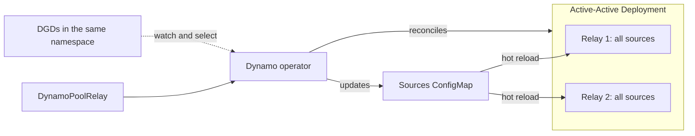

<!--
SPDX-FileCopyrightText: Copyright (c) 2026 NVIDIA CORPORATION & AFFILIATES. All rights reserved.
SPDX-License-Identifier: Apache-2.0
-->

# DEP: Kubernetes-managed Pool Relay with DynamoPoolRelay

Status: Draft; GitHub issue not yet created.

Proposed labels: `dep:draft`, `operator`, `router`.

## Area

k8s (operator), with router runtime integration.

## Summary

Introduce `nvidia.com/v1alpha1 DynamoPoolRelay`, a namespaced resource managed by the existing Dynamo operator. It deploys an active-active Pool Relay with two replicas by default, independently of inference DynamoGraphDeployments (DGDs), selects its source DGDs through `spec.sources.dgds` by labels or explicit references, and derives the worker discovery scope and connection configuration from those DGDs. Compatible source changes are applied without restarting Relay. An optional `logicalNamespace` source field keeps the published endpoint name stable when a DGD changes its physical worker namespace, while preserving separate KV-pool lifetimes.

Source selection is independent of publication, allowing future push from Relay to Global Router without changing DGD selection semantics.

The CRD uses the Pool Relay vocabulary from [DEP #15742](https://github.com/ai-dynamo/dynamo/issues/15742). This proposal defines the Kubernetes lifecycle and source-selection behavior; the broader runtime and gRPC rename remains owned by that DEP.



## Motivation

The goal is to simplify deploying and operating Pool Relay in Kubernetes. Users should be able to declare a Relay and the DGDs it should observe, while the Dynamo operator creates and maintains its workload, networking, access permissions, and source configuration. This reduces the manual setup and ongoing maintenance required to run Relay alongside inference deployments.

Relay should automatically discover newly created DGDs that match its selector in the same Kubernetes namespace and keep its sources up to date as DGDs are updated, relabeled, or deleted. Users should not have to edit source lists or redeploy Relay whenever inference deployments change. Compatible source changes should take effect without restarting Relay, whose lifecycle remains independent of any individual DGD.

## Proposal

### 1. Resource and ownership

Add a single-version, namespaced CRD:

- Kind: `DynamoPoolRelay`.
- API version: `nvidia.com/v1alpha1`.
- Plural: `dynamopoolrelays`.
- Short name: `dprelay`.

Register its controller unconditionally alongside the existing DGD controllers. Creating a CR deploys a Relay; starting the operator alone does not create one. There is no separate controller enable flag.

Each CR owns one active-active Deployment with `spec.replicas` (default `2`, minimum `1`) and the `RollingUpdate` strategy (`maxUnavailable: 0`, `maxSurge: 1`), a ClusterIP Service, a sources ConfigMap, a ServiceAccount, a Role, a RoleBinding, and a Secret used to derive connection revisions. The operator does not adopt foreign resources. Deleting the CR removes its owned resources through Kubernetes garbage collection and leaves inference DGDs and their workloads intact.

The resource is namespace-local even though `clusterId` identifies a discovery cluster. This phase does not provide a cluster-wide source selector or a cross-namespace aggregation controller.

### 2. User-facing API

The following resource observes all DGDs in `inference`:

```yaml
apiVersion: nvidia.com/v1alpha1
kind: DynamoPoolRelay
metadata:
  name: pool-relay
  namespace: inference
spec:
  clusterId: cluster-a
  replicas: 2
  sources:
    dgds:
      labelSelector: {}
  podTemplate:
    spec:
      containers:
        - name: main
          image: registry.example.com/dynamo:pool-relay
```

The image is an example placeholder and must be replaced with an image implementing the required runtime contract.

| Field | Contract |
| --- | --- |
| `clusterId` | Required, nonempty, immutable discovery-cluster identity. Stable across Relay restarts; not a geographic label or a Pod identifier. |
| `replicas` | Number of active replicas; defaults to `2`, minimum `1`. Every replica observes the complete selected source set. A single replica provides no redundancy. |
| `sources.dgds` | Required DGD source selection. Combines `labelSelector` and `refs` as a union, with duplicates removed. |
| `sources.dgds.labelSelector` | Optional Kubernetes label selector evaluated against DGD `metadata.labels` in the CR's namespace. An explicit `{}` selects all DGDs there; omission selects none through this mechanism. |
| `sources.dgds.refs` | Optional nonempty list of unique `{name: ...}` references to DGDs in the same namespace. Missing references are reported as unresolved. |
| `podTemplate` | Required native Pod template, with exactly one container named `main` and an explicit image. Supports resource settings, scheduling, image-pull secrets, and sidecars, subject to operator-owned fields. |
| `service.ports` | Optional replacement for the default publication ports. A port named `grpc` identifies the publication endpoint and may target a configured sidecar. |

`sources.dgds` requires `labelSelector` or nonempty `refs`; both may be provided. The operator watches DGD creation, deletion, label changes, and relevant spec/status changes. DGDs being deleted are withdrawn. Normalized namespace collisions between different selected DGDs are rejected.

The operator owns the launch command, identity, ServiceAccount, connection settings, and source-file mounts. The CR does not duplicate worker `eventPlane`, NATS settings, or a manually maintained list of Dynamo namespaces. Sidecars retain their own configuration; they cannot override the managed Relay contract.

### 3. Derived connection configuration

The operator derives a shared connection profile from selected worker, prefill, and decode components. This phase supports Kubernetes discovery in Pod mode and requires compatible transport, broker, authentication, and TLS settings. Explicit environment values and supported Secret/ConfigMap references and mounts are inherited; connection settings hidden in `envFrom`, commands, or image defaults are unsupported.

Unresolved or incompatible configuration is reported in status. The last valid connection remains active while deselected sources are withdrawn. Connection or credential changes trigger a rollout, identified by a keyed revision that does not expose credentials.

### 4. Live sources and acknowledgement

Relay reads a projected ConfigMap through `--sources-file`. The document contains a connection revision and physical/logical source mappings, with limits of 4,096 sources and 1 MiB. Go and Rust compute source revisions from the same canonical JSON. Compatible source changes reload without a Pod-template change; unchanged watches remain active, and an empty selection watches nothing.

The operator checks each current Pod's `/engine/state`, validating ownership, Pod identity, current template, connection revision, and desired/applied source revisions. `SourcesApplied` requires acknowledgement from every requested replica and no superseded non-terminating Pods. A ConfigMap write alone is insufficient. Invalid initial files fail startup; invalid updates retain the last valid sources, and mismatched connection revisions are rejected.

### 5. Physical and logical namespaces during rollout

Physical sources follow the DGD's published `status.components[componentName].runtimeNamespace`, falling back to its base namespace when absent. The DGD controller decides when to switch; Relay does not anticipate cutover from the desired worker spec.

`logicalNamespace` keeps the public endpoint name stable across physical namespace changes. Discovery, subscriptions, cache domains, and KV ownership still use the physical namespace. Physical or logical remapping retires the old pool and readiness lifetime before publishing the new one; stale owners cannot publish after cancellation. Distinct endpoints remain separate, and conflicting physical claims to one logical endpoint are withheld and reported. This mapping does not change worker admission or cache identity.

### 6. Rollout and status semantics

Active-Active defaults to two replicas. Each observes all sources under the same `clusterId` but maintains independent discovery, KV indexes, catalog, readiness, load, and publication incarnations. There is no leader, shared state, or sharding.

Consumers must keep a catalog and its subscriptions on one replica, using a persistent gRPC connection or explicit Pod endpoint. Separate ClusterIP connections may reach different replicas. After a backend or incarnation change, consumers discard old producer state and bootstrap again; replica-local deltas, sequence numbers, and load observations must not be merged.

Source-only changes reload every replica. Image, Pod-template, and connection changes use `RollingUpdate` with `maxUnavailable: 0` and `maxSurge: 1`; old processes retain their connection-bound source files until replaced. Streams require reconnection, and listener availability does not imply completed KV recovery. Scheduling across failure domains is user-configured.

Status exposes the endpoint, selected DGDs, observed generation, desired/applied source revisions, replica counts, and these conditions:

| Condition | Meaning |
| --- | --- |
| `SelectionResolved` | DGD selection and explicit references are resolved. |
| `ConfigurationResolved` | Selected workers provide a supported, compatible connection. |
| `SourcesApplied` | All requested current replicas acknowledged the desired revision, with no superseded non-terminating Pods. Only then is `appliedSourcesRevision` populated. |
| `Ready` | Configuration is resolved, rollout is complete, and all requested replicas and publication listeners are available. |

`SourcesApplied` and `Ready` do not assert model or KV readiness; consumers use Relay's catalog and serving-readiness streams. Source conflicts remain separately observable.

### 7. Installation, security, and compatibility

Ship the CRD and RBAC with the operator. Helm applies the CRD when `upgradeCRD=true`; separately managed installations must install matching CRDs first. Existing namespace restrictions remain in force. The current gRPC API uses an internal ClusterIP Service; ingress and TLS/mTLS termination are user-managed. The operator needs access to connection references and Pod-local acknowledgement endpoints, which stay off the publication Service. Credentials must not appear in source files, status, or logs.

Documents without `logicalNamespace` retain existing behavior and revisions; aliased sources require a compatible Relay image. Runtime and gRPC naming follows DEP #15742, using existing names until that transition. The unpublished `DynamoRelay` prototype is not a supported second API.

### 8. Scope and implementation

Implement the work in three reviewable parts:

1. Extend the existing runtime source contract with `logicalNamespace`, physical/public identity separation, and retirement of old pool and readiness state.
2. Add the CRD, controller, owned resources, connection derivation, acknowledgement handling, generated RBAC, and operator documentation.
3. Validate installation and reconciliation in envtest, cross-language source revisions, and an end-to-end Kubernetes rollout with matching operator and Relay images.

Push publication to Global Router, Global Router policy, routing traffic, load prediction, worker admission changes, cache-identity redesign, state replication, source sharding, cross-namespace selection, and a general runtime rename are outside this DEP.

A future `spec.publication.push` extension could configure outbound publication from Relay to Global Router alongside the existing gRPC API. `sources.dgds` would retain the same selection semantics. Push targets and delivery settings should be defined with the publication protocol; this proposal adds no push fields or mutually exclusive pull/push mode.

With Active-Active publishers, that protocol must distinguish replica incarnations, define how Global Router selects an authoritative view of each source without double counting, and support state recovery after reconnection. Independent replica streams must not be merged as one producer.

## Alternate Solutions

- **Embed Relay in an inference DGD or worker Pod.** This couples a shared observer to one inference workload's lifecycle and requires additional ownership rules when several DGDs share it.
- **Manage a standalone Deployment and ConfigMap manually.** Existing file mode supports this, but users must keep namespaces, connection references, and acknowledgements synchronized themselves.
- **Restart Relay whenever selection changes.** This avoids live reload but repeatedly interrupts publication and rebuilds otherwise unchanged pool state.
- **Publish hashed worker namespaces directly.** This avoids the mapping extension but changes public endpoint names on rollout and exposes deployment-generation details to consumers.

## Requirements

- Selection MUST remain within the CR's Kubernetes namespace and MUST support an explicit all-DGD selector.
- `sources.dgds` MUST combine label selection and explicit references as a union, independently of publication settings.
- The controller MUST NOT own, edit, or delete selected inference DGDs or adopt foreign resources.
- The default MUST be two active replicas, each observing the complete source set with an independent runtime incarnation.
- A successful acknowledgement from one replica MUST NOT mark the whole Relay source configuration applied.
- Consumers MUST keep replica-local publication state separate and bootstrap after changing replicas.
- Membership-only changes MUST NOT change the Relay Pod template when its connection remains compatible.
- Invalid additions MUST remain visible as configuration errors; they MUST NOT prevent withdrawal of deselected sources.
- Logical names MUST NOT merge physical KV domains or carry readiness across retired lifetimes.
- Retired owners MUST be prevented from publishing stale pool state after a cutover.
- The operator MUST distinguish desired configuration, applied source revision, listener availability, and model/KV readiness.
- The source protocol MUST preserve legacy documents and MUST have shared Go/Rust canonicalization fixtures.

Validation must cover selector unions and namespace isolation; label-only withdrawal; active worker-namespace cutover; credential rotation; invalid updates and last-valid retention; wrong-Pod or wrong-connection acknowledgements; conflicting logical endpoints; late allocation after cancellation; resource ownership and deletion; default CRD installation; and a real projected-volume reload without a Relay Pod restart. Active-active validation must cover two independently serving replicas, partial acknowledgements, source reloads on both Pods, scaling, rolling updates, and loss of one Pod while the other continues serving. A consumer reconnection test must bootstrap a new runtime incarnation without reusing the old producer state.

## References

- [DEP #15742: PoolRelay naming and compatibility contract](https://github.com/ai-dynamo/dynamo/issues/15742).
- [PR #14807: KV DC Relay file-based source mode](https://github.com/ai-dynamo/dynamo/pull/14807), the existing file-source and acknowledgement foundation.
- [DEP #14971: Path-independent worker admission and relay identity](https://github.com/ai-dynamo/dynamo/issues/14971), a separate identity and admission proposal.
