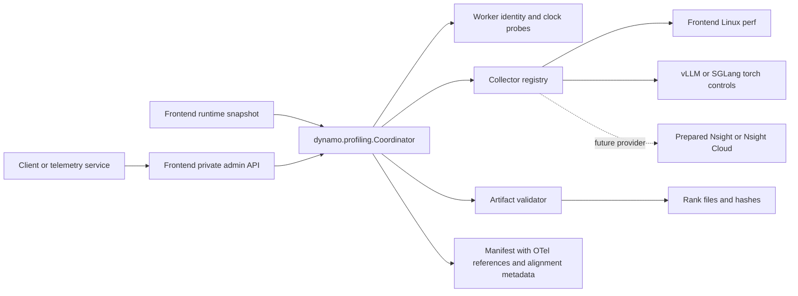

<!--
SPDX-FileCopyrightText: Copyright (c) 2026 NVIDIA CORPORATION & AFFILIATES. All rights reserved.
SPDX-License-Identifier: Apache-2.0
-->

# On-demand profiling interface draft

The frontend accepts a client capture plan, gathers an explicit runtime snapshot,
and invokes a reusable coordinator module. This is orthogonal to lifecycle
instrumentation. A telemetry service can use always-on OTel evidence to decide
when and which target to profile.

## Implemented module boundaries

- `dynamo.profiling.Coordinator`: plan validation, idempotency, one active lease,
  session state, concurrent collector stop, and persisted manifests. Callable API;
  no dependency on the frontend or aiohttp web routing.
- `RuntimeSnapshot`: explicit frontend PID/startup epoch/hostname/context and
  worker inventory. Frontend configuration supplies the initial inventory;
  discovery can later build the same object.
- `CollectorRegistry`: trusted mode factories. The built-in `torch_profile`
  factory selects frontend Linux perf and selected workers' native torch controls.
- `ClockSampler`: worker control-process identity and offset/uncertainty estimates
  before capture and after stop. Alignment does not set host clocks or synchronize
  rank starts. Engine-rank clocks on other hosts are not attested by this endpoint.
- `ArtifactValidator`: format/store-specific evidence validation, separate from
  backend control acknowledgments. The built-in validator checks accessible
  vLLM Kineto files and expected rank identities using a unique capture prefix.
- `dynamo.frontend.profiling.http`: maps client HTTP requests to module calls and
  maps typed control errors to HTTP status codes.
- `dynamo.frontend.profiling.hosting`: private Unix-socket listener, frontend
  snapshot creation, and shutdown draining. The default frontend path runs this
  in process. The optional standalone launcher calls the same module.
- `ProfilingAgent.info`: lightweight shared callback registered by vLLM and
  SGLang at `/engine/control/profiling_info`, reporting control-process identity
  and clock timestamps without invoking the GPU profiler.

## Completion and coverage

Control state and artifact proof are independent. Successful backend stop replies
can complete control work while artifact status remains unverified. Accessible
missing/corrupt/duplicate rank files fail the capture instead of reporting full
coverage. Configured membership is required to claim complete engine-rank files.

The manifest carries lifecycle OTel trace IDs, request IDs, and an existing
telemetry backend reference. OTel coverage stays unknown. Runtime changes to
instrumentation detail, trace fetching, and local OTLP storage are deferred.

The frontend is implicitly profiled with Linux perf in `torch_profile` mode,
including worker-only requests. The operator can temporarily disable attachment;
that omission is visible in the manifest. Linux perf, SGLang exports, inaccessible
stores, and vLLM AsyncLLM CPU-file association remain unverified by the current
artifact validator.

## Hosting tradeoff and deferred work

The module-first implementation lets us evaluate embedded overhead before
choosing a separate service. Embedded timers depend on the frontend event loop.
A standalone coordinator can keep its loop separate, but independent worker
leases and durable recovery still need implementation. Stop/export timeouts can
leave an uncertain remote profiler; the coordinator reports failure and blocks
new captures until the operator reconciles worker state and restarts the host.

The initial admin surface is a private Unix socket served inside the frontend,
separate from its inference listener. Public POST routes, authentication, dynamic
worker discovery, storage-provider upload/download, per-rank attestations, and
runtime instrumentation switching are future work.

Nsight requires targets to be launched under a prepared Nsight session. The
registry is the provider boundary for local Nsight or Nsight Cloud; neither is
implemented by this refactor. Nsight Cloud documents a coordinator that controls
agent collections and an OTLP proxy that mirrors traces. We have not established
its clock-alignment guarantees or a tested Dynamo provider API.
See [architecture](https://docs.nvidia.com/nsight-operator/Architecture/index.html)
and [user guide](https://docs.nvidia.com/nsight-operator/UserGuide/index.html).

The exact configuration, HTTP examples, Python API, and validation limitations
are in [the administration README](components/src/dynamo/frontend/profiling/README.md).

## Validation record

The saved pre-refactor checkpoint (`3a0a3b6d9319de567305100f64ecfb0475c37d1f`)
was exercised with a real vLLM TP1/DP2 workload and produced both native rank
traces when CUDA summary processing was disabled. Frontend perf was disabled on
that allocated environment. That run does not validate this new hosting path.

The refactor's 33 CPU tests exercise the module and real local HTTP endpoints,
unique prefixes, stale epochs, clock uncertainty and clock steps, valid/missing/
corrupt/duplicate rank files, validation limits, legacy unknown coverage,
registered providers, embedded Unix-socket hosting, shutdown draining, plan
copying, blocked admission after uncertain cleanup, and cleanup despite failed
manifest writes. The validator also parsed
both real traces from the saved workload: 4,644,687 events and 74,453 CUDA kernels.
A new GPU workload run and actual Nsight collection remain separate validation.
