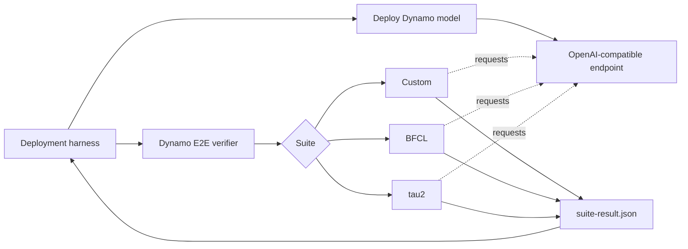
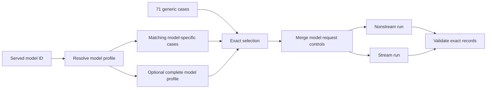
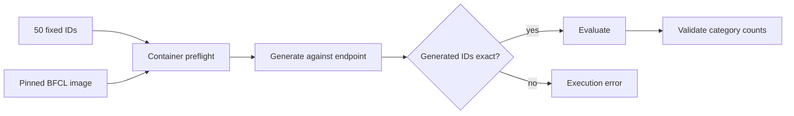
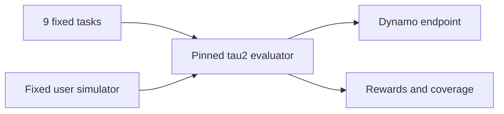
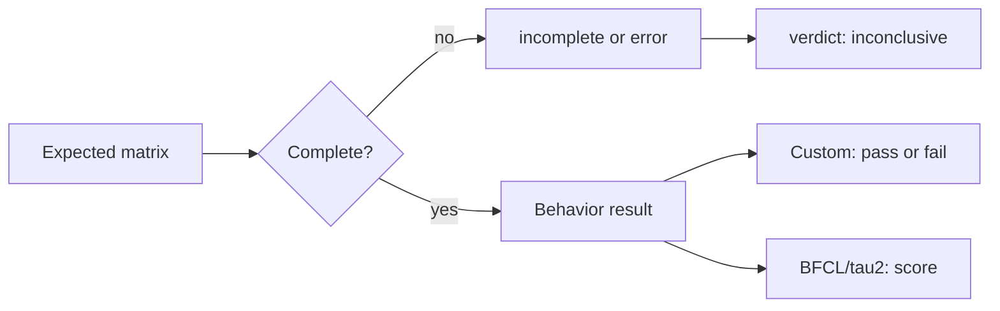

# E2E Tool-Calling Qualification

This package is Dynamo's public correctness boundary for bounded tool-calling
qualification. An external harness deploys a model endpoint; this package
selects tests, runs them, validates coverage, and emits one normalized result.



The ownership split is deliberate:

- Dynamo owns case selection, validators, evaluator versions, scoring, and the
  `suite-result.json` contract.
- The external harness owns image resolution, Kubernetes deployment, endpoint
  readiness, artifact retention, dashboards, cleanup, and notifications.

## Qualification profile

Manual, PR, and nightly runs currently extend the same bounded
`qualification` profile. These are qualification subsets, not official full
benchmark scores.

| Suite | Fixed coverage | Target |
|---|---:|---:|
| Custom | 71 generic cases in streaming and nonstreaming modes, plus matching model-specific cases or a complete model profile | 10–12 min |
| BFCL | 50 BFCL v3 cases across 8 categories | 3–5 min |
| tau2 | 9 tasks: 3 each from airline, retail, and telecom | 10–12 min |

The exact selections, budgets, concurrency, and evaluator image digests live in
`e2e_verifier/profiles.json`.

## Custom flow

Custom tests exercise OpenAI Chat Completions request and response contracts,
including tool choice, schemas, parallel calls, streaming finish reasons,
reasoning separation, parser-marker leakage, truncation, history, and
multi-turn tool execution. Targeted allowed-tools regressions also exercise
the Responses API, including its native unary and SSE completion/error states.

Install the lightweight Custom client dependencies in the evaluator's Python
environment before invoking a new test bundle:

```bash
python3 -m pip install -r benchmarks/tool_calling/requirements.txt
```

These dependencies are also declared in the benchmark and CPU-test dependencies.

The shared regression definitions in `custom/regression_cases.py` add ten
generic cases and eight distinct family cases. Complete profiles append these
definitions too; they do not silently replace them with their original JSON
selection.

| Regression group | Cases | Source |
|---|---|---|
| Allowed tool catalog and selection | `auto`/`required` catalog visibility, text-only `auto`, unknown selection; Chat and Responses | dynamo #18429, #18496 |
| Argument schemas and framing | Automatic regex fallback and non-strict control; Qwen empty calls and escaped references; Muse decoded string lengths and delimiter data | dynamo #17513; frontend-crates #570, #644 |
| Tool-result image identity | Seeded call history with ordered/reversed results and multiple images in one result | frontend-crates #283 |

Qualification selects 71 generic cases, 73 for Kimi K2, 74 for Kimi K3,
79 for GLM, 76 for MiniMax M2, 73 for the inline Qwen Coder profile, 74 for
complete Muse, and 75 for complete Qwen XML. Each case runs in both modes.
A model is not required to generate
multiple calls just because parallel calls are permitted; image-order cases
start with fixed historical call IDs.

Tool-choice checks use the actual request after overrides. Returning a call
outside an explicit allowed subset or returning multiple calls with
`parallel_tool_calls:false` fails Dynamo compatibility. A text-only answer is
valid under `allowed_tools.mode:auto`.

Decoded arguments are checked with the declared JSON Schema dialect (2020-12
when omitted), including local references, composition, string constraints,
and extra properties. Schema retrieval over the network is disabled. A schema
the verifier cannot safely evaluate produces an inconclusive result. Explicit
strict constraints, global strict mode, and case-declared effective constraints
are compatibility checks. Other declared-schema violations remain model-quality
checks; `strict:false` and patterns deliberately relaxed by automatic guidance
are not silently promoted to strict requirements. Global schema mode `off`
disables enforcement attribution, while retaining argument-quality checks.

Vision cases require an explicit `vision` deployment capability. Pass deployment
metadata through the existing request contract, for example:

```json
{
  "enabled": {"enable_thinking": true},
  "disabled": {"enable_thinking": false},
  "capabilities": ["vision"],
  "schema_mode": "auto",
  "provenance": {
    "parser_version": "2",
    "grammar_backend": "xgrammar",
    "dynamo_sha": "<deployed SHA>",
    "parser_crate_version": "<deployed version>"
  }
}
```

These fields record the deployment contract supplied by the caller; the verifier
does not independently inspect the running image. Missing required capabilities
produce an explicit inconclusive record without dispatch, never a passing case.
Catalog-token retrieval, exact argument copying and image understanding remain
semantic checks. Keep deterministic Rust renderer/parser regressions alongside
these live diagnostics when attributing a semantic failure to Dynamo.

Some cases target fixes that may not be present in the deployed crate versions,
including frontend-crates #283 and #644. Their records retain source PR links;
known failures remain visible rather than being counted as passes. The Muse
delimiter round-trip case additionally requires
`capabilities:["muse_delimiter_string_roundtrip"]`: only enable it when the
deployed parser promises that representation. Until that policy is settled,
rejecting delimiter-admitting schemas can be a safe implementation choice.

Five additional cases in `custom/guided_output_cases.py` cover
[dynamo #18527](https://github.com/ai-dynamo/dynamo/issues/18527), tracked by
[DGH-2516](https://linear.app/nvidia/issue/DGH-2516/bug-top-level-guided-json-output-lands-in-reasoning-content-with-force),
and the proposed fix in [#18718](https://github.com/ai-dynamo/dynamo/pull/18718).
They exercise top-level `guided_json`, `guided_choice`, `guided_regex`,
`guided_grammar`, and one equivalent `response_format` control. Together with
the eighteen cases above, the regression additions contain 23 distinct cases.
Only GLM and MiniMax M2 qualification profiles add these five cases, each in
streaming and nonstreaming mode.

The guided cases preserve the customer's request defaults: no tools, no tool
choice, no thinking-control kwargs, no explicit temperature, and a 256-token
budget. They require the final answer in `content` and check reported
reasoning-token accounting without estimating token counts from text length.
Reasoning counts must be present and within the completion-token bounds.
An all-reasoning count alongside visible answer content is a warning, since
the frontend estimator can count a mixed reasoning/content chunk as reasoning.

Run them only with capability `guided_reasoning_three_parsers` and a matching
top-level `parser_configuration` in the request contract:

| Model profile | `chat_processor` | `dynamo_reasoning_parser` | `dynamo_tool_call_parser` | `native_reasoning_parser` |
|---|---|---|---|---|
| `glm5`, `glm47` | `dynamo` | `glm45` | `glm47` | `glm45` |
| `minimax_m2` | `dynamo` | `minimax_m2` | `minimax_m2` | `minimax-append-think` |

Missing or mismatched configuration produces an explicit inconclusive record
without dispatch. CPU checks validate the cases and verifier behavior;
confirming the production fix requires targeted runs after redeployment.

Response readers accept both `reasoning` and `reasoning_content` in messages,
streaming deltas, and provider fields. Matching aliases are read once;
conflicting fields remain validation errors. Finish-reason and truncated-tool
argument checks are unchanged.

The generic selection groups into:

| Group | Cases | Source |
|---|---|---|
| Tool choice and multiplicity | `auto_*`, `required_*`, `none_*`, `parallel_tool_calls_false_single_call`, `tool_choice_null_behaves_as_auto`, `required_truncated_call_reports_length`, `auto_stop_string_does_not_cut_tool_call` | OpenAI contract; dynamo #15922, #16212, #13791 |
| Argument fidelity | `named_*` typed, nested, array-of-object, nullable, falsy, strict, Unicode, control-character, numeric literals | frontend-crates typing and escape fixes; dynamo #16311 |
| Request contract | `named_dotted_tool_name`, `required_schema_local_definitions_ref`, `reject_empty_tools_array`, `reject_named_tool_choice_not_in_tools`, `plain_usage_counts_consistent` | dynamo #16482, #16780, #16160, #13947 |
| Tool-result follow-up turns | `followup_after_*`, `history_*`, `agent_weather_then_final_answer` | dynamo #16781, #17050, #17069; Kimi/MiniMax vendor verifiers |
| Prompt shapes | `auto_system_prompt_directs_tool_use`, `auto_long_system_context_tool_call`, `auto_user_pasted_tool_call_json_is_data`, `auto_parallel_three_distinct_tools`, `auto_many_tools_selects_right_one`, `named_tool_without_parameters_key`, `required_max_completion_tokens_alias_truncates` | agent traces; dynamo #17466 |
| Long and repeated tool results | `followup_after_long_tool_result`, `history_three_round_trips_then_answer`, `followup_tool_result_as_content_parts` | agent traces |
| Context isolation and markers | `*_echo_*`, `customer_*marker*`, `customer_truncated_tool_markup_hidden` | customer regressions |
| Vendor-verifier scenarios | `auto_parameter_order_recall` | MiniMax Provider Verifier scenario check |

Every record also runs response-wide checks that need no case opt-in: tool and
reasoning delimiters in `content`, OpenAI-shaped tool-call JSON leaked into
`content`, reasoning-only or empty final messages, typed scalars returned as
strings, and tool call IDs reused from the conversation history.

Every case that disables thinking also asserts that none happened: an empty
`reasoning_content` is required, and when the backend reports
`usage.completion_tokens_details.reasoning_tokens` it must be zero
(`unexpected_reasoning_tokens`). With thinking enabled, reasoning tokens with
an empty `reasoning_content` are reported as `reasoning_dropped`. When a
forced tool call comes back with thinking disabled and `content` reads like a
thinking block, the record fails with `reasoning_text_in_content`: the
template ignored the flag and the frontend folded the reasoning into content
(dynamo #17521, #17578).

### Failure taxonomy

Each failed record carries one ownership `failure_category` (which decides the
verdict) and one fine-grained `failure_subcategory`; `failure_kinds` lists every
error kind the record raised. `summary.failure_subcategories` counts records per
`<category>.<subcategory>`.

| Category | Subcategories |
|---|---|
| `dynamo_api` (fails the verdict) | `request_validation`, `response_shape`, `finish_reason`, `tool_choice_enforcement`, `tool_call_identity`, `argument_encoding`, `marker_leak`, `reasoning_routing` |
| `infrastructure` (inconclusive) | `transport`, `server_error`, `rate_limited` |
| `model_quality` (visible, does not fail) | `tool_selection`, `argument_values`, `context_leak`, `content_quality`, `agent_loop` |
| `unclassified` (inconclusive) | `probe`, `unknown_kind` |

Within a record the category follows the existing precedence (infrastructure,
then dynamo_api, then unclassified, then model_quality); the subcategory is the
first one in the table order raised by an error of that category.



Applicability and provenance are separate:

- **Generic** cases run for every model.
- **Model-specific** cases run only for the resolved model profile. Kimi K2
  currently adds two multi-turn cases.
- **Complete profiles** replace the generic selection when a model's protocol
  requires a different contract. Muse Glimmer runs 61 declarative cases in
  streaming and nonstreaming modes, uses always-on reasoning, and sends no
  thinking-control kwargs.
- A `customer_` prefix identifies a customer regression. A customer case can
  be generic or model-specific.

Model-specific request fields such as thinking controls are supplied through
`--request-contract-json` and merged by `custom_runner.py`. They do not require
copies of the generic cases.

## BFCL flow

BFCL uses the NeMo Evaluator `26.03` image pinned by OCI digest. The image runs
as short-lived Docker containers on the verifier host, not in the model's
Kubernetes pod.



The container uses host networking to reach the harness port-forward and
mounts the suite output directory at `/results`. Live, executable, and
long-context categories are intentionally outside this bounded selection.

Generation retains `bfcl-http-trace.jsonl` with complete prepared request bodies,
responses, case IDs, and per-case request sequences. HTTP and transport failures
also appear in `bfcl-http-failures.jsonl`; authorization headers are excluded.
The observer preserves the evaluator's requests and exceptions. A generation
error still prevents evaluation and yields no numeric score. Captured responses
are public API output, not pre-parser backend generations.

## tau2 flow



tau2 requires `TAU2_SIMULATOR_MODEL`, `TAU2_SIMULATOR_BASE_URL`, and
`TAU2_SIMULATOR_API_KEY`.

## Run the verifier

The model endpoint must already be running.

```bash
python3 -m benchmarks.tool_calling.e2e_verifier \
  --suite custom \
  --profile qualification \
  --base-url http://127.0.0.1:8000/v1 \
  --model google/gemma-4-31B-it \
  --runtime dynamo-vllm \
  --request-contract-json '{"enabled":{"thinking":true},"disabled":{"thinking":false}}' \
  --output-dir /tmp/dynamo-e2e/custom
```

Use `--dry-run` to resolve selections and commands without sending model
requests.

## Result contract

Every invocation writes `suite-result.json`.



- `execution_status` reports whether the expected matrix executed and produced
  valid artifacts.
- `verdict` reports behavioral interpretation. Custom has pass/fail assertions;
  BFCL and tau2 currently report scores with `verdict=inconclusive` because the
  qualification profile defines no pass threshold.
- `coverage` records the resolved selection and counts.
- `provenance` records profile hashes, selection hashes, and evaluator images.

## Code map

| Path | Responsibility |
|---|---|
| `custom/tool_calling_probe.py` | Custom cases, requests, streaming assembly, and assertions |
| `custom/model_profiles.py` | Served-model name to Custom profile mapping |
| `custom/case_profile_loader.py` | Declarative profile loading and validation |
| `custom/configs/case_profiles/` | Generated complete model profiles |
| `tools/gen_*_profile.py` | Deterministic declarative-profile generators |
| `custom/tool_calling_static_report.py` | Detailed Custom JSON, JSONL, and static HTML artifacts |
| `custom_runner.py` | Per-model request-contract adapter |
| `e2e_verifier/profiles.json` | Fixed qualification selections and evaluator images |
| `e2e_verifier/cli.py` | Suite orchestration, coverage checks, and normalized result |
| `e2e_verifier/test_cli.py` | Verifier contract regression tests |
| `custom/tests/test_probe_reliability.py` | Custom catalog and selection regression tests |

## Extend coverage

1. Add a reusable Custom case and assertion in `tool_calling_probe.py`.
2. Add universal cases to `generic_cases`, additive profile cases to
   `model_specific_cases`, or register a declarative replacement under
   `complete_case_profiles` in `profiles.json`.
3. Add a `customer_` prefix when preserving a customer regression.
4. Register any new error kind in `ERROR_KIND_SUBCATEGORIES` and in the
   owning `*_ERROR_KINDS` set, so it classifies instead of landing in
   `unclassified.unknown_kind`.
5. Update the focused tests and verify the exact selection and record counts.

Run the focused unit tests with:

```bash
pytest -q \
  benchmarks/tool_calling/custom/tests/test_probe_reliability.py \
  benchmarks/tool_calling/e2e_verifier/test_cli.py
```
