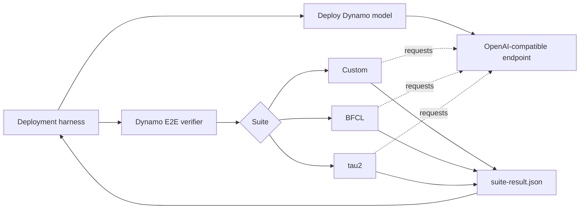
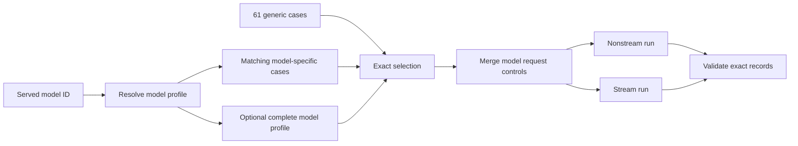
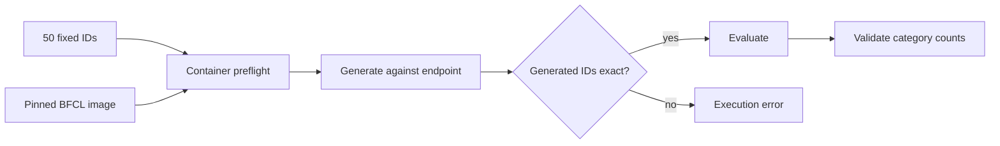
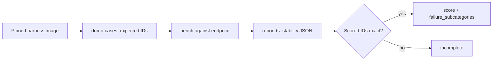
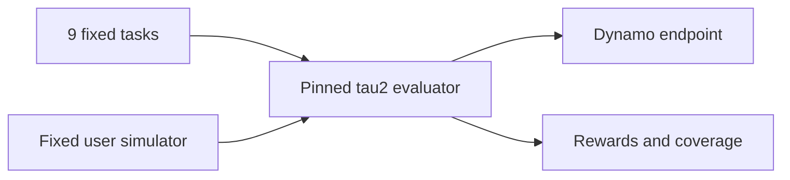
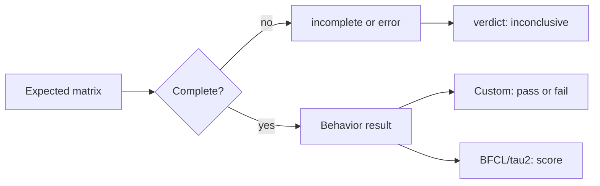

# E2E Tool-Calling Qualification

This package is Dynamo's public correctness boundary for bounded tool-calling
qualification. An external harness deploys a model endpoint; this package
selects tests, runs them, validates coverage, and emits one normalized result.



The ownership split is deliberate:

- Dynamo owns case selection, validators, evaluator versions, scoring, and the
  `suite-result.json` contract.
- The external harness owns image resolution, Kubernetes deployment, endpoint
  readiness, artifact retention, dashboards, cleanup, and notifications.

## Qualification profile

Manual, PR, and nightly runs currently extend the same bounded
`qualification` profile. These are qualification subsets, not official full
benchmark scores.

| Suite | Fixed coverage | Target |
|---|---:|---:|
| Custom | 61 generic cases in streaming and nonstreaming modes, plus matching model-specific cases or a complete model profile | 10–12 min |
| BFCL | 50 BFCL v3 cases across 8 categories | 3–5 min |
| tau2 | 9 tasks: 3 each from airline, retail, and telecom | 10–12 min |
| OpenRouter | 187 `toolcall_schema_fuzz` sentinel samples (OpenRouter benchmark harness, run as-is) | 6–8 min |

The exact selections, budgets, concurrency, and evaluator image digests live in
`e2e_verifier/profiles.json`.

## Custom flow

Custom tests exercise OpenAI Chat Completions request and response contracts,
including tool choice, schemas, parallel calls, streaming finish reasons,
reasoning separation, parser-marker leakage, truncation, history, and
multi-turn tool execution.

Response readers accept both `reasoning` and `reasoning_content` in messages,
streaming deltas, and provider fields. Matching aliases are read once;
conflicting fields remain validation errors. Finish-reason and truncated-tool
argument checks are unchanged.

The generic selection groups into:

| Group | Cases | Source |
|---|---|---|
| Tool choice and multiplicity | `auto_*`, `required_*`, `none_*`, `parallel_tool_calls_false_single_call`, `tool_choice_null_behaves_as_auto`, `required_truncated_call_reports_length`, `auto_stop_string_does_not_cut_tool_call` | OpenAI contract; dynamo #15922, #16212, #13791 |
| Argument fidelity | `named_*` typed, nested, array-of-object, nullable, falsy, strict, Unicode, control-character, numeric literals | frontend-crates typing and escape fixes; dynamo #16311 |
| Request contract | `named_dotted_tool_name`, `required_schema_local_definitions_ref`, `reject_empty_tools_array`, `reject_named_tool_choice_not_in_tools`, `plain_usage_counts_consistent` | dynamo #16482, #16780, #16160, #13947 |
| Tool-result follow-up turns | `followup_after_*`, `history_*`, `agent_weather_then_final_answer` | dynamo #16781, #17050, #17069; Kimi/MiniMax vendor verifiers |
| Prompt shapes | `auto_system_prompt_directs_tool_use`, `auto_long_system_context_tool_call`, `auto_user_pasted_tool_call_json_is_data`, `auto_parallel_three_distinct_tools`, `auto_many_tools_selects_right_one`, `named_tool_without_parameters_key`, `required_max_completion_tokens_alias_truncates` | agent traces; dynamo #17466 |
| Long and repeated tool results | `followup_after_long_tool_result`, `history_three_round_trips_then_answer`, `followup_tool_result_as_content_parts` | agent traces |
| Context isolation and markers | `*_echo_*`, `customer_*marker*`, `customer_truncated_tool_markup_hidden` | customer regressions |
| Vendor-verifier scenarios | `auto_parameter_order_recall` | MiniMax Provider Verifier scenario check |

Every record also runs response-wide checks that need no case opt-in: tool and
reasoning delimiters in `content`, OpenAI-shaped tool-call JSON leaked into
`content`, reasoning-only or empty final messages, typed scalars returned as
strings, and tool call IDs reused from the conversation history.

Every case that disables thinking also asserts that none happened: an empty
`reasoning_content` is required, and when the backend reports
`usage.completion_tokens_details.reasoning_tokens` it must be zero
(`unexpected_reasoning_tokens`). With thinking enabled, reasoning tokens with
an empty `reasoning_content` are reported as `reasoning_dropped`. When a
forced tool call comes back with thinking disabled and `content` reads like a
thinking block, the record fails with `reasoning_text_in_content`: the
template ignored the flag and the frontend folded the reasoning into content
(dynamo #17521, #17578).

### Failure taxonomy

Each failed record carries one ownership `failure_category` (which decides the
verdict) and one fine-grained `failure_subcategory`; `failure_kinds` lists every
error kind the record raised. `summary.failure_subcategories` counts records per
`<category>.<subcategory>`.

| Category | Subcategories |
|---|---|
| `dynamo_api` (fails the verdict) | `request_validation`, `response_shape`, `finish_reason`, `tool_choice_enforcement`, `tool_call_identity`, `argument_encoding`, `marker_leak`, `reasoning_routing` |
| `infrastructure` (inconclusive) | `transport`, `server_error`, `rate_limited` |
| `model_quality` (visible, does not fail) | `tool_selection`, `argument_values`, `context_leak`, `content_quality`, `agent_loop` |
| `unclassified` (inconclusive) | `probe`, `unknown_kind` |

Within a record the category follows the existing precedence (infrastructure,
then dynamo_api, then unclassified, then model_quality); the subcategory is the
first one in the table order raised by an error of that category.



Applicability and provenance are separate:

- **Generic** cases run for every model.
- **Model-specific** cases run only for the resolved model profile. Kimi K2
  currently adds two multi-turn cases.
- **Complete profiles** replace the generic selection when a model's protocol
  requires a different contract. Muse Glimmer runs 61 declarative cases in
  streaming and nonstreaming modes, uses always-on reasoning, and sends no
  thinking-control kwargs.
- A `customer_` prefix identifies a customer regression. A customer case can
  be generic or model-specific.

Model-specific request fields such as thinking controls are supplied through
`--request-contract-json` and merged by `custom_runner.py`. They do not require
copies of the generic cases.

## BFCL flow

BFCL uses the NeMo Evaluator `26.03` image pinned by OCI digest. The image runs
as short-lived Docker containers on the verifier host, not in the model's
Kubernetes pod.



The container uses host networking to reach the harness port-forward and
mounts the suite output directory at `/results`. Live, executable, and
long-context categories are intentionally outside this bounded selection.

Generation retains `bfcl-http-trace.jsonl` with complete prepared request bodies,
responses, case IDs, and per-case request sequences. HTTP and transport failures
also appear in `bfcl-http-failures.jsonl`; authorization headers are excluded.
The observer preserves the evaluator's requests and exceptions. A generation
error still prevents evaluation and yields no numeric score. Captured responses
are public API output, not pre-parser backend generations.

## OpenRouter flow

The `openrouter` suite runs OpenRouter's open-source benchmark harness
(`toolcall_schema_fuzz`: every sample already holds the expected call in its
history and asks the model to repeat it, so a miss points at the serving
stack) from a pinned image. The image (upstream commit plus one build-time
patch) is built and published by the deployment harness repository
(`images/openrouter-bench-harness/` in `e2e_tc_harness`) and referenced here
by digest, the same way the BFCL evaluator image is. The harness
generates the requests, scores them with its own scorer, and writes parquet;
the verifier fixes the generator, checks that exactly the expected sample IDs
were scored once, and maps the harness failure categories onto the Custom
failure subcategories.



The image carries one build-time patch so a 400/422 from a direct endpoint
scores as `request_rejected` instead of aborting the run (upstream scores a
rejection only when the body carries OpenRouter's provider envelope). The
endpoint is passed through `OPENROUTER_BASE_URL`; `OPENROUTER_API_KEY` is set
to a placeholder. The image exposes `dump-cases`, `bench`, `report` and
`provenance` subcommands; `provenance` prints the pinned commit and patches.

The result carries `case_results` (one outcome per sample). Run the suite
against the native engine serving the same model (the harness's `vllm-serve`
or `sglang-serve` variant) as the control group and diff the two with
`e2e_verifier/compare.py`: shared failures are the engine's or the model's,
candidate-only failures are Dynamo's.

## tau2 flow



tau2 requires `TAU2_SIMULATOR_MODEL`, `TAU2_SIMULATOR_BASE_URL`, and
`TAU2_SIMULATOR_API_KEY`.

## Run the verifier

The model endpoint must already be running.

```bash
python3 -m benchmarks.tool_calling.e2e_verifier \
  --suite custom \
  --profile qualification \
  --base-url http://127.0.0.1:8000/v1 \
  --model google/gemma-4-31B-it \
  --runtime dynamo-vllm \
  --request-contract-json '{"enabled":{"thinking":true},"disabled":{"thinking":false}}' \
  --output-dir /tmp/dynamo-e2e/custom
```

Use `--dry-run` to resolve selections and commands without sending model
requests.

## Result contract

Every invocation writes `suite-result.json`.



- `execution_status` reports whether the expected matrix executed and produced
  valid artifacts.
- `verdict` reports behavioral interpretation. Custom has pass/fail assertions;
  BFCL and tau2 currently report scores with `verdict=inconclusive` because the
  qualification profile defines no pass threshold.
- `coverage` records the resolved selection and counts.
- `provenance` records profile hashes, selection hashes, and evaluator images.

## Code map

| Path | Responsibility |
|---|---|
| `custom/tool_calling_probe.py` | Custom cases, requests, streaming assembly, and assertions |
| `custom/model_profiles.py` | Served-model name to Custom profile mapping |
| `custom/case_profile_loader.py` | Declarative profile loading and validation |
| `custom/configs/case_profiles/` | Generated complete model profiles |
| `tools/gen_*_profile.py` | Deterministic declarative-profile generators |
| `custom/tool_calling_static_report.py` | Detailed Custom JSON, JSONL, and static HTML artifacts |
| `custom_runner.py` | Per-model request-contract adapter |
| `e2e_verifier/profiles.json` | Fixed qualification selections and evaluator images |
| `e2e_verifier/compare.py` | Case-by-case diff of a candidate result against a control (native engine) result |
| `e2e_verifier/cli.py` | Suite orchestration, coverage checks, and normalized result |
| `e2e_verifier/test_cli.py` | Verifier contract regression tests |
| `custom/tests/test_probe_reliability.py` | Custom catalog and selection regression tests |

## Extend coverage

1. Add a reusable Custom case and assertion in `tool_calling_probe.py`.
2. Add universal cases to `generic_cases`, additive profile cases to
   `model_specific_cases`, or register a declarative replacement under
   `complete_case_profiles` in `profiles.json`.
3. Add a `customer_` prefix when preserving a customer regression.
4. Register any new error kind in `ERROR_KIND_SUBCATEGORIES` and in the
   owning `*_ERROR_KINDS` set, so it classifies instead of landing in
   `unclassified.unknown_kind`.
5. Update the focused tests and verify the exact selection and record counts.

Run the focused unit tests with:

```bash
pytest -q \
  benchmarks/tool_calling/custom/tests/test_probe_reliability.py \
  benchmarks/tool_calling/e2e_verifier/test_cli.py
```
