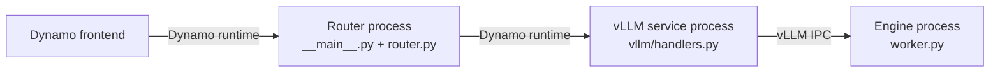
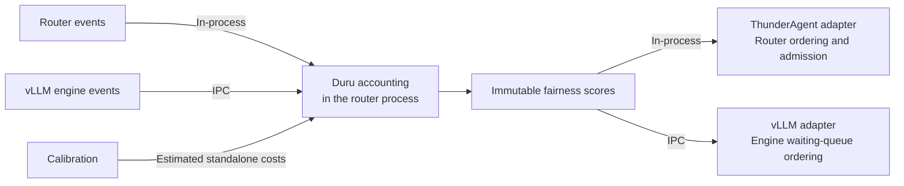

<!--
SPDX-FileCopyrightText: Copyright (c) 2026 NVIDIA CORPORATION & AFFILIATES. All rights reserved.
SPDX-License-Identifier: Apache-2.0
-->

# Duru router

Duru adds U-based fairness to Dynamo while reusing ThunderAgent admission and native vLLM scheduling.

**Request path**



**Fairness dataflow**



Responses return along the request path. Accounting runs inside the router process;
router events and scores stay in-process, while engine events and scores cross
local Unix sockets. Router events retain the existing 8,192-record and 16 MiB
buffer limits; overflow raises an error rather than dropping or overwriting events.
File labels without a directory refer to this package.

## Files

| File | Responsibility |
| --- | --- |
| [router.py](router.py) | Connect fresh scores and Duru admission rules to ThunderAgent. |
| [admission.py](admission.py) | Order candidates, set admission ceilings, and authorize alpha exceptions. |
| [worker.py](worker.py) | Order native vLLM waiting queues and report accepted engine work. |
| [scoring.py](scoring.py) | Calculate U and publish snapshots through `router_publish` and `worker_publish`. |
| [events.py](events.py) | Package ordered events and clock updates; optionally record JSONL. |
| [transport.py](transport.py) | Deliver bounded event streams and latest score snapshots over Unix sockets. |
| [diagnostics.py](diagnostics.py) | Log optional admission decisions, throughput, and U summaries. |
| [calibration/](calibration/README.md) | Plan and measure solo engine costs, then predict accepted-work costs. |
| [args.py](args.py) | Reuse ThunderAgent CLI configuration. |
| [__main__.py](__main__.py) | Handle requests and their identities, supervise accounting, and start the shared serving endpoints. |

ThunderAgent owns [capacity checks and reservations](../thunderagent_router/router.py)
and [request forwarding](../thunderagent_router/__main__.py).

## Policy and U

1. Order router admissions and each native worker waiting queue by decreasing score.
2. Try normal router capacity admission first; if a candidate cannot fit, lower-ranked candidates can backfill.
3. If a pending request's valid score is at least alpha, allow the router's capacity exception after its normal check fails.

The `--alpha` option defaults to `1`; set it explicitly to change the threshold.

The worker still requires real KV space. Native vLLM queue precedence and running
request behavior remain; there is no worker backfill or fairness-based preemption.
ThunderAgent's tool-phase pressure pausing remains. Duru disables its timeout-based
forced resume and marking reasoning agents for later pause.

Each parent/descendant **agent group** shares U. With `G` replicas, `N` outstanding
groups, and `k` distinct active agents in a group, entitlement E accrues at
`min(k, G/N)`. Accepted engine steps add calibrated solo cost to W; **U = E/W**.
Router and worker waiting time counts. Overlapping requests from one agent count
once; tool gaps without outstanding requests do not accrue entitlement. Parent
waits do not automatically release reservations or guarantee progress.

Before a group's first accepted work, pending requests use predicted next-five-step
cost for lookahead. Unknown cache reuse is a miss. Invalid or stale accounting
cannot trigger an exception. Predictions interpolate the calibration grid and
extend its edge slopes outside the grid; this does not certify extrapolation accuracy.

Events are processed through `accounting_cutoff`, the earliest `received_through`
time among open sources. This aligns E and W at the same time; newer events wait
in a bounded queue. Clock updates advance idle sources. Closed sources stop
holding back the cutoff.

## Setup

The adapter targets **vLLM 0.33.0** with its native asynchronous scheduler.
Select `dynamo.duru_router.worker.DuruScheduler` and give each worker a unique
node-local `DURU_WORK_DIR`. Router and workers must share a fresh private
`DURU_IPC_DIR` and the same required `DURU_SCORES` channel name. These are local
IPC channels, not score files; cross-node transport is not implemented.

```bash
export DURU_ACCOUNTING_CONFIG=/local/session/scoring.json
export DURU_SCORES=/local/session/scores
export DURU_IPC_DIR=$(mktemp -d /dev/shm/duru.XXXXXXXX)
python3 -m dynamo.duru_router --alpha 0.7 \
  --endpoint dynamo.vllm.generate --router-block-size 64
```

Use the deployment's actual endpoint and block size. Example accounting config:

```json
{
  "ingress": "/local/session/ingress/duru-ingress.jsonl",
  "ledgers": ["/local/session/worker-0/compact-work.jsonl"],
  "scores": "/local/session/scores",
  "audit_dir": "/local/session/audit",
  "capacity": 1,
  "calibration": "/local/calibration/calibration.json",
  "runtime_contract": {"model": "your-model"}
}
```

`capacity` counts TP replicas, not GPUs. Include every worker channel in `ledgers`.
The actual serving `runtime_contract` must match the calibration; see
[calibration setup](calibration/README.md). Live accounting requires
`DURU_ACCOUNTING_TRANSPORT=memory` (the default). Use one accounting owner per score
channel and remove the IPC directory after all participants exit.

Embedders create `Ingress(ingress_path.parent, in_process=True)` and pass it to
`RouterAccounting(config_path, ingress=ingress)`, then construct
`DuruScheduler(capacity, config, reader=accounting.reader)`. Close ingress before
accounting so its final events can drain. Each policy owns its snapshot.
The public entrypoint uses this local path; the default `Ingress(path)` socket
path remains available for external producers and existing replay harnesses.

## Lifecycle

`agent_context.session_id` identifies one agent's conversation across requests.
A child supplies `parent_session_id` on its first request; its parent must already
be open on the same router. Send `session_final=true` for each agent when it is
permanently done. Anonymous requests receive temporary groups that close automatically.

| Event | Meaning |
| --- | --- |
| `request_arrived` | Start counting the request as outstanding, before admission. |
| `request_dispatched` | Forward the admitted request; the worker may still queue it. |
| `request_completed` / `request_cancelled` / `request_failed` | Stop counting the request as outstanding at the router. |
| `accepted_output` | Add one accepted engine step's calibrated work. |
| `worker_request_finished` | Acknowledge worker completion or abort, permitting cleanup. |
| `agent_end` | One agent is permanently finished. |
| `agent_group_end` | All agents in the group are finished. |

Router outcomes and worker acknowledgements can arrive in either order. Retain
identities for late accepted work, and free group accounting only after all agents
and dispatched worker requests finish. Cancelling before dispatch needs no worker
acknowledgement. The handler supplies fresh request IDs and stable agent/group IDs
through `vllm_xargs`; [vllm/handlers.py](../vllm/handlers.py) passes them into
`SamplingParams.extra_args`. Direct `Ingress` users must supply the same lifecycle
and identity information.

Pending storage is capped at 16 MiB per producer queue, 2 MiB per record, 262,144
staged events, 100,000 request identities, and 32,768 cached cost predictions,
plus bounded socket buffers. Overflow fails accounting; stale scores defer
admission. Accounting failure returns an explicit 503 error to new requests and
requests waiting at the router. Endpoints remain available, and the router does
not cancel requests already dispatched because of this failure. Session cleanup
still works. There is no automatic scheduling fallback or accounting recovery;
resolve the failure and restart the Duru router to admit new requests again.
Memory still scales with outstanding groups; it is not constant in concurrency.
Drain requests and close producers before stopping accounting. Restart the whole
accounting session with fresh channels after a crash.

## Optional diagnostics

- `DURU_DIAGNOSTICS=1` with INFO logging enables admission decisions and five-second throughput/U summaries.
- `DURU_RECORD_EVENTS=1` enables producer JSONL recordings and per-root E/W/U audit snapshots through separate writer processes.

Both default to off. Live accounting needs neither logs nor JSONL files. Detailed
root snapshots are built only when needed. Audit `source_received_through` and
`source_sequences` report producer progress. Generated-token counts measure
throughput, not U costs. Rates reflect consumed events and may lag GPU execution;
recordings need external retention limits. Logs never drive scheduling.

## Tests

```bash
PYTHONPATH=components/src python3 -m pytest components/src/dynamo/duru_router/tests -q
```

CPU tests cover U, admission, lifecycle cleanup, cancellation, failures, and actual
IPC. They use engine stand-ins; full Dynamo frontend/runtime/GPU integration needs
separate validation. See [RFC.md](RFC.md) for the proposal and merge plan.

## Citation

If you use Duru in your research, please cite
[*Towards Fair Resource Sharing in Agentic LLM Serving*](https://arxiv.org/abs/2611.23558v1):

```bibtex
@misc{lee2026duru,
  title         = {Towards Fair Resource Sharing in Agentic {LLM} Serving},
  author        = {Sehyeon Lee and Yuchen Xia and Zhaoyang Hong and Jinrui Hu
                   and Anuradha Pandey and Evan Zhao and Ankita Nayak and Nishil Talati},
  year          = {2026},
  eprint        = {2611.23558},
  archivePrefix = {arXiv},
  primaryClass  = {cs.OS},
  url           = {https://arxiv.org/abs/2611.23558}
}
```
