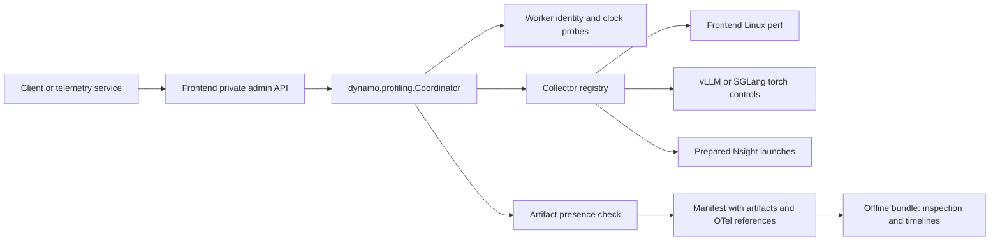

<!--
SPDX-FileCopyrightText: Copyright (c) 2026 NVIDIA CORPORATION & AFFILIATES. All rights reserved.
SPDX-License-Identifier: Apache-2.0
-->

# On-demand profiling

A private admin API that captures a bounded native profile (PyTorch/Kineto or
Nsight Systems) of selected workers and the frontend, and records it with the
triggering OpenTelemetry (OTel) trace/request IDs. It is embedded in the frontend:

```bash
python -m dynamo.frontend --profiling-config /private/profiling/config.json  # or DYN_PROFILING_CONFIG
```

The API listens on a Unix socket (mode 0600) separate from the inference port and
has no remote authentication; socket/output directories must be owned by the
serving user with mode 0700. A standalone host (`python -m dynamo.frontend.profiling
--config ... --frontend-pid ... --frontend-epoch ...`) runs the same coordinator
and can control workers, but cannot emit frontend NVTX.

## Configuration

```json
{
  "socket_path": "/private/profiling/admin.sock",
  "output_dir": "/private/profiling/sessions",
  "lifecycle_evidence_location": "https://existing-otel-backend.example/traces",
  "workers": [{
    "target_id": "decode-0",
    "process_epoch": "<epoch from profiling_info>",
    "backend": "vllm",
    "control_url": "http://decode-0-admin:9090",
    "verify_runtime": true,
    "artifact_location": "/shared/native-profiles/decode-0",
    "expected_rank_ids": ["dp0_pp0_tp0_dcp0_ep0_rank0"]
  }]
}
```

Worker endpoints, paths and rank membership are operator-owned; clients cannot
supply commands, PIDs or output paths. Fields and defaults are in
[models.py](../../profiling/models.py). POST `{}` to a worker's
`/engine/control/profiling_info` for its startup epoch (boot ID, PID, start tick)
and `worker_instance_id` (its runtime connection ID, which the router records as
the worker ID and the bundle uses for request attribution); with `verify_runtime`,
a failed probe or changed epoch prevents start. Which profiler a target uses is
fixed by how its worker was launched; see [Enabling captures](#enabling-captures).

## Admin API

Use `curl --unix-socket <socket_path> http://localhost/admin/profiling/v1/...`.

| Method | Path under `/admin/profiling/v1` | Result |
| --- | --- | --- |
| GET | `/targets` | Inventory and identity requirements |
| POST | `/plans/validate` | `{"valid": true}`, or an error |
| POST | `/sessions` | HTTP 202 with session ID and manifest |
| GET | `/sessions/{id}` | State, errors, evidence and manifest |
| POST | `/sessions/{id}/stop` | HTTP 202; idempotent early stop |
| GET | `/sessions/{id}/artifacts` | Artifact view for retrieval: state, session directory, files per target with status, OTel references |
| POST | `/reconcile` | Clears uncertain cleanup (see below) and returns its reasons; 409 while a capture is active |

- **Single lease.** One capture is active through finalization; a concurrent or
  conflicting plan gets 409. Selected targets are started and stopped concurrently.
- **Idempotent.** A `client_request_id` identifies an immutable plan; retries
  return the same session and deadline.
- **Best-effort duration.** The lease counts from acceptance, including probes and
  startup; there is no synchronized start. Early stop shortens it.
- **Cleanup.** Uncertain starts are still stopped. A failed stop after a start
  that may have taken effect, or an Nsight export that never arrived, blocks new
  captures (409) until the operator checks the workers and POSTs `/reconcile`.
  A start the worker refused does not block.
- **Retention.** At most `max_sessions` sessions are kept in memory; the oldest
  finished one is dropped (its manifest stays on disk, its ID returns 404, and a
  retry of its `client_request_id` gets 409).
- **Shutdown.** On frontend shutdown the active capture's workers are still
  stopped, but the capture-path artifact check is skipped.
- **Frontend perf.** `torch_profile` adds frontend Linux perf unless
  `frontend_perf_enabled` is false (the omission is recorded). Its
  `frontend.perf.data` is listed as an artifact and packed into the bundle
  archive, though the bundle does not draw it.

Each session writes `manifest.json` atomically. The capture path only checks that
artifacts are **present**: Kineto rank files under the session's unique prefix
(size, gzip header, expected rank membership), or this window's new Nsight
report/SQLite pair (sizes, finished export metadata, recording bounds). It then
reports `artifact_status: present`. Parsing, hashes, SQLite integrity and
required activity are checked offline by the bundle, which reports `verified`.
Clock probes estimate worker offsets and uncertainty; they never change clocks.

## Enabling captures

A plan's `mode` picks the profiler: `"torch_profile"` (PyTorch profiler, Kineto
traces) or `"nsys"` (Nsight Systems). Each worker is launched for one of them;
`GET /targets` lists the collectors each target supports.

### Kineto (`"mode": "torch_profile"`)

1. **Launch the worker with the Torch profiler** writing to a directory that the
   coordinator can also read (`artifact_location`):
   - vLLM:

     ```bash
     python -m dynamo.vllm ... --profiler-config '{"profiler": "torch",
       "torch_profiler_dir": "/shared/native-profiles/decode-0",
       "torch_profiler_with_stack": false, "torch_profiler_use_gzip": false}'
     ```

     vLLM exports the trace inside `stop_profile` on the engine loop, so the
     stopped replica pauses for the export. Without Python stacks and gzip the
     pause drops from about a minute to seconds; the bundle compresses offline.
   - SGLang: no launch flag. SGLang picks the profiler per `start_profile`
     request from its `activities`; left unset, as the coordinator does in this
     mode, it runs `torch.profiler` (CPU and GPU). The coordinator passes the
     worker's `start_options`; set
     `"start_options": {"output_dir": "<artifact_location>", "with_stack": false}`.
     SGLang also exports inside `stop_profile`, in the scheduler loop, and always
     gzips the trace, so the worker stops serving for the export. SGLang records
     Python stacks unless `with_stack` is false; turning them off roughly halved
     the pause in our runs (34 s to 14 s for a 3 s capture).
2. **Configure the worker entry**: `artifact_location` as above, and
   `expected_rank_ids` with one ID per engine rank as it appears in the trace
   file names: vLLM `dp0_pp0_tp0_dcp0_ep0_rank0`, SGLang `TP-0` (with `-DP-<n>`,
   `-PP-<n>` or `-EP-<n>` when that dimension is larger than one, e.g. `TP-0-DP-0`
   and `TP-1-DP-1` for TP2 with two DP-attention ranks). The
   coordinator gives each session a unique `profile_prefix`, so files from other
   sessions never count.
3. **Frontend**: a `torch_profile` session also records the frontend with Linux
   perf unless `frontend_perf_enabled` is false. Set it to false where
   `perf_event_paranoid` denies attaching perf.
4. **Data parallelism.** The export pauses every data-parallel rank, so prefer
   Nsight for DP deployments. The coordinator does not enforce this.
   - vLLM (DP > 1, including DP attention and wide EP): do not use Kineto. The
     export runs synchronously in `stop_profile` and serializes across the DP
     group's ranks, stalling the whole group for the sum of the exports.
   - SGLang (`--dp-size`, with or without `--enable-dp-attention`): the stop
     reaches all DP ranks at once and they export concurrently, so the pause is
     one rank's export, but every rank stops serving for it (about 30 s with
     stacks in our two-rank runs). Use Kineto only if that pause is acceptable,
     with `with_stack: false` and a short `duration_ms`.

### Nsight Systems (`"mode": "nsys"`)

1. **Launch each process under Nsight** (the deployment does this; clients never
   run Nsight) with repeat capture and automatic SQLite export, and a distinct,
   fresh output prefix per launch on storage the coordinator mounts:

   ```text
   frontend: --trace=nvtx,osrt --sample=process-tree --cpuctxsw=process-tree
             --capture-range=nvtx --nvtx-capture=ROI@app
             --capture-range-end=repeat:100:async --export=sqlite
   worker:   --trace=cuda,nvtx,osrt --capture-range=cudaProfilerApi
             --capture-range-end=repeat:100:async --export=sqlite
   ```

   vLLM workers also need `--profiler-config '{"profiler": "cuda"}'` so that
   `start_profile`/`stop_profile` open and close the CUDA profiler range; such a
   launch cannot serve Torch capture. SGLang needs no flag: in this mode the
   coordinator sends `activities: ["CUDA_PROFILER"]`, so `start_profile` calls
   `cudaProfilerStart`/`cudaProfilerStop` instead of the Torch profiler. One SGLang
   launch under Nsight can therefore serve both modes.
2. **Configure** `nsys_frontend_output_prefix` (absolute) in the config and
   `nsys_output_prefix` (absolute) per worker, matching the launches.
3. **Frontend**: install `ai-dynamo[profiling]` (NVTX) and use the embedded host.
   In `nsys` mode the frontend is captured only when the plan selects `frontend`.

### Starting a capture

```bash
S=/private/profiling/admin.sock
curl -s --unix-socket $S http://localhost/admin/profiling/v1/targets  # epochs, collectors
curl -s --unix-socket $S -X POST http://localhost/admin/profiling/v1/sessions \
  -H 'Content-Type: application/json' -d '{
    "client_request_id": "incident-42",
    "mode": "torch_profile",
    "targets": [{"target_id": "decode-0", "process_epoch": "<from /targets>"}],
    "duration_ms": 5000,
    "trace_ids": ["<triggering OTel trace ID>"]}'
curl -s --unix-socket $S http://localhost/admin/profiling/v1/sessions/<session_id>
```

The session stops at `duration_ms` (at most `max_duration_ms`) or on
`POST /sessions/<session_id>/stop`, then reports `artifact_status` and the files per
target. For Nsight, use `"mode": "nsys"` and add
`{"target_id": "frontend", "process_epoch": ...}` to capture the frontend.

## Design



`dynamo.profiling.Coordinator` owns plan validation, idempotency, the lease,
session state and manifests, with no frontend or HTTP dependency; it takes a
`RuntimeSnapshot` (frontend identity, worker inventory) and optionally a
collector registry (mode → factory), clock sampler and artifact validator.
`dynamo.frontend.profiling` owns HTTP routing, the socket and shutdown draining.

## Investigation bundle

After a session, a separate job builds the bundle (never the serving frontend):
`python -m dynamo.profiling.bundle <session> --otel-jsonl <collector.jsonl>
[--per-request] [--perfetto] [--nsys-root <dir>]`. Kineto sessions get a Perfetto
timeline by default; Nsight sessions get the native reports with request NVTX
rows. See the [bundle module docstring](../../profiling/bundle.py) for details.
