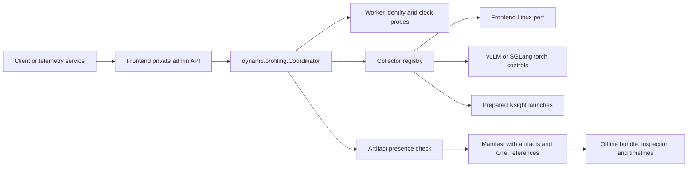

<!--
SPDX-FileCopyrightText: Copyright (c) 2026 NVIDIA CORPORATION & AFFILIATES. All rights reserved.
SPDX-License-Identifier: Apache-2.0
-->

# On-demand profiling

A private admin API that captures a bounded native profile (PyTorch/Kineto or
Nsight Systems) of selected workers and the frontend, and records it with the
triggering OpenTelemetry (OTel) trace/request IDs. It is embedded in the frontend:

```bash
python -m dynamo.frontend --profiling-config /private/profiling/config.json  # or DYN_PROFILING_CONFIG
```

The API listens on a Unix socket (mode 0600) separate from the inference port and
has no remote authentication; socket/output directories must be owned by the
serving user with mode 0700. A standalone host (`python -m dynamo.frontend.profiling
--config ... --frontend-pid ... --frontend-epoch ...`) runs the same coordinator
and can control workers, but cannot emit frontend NVTX.

## Configuration

```json
{
  "socket_path": "/private/profiling/admin.sock",
  "output_dir": "/private/profiling/sessions",
  "lifecycle_evidence_location": "https://existing-otel-backend.example/traces",
  "workers": [{
    "target_id": "decode-0",
    "process_epoch": "<epoch from profiling_info>",
    "backend": "vllm",
    "control_url": "http://decode-0-admin:9090",
    "verify_runtime": true,
    "artifact_location": "/shared/native-profiles/decode-0",
    "expected_rank_ids": ["dp0_pp0_tp0_dcp0_ep0_rank0"]
  }]
}
```

Worker endpoints, paths and rank membership are operator-owned; clients cannot
supply commands, PIDs or output paths. Fields and defaults are in
[models.py](../../profiling/models.py). POST `{}` to a worker's
`/engine/control/profiling_info` for its startup epoch (boot ID, PID, start tick)
and `worker_instance_id` (its runtime connection ID, which the router records as
the worker ID and the bundle uses for request attribution); with `verify_runtime`,
a failed probe or changed epoch prevents start. For Torch capture, launch vLLM
with `--profiler-config '{"profiler":"torch","torch_profiler_dir":...}'`; SGLang
uses its own start/stop controls and `start_options` (`output_dir` = the
`artifact_location`). Both get the session prefix; vLLM rank IDs look like
`dp0_pp0_tp0_dcp0_ep0_rank0`, SGLang's like `TP-0` or `TP-0-DP-1`.

## Admin API

Use `curl --unix-socket <socket_path> http://localhost/admin/profiling/v1/...`.

| Method | Path under `/admin/profiling/v1` | Result |
| --- | --- | --- |
| GET | `/targets` | Inventory and identity requirements |
| POST | `/plans/validate` | `{"valid": true}`, or an error |
| POST | `/sessions` | HTTP 202 with session ID and manifest |
| GET | `/sessions/{id}` | State, errors, evidence and manifest |
| POST | `/sessions/{id}/stop` | HTTP 202; idempotent early stop |
| GET | `/sessions/{id}/artifacts` | Artifact view for retrieval: state, session directory, files per target with status, OTel references |
| POST | `/reconcile` | Clears uncertain cleanup (see below) and returns its reasons; 409 while a capture is active |

- **Single lease.** One capture is active through finalization; a concurrent or
  conflicting plan gets 409. Selected targets are started and stopped concurrently.
- **Idempotent.** A `client_request_id` identifies an immutable plan; retries
  return the same session and deadline.
- **Best-effort duration.** The lease counts from acceptance, including probes and
  startup; there is no synchronized start. Early stop shortens it.
- **Cleanup.** Uncertain starts are still stopped. A failed stop after a start
  that may have taken effect, or an Nsight export that never arrived, blocks new
  captures (409) until the operator checks the workers and POSTs `/reconcile`.
  A start the worker refused does not block.
- **Retention.** At most `max_sessions` sessions are kept in memory; the oldest
  finished one is dropped (its manifest stays on disk, its ID returns 404, and a
  retry of its `client_request_id` gets 409).
- **Shutdown.** On frontend shutdown the active capture's workers are still
  stopped, but the capture-path artifact check is skipped.
- **Frontend perf.** `torch_profile` adds frontend Linux perf unless
  `frontend_perf_enabled` is false (the omission is recorded). Its
  `frontend.perf.data` is listed as an artifact and packed into the bundle
  archive, though the bundle does not draw it.

Each session writes `manifest.json` atomically. The capture path only checks that
artifacts are **present**: Kineto rank files under the session's unique prefix
(size, gzip header, expected rank membership), or this window's new Nsight
report/SQLite pair (sizes, finished export metadata, recording bounds). It then
reports `artifact_status: present`. Parsing, hashes, SQLite integrity and
required activity are checked offline by the bundle, which reports `verified`.
Clock probes estimate worker offsets and uncertainty; they never change clocks.

## Nsight launches

Install `ai-dynamo[profiling]` for frontend NVTX. Each process is launched under
Nsight by the deployment (clients never run it) with repeat capture and SQLite export:

```text
frontend: --trace=nvtx,osrt --sample=process-tree --cpuctxsw=process-tree
          --capture-range=nvtx --nvtx-capture=ROI@app
          --capture-range-end=repeat:100:async --export=sqlite
worker:   --trace=cuda,nvtx,osrt --capture-range=cudaProfilerApi
          --capture-range-end=repeat:100:async --export=sqlite
```

Set a distinct, fresh output prefix per launch (mounted in the coordinator):
`nsys_frontend_output_prefix` in the config and `nsys_output_prefix` per worker.
vLLM selects its `cuda` profiler (a separate launch from Torch capture); SGLang
receives `activities: ["CUDA_PROFILER"]`. In `mode: "nsys"`, select `frontend`
explicitly; frontend perf is not implicit.

## Design



`dynamo.profiling.Coordinator` owns plan validation, idempotency, the lease,
session state and manifests, with no frontend or HTTP dependency; it takes a
`RuntimeSnapshot` (frontend identity, worker inventory) and optionally a
collector registry (mode → factory), clock sampler and artifact validator.
`dynamo.frontend.profiling` owns HTTP routing, the socket and shutdown draining.

## Investigation bundle

After a session, a separate job builds the bundle (never the serving frontend):
`python -m dynamo.profiling.bundle <session> --otel-jsonl <collector.jsonl>
[--per-request] [--perfetto] [--nsys-root <dir>]`. Kineto sessions get a Perfetto
timeline by default; Nsight sessions get the native reports with request NVTX
rows. See the [bundle module docstring](../../profiling/bundle.py) for details.
