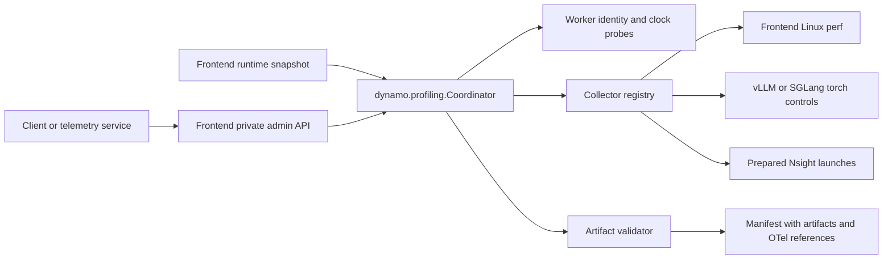

<!--
SPDX-FileCopyrightText: Copyright (c) 2026 NVIDIA CORPORATION & AFFILIATES. All rights reserved.
SPDX-License-Identifier: Apache-2.0
-->

# On-demand profiling interface design

The frontend accepts a client capture plan, gathers a `RuntimeSnapshot`, and
calls `dynamo.profiling.Coordinator`. A telemetry service can select targets using
always-on OpenTelemetry (OTel) evidence. Collection is independent of lifecycle
instrumentation; changing its verbosity is deferred.

## Module boundaries

- `Coordinator` owns validation, idempotency, one active lease, session state,
  concurrent stop, and persisted manifests. It has no frontend or HTTP dependency.
- `RuntimeSnapshot` contains the frontend identity, context, and worker inventory.
  The frontend builds it from configuration; discovery can supply it later.
- `CollectorRegistry` selects trusted factories. `torch_profile` combines frontend
  Linux perf with selected workers' native torch controls. Linux perf can be
  disabled by the operator, with the omission recorded in the manifest. `nsys`
  uses frontend process NVTX ranges and selected workers' CUDA-profiler controls;
  it never starts a runtime Nsight command or frontend perf collector.
- `ClockSampler` probes selected workers' control-process epochs and estimates
  host offsets and uncertainty before and after capture. It does not change
  clocks, synchronize starts, or attest individual engine-rank clocks.
- `ArtifactValidator` checks on the capture path only that each target's native
  files are present: expected Kineto rank files, or this window's finished Nsight
  report and SQLite export. Full inspection (parsing, hashes, recording bounds,
  required activity) runs offline in `dynamo.profiling.inspection`, called by
  the bundle command. Other stores/formats can implement the same protocol.
- `dynamo.frontend.profiling` owns HTTP routing, the private Unix socket, runtime
  snapshot creation, and shutdown draining. Embedded and standalone hosts call
  the same coordinator. Workers expose `ProfilingAgent.info` through their
  existing engine-control API without invoking a GPU profiler.

## Lifecycle and limits

A duration requests a best-effort lease from acceptance, including startup and
clock probes. Stop/export and artifact validation have separate timeouts. Native
recording bounds are reported separately from control-response timestamps.
Selected Dynamo endpoints are independent; an endpoint backed by a shared engine
group still profiles its internal ranks together. Failed or uncertain cleanup
blocks new captures until the operator reconciles worker state and restarts the
host. Embedded timers depend on the frontend event loop; durable recovery and
independent worker leases are deferred.

Manifests retain OTel trace/request IDs and a reference to the existing telemetry
backend. This does not require local OTLP archival or claim exhaustive coverage.
Public routes, remote authentication, dynamic discovery, and storage transfer
are deferred. Nsight requires separately prepared frontend/worker launches with
repeat capture and automatic SQLite export. The embedded frontend opens and
closes `ROI@app`; vLLM/SGLang controls dispatch to GPU execution processes.
Only explicitly selected targets participate. The validator waits for new
report/export pairs within each launch's dedicated output prefix and checks the
export metadata; the bundle job later checks SQLite integrity, required CPU/GPU
activity, and transport hashes.
Frontend CPU activity may consist of OS runtime events when host policy denies
sampling/context switches; each report records those capabilities and diagnostics.
GPU process counts can be checked against expected rank counts, but rank identities
remain unattested. Export failure blocks new captures to avoid associating a late
report with the next window. Frontend NVTX capture requires embedded hosting; a
standalone host can control workers but cannot emit NVTX in the frontend.

See the [administration README](../frontend/profiling/README.md) for configuration,
HTTP requests, collector evidence, and hosting.
