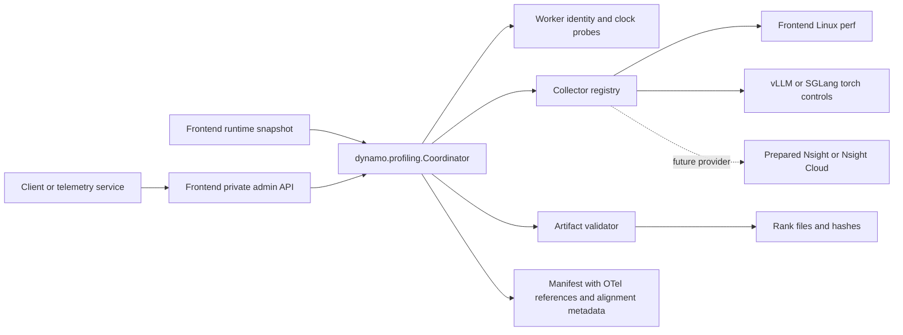

<!--
SPDX-FileCopyrightText: Copyright (c) 2026 NVIDIA CORPORATION & AFFILIATES. All rights reserved.
SPDX-License-Identifier: Apache-2.0
-->

# On-demand profiling interface design

The frontend accepts a client capture plan, gathers an explicit runtime snapshot,
and invokes a reusable coordinator module. This is orthogonal to lifecycle
instrumentation. A telemetry service can use always-on OTel evidence to decide
when and which target to profile.

## Implemented module boundaries

- `dynamo.profiling.Coordinator`: plan validation, idempotency, one active lease,
  session state, concurrent collector stop, and persisted manifests. Callable API;
  no dependency on the frontend or aiohttp web routing.
- `RuntimeSnapshot`: explicit frontend PID/startup epoch/hostname/context and
  worker inventory. Frontend configuration supplies the initial inventory;
  discovery can later build the same object.
- `CollectorRegistry`: trusted mode factories. The built-in `torch_profile`
  factory selects frontend Linux perf and selected workers' native torch controls.
- `ClockSampler`: worker control-process identity and offset/uncertainty estimates
  before capture and after stop. Alignment does not set host clocks or synchronize
  rank starts. Engine-rank clocks on other hosts are not attested by this endpoint.
- `ArtifactValidator`: format/store-specific evidence validation, separate from
  backend control acknowledgments. The built-in validator checks accessible
  vLLM Kineto files and expected rank identities using a unique capture prefix.
- `dynamo.frontend.profiling.http`: maps client HTTP requests to module calls and
  maps typed control errors to HTTP status codes.
- `dynamo.frontend.profiling.hosting`: private Unix-socket listener, frontend
  snapshot creation, and shutdown draining. The default frontend path runs this
  in process. The optional standalone launcher calls the same module.
- `ProfilingAgent.info`: lightweight shared callback registered by vLLM and
  SGLang at `/engine/control/profiling_info`, reporting control-process identity
  and clock timestamps without invoking the GPU profiler.

## Completion and coverage

Control state and artifact proof are independent. Successful backend stop replies
can complete control work while artifact status remains unverified. Accessible
missing/corrupt/duplicate rank files fail the capture instead of reporting full
coverage. Configured membership is required to claim complete engine-rank files.

`duration_ms` is a best-effort lease from acceptance, including startup and clock
probes. Export and validation have separate timeouts and may finish later. The
manifest states this contract; worker control-response timestamps are labeled
separately from native recording bounds. Accessible Kineto artifacts report
integer-nanosecond recorder bounds when a unique native marker is available.
The interface does not promise exact duration or synchronized collection.

The plan's `targets` list selects Dynamo worker endpoints independently. A worker
backed by a shared multi-rank engine group still profiles that internal group.
Only selected workers receive clock probes and start/stop calls. The implicit
frontend perf collector follows the operator's separate enable/disable setting.

The manifest carries lifecycle OTel trace IDs, request IDs, and an existing
telemetry backend reference. OTel coverage stays unknown. Runtime changes to
instrumentation detail, trace fetching, and local OTLP storage are deferred.

The frontend is implicitly profiled with Linux perf in `torch_profile` mode,
including worker-only requests. The operator can temporarily disable attachment;
that omission is visible in the manifest. Linux perf, SGLang exports, inaccessible
stores, and vLLM AsyncLLM CPU-file association remain unverified by the current
artifact validator.

## Hosting tradeoff and deferred work

The module-first implementation lets us evaluate embedded overhead before
choosing a separate service. Embedded timers depend on the frontend event loop.
A standalone coordinator can keep its loop separate, but independent worker
leases and durable recovery still need implementation. Stop/export timeouts can
leave an uncertain remote profiler; the coordinator reports failure and blocks
new captures until the operator reconciles worker state and restarts the host.

The initial admin surface is a private Unix socket served inside the frontend,
separate from its inference listener. Public POST routes, authentication, dynamic
worker discovery, storage-provider upload/download, per-rank attestations, and
runtime instrumentation switching are future work.

Nsight requires targets to be launched under a prepared Nsight session. The
registry is the provider boundary for local Nsight or Nsight Cloud; neither is
implemented by this refactor. Nsight Cloud documents a coordinator that controls
agent collections and an OTLP proxy that mirrors traces. We have not established
its clock-alignment guarantees or a tested Dynamo provider API.
See [architecture](https://docs.nvidia.com/nsight-operator/Architecture/index.html)
and [user guide](https://docs.nvidia.com/nsight-operator/UserGuide/index.html).

The exact configuration, HTTP examples, Python API, and validation limitations
are in [the administration README](../frontend/profiling/README.md).

## Validation record

Checkpoint `fa32249977` preserves the modular implementation exercised in three
real GH200 AgentX runs with Dynamo/runtime `1.6.0.dev20261007`, vLLM `0.30.0`,
Qwen3.6-35B-A3B FP8, and frontend perf disabled:

| Run | Capture selection | Observed result |
| --- | --- | --- |
| `on_demand_modular_validation_20261008_215609` | One TP1/DP2 endpoint | Both rank artifacts verified; shared-group stop skew exposed |
| `on_demand_independent_replicas_20261009_072400` | Two independent DP1 decode endpoints | Both artifacts verified; 9.864609/9.258399-second recordings |
| `on_demand_single_worker_20261009_180200` | Only decode-0, both decode endpoints registered | One 9.800296-second GPU trace, 90,480 CUDA kernels; no profiling traces on other workers |

The selected-worker trial retained 69 observed lifecycle OTel spans, successful
before/during/after inference probes, and successful final accounting for all
four jobs and their steps. The unselected decode replica continued serving.
Synchronous export stalls remain expected; this does not establish overhead or
exact requested-duration coverage.

Subsequent refinements identify processes by boot ID/PID/start tick, detach
callable API snapshots, and report native recorder bounds separately from
control-response times. All 39 CPU tests pass, covering selected-only real HTTP
dispatch, same-tick process identities, clock uncertainty/steps, artifact
integrity and membership, precise/unknown native bounds, embedded hosting,
idempotency, cleanup failures, and caller mutation isolation. The revised
validator also rechecks the original selected GPU trace's hash/event count and
extracts its exact 9,800,295,631-nanosecond duration.

These refinements were then validated on checkpoint `0e6ec5e1f3` with the same
selected-worker workload. Run `on_demand_refinement_20261009_213629` produced one
9.957628-second GPU trace with 104,400 CUDA kernels and 69 observed lifecycle OTel
spans; unselected workers had no profiler starts, stops, or traces. All four jobs
completed successfully. The measurement/grace phase completed 83 requests,
cancelled one at the grace timeout, and recorded zero request errors. The
synchronous stop/export response arrived 60.753 seconds after the lease deadline.
Full-tree pre-commit and 405 applicable pre-merge tests passed. Actual frontend
perf, Nsight collection, and SGLang export validation remain pending.
