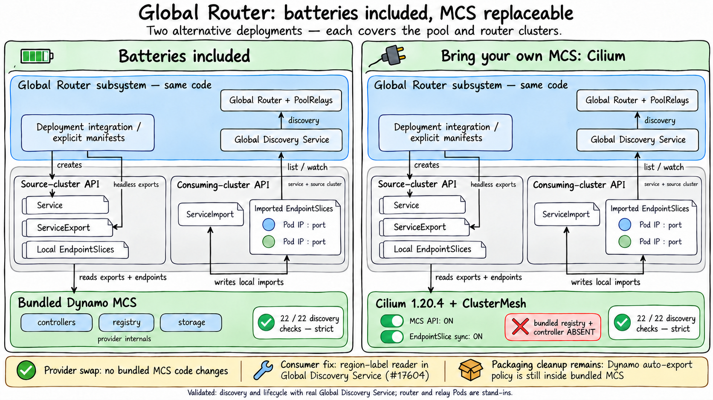
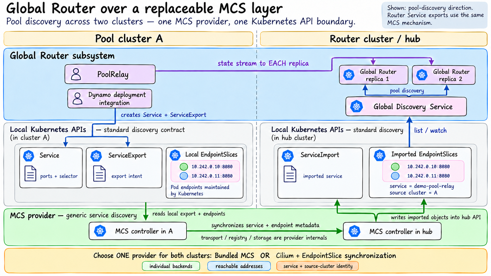

<!--
SPDX-FileCopyrightText: Copyright (c) 2026 NVIDIA CORPORATION & AFFILIATES. All rights reserved.
SPDX-License-Identifier: Apache-2.0
-->

# End-to-end test on kind

This directory holds the end-to-end test of `mcs-registry` and
`mcs-controller` from the Helm chart `deploy/helm/charts/global-discovery-mcs`
on three local kind clusters, and, in phase 3, of the Global Discovery Service
(`lib/global-discovery-service`) reading what the controller imports.

```bash
make -C deploy/global-discovery-mcs e2e E2E_PHASES="1 2 3"
make -C deploy/global-discovery-mcs e2e-down   # delete the clusters
```

The same phase-3 discovery assertions also run against Cilium, without the
bundled registry or controller:

```bash
make -C deploy/global-discovery-mcs e2e-discovery E2E_PROVIDER=dynamo
make -C deploy/global-discovery-mcs e2e-discovery E2E_PROVIDER=cilium
make -C deploy/global-discovery-mcs e2e-down E2E_PROVIDER=cilium
```

`e2e-discovery` always selects phase 3 and strict mode: skipped cases and
known gaps fail the run. Both providers execute `phase3.sh`, using the same
manifests, GDS image and assertions. Provider selection changes installation,
readiness checks, diagnostics and cleanup; it does not select different
discovery cases. Provider setup checks are reported separately from phase 3.
Add new discovery cases once in `phase3.sh`; they run in both modes without
maintaining another test suite. Cilium is the independent compatibility check
that prevents Global Router discovery from depending on bundled MCS features.

`E2E_PROVIDER=cilium` selects phase 3 by default. Explicitly requesting phases
1 or 2 fails before setup: those phases test the bundled implementation's
registry, leases, auto-export policy and conflict handling. No assertions are
silently skipped. The **MCS Provider Discovery** workflow runs this same target
in a `dynamo` / `cilium` matrix on relevant pull requests or a manual dispatch,
and uploads results and diagnostics. The matrix does not have a separate
Cilium test implementation.

`e2e-discovery` first runs `make e2e-runner-test`, which exercises the EXIT
handler with failed report writes, using stubbed cluster operations.
Report failures cannot bypass teardown. Failure to save the
summary makes a successful run fail; an existing nonzero exit status is
preserved. The normal `E2E_KEEP` policy still applies.

The run prints a PASS, FAIL, GAP or SKIP line per assertion and a summary with
the counts of every phase. It exits non-zero when an assertion failed.

## Architecture boundary



The Cilium swap requires no changes to the bundled MCS implementation. The
runtime fix is in the Global Discovery Service's region-label reader
([#17604](https://github.com/ai-dynamo/dynamo/pull/17604)). The discovery
boundary is interchangeable; extracting a generic MCS package remains separate
work because Dynamo-specific auto-export and Service-metadata forwarding
policies still live in the bundled controller. This shared test creates
standard ServiceExports explicitly.



The MCS provider owns generic Service export/import and publishes imported
EndpointSlices. Global Router owns pool interpretation, replica discovery,
relay admission, state distribution and routing. Dynamo deployment integration
creates ordinary Services and ServiceExports; GDS reads Kubernetes objects,
without calling the provider's registry. The bundled provider's own registry,
storage and cluster-membership mechanisms remain internal to that provider.
The slide shows the target ownership boundary; this test change validates the
existing MCS-to-GDS interface rather than implementing a larger module split.
The shared compatibility suite does not require that larger package extraction.

## What it sets up

The following table describes the default bundled provider. Cilium mode uses
two dedicated clusters, `mcs-e2e-cilium-hub` and `mcs-e2e-cilium-a`, with the
same subnets. It disables kind's default CNI and installs Cilium **1.20.4**
as the CNI and MCS provider in both clusters. ClusterMesh uses shared test CA
certificates and NodePort 32379 on the nodes' Docker-network addresses.
`clustermesh.mcsapi.enabled` and
`clustermesh.enableEndpointSliceSynchronization` are both enabled. Headless
exports expose individual backend addresses. The bundled MCS image is never
built or loaded, its chart is never installed, and phase 3 asserts that its
registry/controller workloads are absent.

Provider identity is recorded on each test node. Reusing or deleting a cluster
with an unknown or different provider fails before the cleanup trap is set.
Use a different prefix for independent runs; do not switch providers in place.

| Cluster | Pod subnet | Service subnet | Region | Runs |
| :---- | :---- | :---- | :---- | :---- |
| `mcs-e2e-hub` | `10.241.0.0/16` | `10.251.0.0/16` | `region-hub` | `mcs-registry` (memory store, 1 replica, Service type NodePort) and `mcs-controller` (cluster id `hub`); in phase 3 the Global Discovery Service |
| `mcs-e2e-a` | `10.242.0.0/16` | `10.252.0.0/16` | `region-a` | `mcs-controller` (cluster id `a`) |
| `mcs-e2e-b` | `10.243.0.0/16` | `10.253.0.0/16` | `region-b` | `mcs-controller` (cluster id `b`) |

1. `docker build` of the module `Dockerfile` into `global-discovery-mcs` for
   the host platform (linux/arm64 on Apple Silicon), tagged
   `e2e-<image id>`. With phase 3 also `container/Dockerfile.global-discovery-service`
   from the repository root into `global-discovery-service`; a first Rust build
   takes 10 to 20 minutes.
2. Three kind clusters (`E2E_PREFIX-hub`, `-a`, `-b`) with the pinned node
   image, distinct pod and service subnets, on the Docker network `kind`.
3. A static route on every node to the pod subnet of each other cluster,
   through that cluster's node address on the Docker network, as VPC peering
   does on EKS. kindnet masquerades pod traffic that leaves the cluster, so
   the replies come back to the node. Service subnets are not routed: a derived
   Service ClusterIP is served by the kube-proxy of the importing cluster, which
   DNATs it to a remote pod IP, so only the pod subnets must be reachable.
4. The images loaded into every node (`kind load`, with a `docker save`
   archive as the fallback).
5. The chart in each cluster, release `mcs` in namespace `mcs-system`:
   the hub with `registry.enabled=true`, `registry.store=memory`,
   `registry.replicas=1`, `registry.service.type=NodePort` and the controller
   on the in-release registry URL; a and b with
   `controller.registryUrls={http://<hub node address>:<registry gRPC NodePort>}`.
   Every controller has `controller.registryAllowInsecureHttp=true`,
   `controller.clusterIdentitySource=flags`, `controller.clustersetId=e2e`,
   `controller.clusterId`, `controller.region`, `controller.replicas=1` and
   `controller.leaseTtl=10s` (the minimum, so the lease expiry test is quick).

The test reaches the registry REST API and the Global Discovery Service through
the API server's Service proxy of the hub (`kubectl get --raw
/api/v1/namespaces/<ns>/services/<name>:<port>/proxy/...`), so it needs no
port-forward and no route from the host into the Docker network (colima's VM
does not offer one). Every `kubectl` and `helm` call uses its own kubeconfig
file in `bin/e2e/kubeconfig`, never the default one.

## Phases

| Phase | Namespace | Assertions |
| :---- | :---- | :---- |
| 1 | `e2e-p1` | The registry is ready; it lists the clusters of the clusterset with ACTIVE leases and their regions; every controller holds its leader election Lease. Labelling Service `echo` (2 pods) in a creates a ServiceExport that is Valid and Ready, and the registry import shows cluster a with 2 ready endpoints. In a, b and the hub: a ClusterSetIP ServiceImport whose `spec.ips` is the ClusterIP of its `derived-<hash>` Service, and EndpointSlices labelled `multicluster.kubernetes.io/service-name`, `multicluster.kubernetes.io/source-cluster=a`, `topology.kubernetes.io/region=region-a` and the controller's managed-by labels, holding the ready pod IPs of a with `targetRef` kind Pod and the pod names. A pod in b and one in the hub reach a pod of a through the derived Service ClusterIP. |
| 2 | `e2e-p2` | Scaling the Deployment to 1, 3 and 2 replicas changes the endpoints in every cluster and the registry import. A ServiceExport created as `multicluster.x-k8s.io/v1alpha1` works like a labelled Service. A conflicting export from b (same port name, port 9090 against 8080) gives Conflict=True, reason PortConflict, on b's ServiceExport (and, as KEP-1645 asks, on a's); the registry import keeps the oldest export (a), with its port only; deleting b's Service clears the conflict. Stopping the controller of b expires its lease (10 s TTL plus skew): its export stops participating and its slices leave the imports of a and the hub; starting it again brings all back. Removing the export label (or deleting a ServiceExport) removes the ServiceImport, the derived Service and the slices everywhere, and the registry import. |
| 3 | `demo`, `gr` | The Global Discovery Service runs in the hub with `--pool-discovery mcs --router-namespace gr --router-service global-router --router-port-name grpc` and read access to EndpointSlices. In a, Deployment `demo` (2 pods) with Services `demo-pool-relay` (exported as `v1alpha1`) and `demo-frontend`; in the hub, Deployment `global-router` (2 pods) with Service `global-router`, port `grpc`, exported. `GET /pools` lists one complete pool with key `{cluster_id: a, namespace: demo, dgd_name: demo}` (`demo-frontend` is not a pool); its `location.region` and `relay_identities` are checked as below; `GET /routers` lists `hub/<pod>` for both pods with `http://<pod IP>:8080` URLs. Scaling `demo` to 0 removes the pool, scaling it to 2 brings it back, and deleting the ServiceExport removes it again; the routers stay. |

Phases are independent: each resets its own namespaces and creates its own
workloads. Phases 1 and 2 use all three clusters; phase 3 needs only the hub and
a, so `E2E_PHASES=3` creates two clusters.

All waits are polls (every 2 s, `E2E_TIMEOUT` seconds each) on the state that
is asserted; there are no fixed sleeps.

Phase 3 uses the same headless Services, mixed v1alpha1/v1beta1 exports and
discovery/lifecycle assertions with either provider. Both providers run the
same GDS image with `--pool-discovery=mcs`, reading Kubernetes EndpointSlices.
The region assertion follows one contract for both: a nonempty imported
`topology.kubernetes.io/region` label supplies the region; without it the
source cluster ID is the fallback. It does not branch on the provider name
or patch provider-owned objects. The routers
and relays are busybox stand-ins: this checks the discovery boundary, not
inference requests or the actual relay state-stream protocol.

Cilium preserves real Pod targetRefs in its local MCS mirrors, so the hub-local
router IDs are still checked against actual Pod names. Its remote EndpointSlice
synchronization can use synthetic Pod names; the relay check uses actual Pod
addresses and remains unchanged. See the [Cilium synchronization guide](https://docs.cilium.io/en/stable/network/clustermesh/global-services/#synchronizing-kubernetes-endpointslice-beta).

### Shared-suite parity

The `e2e-discovery` target was rerun with both providers on 2026-10-30:

| Provider | Shared discovery cases | Setup checks | Failed | GAP | Skipped | Wall time |
| :---- | ----: | ----: | ----: | ----: | ----: | :---- |
| Bundled MCS | 20 | 2 | 0 | 0 | 0 | 100 s |
| Cilium 1.20.4 | 20 | 2 | 0 | 0 | 0 | 160 s |

Both runs used `global-discovery-service:e2e-78fb0157db6a`. The executed
discovery case names and order match exactly; provider-specific setup checks
are separate. The strict-skip guard and rejection of an incomplete cluster
configuration also passed. Both runs deleted their dedicated clusters.
Recorded case lists, source hashes and summaries are in
[results/](results/); raw logs are in `bin/shared-suite/`.

### Validated region fix (earlier runs)

With the minimal backend fix from [#17604](https://github.com/ai-dynamo/dynamo/pull/17604)
in commit `75875e0b294de59bab2d321a21c8ca4432791aa5`, both providers pass
phase 3 in strict mode using `global-discovery-service:e2e-78fb0157db6a`:

| Provider | Passed | Failed | GAP | Skipped | Wall time |
| :---- | ----: | ----: | ----: | ----: | :---- |
| Bundled MCS | 22 | 0 | 0 | 0 | 93 s |
| Cilium 1.20.4 | 22 | 0 | 0 | 0 | 158 s |

The bundled run reports `region-a` from its imported EndpointSlices. Both
runs automatically deleted their dedicated clusters. The backend also passed
45 library tests and 6 binary tests, formatting and Clippy. Summaries and
provenance are in [results/](results/); raw logs are in `bin/region-fix/`.

### Recorded provider comparison before the region fix

Executed locally on 2026-10-30 on macOS arm64 with Docker Desktop, kind
v0.33.0, the pinned Kubernetes v1.35.8 node image and Helm v3.21.0:

| Provider | Passed | Failed | GAP | Skipped | Wall time |
| :---- | ----: | ----: | ----: | ----: | :---- |
| Cilium 1.20.4, strict mode | 22 | 0 | 0 | 0 | 209 s |
| Bundled MCS | 21 | 0 | 1 | 0 | 90 s |

Both runs used `global-discovery-service:e2e-10958618f218`. The bundled
comparison used `global-discovery-mcs:e2e-917f383c28b8`; the Cilium run had
no bundled registry/controller. Images were built locally before running
the suite with `E2E_SKIP_BUILD=1`. Both runs automatically deleted their
dedicated clusters. The bundled GAP is the existing region-label behavior
before the fix; no runtime assertion was disabled.

The [recorded summaries](results/) include the provider/image metadata.
The implementation checkout was `5ccd7b6e1a214448c5ff21e28f885f25ed2c5af7`
with this harness change uncommitted (`source_dirty: true`). Raw local logs
and object snapshots remain under `bin/e2e-provider-build/`, `bin/e2e/reports/`
and `bin/e2e-cilium/reports/`. The CI matrix is provided but was not executed
for these local changes. These results cover phase 3; phases 1/2 and the
separate upstream conformance suite were not rerun for this harness change.

### Region metadata

The GDS backend includes the region-label fix from
[#17604](https://github.com/ai-dynamo/dynamo/pull/17604), source commit
`b30c06b16cd122e726d0c9da5aa8593f2b4ea193`. It reads
`topology.kubernetes.io/region` from imported EndpointSlices. When no slice
provides a nonempty region label, it preserves the upstream cluster-ID fallback.

Phase 3 derives the expected region from the imported EndpointSlices, using
the same label-or-source-cluster contract for both providers. In these
fixtures the bundled provider publishes `region-a`; Cilium does not publish
the optional label, so the fallback is `a`. There are no provider-specific
expected values in the assertion. The historical GAP recorded above has no
exception in the current suite, and the provider CI matrix runs in strict mode.

`relay_identities` is `["ip:<address>"]` of the one relay pod with the lowest
address (the service binds a single relay), not the pod names; the test accepts
either the pod names or that address form. The slices carry the pod names in
`targetRef`, which the router replicas (`hub/<pod>`) use.

## Prerequisites

- Docker (on macOS, colima) and `kubectl`, `helm` 3, `jq`, `curl`, `go`
  (for `make kind`), and `shellcheck` for `make` linting of the scripts.
- `kind` is installed into `bin/` at the version `KIND_VERSION` of the
  Makefile, by `make e2e` itself; nothing is installed globally.
- The Docker host's `fs.inotify.max_user_instances` must be at least 256.
  Every kind node is a systemd container holding dozens of inotify instances
  of the host's per-user pool, 128 by default in colima: with three clusters
  the node that starts last fails with `too many open files` (kube-proxy
  crash-loops) and the run stops. The script checks the limit after creating
  the hub and prints the fix: `colima ssh -- sudo sysctl -w
  fs.inotify.max_user_instances=512`. The setting is lost when the VM
  restarts; `E2E_SKIP_INOTIFY_CHECK=1` skips the check.
- Network access to Docker Hub (`busybox`, `golang`, `rust`), `nvcr.io`
  (the distroless base) and the `kindest/node` image.

## Settings

| Variable | Default | Meaning |
| :---- | :---- | :---- |
| `E2E_PROVIDER` | `dynamo` | Bundled provider, or `cilium` with ClusterMesh and imported EndpointSlices |
| `CILIUM_VERSION` | `1.20.4` | Pinned external-provider Helm chart and images |
| `E2E_PHASES` | `1 2 3`; Cilium: `3` | Phases to run, separated by spaces or commas |
| `E2E_KEEP` | `0` | `1` keeps the clusters when the run fails, `always` also after a pass; `make e2e-down` deletes them |
| `E2E_SKIP_BUILD` | `0` | `1` reuses the images of an earlier run (`<repo>:e2e-latest` in Docker) |
| `E2E_STRICT` | `0` (`1` for `e2e-discovery`) | `1` fails on known gaps and skipped cases |
| `E2E_TIMEOUT` | `90` | Seconds each assertion polls |
| `E2E_HELM_TIMEOUT` | `5m` | `helm --wait` timeout |
| `E2E_PREFIX` | `mcs-e2e`; Cilium: `mcs-e2e-cilium` | Cluster name prefix (`<prefix>-hub`, `-a`, `-b`); the test only touches these |
| `E2E_CLUSTER_KEYS` | by phase | Clusters to create, for example `hub a`; steps that need b are skipped |
| `E2E_PLATFORM` | host | Image platform, `linux/arm64` or `linux/amd64` |
| `E2E_WORK_DIR` | `bin/e2e`; Cilium: `bin/e2e-cilium` | Private kubeconfigs, kind configs and logs; shareable object snapshots and summary are under `reports/` |
| `KIND_NODE_IMAGE` | `kindest/node:v1.35.8@sha256:...` | Node image, pinned by digest |
| `POD_SUBNET_*`, `SERVICE_SUBNET_*` | see above | Subnets of `HUB`, `A` and `B`; keep them distinct and clear of the Docker network |
| `MCS_IMAGE_REPO`, `GDS_IMAGE_REPO`, `BUSYBOX_IMAGE` | `global-discovery-mcs`, `global-discovery-service`, `busybox:1.37` | Images |

A run reuses clusters that exist (for example kept ones) and re-applies the
routes and the chart, so it is idempotent. Unless kept, the clusters are
deleted at the end, passed or failed. On a failure the script prints the pods,
the controller and registry logs and the MCS objects of every cluster first.

## Files

| File | Contents |
| :---- | :---- |
| `run.sh` | Entry point: setup, phases, summary, teardown; `run.sh down` deletes the clusters |
| `lib.sh` | Settings, output, polling and result counters, kubectl, helm and registry REST wrappers |
| `setup.sh` | Image builds and loading, kind clusters, routes, Helm releases |
| `provider.sh` | Provider installation and the assertion that the bundled MCS is absent in external mode |
| `checks.sh` | Check functions on MCS objects, shared by the phases |
| `phase1.sh`, `phase2.sh`, `phase3.sh` | The phases |
| `manifests/` | The workloads, the Global Discovery Service and the ServiceExports the phases apply |
