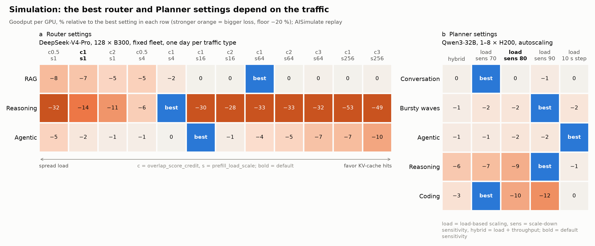
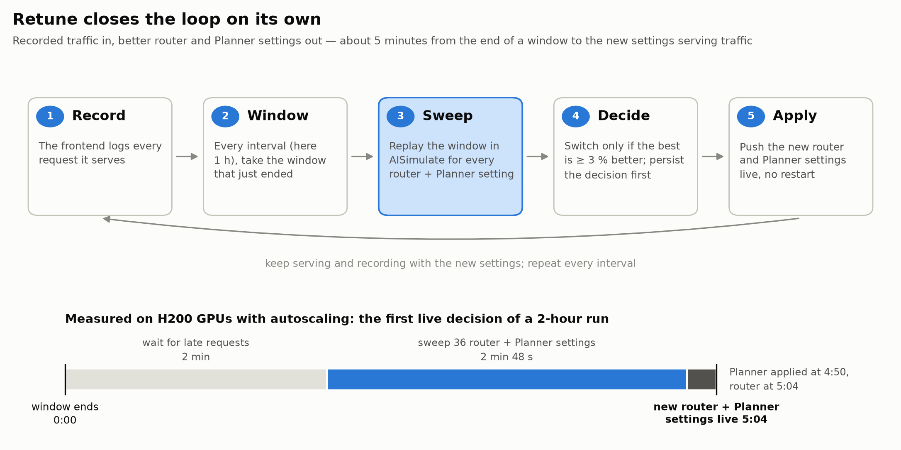
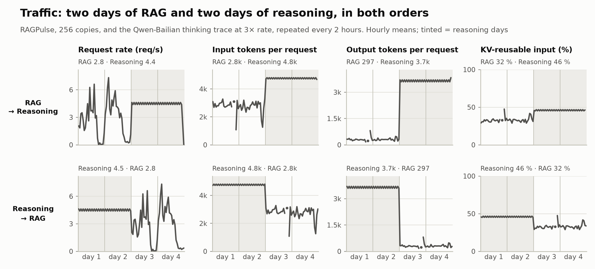
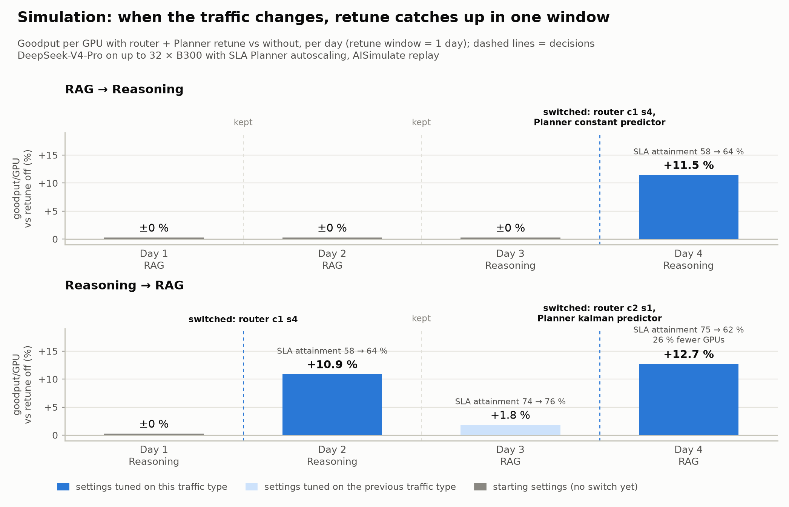
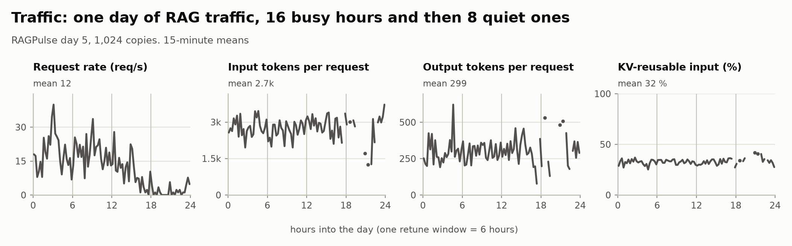
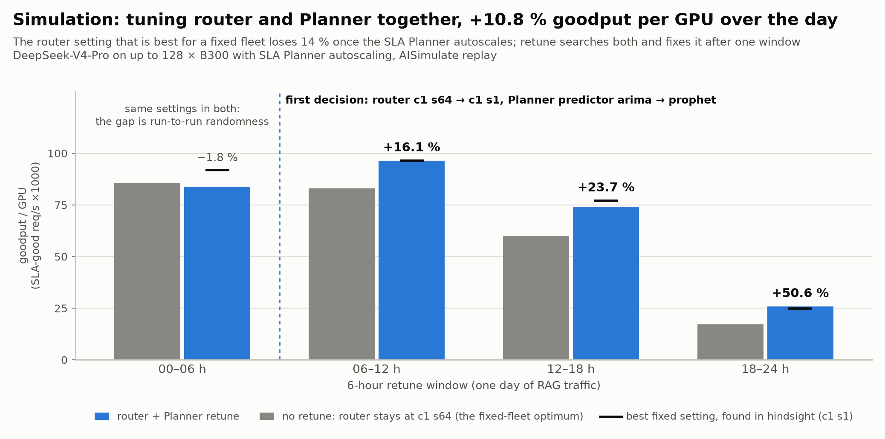
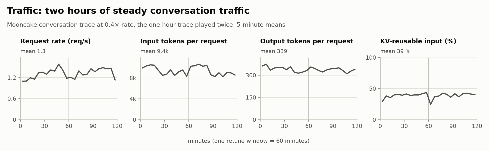
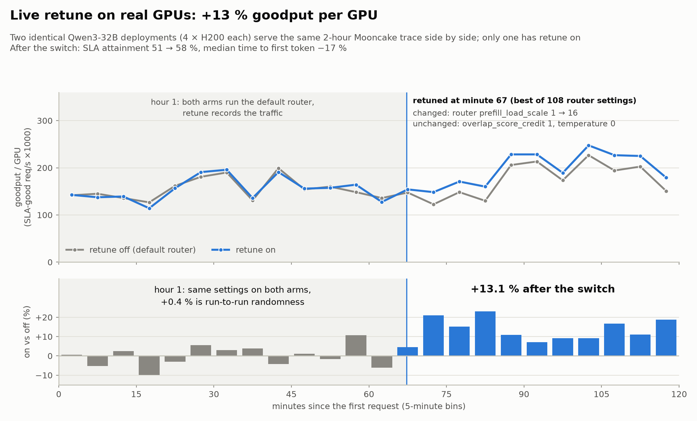
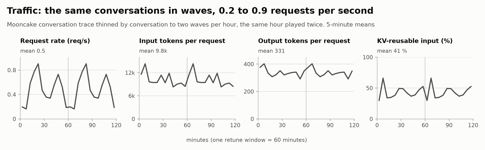
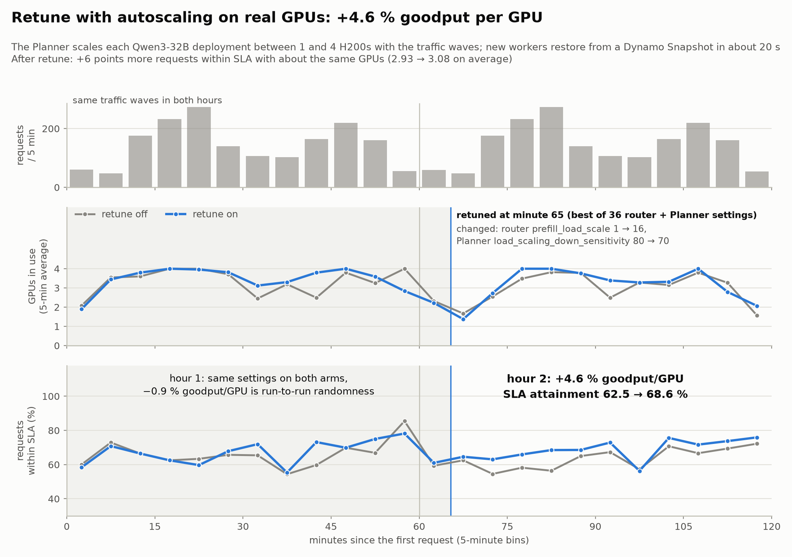

import { BlogStyles } from "@/components/BlogStyles";
import { BlogArticleMeta } from "@/components/BlogArticleMeta";

<BlogStyles />

<BlogArticleMeta
  authors={[
    { name: "Hongkuan Zhou", href: "https://developer.nvidia.com/blog/author/hongkuanz/" },
  ]}
  category="Engineering"
  date="November 2026"
  readTime="15 min read"
/>

In [AISim: Simulating the Pareto Frontier](./dynosim-pareto-frontier.mdx) we used simulation to find the best
serving configuration before a deployment goes live. That configuration is only best for the traffic it was tuned on.
Production traffic does not hold still: a RAG workload in the morning, reasoning-heavy chat in the afternoon, an agent
fleet at night. The settings that were optimal at deploy time quietly drift away from the frontier.

**Planner Retune** closes that gap. The Dynamo Planner records the traffic a deployment actually serves, replays the
most recent window in AISimulate for a grid of KV-router and Planner settings, and switches the running deployment to
the winner, with no restart. Here is what it buys:

- **Real H200, router retune:** **+13.1 % goodput per GPU** after the first decision, with SLA attainment up from 51 %
  to 58 % and median time to first token down 17 %.
- **Real H200, router and Planner retune with autoscaling:** **+4.6 % goodput per GPU** and **+6.1 points** more
  requests within SLA, on about the same number of GPUs.
- **Simulation, traffic switches:** after the traffic changes, retune catches up in one window and gains **+11 to 12 %**
  goodput per GPU on the next one.
- **Simulation, router and Planner together:** **+10.8 %** over a day by fixing a router setting that only breaks once
  the Planner autoscales.
- **Fast:** **5 to 7 minutes** from the end of a window to the new settings serving traffic.<sup>1</sup>

<sup>1</sup> Measured in the two real-GPU runs in Section 4, with a one-hour retune window. This time depends on the
retune window size and the traffic load, which set how many requests each replay covers, and on the speed of the CPUs
that run the sweep.

---

## 1. The best settings move with the traffic

Two components decide how well a Dynamo deployment uses its GPUs from minute to minute. The **KV router** decides
which worker serves each request, trading KV-cache reuse (send a request to the worker that already holds its prefix)
against load balance (send it to the least busy worker). The **Planner** decides how many workers to run and how
quickly to add or remove them. Both have a handful of knobs, and the right values depend on the traffic.

<Frame caption="Figure 1 — The best router and Planner settings depend on the traffic">
  
</Frame>

<Info icon="hand-point-up" className="fig-caption">
Simulation (AISimulate replay). Each cell is goodput per GPU relative to the best setting in its row; blue marks the
best. (a) Twelve KV-router settings, DeepSeek-V4-Pro on a fixed fleet of 128 B300 GPUs, one day of each traffic type.
(b) Five Planner scaling settings, Qwen3-32B with the Planner autoscaling between 1 and 8 H200 GPUs, two hours of each
traffic type.
</Info>

On the router side (Figure 1a), RAG traffic wants strong cache affinity: `prefill_load_scale` 64 is best. The same
setting loses **33 %** on single-tenant reasoning traffic, where long decodes pile up on the few workers that hold the
hot prefixes; there, a much lighter `prefill_load_scale` 4 wins. Agentic traffic lands in between, at 16. The default
(credit 1, scale 1) is never the best and gives up 2 to 14 %.

The Planner shows the same pattern (Figure 1b). On reasoning traffic and bursty waves, scaling down conservatively
(sensitivity 90) is best and the default sensitivity of 80 loses up to 9 %. On coding traffic it is the reverse:
aggressive scale-down (sensitivity 70) is best and the conservative setting loses 12 %. Agentic traffic prefers a
slower 10-second load step.

No single setting wins everywhere, so any setting tuned once at deploy time leaves goodput on the table as soon as the
mix shifts. Tuning has to follow the traffic.

## 2. How retune works

Retune turns the DynoSim workflow into a loop that runs next to the deployment.

<Frame caption="Figure 2 — The retune loop">
  
</Frame>

<Info icon="hand-point-up" className="fig-caption">
The timeline is the first live decision of the autoscaling experiment in Section 4: the sweep started 2 minutes after
the window ended, scored 36 router and Planner settings in 2 minutes 48 seconds, and the new Planner and router settings
were live at 4:50 and 5:04.
</Info>

1. **Record.** Every frontend writes one record per request it serves: timing, token counts, and hashes of the
   prompt's KV blocks, which is what a KV-aware replay needs. The prompt text itself is not recorded.
2. **Window.** Every `interval_seconds` (one hour in our runs), the Planner cuts the records of the window that just
   ended into one trace.
3. **Sweep.** The Planner replays that window in AISimulate, the engine behind DynoSim, once for every candidate
   router and Planner setting. On Kubernetes the replays run as DynamoGraphDeploymentRequests, in parallel, next to the
   deployment.
4. **Decide.** Each candidate is scored on goodput per GPU: requests that meet the time-to-first-token and
   inter-token-latency SLA, per GPU. The best candidate replaces the current settings only if it is more than 3 % better
   on the same window. The decision is written to a Kubernetes Lease before anything changes.
5. **Apply.** The Planner pushes the router settings to every frontend and applies its own new settings in place.
   Traffic keeps flowing; nothing restarts.

Three properties make the loop safe to leave on. All candidates replay with the same random seed, so a setting that
changes no routing or scaling decision scores exactly like the current one and is never picked by chance; together
with the 3 % threshold, this keeps retune from switching back and forth on noise. Decisions are written to a Lease
before they act, and windows are aligned to wall-clock time, so a restarted Planner continues the same windows. And
`advisory` mode records every decision without applying it, so you can watch what retune would do first.

Turning it on is a block in the Planner configuration. This is the one from our autoscaling run:

```yaml
enable_load_scaling: true
retune:
  interval_seconds: 3600            # one window per hour
  grace_seconds: 120                # wait for late request records
  objective: GoodputPerGPU          # SLA goodput per GPU
  min_improvement_percentage: 3     # switch only for a clear win (default)
  router:
    overlap_score_credit: {choices: [0.5, 1.0]}
    prefill_load_scale: {choices: [1.0, 4.0, 16.0]}
    temperature: 0.0
  planner:
    scaling_policy: {preset: [load_180_5, load_180_10]}
    load_sensitivity: {preset: [aggressive, default, conservative]}
  executor: dgdr                    # run the sweep on the cluster
```

Retune comes in two forms. **Replay retune** runs the whole loop inside a simulation, so you can measure what it would
gain on your own traces before touching a cluster; Section 3 uses it. **Live retune** runs it on a Kubernetes
deployment; Section 4 uses it. See [Planner Live Retune](../../kubernetes/auto-deployment/planner-live-retune.md) for
the setup.

## 3. Simulation: following the traffic

We first ran retune in simulation, where the same traffic can be replayed with retune on and off and nothing else
changes.

### Catching up after a traffic switch

To see whether retune keeps up when the traffic changes, we replayed four days of traffic that switch between two very
different workloads, RAG and reasoning, in both orders.

The RAG days come from [RAGPulse](https://github.com/flashserve/RAGPulse), a public trace of a university-wide
question-answering service built on retrieval. One day of it holds about a thousand requests, so we replay 256 copies
of every request, each copy with its own KV prefixes and shifted by up to 30 seconds. A RAG request is light: about
2,800 input tokens and 300 output tokens. The request rate follows the day, from 7 requests per second in the busiest
hour to almost nothing in the quiet hours.

The reasoning days come from the thinking-model trace of the
[Qwen-Bailian usage traces](https://github.com/alibaba-edu/qwen-bailian-usagetraces-anon): two hours of anonymized
production requests from a Qwen serving cluster on Alibaba Cloud Bailian. We replay it at three times its rate and
repeat it to fill two days. The rate is steady at about 4.5 requests per second, and each request is much heavier:
about 4,800 input tokens and 3,700 output tokens, twelve times the output of a RAG request. About a third of the RAG
input and almost half of the reasoning input repeats a prefix that an earlier request already sent.

<Frame caption="Figure 3a — The traffic: two days of RAG and two days of reasoning, in both orders">
  
</Frame>

<Info icon="hand-point-up" className="fig-caption">
Hourly means of the replayed traces. **KV-reusable input** is the share of input tokens whose prefix already appeared
earlier in the trace: the most a KV cache could reuse. A real deployment reuses less. A line breaks where an hour has
no requests.
</Info>

The deployment is DeepSeek-V4-Pro on up to 32 B300 GPUs with the SLA Planner autoscaling, and retune runs once per
day, searching router settings and the Planner's load predictor.

<Frame caption="Figure 3b — Simulation: when the traffic changes, retune catches up in one window">
  
</Frame>

<Info icon="hand-point-up" className="fig-caption">
Simulation (AISimulate replay). Goodput per GPU with router and Planner retune versus without, per day; one retune
window is one day. Dashed lines mark decisions.
</Info>

In both orders, retune switches as soon as it has seen one window of the new traffic, and the next day gains
**+11.5 %** and **+10.9 %** goodput per GPU, with SLA attainment rising from 58 % to 64 %. When nothing is clearly
better, it keeps the current settings: on the two RAG days of the first sequence, every sweep found less than 3 %, so
nothing changed and nothing was lost. Carrying reasoning-tuned settings into the first RAG day did not hurt either
(+1.8 %).

The last RAG day gains +12.7 % in a different way: retune switched the router to credit 2, scale 1 and the Planner's
load predictor from ARIMA to Kalman, and the deployment ran 26 % fewer GPUs while SLA attainment fell from 75 % to
62 %. Goodput per GPU rewards that trade. This is a recovery rather than a better RAG setting: after two reasoning
days the deployment without retune, whose load predictor was fitted to reasoning traffic, stays at about 32 GPUs
through both RAG days, and retune brings the fleet back to where the starting settings run when RAG comes first (about
22 GPUs on the same day, with goodput per GPU within 1 % of the retuned run). If SLA attainment matters more than GPU
count for your service, keep an eye on it when choosing the objective.

### Tuning the router and the Planner together

The router and the Planner also interact. A router setting that is ideal for a fixed fleet can hurt once the Planner
starts adding and removing workers: with SLA Planner autoscaling on a day of RAG traffic, the fixed-fleet favorite
`prefill_load_scale` 64 loses 14 % to the default.

The traffic here is one day of the same RAGPulse trace at four times the scale: 1,024 copies, 1.08 million requests.
The requests look the same all day (about 2,700 input tokens, 300 output tokens, a third of the input reusable), but
the rate does not: 17 requests per second on average for the first 16 hours, with 15-minute peaks near 40, and then
about 2 requests per second for the last 8 hours.

<Frame caption="Figure 4a — The traffic: one day of RAG traffic, 16 busy hours and then 8 quiet ones">
  
</Frame>

<Info icon="hand-point-up" className="fig-caption">
15-minute means of the replayed trace; KV-reusable input as in Figure 3a. Vertical lines mark the 6-hour retune
windows. A line breaks where 15 minutes pass without a request.
</Info>

<Frame caption="Figure 4b — Simulation: tuning router and Planner together">
  
</Frame>

<Info icon="hand-point-up" className="fig-caption">
Simulation (AISimulate replay). DeepSeek-V4-Pro on up to 128 B300 GPUs with SLA Planner autoscaling, one day of RAG
traffic, retune every 6 hours. Black ticks mark the best fixed setting, found in hindsight. Both runs use the same
settings in the first window, so the −1.8 % gap there is run-to-run randomness.
</Info>

Starting from that setting, retune searches router and Planner settings together. Its first decision switches the
router back to `prefill_load_scale` 1 and the Planner's load predictor from ARIMA to Prophet. Every window after it
gains 16 to 51 % and stays within 4 % of the best fixed setting: **+10.8 %** goodput per GPU over the day. Because
every candidate replays with the Planner in the loop, retune sees an interaction that a router sweep on a fixed fleet
misses.

## 4. Real GPUs

Simulation tells us where the gains are. To show them on hardware, we ran live retune on H200 GPUs in two experiments.
Each one runs two identical Dynamo deployments of Qwen3-32B (vLLM 0.33, KV router) side by side on the same
Kubernetes cluster and replays the same two-hour trace into both with AIPerf on a fixed schedule. Only one deployment
has retune on. For the first hour both run the same settings, and retune only records traffic, so the first hour also
measures how much two identical deployments differ by chance.

### Router retune: +13 % goodput per GPU

The first experiment keeps four H200 GPUs per deployment and lets retune search 108 router settings.

The traffic is the conversation trace published with [Mooncake](https://github.com/kvcache-ai/Mooncake) (FAST '25):
one hour of online conversation requests, multi-turn chats that carry their history with them. To fit four GPUs we
replay it at 0.4 times its rate and drop the 5 % of requests that exceed the model's 40,960-token context. We play the
hour twice, the second time with new prefixes for everything except the most widely shared ones. The result is 9,477
requests at a steady 1.3 requests per second, about 9,400 input tokens and 340 output tokens each, with 39 % of the
input repeating an earlier prefix.

<Frame caption="Figure 5a — The traffic: two hours of steady conversation traffic">
  
</Frame>

<Info icon="hand-point-up" className="fig-caption">
5-minute means of the replayed trace; KV-reusable input as in Figure 3a. The vertical line marks the end of the first
retune window.
</Info>

<Frame caption="Figure 5b — Live router retune on H200">
  
</Frame>

<Info icon="hand-point-up" className="fig-caption">
Measured on H200. Top: goodput per GPU in 5-minute bins. Bottom: retune on versus off. In the first hour both
deployments run the same settings, so the +0.4 % difference is run-to-run randomness.
</Info>

Seven minutes after the first hour ended, retune changed one setting, `prefill_load_scale` from 1 to 16, chosen from
108 candidates. From then on the retuned deployment was ahead in every 5-minute bin: **+13.1 % goodput per GPU**, SLA
attainment up from 51 % to 58 %, and median time to first token down 17 %. An hour later the next sweep found nothing
more than 3 % better and kept the setting, as it should when the traffic has not changed.

### Router and Planner retune with autoscaling: +4.6 %

The second experiment lets the Planner scale each deployment between one and four H200 GPUs as traffic rises and falls
in waves, and lets retune search router and Planner settings together. Fast scaling matters here, so new workers
start from a [Dynamo Snapshot](./dynamo-snapshot.mdx): they are ready in about 20 seconds instead of about 2.5 minutes
for a cold start.

The traffic is the same conversation trace, reshaped into waves: we keep or drop whole conversations so that the
request rate rises and falls twice per hour, between about 0.2 and 0.9 requests per second. Each request still looks
like those of the first experiment: about 9,800 input tokens and 330 output tokens, with 41 % of the input reusable.
The second hour repeats the conversations of the first hour with new prefixes, so both hours offer the same load:
3,472 requests in total.

<Frame caption="Figure 6a — The traffic: the same conversations in waves, 0.2 to 0.9 requests per second">
  
</Frame>

<Info icon="hand-point-up" className="fig-caption">
5-minute means of the replayed trace; KV-reusable input as in Figure 3a. The vertical line marks the end of the first
retune window.
</Info>

<Frame caption="Figure 6b — Live router and Planner retune with autoscaling on H200">
  
</Frame>

<Info icon="hand-point-up" className="fig-caption">
Measured on H200. Top: requests per 5 minutes, the same waves in both hours. Middle: GPUs in use. Bottom: share of
requests within SLA. In the first hour both deployments run the same settings, so the −0.9 % difference is run-to-run
randomness.
</Info>

Five minutes after the first hour ended, retune changed two settings at once: the router's `prefill_load_scale` from 1
to 16 and the Planner's scale-down sensitivity from 80 to 70. In the second hour the retuned deployment served
**+4.6 % goodput per GPU** and kept **68.6 %** of requests within SLA versus 62.5 % without retune, on about the same
GPUs (3.08 versus 2.93 on average).

## Try it

- Measure the gain on your own traffic first with replay retune:
  [Simulate Retune](../../developer-guide/knowledge-base/modular-components/planner/aisimulate-planner-replay.mdx#simulate-retune-experimental).
- Then turn it on for a development deployment, in `advisory` mode first:
  [Planner Live Retune](../../kubernetes/auto-deployment/planner-live-retune.md).
- Every field of the `retune` block is in the
  [Planner configuration reference](../../reference/components/planner-configuration.mdx).
