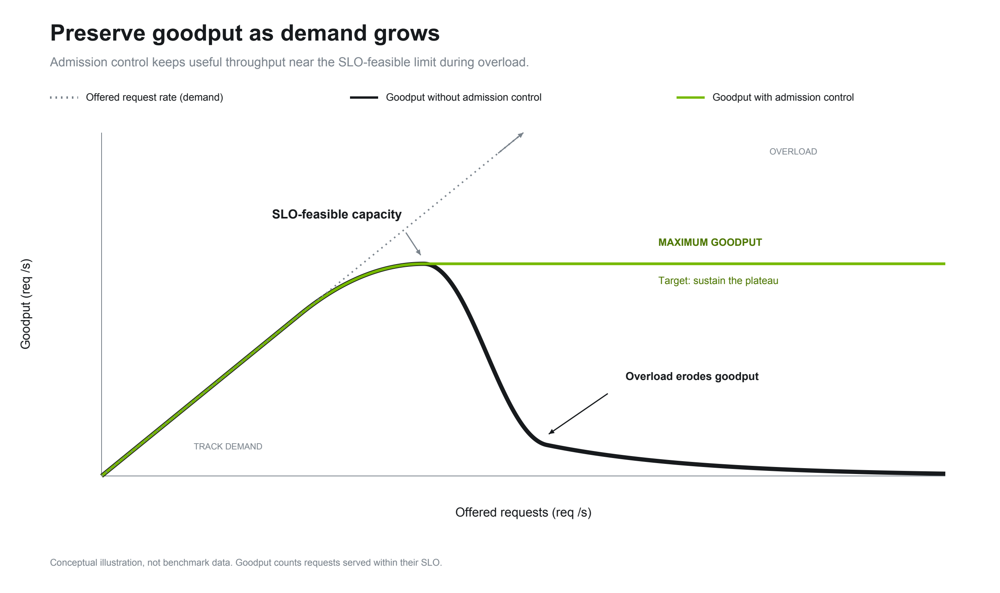

NVIDIA Dynamo admission control aims to preserve useful service under load and govern how competing
requests share capacity. It works at two layers:

- [Router Admission Control](router.md) queues requests by policy class in the Frontend's KV router
  before a worker is selected, and controls how request classes share capacity.
- [Backend Admission Control](backend.md) limits the work inside each worker's engine and queues the
  excess outside it.

## Goal

Admission control protects **goodput** and **quality of service (QoS)** by deciding which requests
to admit, delay, or reject before they consume engine capacity.

**Goodput:**

- **Useful throughput:** sustain the rate of successful requests that meet their service-level
  objectives (SLOs).
- **Overload protection:** bound concurrent work and backlog so excess demand does not overwhelm
  serving resources.

**Quality of service (QoS):**

- **Priority:** favor requests according to the provider's priorities and service objectives when
  capacity is contested.
- **Fairness:** share capacity among competing request classes according to provider-defined shares,
  preventing one class from monopolizing service.

### Goodput Illustration

The graph illustrates the goodput goal: useful work should remain near sustainable capacity as
demand grows.

This graph illustrates the goal; it is not benchmark data or a guarantee for every workload. The
backend gate provides local capacity protection. Priority and fairness across request classes come
from router policy classes; see [Router Admission Control](router.md).
