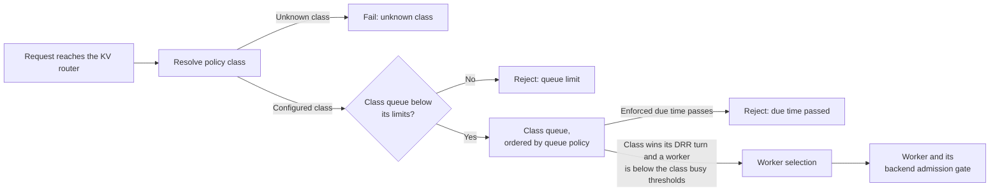

Router admission control decides which requests wait in the NVIDIA Dynamo KV router before a worker is
selected, the order in which waiting requests leave, and how request classes share capacity. It
provides the priority and fairness half of the [admission control goal](overview.md#goal); the
[backend gate](backend.md) on each worker bounds the work inside its engine.

Router admission control runs in the Frontend's KV router (`--router-mode kv`). For the complete
policy-class schema, see
[Policy-Class Queues](../../modular-components/router/configuration-and-tuning.md#policy-class-queues).
For flags and environment variables, see the
[Frontend Configuration Reference](../../../../reference/components/frontend-configuration.mdx#active-load-and-queueing).

## Admission Layers

A request can wait or be rejected at three stages. Each stage is configured separately, and class
queueing, busy-threshold rejection, and backend admission are all off by default.

| Stage | Where | What it decides | When it rejects |
|---|---|---|---|
| Class queueing | Frontend KV router | Whether a request waits, which class sends next, and which request in that class goes first | The class queue reaches a limit, or an enforced due time passes (HTTP 529 by default for both) |
| Worker selection | Frontend KV router | Which eligible worker serves the request, based on KV cache overlap and load | Every eligible worker is past the Frontend [busy thresholds](../../../../kubernetes/fault-tolerance/request-rejection.md) (HTTP 529 by default) |
| Backend admission | Each worker | Whether the request enters the engine now or waits in the worker's queue | The worker's [admission queue](backend.md) is full (HTTP 529 by default) |

Class queueing happens before worker selection. A request leaves its class queue with any worker
constraints it carries, such as a pinned worker, and the router then selects among the workers it
allows, using their load at that time.

## Request Flow

When a request reaches the KV router, the router:

1. Resolves its policy class: the class that a request classifier sets, if any, otherwise the class
   named by the `x-dynamo-meta-policy-class` request header, otherwise `default_policy_class`. A
   name that matches no configured class fails the request instead of falling back to the default;
   for an unknown header name, the Frontend returns HTTP 400.
2. Rejects the request if its class queue has already reached a configured limit, and otherwise adds
   it to the queue.
3. Holds the request while every eligible worker is past the class's busy thresholds, or while
   requests ahead of it in the same lane of its class are waiting, as described in
   [Class Shares](#class-shares). Otherwise, the request can leave right away.
4. Whenever workers have room, lets weighted Deficit Round Robin (DRR) choose which class sends next,
   and the class's queue policy choose which of its requests goes first.
5. Selects a worker for the request and sends it. If the worker has backend admission control
   enabled, its gate applies next.

A request is rejected if its class enforces its due time and that time passes before the request is
sent to a worker; see [Due Times](#due-times). A class with a queue limit of `0` is the exception to
steps 2 and 3: it never holds requests, so a request goes straight to worker selection when an
eligible worker is below the class's busy thresholds and is rejected otherwise.



A [request classifier](../../modular-components/router/custom-admission-control.md), if configured,
runs before the request joins a queue. It can choose the class, set an explicit deadline, defer the
request, or reject it.

### Class Shares

Each class has its own queue, and DRR shares capacity between classes that have a request that can
leave. Each round, such a class earns credit equal to its `quantum`. Each request it sends spends
credit equal to its scheduling cost: by default, its input tokens not already cached, at least 1,
measured when the request joined the queue. A request classifier can override that cost. While
several classes have requests ready, their quanta weight the uncached-token service each receives. A
class with no request that can leave earns no credit, so other classes can use the idle capacity.

`quantum` sets a relative weight for token service. It is not a request count, a worker reservation,
or a guaranteed share of compute. Quanta of 800 and 200 weight the first class four times as heavily
as the second, but how many requests each sends depends on request sizes and on which classes have
requests ready.

Requests pinned to an exact worker wait in a separate lane of their class for that worker. All other
requests of the class share one lane, including requests restricted to a subset of workers. Each lane
releases requests in the class's queue order and does not look past its first request: while that
request cannot leave, the requests behind it in the same lane wait, even when a worker they could use
has room. A blocked exact-worker lane does not hold the class's other lanes, so a dispatchable
shared-lane head or another exact-worker lane can still leave, and other classes keep their turns. For
head-of-line details, credit carry-over, and oversized requests, see
[Deficit Round Robin Queue Scheduling](../../modular-components/router/deficit-round-robin.md).

### Order Within a Class

Each class orders its own queue with its `queue_policy`:

| `queue_policy` | Order | Request priority hints |
|---|---|---|
| `edf` (policy-file default) | Earliest due time first. Requests without a due time follow every request that has one, and requests with equal or no due times leave in the order they joined the queue. | Ignored |
| `fcfs` | Arrival order, with `nvext.agent_hints.priority` moving a request earlier. Optimizes tail Time To First Token (TTFT). | `strict_priority` tiers, then `priority` |
| `wspt` | Least uncached input first, weighted by `priority`. Optimizes average TTFT; long prompts can wait behind a steady stream of short ones. | `strict_priority` tiers, then `priority` |

Within one `edf` class, every request has the same `slo_ttft_ms` budget, so requests in the same lane
leave in arrival order unless a request classifier sets explicit deadlines. Requests in different
lanes can leave out of arrival order: a lane whose first request can leave goes ahead while another
lane of the class is blocked. For how `fcfs` and `wspt` combine strict tiers, explicit deadlines, and
priority, see
[Priority Scheduling](../../../../use-cases/agents/priority-scheduling.md#router-queue-priority).

### Due Times

A request's due time is the explicit deadline that a request classifier sets, if any. Otherwise, it is
the time the request reached the router plus its class's `slo_ttft_ms`. An explicit deadline replaces
the class budget even when it is later. A request has no due time when neither is set. Time spent in
a classifier and in the queue counts against the budget.

Whether a request still waiting at its due time is rejected depends on where the due time came from:

| Due time | `edf` class, `controlled_delay: false` (default) | `edf` class, `controlled_delay: true` | `fcfs` or `wspt` class |
|---|---|---|---|
| Class budget, `slo_ttft_ms` | Orders the queue; the request keeps waiting | Rejected | Not used |
| Explicit deadline from a request classifier | Rejected | Rejected | Rejected |

Expiry does not wait for new traffic: the router rejects a request at its due time even when no
requests arrive and no capacity frees. A rejected request spends none of its class's DRR credit.

A due time bounds only the wait for router admission. It does not limit an admitted request or
predict its TTFT, which also includes the Frontend's work before the router and the worker's time
after dispatch.

### Rejections

| Cause | Frontend response | `reason` |
|---|---|---|
| The class queue reached a configured limit | The overload status, HTTP 529 by default; set `DYN_HTTP_OVERLOAD_STATUS_CODE` to change it. The error names the class and the limit. | `queue_size_exceeded` |
| A request's enforced due time passed before it was sent to a worker | The same overload status, with the message `request deadline exceeded` | `due_time_passed` |

The `reason` values label `dynamo_frontend_router_admission_rejected_total`; see [Metrics](#metrics).
Both responses signal backpressure and carry no `Retry-After` header; gRPC requests receive
`RESOURCE_EXHAUSTED` instead. Clients that retry should back off, as described in
[Configure Client Retries](../../../../kubernetes/fault-tolerance/request-rejection.md#configure-client-retries).
A request whose class is unknown fails before it joins a queue, as described in
[Request Flow](#request-flow), and the router admission metrics do not count it.

## Configuration

> [!NOTE]
> **Router admission control is disabled by default.** Requests wait at the router only when a policy
> class sets a busy threshold. To enable it, define policy classes as shown below, then tune them with
> the [best practices](#best-practices).

Define policy classes in a YAML file and pass it to the Frontend with `--router-policy-config` or
`DYN_ROUTER_POLICY_CONFIG`. The Frontend reads the file at startup; restart the Frontend to change it.
Invalid values, unknown fields, and removed fields stop startup with an error.

This profile, the root profile of the tested
[sample policy](https://github.com/ai-dynamo/dynamo/blob/main/examples/router/policy-class-queues.yaml),
weights `priority` four times as heavily as `standard` and rejects `priority` requests still waiting
one second after they reach the router:

```yaml
default_policy_class: standard
policy_classes:
  - name: priority
    quantum: 800
    slo_ttft_ms: 1000
    controlled_delay: true
    prefill_busy_threshold_frac: 1.0
    request_queue_limit_per_worker: 256
  - name: standard
    quantum: 200
    slo_ttft_ms: 3000
    prefill_busy_threshold_frac: 1.0
    request_queue_limit_per_worker: 1024
```

```bash
python3 -m dynamo.frontend --router-mode kv --router-policy-config policy-classes.yaml
```

Clients select a class on each request with the `x-dynamo-meta-policy-class` header. Requests without
it use `standard` in this profile, and a name other than `priority` or `standard` fails with HTTP 400:

```bash
curl http://localhost:8000/v1/chat/completions \
  -H "Content-Type: application/json" \
  -H "x-dynamo-meta-policy-class: priority" \
  -d '{"model": "YOUR_MODEL", "messages": [{"role": "user", "content": "Hello"}]}'
```

The same file can also configure [worker-selection policies](../../modular-components/router/configuration-and-tuning.md#worker-selection-policies)
and a [request classifier](../../modular-components/router/custom-admission-control.md#configure-the-classifier).

### Profile Settings

| Key | Meaning |
|---|---|
| `policy_classes` | The classes, each selected by its `name`. |
| `default_policy_class` | The class for requests that do not name one. Required when a profile has more than one class. |
| `models` | Profiles for specific models, keyed by model name. Each has its own `policy_classes` and `default_policy_class` and replaces the root profile for that model; nothing is inherited. |

### Class Settings

| Field | What it controls | Default |
|---|---|---|
| `name` | The name requests use to select the class. Unique within the profile; letters, digits, `_`, `.`, and `-`. | Required |
| `quantum` | DRR weight, in uncached input tokens per round. | Required; positive integer |
| `queue_policy` | Order within the class: `edf`, `fcfs`, or `wspt`. | `edf` |
| `slo_ttft_ms` | Due-time budget, in milliseconds after the request reaches the router. Positive integer up to `4294967295`. | Unset: no budget |
| `controlled_delay` | Rejects a request still waiting at its due time. `edf` classes only. | `false` |
| `prefill_busy_threshold_frac` | A worker is busy when its active prefill tokens exceed this fraction of its `max_num_batched_tokens`. | Unset |
| `decode_busy_threshold_frac` | A worker is busy when the KV blocks held by its active requests exceed this fraction of its `total_kv_blocks`. | Unset |
| `request_queue_limit_per_worker` | Waiting requests allowed per discovered worker endpoint. | Unset: no limit |
| `raw_isl_token_queue_limit_per_worker` | Waiting input tokens allowed per discovered worker endpoint. | Unset: no limit |
| `cached_token_queue_limit_per_worker` | Waiting cached-token estimate allowed per discovered worker endpoint. | Unset: no limit |

Both busy thresholds accept finite, non-negative fractions, and a worker past either one counts as
busy. A class queues only when it sets at least one busy threshold; a request then waits while every
eligible worker is busy for its class. Without a busy threshold, the class's requests never wait in
its queue.

Each queue limit is multiplied by the number of worker endpoints the router currently discovers, not
by data-parallel ranks, and counts only that class's waiting requests. The router compares current
usage with the limit before it adds a request, so the request that crosses a limit is accepted and the
next one is rejected. Removing workers lowers the limit but does not evict waiting requests; new
requests are rejected until usage falls. A class with any limit set to `0` never queues: when every
eligible worker is busy for that class, it rejects the request instead of holding it.

The absolute `prefill_busy_threshold`, in tokens, is deprecated; use `prefill_busy_threshold_frac`.
The policy-family and cache-bucket fields were removed; see
[Migrate from Policy Families and Cache Buckets](../../modular-components/router/configuration-and-tuning.md#migrate-from-policy-families-and-cache-buckets).

### Defaults Without a Policy File

Without `--router-policy-config`, the router has one class named `default`, which queues only when
`--router-queue-threshold` is set. That value acts as the class's `prefill_busy_threshold_frac`, and
`--router-queue-policy` sets its queue policy, `fcfs` by default. Both flags are deprecated; set
`prefill_busy_threshold_frac` and `queue_policy` on a policy class instead.

With a policy file, the router uses a model's profile from `models` if there is one, then the root
profile, and then this `default` class.

## Best Practices

**Start with one class per service tier.** Name classes after the tiers that clients or your gateway
select, such as `interactive` and `batch`, and set `default_policy_class` to the tier for untagged
traffic. The Frontend accepts any configured class name in the header. Unless a request classifier
sets the class, any other name fails with HTTP 400, so add a class to the policy file before clients
send its name. If clients must not choose their own tier, set or overwrite
`x-dynamo-meta-policy-class` at a trusted gateway.

**Enable queueing with a busy threshold.** Start each class with `prefill_busy_threshold_frac: 1.0`,
as in the sample policy: requests wait once every eligible worker has more active prefill tokens than
one engine step processes. Lower values queue earlier; higher values send more prefill work to workers
before holding requests. Add `decode_busy_threshold_frac` to hold requests while long-running decodes
fill the workers' KV cache, and enable the experimental `--router-track-output-blocks` so generated
tokens count toward it. On SGLang, set `--max-prefill-tokens` so that `max_num_batched_tokens`
reflects the per-step prefill window; see
[Tuning Guidelines](../../modular-components/router/configuration-and-tuning.md#tuning-guidelines).

**Keep Frontend busy thresholds above class thresholds.** If you also enable
[request rejection](../../../../kubernetes/fault-tolerance/request-rejection.md), set its thresholds
above the class thresholds for the same signal. Otherwise, worker selection rejects requests as
overloaded before their class would hold them in its queue.

**Set quanta from the relative token service each class should receive.** A 4:1 quantum ratio
weights the first class's uncached-token service four times as heavily as the second's while both
have requests ready. A class can still use idle capacity, so a small quantum does not cap a class when
others are idle. A shorter `slo_ttft_ms` does not give a class a larger weight.

**Keep `edf` unless requests carry priority hints.** `edf` is the only queue policy that orders by and
enforces the class budget. Use `fcfs` when `nvext.agent_hints.priority` or `strict_priority` should
reorder a class, and `wspt` to lower average TTFT when prompt sizes vary widely.

**Bound waiting with limits and budgets.** Set `request_queue_limit_per_worker` to the backlog you are
willing to hold per worker; a deeper queue absorbs longer bursts at the cost of longer waits. For
interactive classes, set `slo_ttft_ms` with `controlled_delay: true` so that requests the router cannot
send in time are rejected instead of waiting. The budget covers only the router wait, so set it below
the class's TTFT objective to leave time for prefill. Batch classes can omit the budget or leave
`controlled_delay` off.

**Validate under representative load.** Confirm that requests actually wait in the class queues, then
change one setting at a time while comparing each class's queueing, rejections, goodput, and latency
percentiles.

## Metrics

The Frontend exposes these metrics at `/metrics` on its HTTP port once a KV router starts; the queue
gauges stay at zero until a class queues. Every metric carries `model`, `worker_type`, and
`policy_class`. `worker_type` is `prefill` or `decode`, and aggregated workers report `decode`.
`policy_class` is the resolved class: requests that name no class appear under the default class, and
requests whose class is unknown fail before they are queued, so these metrics do not count them.

| Metric | Type | Extra labels | Meaning |
|---|---|---|---|
| `dynamo_frontend_router_queue_pending_requests` | Gauge | | Requests waiting in the class queue. |
| `dynamo_frontend_router_queue_pending_isl_tokens` | Gauge | | Input tokens of the waiting requests. |
| `dynamo_frontend_router_queue_pending_cached_tokens` | Gauge | | Cached-token estimate of the waiting requests, taken when each joined the queue. |
| `dynamo_frontend_router_admission_received_total` | Counter | | Attempts received by router admission, including retries. |
| `dynamo_frontend_router_admission_rejected_total` | Counter | `reason` | Attempts rejected before admission: `due_time_passed` or `queue_size_exceeded`. `predicted_miss` is reserved and stays zero. |
| `dynamo_frontend_router_queue_backpressure_total` | Counter | `reason` | Queue-limit rejections by limit: `request_limit`, `raw_isl_token_limit`, or `cached_token_limit`. |

`queue_size_exceeded` rejections also appear in `dynamo_frontend_router_queue_backpressure_total`, so
do not add the two counters together.

Compare each class's pending requests with its queue limit times the number of worker endpoints to
see how close the class is to rejecting. A steady `due_time_passed` rate means enforced due times
expired before admission. Before tuning, check whether those due times come from a request
classifier's explicit deadlines or from the class budget, and where the time went: time spent in a
classifier counts against the due time before the request joins the queue. A longer `slo_ttft_ms`
changes only due times that come from the class budget. When requests expire while waiting for busy
workers, add capacity, or raise the class's `quantum` if other classes take the capacity it waits
for. For exact counting rules, see
[Router Queue Metrics](../../../../reference/observability/metrics-catalog.mdx#router-queue-metrics).
For the worker-side gate, see [Backend Admission Control](backend.md#metrics).
