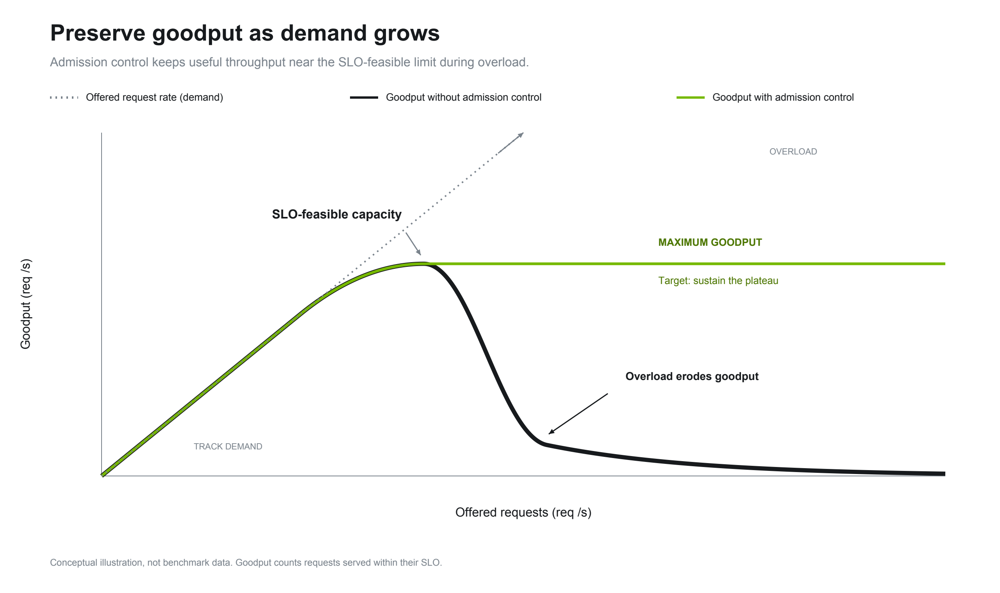
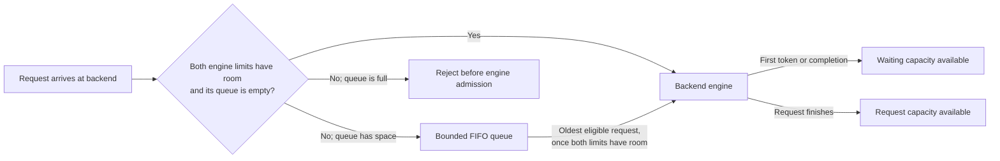

NVIDIA Dynamo admission control aims to preserve useful service under load and govern how competing
requests share capacity.

For deployment instructions, see [Admission Control on Kubernetes](../../../../kubernetes/fault-tolerance/admission-control.md).

## Goal

Admission control protects **goodput** and **quality of service (QoS)** by deciding which requests
to admit, delay, or reject before they consume engine capacity.

**Goodput:**

- **Useful throughput:** sustain the rate of successful requests that meet their service-level
  objectives (SLOs).
- **Overload protection:** bound concurrent work and backlog so excess demand does not overwhelm
  serving resources.

**Quality of service (QoS):**

- **Priority:** favor requests according to the provider's priorities and service objectives when
  capacity is contested.
- **Fairness:** share capacity among competing request classes according to provider-defined shares,
  preventing one class from monopolizing service.

The graph illustrates the goodput goal: useful work should remain near sustainable capacity as
demand grows.



This graph illustrates the goal; it is not benchmark data or a guarantee for every workload. The
backend gate provides local capacity protection; priority and fairness policies across request classes
are planned at the router.

## Backend

Backend admission control supports both Dynamo Python and Dynamo Sidecar backends. Each worker has
its own gate, including separate prefill and decode workers in a disaggregated deployment. All
endpoints of a worker share its gate.

### Request Flow

The gate keeps excess work outside the engine using two limits and a bounded first-in, first-out
(FIFO) queue:

| Limit | What it controls |
|---|---|
| Engine request limit | How many requests can be at the engine from admission until they finish. |
| Engine request waiting limit | How many admitted requests can still be waiting for their first generated token or completion. |

A new request enters the engine immediately only when both limits have room and its queue is empty.
Otherwise, it waits in the queue without using engine capacity. As capacity becomes available, the gate admits the
oldest queued request that fits. When the queue is full, the gate rejects new requests before they
reach the engine.



Waiting ends at the first generated token or completion, whichever comes first, for every worker.
A request can complete without generating a token. Once waiting ends, the request still counts toward
the engine request limit until its response stream ends. Interim metadata does not end the wait.

Cancelled queued requests are removed and free their queue space. Requests that finish, fail, or are
cancelled at the engine free their remaining capacity. The gate does not preempt engine work or
enforce a queue waiting-time limit.

**Data-parallel ranks.** Each data-parallel (DP) rank has its own limits and FIFO queue. A request with
a specified, recognized rank uses that rank's queue and limits. A busy rank does not prevent another
rank with available capacity from admitting work.

Requests without a specified or recognized rank use a shared queue and draw from the combined capacity
of all ranks. They do not get extra capacity or count against every rank. Ranked requests must fit
both their own rank's limits and the remaining combined capacity; unranked requests need only fit the
combined capacity. These rules apply to both engine limits and queue space, so ranked and unranked
requests can hold each other back when the worker's combined capacity is full.

**Rejection scope.** Every rejection reaches the client as an overload, HTTP 529 by default. When the
worker could still admit or queue other requests, such as requests for another rank, the rejection
names the rejected request's rank, and the Frontend keeps routing new requests to the worker. When the
worker could neither admit nor queue any request, the rejection applies to the whole worker, and the
Frontend stops routing new requests to it for up to one second. Rejections of unranked requests always
apply to the whole worker.

### Configuration

> [!NOTE]
> **Tune these limits to your traffic shape.** The engine-based defaults are starting points; validate
> the limits with representative request sizes, concurrency, and bursts, watching goodput and latency.
> Dynamic adaptation to changing traffic is planned as separate router work.

Set these on the backend worker. All values apply **per DP rank**; the worker's total capacity is the
combined capacity of its ranks. Restart the worker to change an explicit setting.

| Setting | Environment variable | Also configured by | Default |
|---|---|---|---|
| Engine request limit | `DYN_BACKEND_ADMISSION_ENGINE_REQUEST_LIMIT` | `--engine-request-limit`; alias `DYN_ENGINE_REQUEST_LIMIT` | Engine-reported `max_num_seqs`; `10000` until reported. |
| Engine request waiting limit | `DYN_BACKEND_ADMISSION_ENGINE_REQUEST_WAITING_LIMIT` | Alias `DYN_BACKEND_ADMISSION_ENGINE_WAIT_LIMIT` | Engine-reported `max_num_seqs`; `10000` until reported. |
| Request queue limit | `DYN_BACKEND_ADMISSION_REQUEST_QUEUE_LIMIT` | Alias `DYN_DYNAMO_REQUEST_QUEUE_LIMIT` | Twice the engine-reported `max_num_seqs`; `20000` until reported. |

Both engine limits accept positive integers. The queue limit accepts non-negative integers; `0`
disables queueing, so requests that cannot enter immediately are rejected.

An explicit `--engine-request-limit` takes precedence over environment variables. Each canonical
variable takes precedence over its alias. Invalid environment values log a warning and fall back to
the next source; an invalid CLI value fails startup.

Defaults follow the engine's reported capacity, while explicit settings remain fixed. Until the engine
reports its ranks, the gate assumes one rank and handles all requests as unranked. Each setting is
independent: overriding an engine limit does not change the queue default.

### Best Practices

**Start with the engine-based defaults.** Both engine limits default to `max_num_seqs` per rank,
keeping excess work outside the engine once that many requests are admitted. Raising the limits does
not increase the engine's batch capacity.

**Adjust engine limits only for your workload.** Use the request limit to bound ongoing work,
including requests already streaming, and the waiting limit to bound work still awaiting a first token
or completion. Validate changes under representative load, watching goodput and latency.

**Keep the default queue unless your bursts require a different size.** The default provides a
backlog of twice `max_num_seqs` per rank. A deeper queue absorbs longer bursts at the cost of longer
waits; the gate does not reject requests based on how long they have waited. Set the limit to `0`
for immediate rejection when engine capacity is unavailable.

#### Size the waiting limit with Little's law

[Little's law](https://web.mit.edu/urban_or_book/www/book/chapter4/4.4.html) relates average occupancy,
arrival rate, and time spent in a stage:

```text
L = C × W
```

For the engine waiting stage, `L` is the average number of waiting requests, `C` is the admission
rate in requests per second, and `W` is the mean time in seconds from admission to the first generated
token or completion.

Measure a warmed-up worker at the highest steady load that meets your latency SLO. During this
calibration, keep both engine limits high enough that the gate does not constrain admission, and
confirm there is no gate queueing or rejection. Measure prefill and decode workers separately.

For one worker and one known `dp_rank`, use the same steady interval to measure:

- `L`: the time average of `dynamo_backend_admission_engine_request_waiting_count`.
- `C`: the rate of `dynamo_backend_admission_request_admit_total`, summed across
  `source="direct"` and `source="queue"`.

Then `L / C` estimates `W`. This window includes engine queueing and downstream prefill waits after
admission, but excludes the gate queue and earlier upstream processing. Frontend TTFT therefore
measures a different window. Use a run with negligible failures and cancellations, since those also
release waiting capacity. The result is a mean, not a median or percentile.

Round `C × W` up to get an initial candidate for
`DYN_BACKEND_ADMISSION_ENGINE_REQUEST_WAITING_LIMIT`—equivalently, round the measured `L` up.
For example, 50 requests/second with a mean wait of 0.24 seconds gives 12 waiting requests on average.
Validate that candidate under representative load and bursts: a hard limit at the average occupancy
can reduce throughput, and the mean does not bound tail latency. Adjust while checking goodput and
latency percentiles.

For multi-rank workers, `dp_rank="unspecified"` does not reveal how the engine distributes those
requests across ranks, so it cannot provide a per-rank sizing estimate.

### Metrics

Each worker exposes the following metrics. In the **Labels** column, `dp_rank` is the rank ID, such as
`"4"`, or `"unspecified"` for unranked requests.

| Metric | Type | Labels | Meaning |
|---|---|---|---|
| `dynamo_backend_admission_engine_request_count` | Gauge | `dp_rank` | Requests admitted to the engine that have not finished. |
| `dynamo_backend_admission_engine_request_waiting_count` | Gauge | `dp_rank` | Admitted requests still awaiting their first generated token or completion. |
| `dynamo_backend_admission_request_queue_count` | Gauge | `dp_rank` | Requests waiting outside the engine in gate queues. |
| `dynamo_backend_admission_request_receive_total` | Counter | `dp_rank` | All requests received by the gate, counted once regardless of outcome. |
| `dynamo_backend_admission_request_admit_total` | Counter | `dp_rank`, `source="direct"` or `source="queue"` | Requests passed into the engine, directly or after queueing. |
| `dynamo_backend_admission_rejection_total` | Counter | `dp_rank` | Requests the gate could neither admit nor queue. |
| `dynamo_backend_admission_cancellation_total` | Counter | `dp_rank` | Requests cancelled before engine admission. |

Each request is counted under one `dp_rank` value. Sum across all values, including `unspecified`, for
worker totals.

Compare engine and queue counts with their configured limits to identify where work accumulates.
Watch admission and rejection rates alongside client-visible goodput when tuning under load.

## Router

Router policies for SLO-aware admission, priority, and fair sharing across request classes are planned
for future work.
