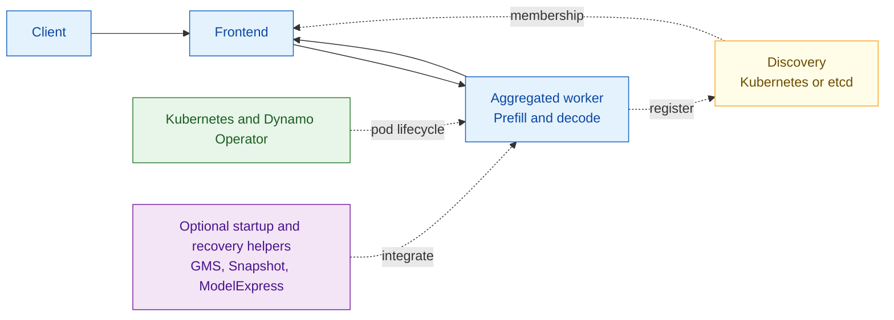
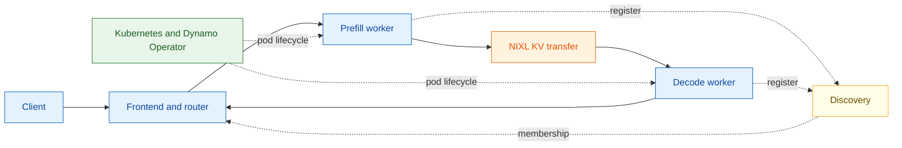
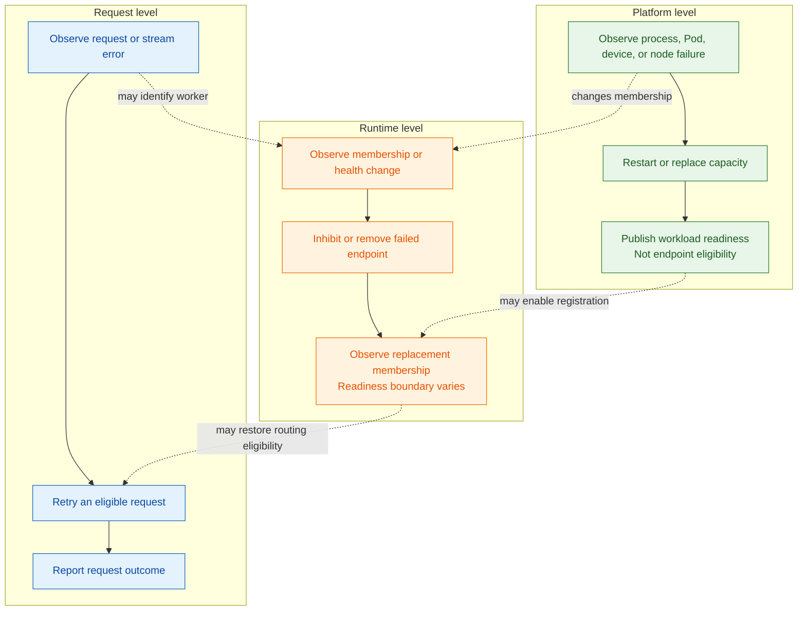

Dynamo fault tolerance spans requests, runtime and discovery, inference engines,
and the deployment platform. Each layer detects and handles different failures.
Dynamo does not yet coordinate them through one recovery policy.

This page documents current behavior and known coverage limits.

The diagrams show Kubernetes deployments. Local deployments use the same
application layers, but rely on a process supervisor instead of Kubernetes to
restore failed processes.

## Diagram Legend

Colors identify system responsibilities:

| Color | Meaning |
| --- | --- |
| Blue | Client requests, Frontend actions, and inference workers |
| Orange | Runtime coordination or KV transfer |
| Yellow | Discovery and membership |
| Green | Kubernetes and Dynamo Operator lifecycle actions |
| Purple | Optional startup or recovery features |

## Aggregated Serving

An aggregated worker performs both prefill and decode. Discovery tells the
Frontend which workers are available.

With compatible spare capacity, request migration can retry eligible interrupted
requests elsewhere. Without a spare worker, the request fails while Kubernetes
restores capacity.

## Disaggregated Serving

Disaggregated serving uses separate prefill and decode pools. NIXL transfers KV
state between the selected workers, while discovery tracks available endpoints.

NIXL transfers state but does not restore failed capacity. Request, worker-pool,
and multi-rank failures are handled independently.

## System-Level Views

The request, runtime, and platform layers see different parts of the same
failure. No layer currently owns the complete recovery process.

The request layer can retry eligible work, the runtime controls endpoint
eligibility, and the platform restores capacity. The exact conditions for
returning an endpoint to traffic vary by backend. Dynamo does not define one
cross-backend return-to-service contract.

## Component Responsibilities

| Component | Role in the healthy path | Failure signal | Action owned today |
| --- | --- | --- | --- |
| Frontend | Accepts, preprocesses, routes, and streams requests | Request setup or stream error and Frontend health state | Retry eligible requests when migration is enabled. Reject or fail requests that cannot migrate |
| Distributed runtime | Registers endpoints and maintains the client routing view | Discovery membership update or request-path failure | Remove endpoints from routing through discovery. Temporarily inhibit a failed worker locally |
| Router | Selects aggregated, prefill, or decode workers | Discovery, load, and request errors | Select another available endpoint for a new attempt. It does not restore failed capacity |
| Backend worker and inference engine | Executes prefill or decode and reports endpoint readiness | Process exit, engine error, health-check failure, or backend-specific error | Stop serving or exit. Backend-specific cleanup and recovery behavior varies |
| Kubernetes | Schedules Pods and evaluates liveness and readiness probes | Container exit, failed probe, Pod eviction, or node loss | Restart or replace Pods according to workload policy |
| Dynamo Operator | Reconciles the graph and reports deployment state | Kubernetes resource status and controller reconciliation errors | Reconcile desired replicas and publish graph, component, restart, rolling-update, and checkpoint status |
| NIXL | Transfers KV cache data between disaggregated workers | Backend-visible transfer or connection error | Report transport failure to the caller. It does not choose a recovery strategy |
| Planner | Computes desired capacity from load signals | Missing or stale metrics affect planning inputs | Adjust desired replica counts. It is not a failure-recovery coordinator |

See [Distributed Runtime](../system-architecture/architecture.md#distributed-runtime)
for discovery and lease behavior, and the [Health Check Reference](../../../../reference/observability/health-checks.mdx)
for runtime health states and active canaries.

## Recovery Features

These features reduce interruption or startup time, but they do not form one
shared recovery policy.

| Feature | Current behavior | Boundary |
| --- | --- | --- |
| GPU Memory Service (GMS) | Keeps supported GPU allocations outside the engine process and lets supported backends attach to them | GMS manages GPU memory lifetime. It does not configure active and standby engines or preserve requests |
| Shadow Engine Failover | Runs an active and standby engine workflow on the same healthy node and GPU allocation by using GMS-owned weights | Experimental. It handles selected process failures only. It does not preserve in-flight requests or KV cache, and it does not cover GMS, GPU, or node loss |
| Dynamo Snapshot | Uses the standalone Snapshot operator to capture and restore `PodSnapshot` resources | Experimental. DGD checkpoint settings control capture and startup policy. Snapshot does not select a failed worker recovery strategy |
| ModelExpress | Streams model weights GPU-to-GPU to reduce replacement startup time | It does not detect failure, create replacement capacity, or establish application readiness |
| NATS | Carries request or event traffic when selected | Failure handling belongs to the NATS deployment and the calling component |

See the [Fault Tolerance Overview](../../../../kubernetes/fault-tolerance/introduction.md#worker-fault-tolerance)
for Shadow Engine Failover, the [Snapshot workflow](../../../../kubernetes/model-deployment/model-loading/snapshot.mdx)
for `PodSnapshot` startup behavior, and the [GPU Memory Service architecture](https://github.com/ai-dynamo/dynamo/blob/main/lib/gpu_memory_service/README.md)
for its memory-lifetime model.

## Common Compositions and Limits

Current mechanisms can be combined without forming one shared recovery policy.

| Composition | Mechanisms | Current limit |
| --- | --- | --- |
| Request continuity during worker loss | Compatible spare workers, discovery, local inhibition, and request migration | Only eligible requests migrate, and compatible spare capacity must remain |
| Planned rollout or scale-down | Graceful shutdown, sufficient Pod termination time, and request migration | Kubernetes can terminate the Pod when its deadline expires |
| Disaggregated pool continuity | Spare prefill and decode capacity, discovery, request migration, and workload replacement | Transfer failure or loss of an entire pool can still fail a request |
| Same-node process recovery | Shadow Engine Failover with GMS on a supported backend and topology | Does not preserve requests or KV cache and does not cover GPU or node loss |
| Initialized-worker startup | Snapshot with a compatible artifact and supported backend | Accelerates startup but does not select failed-worker recovery |
| Model-loading acceleration | ModelExpress with replacement capacity and backend readiness checks | Faster loading does not establish application readiness |
| Tensor-parallel or multinode capacity restoration | Backend-specific recovery with the configured workload provider | Rank and cohort recovery behavior varies by backend and provider |

## Detection and Action Ownership

| Failure scope | First observable signal | Detection owner | Action owner | Traffic behavior |
| --- | --- | --- | --- | --- |
| Request cannot connect to a worker | Request-plane error | Frontend or calling runtime client | Frontend migrator, when enabled | Failed worker is locally inhibited. An eligible request retries elsewhere |
| Worker fails during generation | Stream error or termination | Frontend and runtime. Kubernetes also observes the Pod | Frontend handles the request. Kubernetes restores capacity | Eligible requests migrate. New routing follows discovery |
| Planned worker termination | `SIGTERM` or `SIGINT` | Worker process and Kubernetes | Worker drains and unregisters. Kubernetes completes the rollout or scale-down | New work stops before admitted work drains |
| Worker endpoint becomes stale | Discovery lease expiry or Kubernetes membership update | Discovery backend | Distributed runtime | Endpoint leaves normal routing |
| Active health canary fails | Inference request timeout or error | Runtime health-check client | Runtime client and request owner | Failed endpoint is inhibited locally while discovery remains authoritative |
| Engine process exits | Process and Pod state | Backend wrapper and Kubernetes | Backend cleanup, then Kubernetes restart or replacement | Capacity is unavailable until a ready endpoint registers |
| GPU or node fails | Device plugin, node, Pod, or infrastructure status | Kubernetes and cluster health integrations | Kubernetes and the configured workload provider | Affected endpoints disappear. Replacement behavior depends on deployment policy |
| Tensor-parallel rank fails | Engine or collective failure | Inference engine and process group | Backend and configured workload provider | The cohort is unavailable. Replacement behavior depends on the backend and provider |
| Shadow engine fails over | Active engine process exit and failover state | Operator failover workflow and backend integration | Standby engine workflow | New traffic waits for the standby engine. In-flight requests and KV cache are not preserved |
| Snapshot capture or restore fails | `SnapshotJob`, `PodSnapshot`, and Pod status | Standalone Snapshot operator and Dynamo Operator | Snapshot operator handles artifacts. DGD startup policy controls serving replica startup | `WaitForCheckpoint` keeps serving replicas gated. `Immediate` starts them cold |
| NIXL transfer fails | Backend transfer error | Backend and NIXL | Request owner and backend | The request fails or migrates when eligible. NIXL does not restore the worker |
| ModelExpress model loading fails | Loader, stream, or backend startup signal | ModelExpress or backend integration, depending on the failure | Deployment or backend integration, depending on the configured fallback | ModelExpress does not establish backend readiness or endpoint eligibility |
| NATS request or event transport fails | Client or transport signal | NATS client or calling component | NATS deployment or calling component | Recovery behavior depends on the affected request or event plane |

Detection and recovery can have different owners. The Frontend may detect and
retry a broken request, while Kubernetes restores the lost capacity.

## Endpoint Removal and Rejoin

Discovery controls normal endpoint selection. A request failure can temporarily
inhibit an endpoint without waiting for discovery membership to change. Removal,
replacement, and return-to-service ordering vary by backend and deployment.

| Mechanism | Removal from traffic | Recovery or replacement | Return to service | Status |
| --- | --- | --- | --- | --- |
| Runtime discovery | Membership loss or local inhibition removes or suppresses an endpoint | A replacement is created outside discovery | Registration and membership propagation make the endpoint visible again | Registration order is backend-specific. Dynamo does not define one return-to-service sequence |
| Kubernetes workload | Failed Pod or node removes capacity | Kubernetes or the configured workload provider restarts or replaces capacity | Pod readiness and Dynamo endpoint eligibility are separate checks | Current platform boundary. Application readiness is component-specific |
| Shadow Engine Failover | Failed active engine stops serving | A standby engine takes over on the same healthy node and GPU allocation | Backend and endpoint health must succeed before traffic returns | Detection and readiness span Operator and backend-specific signals |
| ModelExpress-assisted startup | ModelExpress does not control removal from normal routing | Retry and fallback behavior are backend-specific | Backend and runtime determine readiness and registration | Dynamo does not define one ModelExpress fallback or registration sequence |
| NATS transport | The affected request or event path may become unavailable without removing worker membership | Deployment and client recovery are plane-specific | Calling components resume when the required transport path is usable | Dynamo does not define one recovery sequence across request and event planes |

See [Distributed Runtime](../system-architecture/architecture.md#distributed-runtime)
for discovery and lease behavior, [Request Migration](../../../../kubernetes/fault-tolerance/request-migration.md)
for local inhibition and retry, and the [Health Check Reference](../../../../reference/observability/health-checks.mdx)
for endpoint health states.

## Deployment and Failure Matrix

| Deployment shape | Failure unit | Current continuity mechanism | Capacity restoration | Current gap |
| --- | --- | --- | --- | --- |
| Aggregated, one worker on one node | Worker process or Pod | None for requests without another destination | Kubernetes restart or replacement | No service capacity during restart |
| Aggregated, multiple workers on one node | Worker process or Pod | Request migration and discovery-based rerouting | Kubernetes restart or replacement | A node failure removes every colocated worker |
| Aggregated, multiple workers across nodes | Worker process, Pod, or node | Request migration and discovery-based rerouting when compatible capacity remains | Kubernetes restart or replacement | No shared recovery history across request and platform actions |
| Disaggregated prefill and decode on one node | Individual prefill or decode worker, process, or Pod | Discovery rerouting and request migration when the request is eligible | Kubernetes restores the affected pool | A node failure can remove both pools |
| Disaggregated prefill and decode across nodes | Individual worker, pool capacity, Pod, or node | Discovery rerouting and request migration when compatible pool capacity remains | Kubernetes restores the affected pool | No common operation coordinates request, KV-transfer, and worker recovery |
| Tensor parallelism with all ranks on one node | Rank, process, Pod, or complete cohort | Engine-specific failure handling | Backend and workload-provider behavior is implementation-specific | One node failure removes the cohort. Fixed-rank recovery support is backend-specific |
| Tensor parallelism across nodes | Rank, process, Pod, node, or complete cohort | Engine-specific failure handling | Cohort-recreation behavior depends on the backend and workload provider | Dynamo does not define common fixed-rank or cohort-recovery behavior |
| Worker with GMS | Engine process on the same GPU | Backend-specific memory reuse | Process supervisor or Kubernetes | GMS alone does not configure failover |
| Worker with Shadow Engine Failover | Active engine process on the same healthy node and GPU allocation | Standby engine takes over by using GMS-owned weights | Shadow Engine Failover workflow | No in-flight request or KV-cache preservation. No coverage for GMS, GPU, or node loss |
| Worker with Snapshot | New Pod startup | Restore from a ready compatible checkpoint | Dynamo Operator, Snapshot, and Kubernetes | Artifact readiness is tracked separately from runtime failure recovery |
| Worker with ModelExpress | New Pod startup | Faster weight delivery | Kubernetes plus ModelExpress | Startup acceleration does not verify application readiness |
| Deployment using NATS | Request or event transport path | Calling-component retry or NATS deployment recovery, when configured | NATS deployment and calling component | Dynamo does not define common recovery behavior across request and event planes |

## Enablement and Status

| Mechanism | Default or enablement | Primary status surface |
| --- | --- | --- |
| Request migration | Off by default. Set `--migration-limit` or `DYN_MIGRATION_LIMIT` on the Frontend | Frontend migration metrics |
| Local worker inhibition | On by default for five seconds. Configure `DYN_RUNTIME_INHIBITED_DURATION_SECS` | Runtime logs and routing behavior |
| Graceful shutdown | On by default for Dynamo workers | Process logs, endpoint discovery, and Pod status |
| Active worker canaries | Runtime default is off. Operator-managed workers targeting Dynamo runtime 1.5.0 or newer default to on unless explicitly overridden | Runtime logs, health payloads, and request errors |
| Kubernetes restart and replacement | Defined by the generated workload and Kubernetes policy | Pod, workload, and DGD status |
| Shadow Engine Failover | Experimental. Enable the failover and GMS fields for a supported backend and topology | Failover state, backend logs, and endpoint health |
| Snapshot startup | Experimental. Configure DGD checkpoint support and select `Immediate` or `WaitForCheckpoint` | `SnapshotJob`, `PodSnapshot`, Pod readiness, and DGD status |
| GMS memory reuse | Configure the backend GMS load format and integration flags | GMS lock state, backend logs, and engine readiness |
| ModelExpress loading | Configure the backend ModelExpress loader and server | Backend startup logs and Pod readiness |
| NATS transport | Configure NATS for the selected request or event path | NATS deployment status, client logs, and affected component status |

Use the [Health Check Reference](../../../../reference/observability/health-checks.mdx)
for endpoint payloads and canary settings. See [Request Migration](../../../../kubernetes/fault-tolerance/request-migration.md)
and [Graceful Shutdown](../../../../kubernetes/fault-tolerance/graceful-shutdown.md)
for deployment procedures.

Canary defaults depend on how the worker is launched and which runtime version
the Operator resolves. See the [Dynamo v1.5.0 release notes](../../../../reference/general/releases/dynamo-v1-5-0.mdx#kubernetes-deployment)
and [Health Check Reference](../../../../reference/observability/health-checks.mdx#active-canary-configuration).

## Current Coverage Limits

| Area | Current documented limit |
| --- | --- |
| Endpoint lifecycle | Removal and return-to-service signals vary by backend. Dynamo does not define one cross-backend sequence |
| Replacement readiness | Kubernetes Pod readiness and Dynamo endpoint eligibility are separate. Dynamo does not define one end-to-end replacement-readiness contract |
| ModelExpress fallback | Retry, fallback, and registration behavior vary by backend integration |
| NATS recovery | Failure and recovery behavior depend on the request or event plane, NATS deployment, and calling component |
| Tensor-parallel and multinode recovery | Rank recovery and cohort recreation depend on the backend and workload provider |

## Related Documentation

- [Fault Tolerance Overview](../../../../kubernetes/fault-tolerance/introduction.md)
- [Request Migration Architecture](request-migration-architecture.md)
- [Graceful Shutdown Architecture](graceful-shutdown-architecture.md)
- [Fault Tolerance Testing](fault-tolerance-testing.md)
- [Distributed Runtime](../system-architecture/architecture.md#distributed-runtime)
