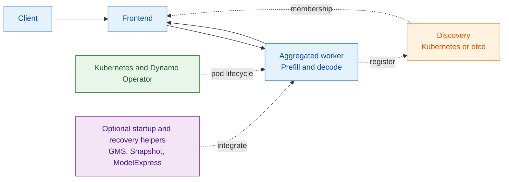
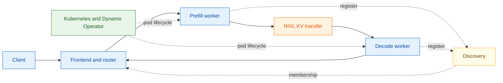
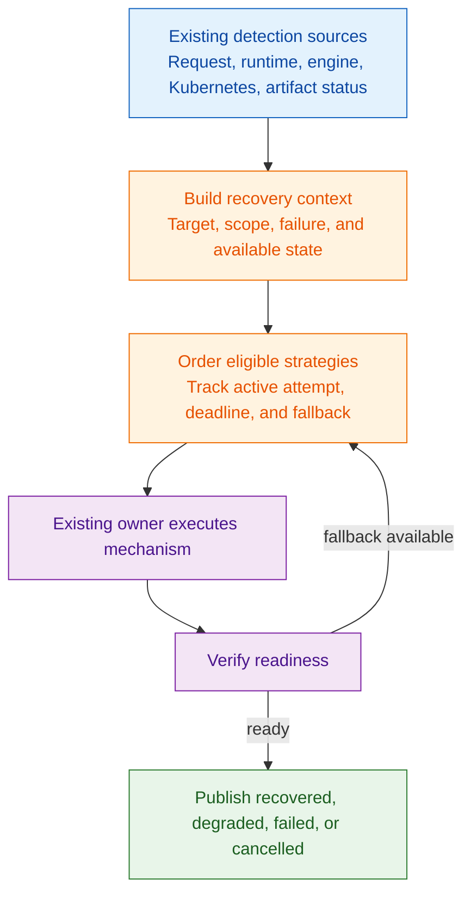

NVIDIA Dynamo fault tolerance spans the request path, distributed runtime,
inference engines, and deployment platform. Each layer owns specific signals and
actions. Dynamo does not currently combine them into one recovery operation or
fallback policy.

This page maps the current component boundaries and separates them from the
proposed common recovery contract.

The diagrams show Kubernetes deployments because the Dynamo Operator exposes
the broadest lifecycle and status surface. Local deployments use the same
Frontend, runtime, discovery, and worker boundaries, but a process supervisor
must restore failed processes.

## Aggregated Serving

An aggregated worker performs prefill and decode. Discovery keeps the Frontend's
routing view synchronized with available workers.

With more than one compatible worker, request migration can retry an eligible
interrupted request on another worker. With one worker, migration has no
alternate destination; Kubernetes must restore capacity or the request fails.

## Disaggregated Serving

Disaggregated serving adds independent prefill and decode pools. A NIXL transfer
connects the selected workers for each request, while discovery tracks pool
membership.

NIXL transports KV cache state but does not own deployment recovery policy.
Failures can affect one request, one worker pool, or a multi-rank engine cohort.
The current mechanisms handle those scopes independently.

## Component Responsibilities

| Component | Role in the healthy path | Failure signal | Action owned today |
| --- | --- | --- | --- |
| Frontend | Accepts, preprocesses, routes, and streams requests | Request setup or stream error; Frontend health state | Retry eligible requests when migration is enabled; reject or fail requests that cannot migrate |
| Distributed runtime | Registers endpoints and maintains the client routing view | Discovery membership update or request-path failure | Remove endpoints from routing through discovery; temporarily inhibit a failed worker locally |
| Router | Selects aggregated, prefill, or decode workers | Discovery, load, and request errors | Select another available endpoint for a new attempt; it does not restore failed capacity |
| Backend worker and inference engine | Executes prefill or decode and reports endpoint readiness | Process exit, engine error, health-check failure, or backend-specific error | Stop serving or exit; backend-specific cleanup and recovery behavior varies |
| Kubernetes | Schedules Pods and evaluates liveness and readiness probes | Container exit, failed probe, Pod eviction, or node loss | Restart or replace Pods according to workload policy |
| Dynamo Operator | Reconciles the graph and reports deployment state | Kubernetes resource status and controller reconciliation errors | Reconcile desired replicas and publish graph, component, restart, rolling-update, and checkpoint status |
| NIXL | Transfers KV cache data between disaggregated workers | Backend-visible transfer or connection error | Report transport failure to the caller; it does not choose a recovery strategy |
| Planner | Computes desired capacity from load signals | Missing or stale metrics affect planning inputs | Adjust desired replica counts; it is not a failure-recovery coordinator |

## Optional Components

| Component | Current use | Recovery boundary |
| --- | --- | --- |
| GPU Memory Service (GMS) | Preserves GPU allocations outside an engine process and supports engine pause and resume for vLLM and SGLang | Supports same-node memory reuse and shadow-engine patterns. It does not replace Kubernetes or define a cluster-wide fallback policy |
| Dynamo Snapshot | Captures initialized workers and restores later Pods from a compatible artifact | Experimental. The operator tracks checkpoint readiness and can gate startup with `WaitForCheckpoint`; this is not automatic failed-worker recovery |
| ModelExpress | Streams model weights GPU-to-GPU to reduce worker startup time | Accelerates reconstruction but does not detect failure, select a replacement, or verify service readiness |
| NATS | Carries request or event traffic when selected | Transport availability affects the corresponding plane; recovery depends on the NATS deployment and the calling component |

See [Restore Workers with Dynamo Snapshot](../../../../kubernetes/model-deployment/model-loading/snapshot.mdx)
for the current Snapshot workflow and the
[GPU Memory Service architecture](https://github.com/ai-dynamo/dynamo/blob/main/lib/gpu_memory_service/README.md)
for its lock and memory-lifetime model.

## Recommended Combinations

These combinations compose existing mechanisms. They do not provide a common
recovery lifecycle or fallback policy.

| Goal | Recommended combination | Constraint |
| --- | --- | --- |
| Preserve eligible requests during worker loss | Two or more compatible workers, discovery, local inhibition, and Frontend request migration | Migration does not support every request type |
| Protect planned rollouts and scale-downs | Graceful shutdown, a Pod termination budget longer than the internal drain windows, and request migration | Kubernetes can still force termination after its deadline |
| Keep disaggregated serving available | Redundant prefill and decode capacity, discovery, request migration, and Kubernetes replacement | A request can still fail when KV transfer or an entire pool is unavailable |
| Reduce same-host engine restart time | GMS with a supported vLLM or SGLang integration | GMS preserves memory on one GPU; it does not replace the failed process |
| Reduce initialized-worker startup time | Snapshot with a supported backend and topology | Experimental; artifact compatibility and storage remain prerequisites |
| Reduce model weight loading time | ModelExpress with Kubernetes replacement capacity | Faster loading does not make the worker ready or restore request state |
| Run tensor-parallel or multi-node workers | Kubernetes workload management, health probes, and a provider that recreates the required cohort | Dynamo does not currently replace one failed rank under a common contract |

## Detection and Action Ownership

| Failure scope | First observable signal | Detection owner | Action owner | Traffic behavior |
| --- | --- | --- | --- | --- |
| Request cannot connect to a worker | Request-plane error | Frontend or calling runtime client | Frontend migrator, when enabled | Failed worker is locally inhibited; an eligible request retries elsewhere |
| Worker fails during generation | Stream error or termination | Frontend and runtime; Kubernetes also observes the Pod | Frontend handles the request; Kubernetes restores capacity | Eligible requests migrate; new routing follows discovery |
| Planned worker termination | `SIGTERM` or `SIGINT` | Worker process and Kubernetes | Worker drains and unregisters; Kubernetes completes the rollout or scale-down | New work stops before admitted work drains |
| Worker endpoint becomes stale | Discovery lease expiry or Kubernetes membership update | Discovery backend | Distributed runtime | Endpoint leaves normal routing |
| Active health canary fails | Inference request timeout or error | Runtime health-check client | Runtime client and request owner | Failed endpoint is inhibited locally while discovery remains authoritative |
| Engine process exits | Process and Pod state | Backend wrapper and Kubernetes | Backend cleanup, then Kubernetes restart or replacement | Capacity is unavailable until a ready endpoint registers |
| GPU or node fails | Device plugin, node, Pod, or infrastructure status | Kubernetes and cluster health integrations | Kubernetes and the configured workload provider | Affected endpoints disappear; replacement behavior depends on deployment policy |
| Tensor-parallel rank fails | Engine or collective failure | Inference engine and process group | Engine process and Kubernetes workload controller | The rank cohort is unavailable; Dynamo has no common rank-replacement contract |
| Snapshot capture or restore fails | Snapshot and checkpoint status | Snapshot integration and Dynamo Operator | Operator startup policy and Kubernetes | `WaitForCheckpoint` keeps serving replicas gated; `Immediate` starts them cold |
| NIXL transfer fails | Backend transfer error | Backend and NIXL | Request owner and backend | The request fails or migrates when eligible; NIXL does not restore the worker |

Detection does not imply recovery ownership. For example, the Frontend can
detect a broken request stream and preserve client progress, but Kubernetes owns
replacement capacity.

## Deployment and Failure Matrix

| Deployment shape | Failure unit | Current continuity mechanism | Capacity restoration | Current gap |
| --- | --- | --- | --- | --- |
| Aggregated, one worker | Worker process or Pod | None for requests without another destination | Kubernetes restart or replacement | No service capacity during restart |
| Aggregated, multiple workers | Worker process or Pod | Request migration and discovery-based rerouting | Kubernetes restart or replacement | No shared recovery history across request and Pod actions |
| Disaggregated prefill and decode | Individual prefill or decode worker | Discovery rerouting; request migration when the request is eligible | Kubernetes restores the affected pool | No common operation coordinates request, KV-transfer, and worker recovery |
| Tensor-parallel or multi-node worker | Rank, process, Pod, or node cohort | Engine-specific failure handling | Kubernetes or the configured workload provider recreates the workload | No common fixed-rank or cohort-recovery contract |
| Worker with GMS | Engine process on the same GPU | Backend pause, resume, and GMS memory import | Process supervisor or Kubernetes | Backend support varies; no cluster-wide selection or fallback policy |
| Worker with Snapshot | New Pod startup | Restore from a ready compatible checkpoint | Dynamo Operator, Snapshot, and Kubernetes | Artifact readiness is tracked separately from runtime failure recovery |
| Worker with ModelExpress | New Pod startup | Faster weight delivery | Kubernetes plus ModelExpress | Startup acceleration does not verify application readiness |

## Enablement and Status

| Mechanism | Default or enablement | Primary status surface |
| --- | --- | --- |
| Request migration | Off by default; set `--migration-limit` or `DYN_MIGRATION_LIMIT` on the Frontend | Frontend migration metrics |
| Local worker inhibition | On by default for five seconds; configure `DYN_RUNTIME_INHIBITED_DURATION_SECS` | Runtime logs and routing behavior |
| Graceful shutdown | On by default for Dynamo workers | Process logs, endpoint discovery, and Pod status |
| Active worker canaries | Off by default; set `DYN_HEALTH_CHECK_ENABLED=true` | Runtime logs and request errors |
| Kubernetes restart and replacement | Defined by the generated workload and Kubernetes policy | Pod, workload, and DGD status |
| Snapshot startup | Experimental; enable checkpoint support and select `Immediate` or `WaitForCheckpoint` | DGD `checkpoints`, conditions, and Pod readiness |
| GMS memory reuse | Configure the backend GMS load format and integration flags | GMS lock state, backend logs, and engine readiness |
| ModelExpress loading | Configure the backend ModelExpress loader and server | Backend startup logs and Pod readiness |

Use the [Health Check Reference](../../../../reference/observability/health-checks.mdx)
for endpoint payloads and canary settings. Use
[Request Migration](../../../../kubernetes/fault-tolerance/request-migration.md)
and [Graceful Shutdown](../../../../kubernetes/fault-tolerance/graceful-shutdown.md)
for deployment procedures.

## Proposed Common Recovery Boundary

> [!IMPORTANT]
> The following diagram is a design direction, not implemented behavior. It
> does not assign an owning component, API, or state store.

The proposed boundary would correlate existing signals and mechanisms without
moving their execution responsibilities.

The design must prevent stale or concurrent attempts from restoring traffic to
the same logical worker or rank. It must also preserve the current split where
request owners handle requests, deployment owners restore capacity, and
mechanism-specific integrations execute their own recovery steps.

`DynamoGraphDeploymentRequest` currently describes auto-deployment input, not a
fault-tolerance policy. Recovery presets or requirements on that API remain a
design question. See the
[DynamoGraphDeploymentRequest Reference](../../../../reference/kubernetes-api/dynamo-graph-deployment-request.mdx)
for its current contract.

## Related Documentation

- [Fault Tolerance Overview](../../../../kubernetes/fault-tolerance/introduction.md)
- [Request Migration Architecture](request-migration-architecture.md)
- [Graceful Shutdown Architecture](graceful-shutdown-architecture.md)
- [Fault Tolerance Testing](fault-tolerance-testing.md)
- [Distributed Runtime](../system-architecture/architecture.md#distributed-runtime)
