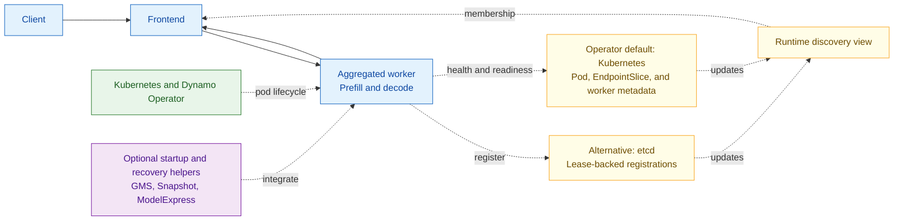
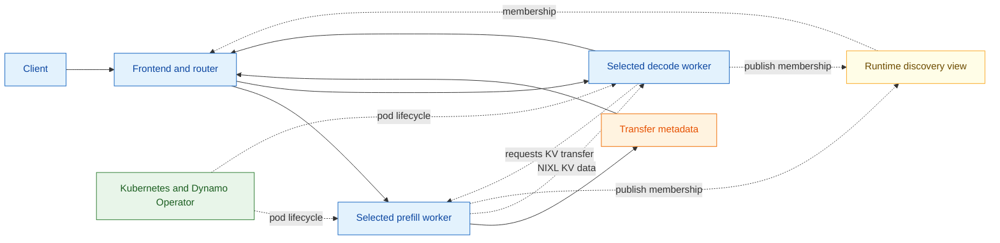
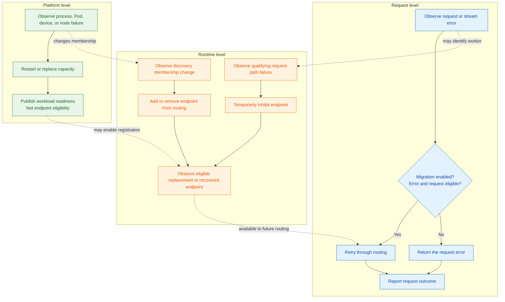

Dynamo fault tolerance spans requests, runtime and discovery, inference engines,
and the deployment platform. Each layer detects and handles different failures.
Dynamo does not yet coordinate them through one recovery policy.

This page documents current behavior and known coverage limits.

The diagrams focus on Kubernetes deployments. The aggregated view includes
etcd as an alternative discovery source. Operator deployments use Kubernetes
discovery. Local deployments use the same application layers, but rely on a
process supervisor instead of Kubernetes to restore failed processes.

## Diagram Legend

Colors identify system responsibilities:

| Color | Meaning |
| --- | --- |
| Blue | Client requests, Frontend actions, and inference workers |
| Orange | Runtime coordination or KV transfer |
| Yellow | Discovery and membership |
| Green | Kubernetes and Dynamo Operator lifecycle actions |
| Purple | Optional startup or recovery features |

## Aggregated Serving

An aggregated worker performs both prefill and decode. Discovery tells the
Frontend which workers are available.

With compatible spare capacity, request migration can retry eligible interrupted
requests elsewhere. Without a spare worker, the request fails while Kubernetes
restores capacity.

## Disaggregated Serving

Disaggregated serving uses separate prefill and decode pools. NIXL transfers KV
state between the selected workers, while discovery tracks available endpoints.

NIXL transfers state but does not restore failed capacity. Request, worker-pool,
and multi-rank failures are handled independently.

## System-Level Views

The request, runtime, and platform layers see different parts of the same
failure. No layer currently owns the complete recovery process.

The request layer classifies retry eligibility, the router selects a destination
for each attempt, the runtime maintains endpoint eligibility, and the platform
restores capacity. Discovery removal and temporary local inhibition are
independent paths. The exact conditions for returning an endpoint to traffic
vary by backend. Dynamo does not define one cross-backend return-to-service
contract.

## Component Responsibilities

| Component | Role in the healthy path | Failure signal | Action owned today |
| --- | --- | --- | --- |
| Frontend | Accepts, preprocesses, routes, and streams requests | Request setup or stream error and Frontend health state | Classify request-path failures and invoke the migrator when migration is enabled and the error and request are eligible. Return an error otherwise |
| Distributed runtime | Maintains the client routing view from discovery membership and local health state | Backend-specific membership event or qualifying request-path failure | Propagate discovery additions and removals. Temporarily inhibit a failed endpoint after a qualifying request-path failure |
| Discovery source | etcd stores lease-backed registrations. Kubernetes publishes Pod, EndpointSlice, and worker metadata state | Lease expiry or Kubernetes resource and readiness change | Supply membership changes to each runtime discovery client. It does not restore failed capacity |
| Router | Selects aggregated, prefill, or decode workers for an initial or retry attempt | Discovery membership, endpoint eligibility, and load state | Select an available destination. The Frontend migrator, not the router, decides whether to retry |
| Backend worker and inference engine | Executes prefill or decode and exposes backend health | Process exit, engine error, health-check failure, or backend-specific error | Stop serving or exit. Runtime registration, backend health, and Kubernetes readiness remain separate signals |
| Kubernetes | Schedules Pods and evaluates liveness and readiness probes | Container exit, failed probe, Pod eviction, or node loss | Restart or replace Pods according to workload policy |
| Dynamo Operator | Reconciles the graph and reports deployment state | Kubernetes resource status and controller reconciliation errors | Reconcile desired replicas and publish graph, component, restart, rolling-update, and checkpoint status |
| NIXL | Transfers KV cache data between disaggregated workers | Backend-visible transfer or connection error | Report transport failure to the caller. It does not choose a recovery strategy |
| Planner | Computes desired capacity from load signals | Missing or stale metrics affect planning inputs | Adjust desired replica counts. It is not a failure-recovery coordinator |

See [Distributed Runtime](../system-architecture/architecture.md#distributed-runtime)
for discovery and lease behavior, and the [Health Check Reference](../../../../reference/observability/health-checks.mdx)
for runtime health states and active canaries.

## Recovery Features

These features reduce interruption or startup time, but they do not form one
shared recovery policy.

| Feature | Current behavior | Boundary |
| --- | --- | --- |
| GPU Memory Service (GMS) | Keeps supported GPU allocations outside the engine process and lets supported backends attach to them | GMS manages GPU memory lifetime. It does not configure active and standby engines or preserve requests |
| Shadow Engine Failover | Uses GMS-owned weights for an active and standby engine workflow. Intra-Pod mode runs two engine containers in one Pod. Inter-Pod mode runs engine pods and a dedicated GMS weight-server Pod per rank | Experimental. Current Shadow workflows do not buffer new requests or preserve in-flight requests and KV cache. Intra-Pod and inter-Pod replacement paths differ, and neither covers GMS, GPU, or node loss |
| Dynamo Snapshot | Uses the standalone Snapshot operator to manage capture resources and the Snapshot node agent to restore Pods and report restore outcomes | Experimental. DGD checkpoint settings control capture and startup policy. Snapshot does not select a failed worker recovery strategy |
| ModelExpress | Streams model weights to reduce replacement startup time. The shared `fetch_model` helper falls back to direct download when it cannot connect, request the model, or resolve the downloaded path | Backend plugin paths can use different fallback behavior. ModelExpress does not detect worker failure, create replacement capacity, or establish application readiness |
| NATS | Provides optional request/reply and event pub/sub transports. TCP is the default request plane. NATS request/reply is a legacy optional path. ZeroMQ (ZMQ) is the default event plane | `DYN_REQUEST_PLANE=nats` and `DYN_EVENT_PLANE=nats` select independent paths. Dynamo does not define one reconnection, retry, or replay guarantee across them |

See the [Fault Tolerance Overview](../../../../kubernetes/fault-tolerance/introduction.md#worker-fault-tolerance)
for Shadow Engine Failover, the [Snapshot workflow](../../../../kubernetes/model-deployment/model-loading/snapshot.mdx)
for `PodSnapshot` startup behavior, and the [GPU Memory Service architecture](https://github.com/ai-dynamo/dynamo/blob/main/lib/gpu_memory_service/README.md)
for its memory-lifetime model.

## Common Compositions and Limits

Current mechanisms can be combined without forming one shared recovery policy.

| Composition | Mechanisms | Current limit |
| --- | --- | --- |
| Request continuity during worker loss | Compatible spare workers, discovery, local inhibition, and request migration | Only eligible requests migrate, and compatible spare capacity must remain |
| Planned rollout or scale-down | Graceful shutdown, sufficient Pod termination time, and request migration | Kubernetes can terminate the Pod when its deadline expires |
| Disaggregated pool continuity | Spare prefill and decode capacity, discovery, request migration, and workload replacement | A transfer error causes migration only when the backend surfaces a migration-eligible request error. Loss of an entire pool can still fail a request |
| GMS-backed engine failover | Shadow Engine Failover on a supported backend and intra-Pod or inter-Pod topology | Current Shadow workflows do not buffer requests or preserve KV cache. Replacement differs by mode and does not cover GMS, GPU, or node loss |
| Initialized-worker startup | Snapshot with a compatible artifact and supported backend | Accelerates startup but does not select failed-worker recovery |
| Model-loading acceleration | ModelExpress with replacement capacity and backend readiness checks | The shared helper has a direct-download fallback, but backend plugin behavior varies. Faster loading does not establish application readiness |
| Tensor-parallel or multinode capacity restoration | Backend-specific recovery with the configured workload provider | Rank and cohort recovery behavior varies by backend and provider |

## Detection and Action Ownership

| Failure scope | First observable signal | Signal source | Observer or propagator | Action owner | Traffic behavior |
| --- | --- | --- | --- | --- | --- |
| Request cannot connect to a worker | Request-plane error | Transport or backend client | Frontend or calling runtime client | Frontend migrator, when enabled | A qualifying failure temporarily inhibits the endpoint. The request retries only when migration is enabled and the error and request are eligible |
| Worker fails during generation | Stream error or termination | Backend or connection | Frontend and runtime. Kubernetes observes Pod state separately | Frontend handles the request. Kubernetes restores capacity | Eligible requests migrate when migration is enabled. New routing follows the runtime discovery view |
| Planned worker termination | `SIGTERM` or `SIGINT` | Kubernetes or process supervisor | Worker process and Kubernetes | Worker attempts to drain and unregister. Kubernetes completes the rollout or scale-down | New work stops before admitted work drains |
| etcd registration becomes stale | Registration lease revocation or expiry | etcd | Runtime etcd discovery client | Distributed runtime | The endpoint leaves routing after the lease change propagates to the client view |
| Kubernetes endpoint becomes stale | Pod, EndpointSlice, worker metadata, or readiness change | Kubernetes API and controllers | Runtime Kubernetes discovery client | Distributed runtime | The endpoint leaves routing after the membership or readiness change propagates to the client view |
| Active health canary fails | Inference request timeout or error | Worker-local inference path | Worker-local runtime `HealthCheckManager` | Worker runtime sets endpoint health to `NotReady` | Routing removal depends on the configured readiness and discovery propagation path |
| Engine process exits | Process and Pod state | Backend wrapper and Kubernetes | Backend integration and Kubernetes | Backend cleanup, then Kubernetes restart or replacement | Capacity remains unavailable until backend health and runtime endpoint eligibility succeed |
| GPU or node fails | Device plugin, node, Pod, or infrastructure status | Kubernetes and configured cluster integrations | Kubernetes and the workload provider | Kubernetes and the configured workload provider | Endpoints leave routing as readiness and membership changes propagate. With etcd discovery, removal follows lease revocation or expiry and watch propagation |
| Tensor-parallel rank fails | Engine or collective failure | Inference engine and process group | Backend integration and workload provider | Backend and configured workload provider | The cohort is unavailable. Replacement behavior depends on the backend and provider |
| Intra-Pod shadow engine fails over | Active engine process exit and failover state | Engine process and failover lock | Backend failover integration | Standby engine workflow | The workflow does not buffer new requests. Serving resumes after the standby becomes healthy and eligible. Earlier requests may fail or migrate when eligible |
| Inter-Pod shadow engine cohort fails | Terminal engine Pod or cohort state | Kubernetes Pod state and failover labels | Failover cascade controller and Grove | Failover cascade controller and Grove | The failed engine group is recreated. The current workflow does not buffer requests or preserve in-flight requests and KV cache |
| Automatic snapshot capture is unavailable or incomplete | `SnapshotJob` and `PodSnapshot` status | Snapshot and Kubernetes resources | Standalone Snapshot operator and Dynamo Operator | Snapshot operator manages capture resources. DGD startup policy controls serving replica startup | Before capture completes, `WaitForCheckpoint` gates serving startup and `Immediate` permits cold startup. Later Pods can restore after the checkpoint becomes ready |
| Selected snapshot restore fails | Restore Pod condition, annotation, status, or logs | Snapshot node agent and Kubernetes | Snapshot node agent reports the restore outcome on the Pod | The Snapshot node agent performs the Pod restore and reports its outcome. Subsequent recovery is deployment-specific | The Pod does not become restored capacity. `Immediate` does not provide cold fallback after restore begins |
| NIXL transfer fails | Backend-visible transfer or connection error | Backend and NIXL | Backend request path | Request owner and backend | The request fails unless the backend surfaces a migration-eligible error and migration is enabled and permitted for the request. NIXL does not initiate migration or restore the worker |
| ModelExpress model loading fails | Connection, download, path-resolution, plugin, or backend startup error | ModelExpress client, backend plugin, or engine startup path | Calling loader or backend integration | The shared `fetch_model` helper falls back to direct download. Plugin and later startup failures follow their backend-specific paths | Model loading does not establish backend readiness or endpoint eligibility |
| Legacy NATS request transport fails | Request/reply client or transport signal | NATS request client | Calling runtime component | Calling component and NATS deployment | The affected request path may fail or apply caller-specific retry. Transport failure does not by itself remove worker membership |
| Optional NATS event transport fails | Publish, subscription, or connection signal | NATS event client | Event producer or consumer | Calling component and NATS deployment | Effects depend on the event consumer. Dynamo does not define one replay or recovery guarantee |

Signal authority, observation, and recovery can have different owners. The
Frontend can classify and retry a broken request while Kubernetes restores lost
capacity. The runtime can update routing only after its selected discovery
source propagates a membership change.

## Endpoint Removal and Rejoin

Discovery controls normal endpoint selection. A request failure can temporarily
inhibit an endpoint without waiting for discovery membership to change. Removal,
replacement, and return-to-service ordering vary by backend and deployment.

| Mechanism | Removal from traffic | Recovery or replacement | Return to service | Status |
| --- | --- | --- | --- | --- |
| etcd runtime discovery | Lease revocation or expiry removes a stale registration from membership | A replacement is created outside discovery and registers with a new lease | Registration and watch propagation make the endpoint visible again | Lease changes and watch propagation are asynchronous |
| Kubernetes runtime discovery | Pod, EndpointSlice, worker metadata, and readiness changes update membership | Kubernetes or the configured workload provider restores capacity | Kubernetes discovery propagates an eligible endpoint into the runtime view | Kubernetes readiness, runtime health, and endpoint eligibility remain separate checks |
| Temporary local inhibition | A qualifying request-path failure suppresses an endpoint in one client | Recovery occurs outside the local inhibition mechanism | The inhibition window expires, or a direct request bypasses it | Local inhibition does not change authoritative discovery membership |
| Intra-Pod Shadow Engine Failover | The failed active engine stops serving | The standby engine wakes against the same GMS-managed allocation | Backend health and endpoint eligibility must succeed before traffic returns | The workflow does not buffer requests while the standby wakes |
| Inter-Pod Shadow Engine Failover | A terminal engine Pod marks its failover group for replacement | The cascade controller removes the failed group, and Grove recreates the cohort | Recreated engines must become healthy and eligible | Cohort recreation differs from intra-Pod standby promotion |
| ModelExpress-assisted startup | ModelExpress does not control removal from normal routing | The shared `fetch_model` path falls back to direct download. Backend plugin fallback varies | Backend and runtime determine health, registration, and eligibility | Dynamo does not define one ModelExpress fallback or registration sequence across load paths |
| Optional NATS transport | A request or event path can become unavailable without removing worker membership | Deployment and client recovery are path-specific | Calling components resume when their selected NATS path is usable | Request/reply and event pub/sub are independent opt-ins with no common replay or recovery contract |

See [Distributed Runtime](../system-architecture/architecture.md#distributed-runtime)
for discovery and lease behavior, [Request Migration](../../../../kubernetes/fault-tolerance/request-migration.md)
for local inhibition and retry, and the [Health Check Reference](../../../../reference/observability/health-checks.mdx)
for endpoint health states.

## Deployment and Failure Matrix

| Deployment shape | Failure unit | Current continuity mechanism | Capacity restoration | Current gap |
| --- | --- | --- | --- | --- |
| Aggregated, one worker on one node | Worker process or Pod | None for requests without another destination | Kubernetes restart or replacement | No service capacity during restart |
| Aggregated, multiple workers on one node | Worker process or Pod | Request migration and discovery-based rerouting | Kubernetes restart or replacement | A node failure removes every colocated worker |
| Aggregated, multiple workers across nodes | Worker process, Pod, or node | Request migration and discovery-based rerouting when compatible capacity remains | Kubernetes restart or replacement | No shared recovery history across request and platform actions |
| Disaggregated prefill and decode on one node | Individual prefill or decode worker, process, or Pod | Discovery rerouting and request migration when the request is eligible | Kubernetes restores the affected pool | A node failure can remove both pools |
| Disaggregated prefill and decode across nodes | Individual worker, pool capacity, Pod, or node | Discovery rerouting and request migration when compatible pool capacity remains | Kubernetes restores the affected pool | No common operation coordinates request, KV-transfer, and worker recovery |
| Tensor parallelism with all ranks on one node | Rank, process, Pod, or complete cohort | Engine-specific failure handling | Backend and workload-provider behavior is implementation-specific | One node failure removes the cohort. Fixed-rank recovery support is backend-specific |
| Tensor parallelism across nodes | Rank, process, Pod, node, or complete cohort | Engine-specific failure handling | Cohort-recreation behavior depends on the backend and workload provider | Dynamo does not define common fixed-rank or cohort-recovery behavior |
| Worker with GMS | Engine process on the same GPU allocation | Backend-specific memory reuse | Process supervisor or Kubernetes | GMS alone does not configure failover |
| Worker with intra-Pod Shadow Engine Failover | Active engine container within one Pod | Standby engine container wakes by using GMS-owned weights | Intra-Pod standby workflow | Current behavior does not buffer requests or preserve in-flight requests and KV cache. It does not cover GMS, GPU, Pod, or node loss |
| Worker with inter-Pod Shadow Engine Failover | Engine Pod or failover cohort | A standby engine Pod can acquire the active role. A terminal cohort is removed and recreated | Inter-Pod failover workflow, cascade controller, and Grove | Current behavior does not buffer requests or preserve in-flight requests and KV cache. It does not cover GMS, GPU, or node loss |
| Worker with Snapshot | New Pod startup | Restore from a ready compatible checkpoint | Dynamo Operator, Snapshot node agent, and Kubernetes | Artifact readiness and restore outcome are tracked separately from runtime failure recovery |
| Worker using the shared ModelExpress fetch path | New Pod startup | Faster weight delivery with direct-download fallback for client, request, and path-resolution failures | Kubernetes, the calling loader, and ModelExpress | Backend plugin paths differ. Startup acceleration does not verify application readiness |
| Deployment using optional NATS transport | Legacy NATS request/reply or optional NATS event pub/sub path | Calling-component handling or NATS deployment recovery | NATS deployment and calling component | TCP requests and ZMQ events remain the defaults. Dynamo does not define common retry, replay, or recovery behavior across the optional NATS paths |

## Enablement and Status

| Mechanism | Default or enablement | Primary status surface |
| --- | --- | --- |
| Request migration | Off by default. Set `--migration-limit` or `DYN_MIGRATION_LIMIT` on the Frontend | Frontend migration metrics |
| Local worker inhibition | On by default for five seconds. Configure `DYN_RUNTIME_INHIBITED_DURATION_SECS` | Runtime logs and routing behavior |
| Graceful shutdown | On by default for Dynamo workers | Process logs, endpoint discovery, and Pod status |
| Active worker canaries | Runtime default is off. Operator-managed workers targeting Dynamo runtime 1.5.0 or newer default to on unless explicitly overridden | Runtime logs, health payloads, and request errors |
| Kubernetes restart and replacement | Defined by the generated workload and Kubernetes policy | Pod, workload, and DGD status |
| Shadow Engine Failover | Experimental. Enable the failover and GMS fields and select a supported intra-Pod or inter-Pod topology | Failover state, engine-group and Pod state, backend logs, and endpoint health |
| Snapshot startup | Experimental. Configure DGD checkpoint support and select `Immediate` or `WaitForCheckpoint` | `SnapshotJob`, a Ready `PodSnapshot`, the restore Pod's `nvidia.com/Restored` condition and `nvidia.com/restore-from` annotation, and DGD status |
| GMS memory reuse | Configure the backend GMS load format and integration flags | GMS lock state, backend logs, and engine readiness |
| ModelExpress loading | Configure the shared fetch path or a backend ModelExpress plugin and server | Client fallback and backend startup logs, Pod readiness, and runtime endpoint eligibility |
| NATS request transport | TCP is the default request plane. NATS request/reply is a legacy optional path. Set `DYN_REQUEST_PLANE=nats` to select it | NATS deployment status, request-client logs, and affected component status |
| NATS event transport | ZMQ is the default. Set `DYN_EVENT_PLANE=nats` to select NATS event pub/sub | NATS deployment status, event-client logs, and affected producer or consumer status |

Use the [Health Check Reference](../../../../reference/observability/health-checks.mdx)
for endpoint payloads and canary settings. See [Request Migration](../../../../kubernetes/fault-tolerance/request-migration.md)
and [Graceful Shutdown](../../../../kubernetes/fault-tolerance/graceful-shutdown.md)
for deployment procedures.

Canary defaults depend on how the worker is launched and which runtime version
the Operator resolves. See the [Dynamo v1.5.0 release notes](../../../../reference/general/releases/dynamo-v1-5-0.mdx#kubernetes-deployment)
and [Health Check Reference](../../../../reference/observability/health-checks.mdx#active-canary-configuration).

## Current Coverage Limits

| Area | Current limit | Failure impact |
| --- | --- | --- |
| Endpoint lifecycle | etcd lease changes and Kubernetes resource changes propagate through different discovery clients. Dynamo does not define one cross-backend removal or return-to-service sequence | A failed endpoint can remain visible until its selected discovery path removes it. A recovered endpoint cannot receive normal traffic until discovery and eligibility converge |
| Replacement readiness | Kubernetes Pod readiness and Dynamo endpoint eligibility are separate. Dynamo does not define one end-to-end replacement-readiness contract | Replacement capacity can exist in Kubernetes before it is available for routing |
| Shadow Engine Failover | Intra-Pod standby activation and inter-Pod cohort recreation use different replacement paths. Current workflows do not buffer requests or preserve KV cache. Neither covers GMS, GPU, or node loss | Earlier requests and KV cache can be lost. A GMS, GPU, or node failure leaves the Shadow workflow without covered replacement capacity |
| NIXL transfer failure | NIXL reports transfer failure. Request migration occurs only when the backend surfaces a migration-eligible error and the request remains eligible | The request fails unless the backend maps the error for migration and the request remains eligible |
| ModelExpress fallback | The shared `fetch_model` helper falls back to direct download for client, request, and path-resolution failures. Backend plugin fallback and later startup behavior vary | Replacement startup can fall back to a cold download or fail on paths without the shared fallback. Loading success does not establish readiness |
| NATS recovery | TCP requests and ZMQ events are the defaults. Legacy NATS request/reply and optional NATS event pub/sub have separate callers, and Dynamo does not define one retry, replay, or recovery guarantee across them | An affected optional request or event path can fail without changing worker membership. Retry or event loss depends on the caller |
| Tensor-parallel and multinode recovery | Rank recovery and cohort recreation depend on the backend and workload provider | One rank failure can make the cohort unavailable until the configured backend or provider restores or recreates it |

### Representative Worker Failure Sequence

1. A worker fails during generation, and the Frontend observes a stream error.
2. The Frontend handles that request while the runtime may inhibit the failed
   endpoint. The selected discovery path removes the endpoint separately.
3. Kubernetes restarts or replaces the failed Pod.
4. The replacement becomes routable only after backend health, registration,
   discovery, and endpoint eligibility converge. Pod readiness alone does not
   define that complete boundary.
5. Future requests can use the replacement. No single component coordinates
   the complete request, routing, and capacity-restoration sequence.

## Related Documentation

- [Fault Tolerance Overview](../../../../kubernetes/fault-tolerance/introduction.md)
- [Request Migration Architecture](request-migration-architecture.md)
- [Graceful Shutdown Architecture](graceful-shutdown-architecture.md)
- [Fault Tolerance Testing](fault-tolerance-testing.md)
- [Distributed Runtime](../system-architecture/architecture.md#distributed-runtime)
- [Disaggregated Serving](../system-architecture/disaggregated-serving.md)
- [Runtime Configuration](../../../../reference/components/runtime-configuration.mdx)
- [DynamoGraphDeployment API Reference](../../../../reference/kubernetes-api/dynamo-graph-deployment.mdx)

This page describes architectural guarantees and boundaries. It is not an
exhaustive inventory of open implementation bugs. Known issues remain tracked
in GitHub.
