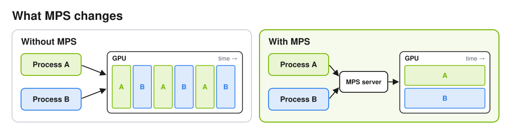

Several models can share one GPU in four ways: time-slicing, HAMi, CUDA Multi-Process Service (MPS), and Multi-Instance GPU (MIG). They differ in two ways: whether the models run at the same time, and which parts of the GPU each model gets for itself. This page explains MPS and compares it with the other three. The GPU fractions configuration in [GPU Sharing](../../../../use-cases/gpu-sharing/overview.mdx) is KAI-Scheduler placing each model on a share of a GPU, with MPS v3 enforcing that share.

## What MPS Is

Without MPS, every process that uses a GPU gets its own CUDA context, and the GPU runs one context at a time. When two models share a GPU this way, one model's kernels wait while the other's run, even if the running model leaves most of the streaming multiprocessors (SMs) idle.

MPS puts an MPS server between the processes and the GPU. Each process connects to the server as a client, and the server submits every client's work through one shared context, so kernels from different clients run on the GPU at the same time. Since Volta, each client keeps its own GPU address space, so one client cannot read another's memory.

MPS limits each client in two ways:

- **Active thread percentage** caps the share of the GPU's SMs a client's kernels can use, such as 30%. It is a ceiling, not a reservation: MPS does not set SMs aside for a client, and when the clients' percentages add up to more than 100%, they compete for the same SMs.
- **Pinned memory limit** caps the GPU memory a client can allocate. An allocation past the limit fails with an out-of-memory error.

MPS can also give a client a **static SM partition**: an exact set of SMs instead of a percentage ceiling. Partitions also change what happens when a model faults, as [MPS Fault Isolation](mps-fault-isolation.md) shows. MPS v3 adds memory limits set per container and per GPU through cgroups. [MPS v2 and v3](mps-v2-and-v3.md) covers what changed and why GPU fractions needs v3.

## Four Ways to Share a GPU

Read the figure from top to bottom. Each row is a GPU resource, and each panel shows whether the two models take turns on it, share it, or get their own part of it. Moving from left to right, the models get more of the GPU at the same time. MIG is the only one that walls off memory bandwidth and the L2 cache. Faults follow a different pattern: time-slicing and HAMi keep each process's faults to itself, MPS shares them by default, and MIG keeps them inside each instance.

| | Time-slicing | HAMi | MPS (GPU fractions) | MIG |
|---|---|---|---|---|
| Models run at the same time | No | No | Yes | Yes |
| Compute limit | None | Optional utilization throttle, by time | Ceiling on the share of SMs (active thread percentage), or an exact SM partition | Fixed SM slices, 1/7 to 7/7 of the GPU |
| Memory limit | None | Per container, enforced by a library loaded into the container | Per client, enforced by MPS | Fixed memory slices |
| Memory bandwidth and L2 cache | Shared | Shared | Shared | Partitioned |
| A memory fault in one model affects | Only that model | Only that model | Every client on the GPU, or only its partition with static SM partitions | Only its own instance |
| Share sizes | Any | Any memory size | Any percentage and memory size | Fixed profiles, up to 7 instances |
| Changing a share | Restart the pod | Restart the pod | Restart the pod | The instance must be empty; on Kubernetes, the GPU is drained and repartitioned |
| On Kubernetes | NVIDIA device plugin time-slicing, equal replicas | HAMi, or KAI-Scheduler with HAMi | NVIDIA device plugin MPS mode (equal replicas, experimental), or KAI-Scheduler GPU fractions (a size per pod) | GPU Operator MIG manager |

### Time-Slicing

Time-slicing is what a GPU does by default when several processes use it. The NVIDIA device plugin can advertise one GPU as several replicas to make this schedulable on Kubernetes, but nothing caps the replicas: they share memory with no limits and take turns on the SMs. Each process keeps its own context, so a fault in one model stops only that model.

### HAMi

HAMi loads a library into each container that intercepts CUDA calls. It enforces a per-container memory cap and can throttle each container's SM utilization over time. The containers still have separate contexts, so the GPU still time-slices between them. In the [GPU fractions benchmark](../../../../use-cases/gpu-sharing/benchmark-gpu-fractions.mdx), KAI-Scheduler with HAMi enforced memory caps only, and the CUDA driver time-sliced the two models.

### MPS

MPS lets the models run at the same time, with a compute ceiling and a memory cap for each. The memory bandwidth, L2 cache, and power budget of the GPU stay shared. Because the clients share the server's context, they also share its faults by default: a memory fault in one client is reported to every client on that GPU, and each of them must exit and restart. Clients on other GPUs are unaffected. Static SM partitions narrow this, as [MPS Fault Isolation](mps-fault-isolation.md) explains.

### MIG

MIG splits the GPU in hardware into up to seven instances, each with its own SMs, memory, memory controllers, L2 cache, and fault domain. It is the only approach here that keeps one model's memory traffic from slowing another, and it gives every instance its own fault domain while the models run at the same time. The cost is flexibility: instances come in fixed profiles, and repartitioning a GPU requires the affected instances to be empty. On an H100 80GB, for example, the profiles are:

| Profile | Share of SMs | Memory | Instances per GPU |
|---|---:|---:|---:|
| `1g.10gb` | 1/7 | 10 GB | 7 |
| `1g.20gb` | 1/7 | 20 GB | 4 |
| `2g.20gb` | 2/7 | 20 GB | 3 |
| `3g.40gb` | 3/7 | 40 GB | 2 |
| `4g.40gb` | 4/7 | 40 GB | 1 |
| `7g.80gb` | 7/7 | 80 GB | 1 |

A model that needs 30% of the SMs and 24 GB gets a `3g.40gb` instance, with 43% of the SMs and 40 GB, and the difference stays unused. [Size Each Model's Share](../../../../use-cases/gpu-sharing/size-each-models-share.mdx#compare-with-mig-profiles) works through what that rounding costs on a real packing.

## MPS Compared With MIG

MIG builds walls, and MPS sets ceilings.

- **Isolation:** MIG partitions everything, including memory bandwidth and faults. MPS caps compute and memory, but a memory-bound neighbor still slows your model, and by default a fault on the GPU affects every model on it. Static SM partitions contain memory faults, but not every kind of fault.
- **Sizing:** MIG offers a fixed menu of profiles. MPS takes any SM percentage and any memory size, so each model gets what it needs and nothing is rounded up.
- **Changing a layout:** MIG instances can be created and destroyed only when nothing runs in them, so on Kubernetes the MIG manager drains a GPU to repartition it. Under MPS, each pod's share is set when the pod starts, so resizing one model restarts that model's pod and leaves its neighbors running.
- **Density:** MIG tops out at seven instances per GPU. An MPS server supports up to 60 client contexts per GPU at the default `CUDA_DEVICE_MAX_CONNECTIONS` of 2.

Choose MIG when tenants must not affect each other. Choose MPS when the models trust each other and the goal is to pack them tightly.

## MPS Compared With KAI + HAMi

Both shared configurations in the [GPU fractions benchmark](../../../../use-cases/gpu-sharing/benchmark-gpu-fractions.mdx) use KAI-Scheduler to place two models on each GPU with half the memory each. The only difference is compute: under HAMi the CUDA driver time-slices the two models, while under GPU fractions MPS runs them at the same time, each capped at half the SMs.

That difference is measurable. With 2 to 32 requests resident on each GPU, GPU fractions kept 63.5% to 87.9% of the dedicated-GPU baseline's throughput, while HAMi kept 44.5% to 72.8%. GPU fractions also had a lower inter-token latency (ITL) than HAMi at every load.

## What MPS Does Not Partition

These resources stay shared under MPS, and they are where co-located models still interfere:

- **Memory bandwidth.** Decoding reads a model's full weights on every step, so decode is usually limited by memory bandwidth, not SMs. Two models on one GPU each read their own weights, and MPS does not divide the bandwidth between them. [Why sharing costs throughput](../../../../use-cases/gpu-sharing/benchmark-gpu-fractions.mdx#how-to-read-the-benchmark) shows the effect.
- **L2 cache.** One model's working set can evict another's.
- **Power.** When every model on a GPU is busy, the GPU can reach its power limit and lower its clocks, so each model's share runs slower than it did when measured alone.
- **The fault domain, by default.** A memory fault in one client affects every client on that GPU, unless the clients run on separate static SM partitions. [MPS Fault Isolation](mps-fault-isolation.md) shows what each configuration contains.

## Next Steps

- [MPS Fault Isolation](mps-fault-isolation.md): which faults reach the other models, and how static SM partitions contain memory faults.
- [MPS v2 and v3](mps-v2-and-v3.md): why per-pod shares on Kubernetes need MPS v3.
- [GPU Sharing](../../../../use-cases/gpu-sharing/overview.mdx): put these ideas to work, from deciding whether to share a GPU to deploying models on GPU fractions.
