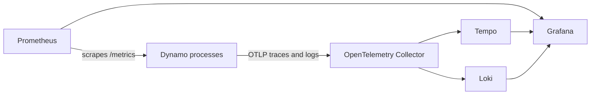
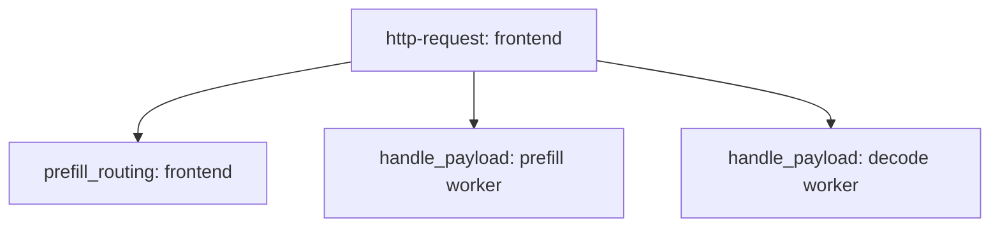
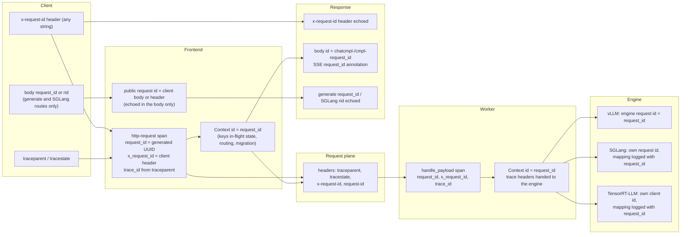
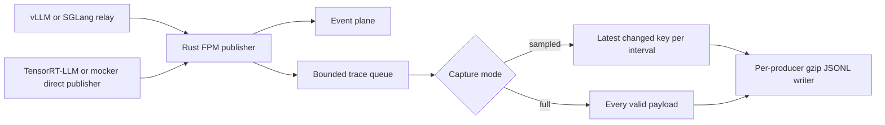
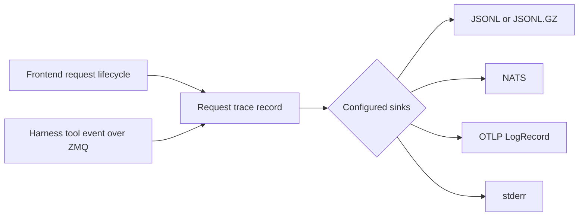

Dynamo uses different transport models for metrics and OpenTelemetry signals. It also separates
passive HTTP status endpoints from active worker checks. This design keeps local and Kubernetes
workflows consistent while allowing each signal to use its native collection model.

## Signal Paths

Metrics use a pull model: each Dynamo process exposes Prometheus text format, and Prometheus scrapes
the endpoint. The frontend exposes metrics on its HTTP port. Workers and standalone routers expose
them through the system-status server when `DYN_SYSTEM_PORT` is enabled.

Traces and logs use a push model. Each participating process exports OTLP records to a collector.
`OTEL_EXPORT_ENABLED` intentionally controls both signals so their trace context stays aligned. The
collector can route the records to different backends, such as Tempo and Loki.

## Trace and Log Correlation

The frontend creates the root `http-request` span for an incoming HTTP request. Dynamo propagates the
trace context over its internal transports, and receiving components create child `handle_payload`
spans. Disaggregated deployments can add routing and backend-specific spans between those layers.

The exact child spans depend on the backend and deployment mode; users should treat span names as
diagnostic structure rather than a stable public API.

Every request carries a server-generated `request_id`, and if a caller supplies `x-request-id`,
Dynamo propagates that too with the trace context. Structured log events emitted inside a request
span can therefore include four correlation keys:

- `request_id` for the Dynamo-generated identifier of the request
- `x_request_id` for the caller's application-level identifier
- `trace_id` for the complete distributed request
- `span_id` for the component-local operation

This is why JSONL logging is required for reliable log-to-trace correlation: the identifiers remain
separate fields instead of being embedded in formatted text.

### Request Identifiers

Three families of identifier are involved in one request, and they stay separate by design. The
caller's identifier is for correlation only. The Dynamo identifier keys functional state. The engine
identifier is whatever the engine needs internally.

| Identifier | Source | Functional use | Logging and tracing | Returned to the caller |
| --- | --- | --- | --- | --- |
| `x-request-id` | Caller header, any string | None; it never keys state | `x_request_id` on the frontend and worker spans and their log events; forwarded in the request plane headers; handed to the engine with the trace headers | Echoed as the `x-request-id` response header |
| `traceparent` / `tracestate` | Caller header | None | Parent of the frontend span; re-injected into the request plane so the worker's `handle_payload` span is a child; handed to the engine so engine spans join the same trace | No |
| `request_id` | Generated UUID on the frontend span; the request context uses the same value | Keys the frontend's in-flight response map, the router's request lifecycle, migration retries (the same value is reused per attempt), and the worker's in-flight map | `request_id` on frontend and worker spans and log events; the `request-id` header on the request plane | The response body `id`; a `request_id` SSE annotation when the request opts in with `nvext.annotations: ["request_id"]` |
| Public request id | Caller body `request_id` or `rid`, or `x-request-id`, on the generate and SGLang routes; the KServe gRPC request `id` | None | Not recorded on spans | Echoed in the generate response body, the SGLang `rid`, and the KServe response `id` |
| Engine request id | vLLM reuses `request_id`; SGLang generates its own per call; TensorRT-LLM uses its own client id | Engine scheduling and abort | Engine logs and metrics; SGLang and TensorRT-LLM log the mapping to `request_id` | No |

The `request-id` request plane header is always set. The `x-request-id`, `traceparent`, and
`tracestate` headers are injected from the trace-context layer, so they reach the worker only when the
sending process runs with JSONL logging, OTLP export, or the legacy `DYN_LOGGING_JSONL=1` switch.

The caller-supplied identifiers are correlation inputs only. Reusing an `x-request-id` across
requests, or sending the `request-id` or `x-dynamo-request-id` headers, does not change how Dynamo
keys or routes a request. For the caller-facing rules, see the
[Logging Reference](../../../reference/observability/logging.mdx#request-correlation).

## Forward Pass Metrics Persistence

Forward Pass Metrics (FPM) tracing branches from the Rust publication path after Dynamo has
validated and normalized the backend payload. The branch is additive: the event-plane publisher
continues independently of the local persistence consumer.

The trace queue is bounded and producer enqueueing is nonblocking. When persistence falls behind,
Dynamo drops trace records instead of delaying inference or event-plane publication. `sampled` mode
coalesces records by `(namespace, component, worker_id, dp_rank)` and writes only changed counters at
the configured interval. `full` mode preserves every accepted payload, including idle heartbeats.

A writer owns one producer-specific file sequence. Rotation uses uncompressed JSONL bytes, retention
applies independently to each producer, and graceful shutdown flushes accepted pending records. These
properties make the files useful for analysis but not equivalent to a durable event log.

## Request Trace Fan-Out

Request tracing separates record creation from destination selection. The frontend creates
`request_end` and optional `request_payload` rows, while a harness can inject tool events through
ZMQ. Dynamo normalizes the rows before sending each one to every configured sink.

The OTLP request-trace sink uses the logs protocol and endpoint resolution rules but does not depend
on the runtime log stream. Selecting `stderr` while configuring an OTLP endpoint does not export the
row; the sink list must include `otel`. Header capture is applied only to payload rows and stores
unredacted allowlisted values.

## Active Worker Health Checks

HTTP `/live` and `/health` endpoints are passive: they report current process and runtime state when
an external system queries them. For LLM workers, active canary checks send a minimal inference
request through an idle worker endpoint, following the lifecycle below. vLLM-Omni workers use a
different default; see
[vLLM-Omni Health Checks](../../../reference/observability/health-checks.mdx#vllm-omni-health-checks).

1. **Observe successful activity.** A response chunk without an error, or a clean end of stream,
   marks the endpoint ready and resets its idle timer.
2. **Wait for the endpoint to become idle.** If no successful activity arrives for
   `DYN_CANARY_WAIT_TIME`, the endpoint's timer expires.
3. **Send the backend canary payload.** Dynamo sends the backend's minimal health-check payload
   through the registered endpoint.
   [Unified backends](../../advanced-customizations/writing-custom-backends/writing-unified-backends.md)
   can override that payload with
   `DYN_HEALTH_CHECK_PAYLOAD`.
4. **Apply the result.** The runtime marks the endpoint `ready` when the first response has no error.
   A failed request, an empty stream, an error in the first response, or no first response within
   `DYN_HEALTH_CHECK_REQUEST_TIMEOUT` marks the endpoint `notready`.

Normal traffic suppresses unnecessary canaries because response activity shows engine progress;
it does not establish completion of every request or successful client delivery. Active checks are
disabled by default. Set `DYN_HEALTH_CHECK_ENABLED=true` where this extra failure-detection path is
required.

## Related Documentation

- [Observe a Local Deployment](../../../cli/operations/observability.mdx)
- [Observe a Local Deployment](../../../cli/operations/observability.mdx#check-deployment-health)
- [Local Observability Stack Reference](../../../reference/observability/local-stack.mdx)
- [Health Check Reference](../../../reference/observability/health-checks.mdx)
- [Logging Reference](../../../reference/observability/logging.mdx)
- [Forward Pass Metrics Trace Reference](../../../reference/observability/forward-pass-metrics-traces.mdx)
- [Request Trace Reference](../../../reference/observability/request-traces.mdx)
