> [!WARNING]
> **Experimental.** Sidecar packaging, launchers, and API coverage are still
> evolving. The sidecar path does not yet match every feature of the in-process
> backends.

A Dynamo sidecar runs beside the inference engine process. It registers the
engine with Dynamo discovery, forwards engine events into the Dynamo event
plane, and serves ordinary inference requests from the Dynamo frontend by
calling the engine's native gRPC API. Native SGLang `/generate` requests use
the engine's HTTP API instead, as described below.

## Design Goals

- Keep the upstream engine's native serve path and argument surface.
- Move toward public, versioned gRPC contracts with explicit backward
  compatibility instead of importing private engine APIs.
- Isolate Dynamo and engine dependencies in separate processes.
- Attribute failures through engine-specific and Dynamo-specific logs and health
  checks.
- Reuse Dynamo's frontend, routing, planning, and disaggregated-serving
  orchestration.

## Architecture



The frontend and router discover sidecars and send requests to them over the
Dynamo request plane. Each sidecar converts ordinary inference requests to the
engine's native gRPC API and streams responses back.

> [!NOTE]
> **SGLang native `/generate` uses HTTP.** When the frontend's opt-in native
> SGLang `/generate` route (`DYN_SGLANG_ENABLE_GENERATE`) sends a request, the
> SGLang sidecar posts it as JSON to the engine's own HTTP `/generate` endpoint,
> reads the engine's server-sent event (SSE) response, and streams the parsed
> outputs back over the Dynamo request plane. It does not pass the raw SSE
> stream to the caller. The sidecar enables this path only when SGLang's
> `GetServerInfo` reports an HTTP port with `incremental_streaming_output`
> enabled and the HTTP `/health` check passes at startup; only then does the
> worker advertise the `sglang_generate` capability. After discovery accepts
> `incremental_streaming_output: true`, a missing HTTP port or a failed HTTP
> `/health` check leaves ordinary gRPC serving available without advertising
> native generate. A missing or false `incremental_streaming_output` value
> stops startup during discovery, before HTTP readiness is checked. A malformed
> `port` value also stops startup. A native generate request that reaches a
> sidecar without a ready HTTP endpoint fails, and an HTTP request failure is
> returned to the caller.
> Neither case falls back to gRPC. See the
> [reinforcement learning implementation guide](../../../../use-cases/reinforcement-learning/implementation-guide.md)
> to enable the route.

## Responsibilities

| Layer | Responsibility |
|---|---|
| Dynamo frontend and router | OpenAI-compatible API, preprocessing, and routing to sidecars |
| Dynamo sidecar | Engine registration and discovery, request forwarding over native gRPC (and over HTTP `/generate` for native SGLang generate requests), and event forwarding |
| Inference engine | Native gRPC request serving (plus the HTTP `/generate` endpoint for native SGLang generate), scheduling, sampling, token generation, KV cache, and GPU execution |

## Container Packaging

The sidecar Dockerfile builds all three engine-specific sidecar executables into
one CPU-only image. Deployments select an engine by setting the container
`command`:

| Engine | Container command |
|---|---|
| vLLM | `dynamo-vllm-sidecar` |
| SGLang | `dynamo-sglang-sidecar` |
| TensorRT-LLM | `dynamo-trtllm-sidecar` |

The image's default entrypoint, `dynamo-sidecar`, maps the short names `vllm`,
`sglang`, and `trtllm` onto those executables. It is a convenience for ad-hoc
`docker run`; the deployment manifests override it with `command`. The inference
engine remains in a separate GPU container, so the sidecar image does not
include vLLM, SGLang, TensorRT-LLM, CUDA, or engine-specific Python
dependencies. The image runs as the non-root `dynamo` user with numeric user ID
`1000` and declares port `9090` for Dynamo system endpoints, so Kubernetes can
enforce `runAsNonRoot`.

The sidecar image is published to NGC for each release, starting with 1.6.0:

```bash
docker pull nvcr.io/nvidia/ai-dynamo/dynamo-sidecar:<version>  # 1.6.0 or later
```

To build it from source instead, run from the repository root with the
[sidecar Dockerfile](https://github.com/ai-dynamo/dynamo/blob/main/lib/sidecar/Dockerfile):

```bash
docker build -f lib/sidecar/Dockerfile -t dynamo-sidecar:1.6.0-dev .
```

## Pod Layout

> [!NOTE]
> Kubernetes sidecar mode is a work in progress.

The engine and sidecar share one worker pod. The engine is the `main`
container; the sidecar is a
[native sidecar](https://kubernetes.io/docs/concepts/workloads/pods/sidecar-containers/):
an init container named `runtime` with `restartPolicy: Always`, which requires
Kubernetes 1.29 or later. The two connect over loopback.

```yaml
podTemplate:
  spec:
    initContainers:
    - name: runtime
      image: nvcr.io/nvidia/ai-dynamo/dynamo-sidecar:<version>
      command: [dynamo-vllm-sidecar]
      args: [--grpc-endpoint, 127.0.0.1:30001]
      restartPolicy: Always
    containers:
    - name: main
      image: vllm/vllm-openai:<version>
```

Kubernetes starts the sidecar before the engine and keeps it running for the
life of the pod. Declaring the `runtime` init container enables sidecar mode in
the Dynamo operator, which gives the sidecar `/live` and `/health` probes on
port `9090`. These probes do not track engine loading, so keep the engine's own
probes on `main`. Sidecar mode supports worker, prefill, and decode components;
multinode deployments are not yet supported.

## Topologies

Each engine page shows its single-node TP, multi-node TP, and multi-node DP
topologies:
[vLLM](../../modular-components/backends/vllm/sidecar.md#topologies),
[SGLang](../../modular-components/backends/sglang/sidecar.md#topologies),
[TensorRT-LLM](../../modular-components/backends/tensorrt-llm/sidecar.md#topologies).
