> [!WARNING]
> **Experimental.** Sidecar packaging, launchers, and API coverage are still
> evolving. The sidecar path does not yet match every feature of the in-process
> backends.

A Dynamo sidecar runs beside the inference engine process. It registers the
engine with Dynamo discovery, forwards engine events into the Dynamo event
plane, and serves requests from the Dynamo frontend by calling the engine's
native gRPC API.

## Backend Support Matrix

**Legend:** Supported = implemented through the stated path; Limited = a known missing capability, explained below; Engine-configured = enabled inside the native engine; No = unavailable through the stated path. **Not validated** describes runtime evidence, not feature support: model and feature combinations without end-to-end evidence are not certified by this table.

| Capability | vLLM | SGLang | TensorRT-LLM |
|---|---|---|---|
| Text generation, streaming, and cancellation | Supported | Supported | Supported |
| Tool calling through the Dynamo frontend | Supported | Supported | Supported |
| Disaggregated prefill/decode serving | Supported | Supported | Supported |
| KV-aware routing | Supported | Supported | Supported |
| Multimodal input | Limited: image, video, audio | No | Limited: images only |
| Separate multimodal encoder workers | Supported | No | No |
| LoRA adapters | Supported | No | No |
| Structured output and logprobs | Limited | Limited | Limited: no prompt logprobs |
| Embedding endpoints | No | No | No |
| Runtime weight updates and sleep/wake controls | Limited | No | No |
| Kubernetes multinode deployment | Experimental | Experimental | Experimental |

### Operations and Recovery

| Capability | vLLM | SGLang | TensorRT-LLM |
|---|---|---|---|
| Observability: metrics, logs, and tracing | Limited | Limited | Limited |
| SLA-based planner and autoscaling | No | No | No |
| Native engine cache offloading | Engine-configured | Engine-configured | Engine-configured |
| Operator-managed GPU Memory Service (GMS) | No | No | No |
| Operator-managed checkpoint/restore | No | No | No |
| Operator-managed shadow-engine failover | No | No | No |
| In-flight request migration | Limited: opt-in token replay | Limited: opt-in token replay | Limited: opt-in token replay |
| Graceful shutdown and draining | Limited: bounded drain | Limited: bounded drain | Limited: bounded drain |
| Speculative decoding | Engine-configured | Engine-configured | Engine-configured |

- **Serving:** vLLM accepts image/video/audio but rejects prompt embeddings and per-request `mm_processor_kwargs`. SGLang's standard gRPC path rejects multimodal input. TensorRT-LLM accepts images but rejects separate encoder handoffs, video, and audio. All three standard generation paths require one completion per request. Basic structured output is implemented across the engines, with narrower constraint controls; TensorRT-LLM returns output logprobs but not prompt logprobs. vLLM runtime weight/sleep controls require the corresponding advertised engine capabilities.
- **SGLang LoRA:** forwarding an adapter name internally does not make it discoverable through OpenAI model lookup. The sidecar does not register the engine's adapter inventory or expose Dynamo-managed adapter loading/unloading. Its separate, opt-in native `/generate` passthrough can select a preloaded adapter using `lora_path`; that is outside the standard path summarized here. Native passthrough and manually published adapter records are separate integration choices.
- **Observability:** Dynamo runtime metrics, logs, and request spans are implemented. Native engine metrics need separate scraping; full engine-internal tracing and existing dashboard parity are not provided by the sidecar. TensorRT-LLM also publishes routing-load snapshots, which are different from the per-iteration Forward Pass Metrics (FPM) required by load-based planning.
- **Planner:** a supported service-level agreement (SLA) autoscaling workflow is not available for these sidecars. Kubernetes worker discovery is implemented, but built-in FPM emission/relay is missing, so default load-based scaling has no input and cannot make scaling decisions. A separate predictive-scaling code path does not establish an integrated sidecar workflow. See [Planner Limitations](../../modular-components/planner/overview.md#current-limitations).
- **Cache offloading:** configure it in the native engine, with any required plugin installed in the engine container. Sidecar separation does not prevent engine-local caching. SGLang explicitly reports HiCache capacity. Offload-aware routing, storage tiers, and combinations with prefill/decode transfer require separate qualification; a prefix-cache hit or KV event alone does not prove them.
- **GMS and recovery:** the Kubernetes operator rejects sidecar mode combined with GMS, enabled checkpointing, or shadow failover. See the [sidecar deployment contract](../../../../reference/kubernetes-api/dynamo-component-deployment.mdx#dynamo-sidecar-mode).
- **Request migration:** enable it with `--migration-limit > 0`; the default is off. Eligible requests can retry connection failures, timeouts, and supported interrupted streams, continuing from delivered tokens. Structured-output requests and explicit worker pins are excluded. Generic engine errors are not all migratable. Premature clean stream closure is migratable for SGLang but is classified as a non-migratable protocol error by vLLM and TensorRT-LLM. TensorRT-LLM KV-session/transfer failures are also non-migratable. Migration is distinct from shadow-engine failover.
- **Shutdown:** the shared worker unregisters, waits, and cleans up. The sidecars do not report engine quiescence, so prefill draining uses a bounded wait rather than proving that engine KV transfers have completed.
- **Speculative decoding:** configure it on the native engine. The sidecars preserve generation output and native handoffs; SGLang also handles EAGLE-family routing metadata and draft-token reserves. Algorithm/model, routing, disaggregation, and telemetry combinations are not fully qualified. The TensorRT-LLM aggregated convenience launcher rejects custom config files; start the native engine directly with the required merged configuration.

For engine-version requirements and launch examples, see [vLLM](../../modular-components/backends/vllm/sidecar.md), [SGLang](../../modular-components/backends/sglang/sidecar.md), and [TensorRT-LLM](../../modular-components/backends/tensorrt-llm/sidecar.md).

## Design Goals

- Keep the upstream engine's native serve path and argument surface.
- Move toward public, versioned gRPC contracts with explicit backward
  compatibility instead of importing private engine APIs.
- Isolate Dynamo and engine dependencies in separate processes.
- Attribute failures through engine-specific and Dynamo-specific logs and health
  checks.
- Reuse Dynamo's frontend, routing, planning, and disaggregated-serving
  orchestration.

## Architecture



The frontend and router discover sidecars and send requests to them over the
Dynamo request plane. Each sidecar converts requests to the engine's native gRPC
API and streams responses back.

## Responsibilities

| Layer | Responsibility |
|---|---|
| Dynamo frontend and router | OpenAI-compatible API, preprocessing, and routing to sidecars |
| Dynamo sidecar | Engine registration and discovery, request forwarding over native gRPC, and event forwarding |
| Inference engine | Native gRPC request serving, scheduling, sampling, token generation, KV cache, and GPU execution |

## Container Packaging

The sidecar Dockerfile builds all four engine-specific sidecar executables into
one CPU-only image. Deployments select an engine by setting the container
`command`:

| Engine | Container command |
|---|---|
| vLLM | `dynamo-vllm-sidecar` |
| SGLang | `dynamo-sglang-sidecar` |
| TensorRT-LLM | `dynamo-trtllm-sidecar` |
| LPX | `dynamo-lpx-sidecar` |

The image's default entrypoint, `dynamo-sidecar`, maps the short names `vllm`,
`sglang`, `trtllm`, and `lpx` onto those executables. It is a convenience for ad-hoc
`docker run`; the deployment manifests override it with `command`. The inference
engine remains in a separate GPU container, so the sidecar image does not
include vLLM, SGLang, TensorRT-LLM, LPX engines, CUDA, or engine-specific Python
dependencies. The image runs as the non-root `dynamo` user with numeric user ID
`1000` and declares port `9090` for Dynamo system endpoints, so Kubernetes can
enforce `runAsNonRoot`.

The sidecar image is published to NGC for each release, starting with 1.6.0:

```bash
docker pull nvcr.io/nvidia/ai-dynamo/dynamo-sidecar:<version>  # 1.6.0 or later
```

To build it from source instead, run from the repository root with the
[sidecar Dockerfile](https://github.com/ai-dynamo/dynamo/blob/main/lib/sidecar/Dockerfile):

```bash
docker build -f lib/sidecar/Dockerfile -t dynamo-sidecar:1.6.0-dev .
```

## Pod Layout

> [!NOTE]
> Kubernetes sidecar mode is a work in progress.

The engine and sidecar share one worker pod. The engine is the `main`
container; the sidecar is a
[native sidecar](https://kubernetes.io/docs/concepts/workloads/pods/sidecar-containers/):
an init container named `runtime` with `restartPolicy: Always`, which requires
Kubernetes 1.29 or later. The two connect over loopback or a Unix socket.

```yaml
podTemplate:
  spec:
    initContainers:
    - name: runtime
      image: nvcr.io/nvidia/ai-dynamo/dynamo-sidecar:<version>
      command: [dynamo-vllm-sidecar]
      args: [--grpc-endpoint, 127.0.0.1:30001]
      restartPolicy: Always
    containers:
    - name: main
      image: vllm/vllm-openai:<version>
```

Kubernetes starts the sidecar before the engine and keeps it running for the
life of the pod. Declaring the `runtime` init container enables sidecar mode in
the Dynamo operator, which gives the sidecar `/live` and `/health` probes on
port `9090`; in host-network LPX Agent Pods the sidecar keeps only the probes its
template declares. These probes do not track engine loading, so keep the engine's own
probes on `main`. Sidecar mode supports worker, prefill, and decode components,
and LPX components through their role templates.
SGLang, vLLM, and TensorRT-LLM multinode deployments require explicit leader and
worker role PodTemplates. Set `backendFramework` explicitly, as the examples do: the
operator does not infer a backend from a native engine command. The leader declares
`runtime`. Worker placement depends on the engine topology. See the
[SGLang guide](../../modular-components/backends/sglang/sidecar.md#deploy-on-kubernetes),
the [vLLM guide](../../modular-components/backends/vllm/sidecar.md#deploy-on-kubernetes),
and the [TensorRT-LLM guide](../../modular-components/backends/tensorrt-llm/sidecar.md#deploy-on-kubernetes).

## Topologies

Each engine page shows its single-node TP, multi-node TP, and multi-node DP
topologies:
[vLLM](../../modular-components/backends/vllm/sidecar.md#topologies),
[SGLang](../../modular-components/backends/sglang/sidecar.md#topologies),
[TensorRT-LLM](../../modular-components/backends/tensorrt-llm/sidecar.md#topologies).
