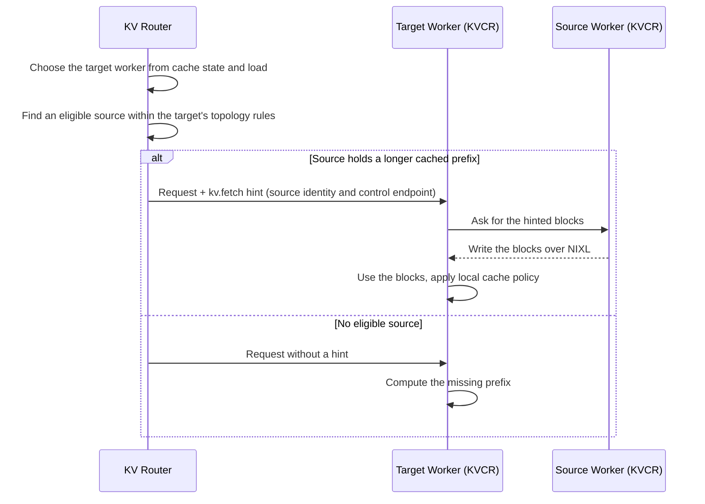

A **KV hint** tells KVCR where to fetch reusable blocks for one request. The router picks a source from its cluster-wide cache view and attaches the source's identity and control endpoint to the request. The hint carries no KV data: KVCR transfers the blocks over NIXL and decides locally whether to keep them.

## Request Flow

## Generation and Attachment

The router generates a hint for a request only when all of these hold:

- The frontend runs `--router-mode kv`. Round-robin routing never generates hints.
- The target worker advertises the `router_hint` capability and a control endpoint.
- A source of the same worker type (aggregated, prefill, or decode) holds a longer cached prefix than the target.
- The source passes the target's topology rules (below).

The hint is a `kv.fetch` action in a versioned hint envelope, built from the same block index that drives [KV-Aware Routing](../concepts/system-architecture/kv-aware-routing.md). Each hint belongs to one request, is not reused, and names one source: KVCR does not fetch one prefix from several peers.

## Topology Filtering

The **target** worker's `kv_transfer_domain` and `kv_transfer_enforcement` decide which sources are eligible. This is the reverse of prefill-to-decode selection: the receiving worker's settings govern the fetch.

| Target setting | Eligible sources |
|---|---|
| Domain set, enforcement `required` or unset | Only sources in the target's domain |
| Domain set, enforcement `preferred` | Sources in the target's domain; others only when none in the domain qualifies |
| No domain | Any source |

The `preferredWeight` setting of [Topology-Aware KV Transfer](../modular-components/router/topology-aware-kv-transfer.md) does not affect which source a hint names. If no eligible source holds a longer prefix than the target, the router sends no hint and the worker computes the prefix.

A KVCR cache owner, such as a Guard pool, that publishes no topology of its own is treated as part of its attached worker's domain.

See [Tune Routing for KVCR](kvcr-routing-tuning.md#keep-fetches-on-fast-links) to set these, and [Topology-Aware KV Transfer](../modular-components/router/topology-aware-kv-transfer.md) for the domain model.

## Fetching and Local Cache Policy

KVCR on the target fetches the hinted blocks directly from the source over NIXL; the router plans the fetch but does not take part in it. If only part of the prefix is still available at the source, the target uses what arrived and computes the rest.

A fetched block is not guaranteed to stay cached. KVCR's local policy still decides admission, retention, and eviction.

## Related Topics

- [KV Cache Runner (KVCR)](kvcr.md)
- [KV Cache Management Overview](overview.md)
- [Tune Routing for KVCR](kvcr-routing-tuning.md)
- [Topology-Aware KV Transfer](../modular-components/router/topology-aware-kv-transfer.md)
- [KV-Aware Routing](../concepts/system-architecture/kv-aware-routing.md)
