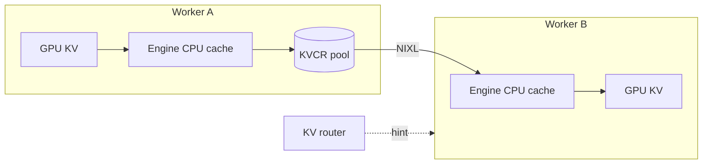
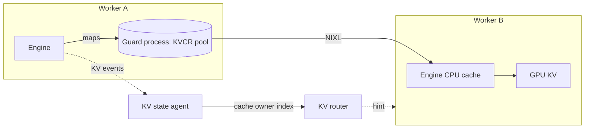
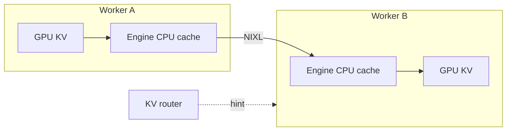
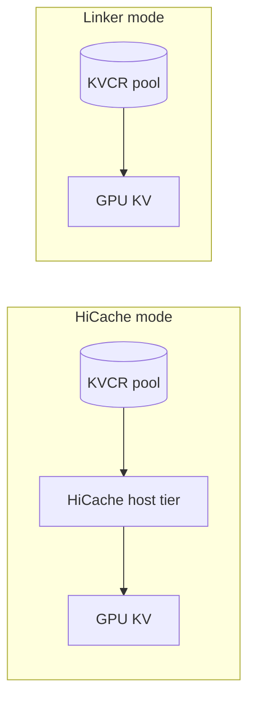

**KV Cache Runner (KVCR)** is Dynamo's distributed KV cache manager. It lets a worker reuse KV blocks that another worker already computed, on the same node or another one, instead of recomputing the prefix.

KVCR runs inside each worker: in vLLM as a secondary tier of `OffloadingConnector`, alongside the worker's own CPU cache; in SGLang as a HiCache storage backend or through the Linker.

## What It Is and Why It Is Split This Way

Reusing cache across workers needs a cluster-wide view to decide, and fast local execution to move the data. KVCR keeps those apart:

- **The KV router decides.** It already knows which worker holds which prefix, how loaded each worker is, and how the network is laid out. When it sends a request to a worker that lacks part of the prefix, it attaches a **KV hint** naming a peer that has it.
- **KVCR moves and manages.** The receiving worker's KVCR fetches the blocks from that peer over NIXL, then applies its own admission and eviction policy. A fetched block is not guaranteed to stay cached; that is a local decision.

Splitting the two lets the router decide early, when it schedules the request and before any data moves. Because the decision does not wait on a transfer, the router has room to weigh every worker, every tier, and every possible source, and makes a better scheduling decision than a worker that sees only its own cache. KVCR keeps no cluster-wide inventory of its own, and the router leaves local cache policy to KVCR. See [How KV Hints Work](kv-hints.md) for when hints are sent and how sources are chosen.

By default the router credits only blocks a worker already holds; it does not choose a worker because that worker could fetch a prefix. To make fetchable blocks count, set `shared_cache_multiplier`; see [Tune Routing for KVCR](kvcr-routing-tuning.md).

## Events and Hints

KVCR uses KV events like the other tiers, and adds hints on top:

- **Events tell the router where blocks are.** Each worker publishes KV events for its GPU cache and vLLM's CPU tier, and KVCR publishes events for its own pool. This is why `self_describing_kv_events` must be on: the events carry the block metadata the router needs to index KVCR's tiers.
- **Hints tell a worker where to fetch.** When the router sends a request to a worker that lacks part of a prefix another worker holds, it attaches a hint naming that worker. The target's KVCR fetches the blocks; the router never moves data.

Events alone let the router credit a worker for blocks it already holds. Hints let a worker use blocks that another worker holds.

## In-Process vs. Guard Sidecar

KVCR always runs in the worker process for serving, so cache access needs no extra hop. **Guard** owns the KVCR memory pool outside the worker, and the worker maps the pool directly. A Guard service (`kvcr_service`) is a separate process that hosts one Guard per rank. Because the pool lives outside the worker, it survives an engine crash: the restarted worker reattaches to its blocks, and peers can fetch them while it is down. Guard adds to the in-process KVCR; it does not replace it. For peers to keep using a crashed worker's Guard, also run the [KV state agent](#the-kv-state-agent).

### Guard Limits

- One Guard per rank: several ranks cannot share one Guard yet. A Guard service hosts as many Guards as `--guard-count`, one per rank.
- vLLM picks the Guard whose index matches the local data-parallel rank, so separate vLLM worker processes need separate Guard services. SGLang ranks choose their Guard with `guard_index`, so several SGLang workers can share one service.
- If the Guard service itself restarts, recovery no longer works for its ranks; restart their workers with it.

## The KV State Agent

The router normally ties cached blocks to the worker that holds them: when a worker deregisters, for example after a crash, the router drops its blocks from the index. With Guard, those blocks are still in memory, so dropping them throws away reusable cache.

The **KV state agent** (`dynamo.kv_state_agent`) is a separate Dynamo process that fixes this by indexing caches by **cache owner** instead of by worker process:

- Each rank declares a cache owner ID and the address of its raw KV event stream: for vLLM, `dynamo_state_agent.cache_owner_ids` and `raw_advertise_host`; for SGLang Linker mode, `--kvcr-state-agent-owner` and `advertise_host`. The address must not be a loopback address, because the state agent connects to it.
- The state agent reads that event stream and keeps the owner's blocks registered with the router, together with the owner's control endpoint.
- When the worker crashes, the owner stays registered. The router keeps sending peers hints that point at the owner, and the Guard serves them.
- When the worker restarts with the same cache owner ID, it takes the owner back.

Run one state agent per Dynamo namespace, which on Kubernetes means one per DynamoGraphDeployment: workers find the state agent through their namespace, so every worker in it shares the same one. `--max-slots` is the number of cache owners it tracks, one per rank across all those workers. Cache owner IDs must be unique per rank and stay the same across restarts. Without the state agent, a restarted worker still reattaches to its own Guard pool, but the router stops pointing peers at a crashed worker's Guard as soon as that worker deregisters.

## Memory Options

Use a KVCR pool, and add Guard when cached blocks must survive an engine crash. Peer-only is for functional testing:

| Option | Where cached blocks live | Survives an engine crash | Use |
|---|---|---|---|
| KVCR pool | A KVCR-owned host-memory pool in the worker process, sized separately from the engine's CPU cache | No | Recommended |
| Guard | A KVCR pool owned by the Guard process | Yes | When the cache must survive a crash; also needs the [KV state agent](#the-kv-state-agent) |
| Peer-only | Each worker's engine-managed CPU cache | No | Testing only |

A KVCR pool is faster than peer-only: KVCR registers the pool once at startup, so transfers do not wait for the engine to pin its CPU cache memory. With vLLM and SGLang HiCache, the engine keeps a small CPU cache that stages blocks between the GPU and KVCR. Some modes do not need an engine-managed CPU cache at all: in SGLang Linker mode, KVCR manages all of the host memory and delivers blocks straight into the GPU.

### KVCR Pool

Each worker adds a KVCR pool next to a small engine CPU cache. Blocks in the pool are kept by KVCR's policy and served to any peer.

### Guard

The pool moves into a separate Guard process, and the KV state agent keeps the pool indexed under its cache owner. If worker A crashes, the router can still send B to A's Guard, and A reattaches to the pool when it restarts.

### Peer-Only

Each worker keeps offloaded KV only in the engine's own CPU cache, under the engine's eviction policy. When the router sends B a hint, B's KVCR copies the blocks from A's CPU cache into B's CPU cache over NIXL, and the engine loads them into the GPU.

### SGLang: HiCache and Linker Modes

In HiCache mode, KVCR is SGLang's HiCache storage backend, so KV passes through SGLang's HiCache host tier. In Linker mode, KVCR delivers KV directly into the GPU.

Local disk (`g3`) extends capacity beyond host memory and is experimental; see the [KVCR developer guide](https://github.com/ai-dynamo/kvcr/blob/main/docs/dev-guide.md). Remote disk is planned.

## Support

| Framework | Status |
|---|---|
| vLLM | Supported with KVCR v0.2.0 and a vLLM build with the KVCR adapter. |
| SGLang | Preview: HiCache mode on one node, needs unmerged SGLang changes; see [Configure KVCR for SGLang](configure-kvcr-sglang.md). Linker mode: see [Configure KVCR Linker Mode for SGLang](configure-kvcr-sglang-linker.md). Preview: needs the SGLang KVCR series ([#45646](https://github.com/sgl-project/sglang/pull/45646) to [#45650](https://github.com/sgl-project/sglang/pull/45650)) and the Dynamo change in [#16827](https://github.com/ai-dynamo/dynamo/pull/16827), neither merged. |
| TensorRT-LLM | Planned. |

See the [KVCR framework support list](https://github.com/ai-dynamo/kvcr#framework-support) for the work in progress.

## Next Steps

| | vLLM | SGLang (preview) |
|---|---|---|
| Configure on one server | [Configure KVCR for vLLM](configure-kvcr-vllm.md) | [Configure KVCR for SGLang](configure-kvcr-sglang.md) |
| Linker mode, with Guard | Not applicable | [Configure KVCR Linker Mode for SGLang](configure-kvcr-sglang-linker.md) |
| Kubernetes | [Run KVCR on Kubernetes with vLLM](kvcr-kubernetes-vllm.md) | [Run KVCR on Kubernetes with SGLang](kvcr-kubernetes-sglang.md) |
| Kubernetes with Guard | [Run KVCR Guard on Kubernetes with vLLM](kvcr-guard-kubernetes-vllm.md) | [Run KVCR Guard on Kubernetes with SGLang](kvcr-guard-kubernetes-sglang.md) |
| Verify and monitor | [Verify and Monitor KVCR with vLLM](kvcr-testing-monitoring-vllm.md) | [Check It Works](configure-kvcr-sglang.md#check-it-works) |

Both engines: [How KV Hints Work](kv-hints.md), [Tune Routing for KVCR](kvcr-routing-tuning.md).

## Related Topics

- [KV Cache Management Overview](overview.md)
- [How KV Hints Work](kv-hints.md)
- [KVCR Design Overview](https://github.com/ai-dynamo/kvcr/blob/main/docs/design_overview.md)
