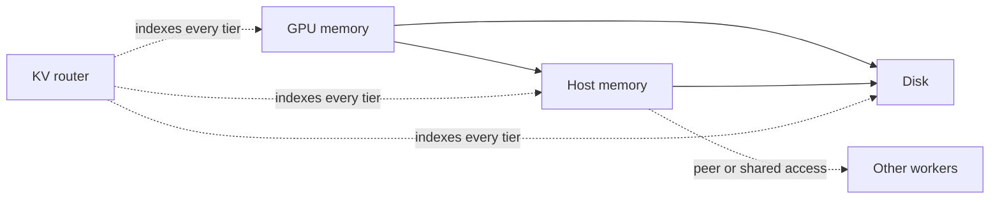

Recomputing the same prompt prefix across requests is expensive, especially in agentic loops that resend a large context. Reuse depends on two things: keeping the right blocks after they leave GPU memory, and sending each request to a worker that holds them or can fetch them.

Dynamo tracks where cached blocks are, so it can make both decisions. This page explains how routing and cache management work together, and which cache manager to use.

## Cache Tiers

Instead of discarding KV cache when GPU memory fills up, a worker can keep it in lower tiers: host memory, local disk, or storage shared with other workers. Blocks do not have to move down one tier at a time. Depending on the cache manager, blocks can be written through to every tier as they are stored, or go from GPU memory straight to disk.

The tiers work together as one cache. GPU memory serves the request. Host memory holds far more blocks and returns them quickly. Disk and shared storage hold the most but are the slowest to read back. A later request that reuses a prefix recalls its blocks from the fastest tier that has them instead of recomputing prefill. What matters is that every tier is addressable from one place: the router knows where each block is, so it can weigh all of them when it picks a worker.

### Write-Through and Write-Back

The write policy decides when a block is copied to the tier below. It changes how soon a block can be reused elsewhere and how much copying the worker does:

| Policy | When a block is copied down | Benefit | Cost |
|---|---|---|---|
| Write-through | As soon as it is stored in the higher tier | The lower tier always has a copy, so other workers can fetch it sooner and the higher tier can drop it without waiting | Copies every block, including blocks that are never reused |
| Write-back | Only when the higher tier approaches its eviction watermark | Copies only blocks that are about to be evicted | Until then the block exists only in the higher tier, and eviction waits for the copy |

The cache manager sets the policy. For example, SGLang HiCache sets it with `--hicache-write-policy`.

## Internal vs. External Cache Managers

A worker's offloaded KV cache is managed either by the engine itself or by an external manager. Dynamo works with whatever offloading the engine supports, and adds external managers on top:

- **Internal (engine-native).** The engine manages its own lower tiers, for example vLLM's `OffloadingConnector` or SGLang's HiCache. Nothing extra to deploy, but the cache serves only that worker unless another mechanism shares it.
- **External.** A separate component manages the cache and can make blocks available to other engine instances, which gives the router more freedom to balance cache reuse against load. "External" describes ownership, not deployment: the manager can run inside the engine process, beside it, or as a shared service.

You can use one or both: for example, vLLM's own CPU tier with KVCR as a secondary tier behind it.

| Manager | Type | Approach | Setup |
|---|---|---|---|
| vLLM `OffloadingConnector` | Internal | Per-worker host and disk tiers | [Native KV Offloading](../modular-components/backends/vllm/native-kv-offloading.md) |
| SGLang HiCache | Internal | Host tier, optional external storage such as Mooncake | [HiCache](../modular-components/backends/sglang/hicache.md) |
| Mooncake | External | Storage pool shared by workers, as a HiCache storage backend | [Tier-Aware Shared KV Cache Routing](../modular-components/backends/sglang/hicache.md#tier-aware-shared-kv-cache-routing) |
| LMCache | External | Local and remote storage options | [KV Cache Offloading](../modular-components/backends/vllm/kv-cache-offloading.md#lmcache) |
| FlexKV | External | Linked into the engine process | [KV Cache Offloading](../modular-components/backends/vllm/kv-cache-offloading.md#flexkv) |
| **KVCR** | External | Worker-to-worker transfers directed by the KV router | [KV Cache Runner (KVCR)](kvcr.md) |

> [!NOTE]
> KVBM is deprecated. Migrate to the engine's native offloading or KVCR; see [Deprecations](../../../reference/general/releases/deprecations.mdx).

Use engine-native offloading when each worker reuses its own prefixes. Add an external cache manager, such as KVCR for vLLM and SGLang, when you need more: workers fetching each other's blocks peer to peer, a shared pool of host memory, or shared or remote storage.

## How Routing Affects Cache Management

The KV router combines cache availability, worker load, and network topology to decide where to serve a request. Workers publish KV events as blocks are stored and evicted, and the router indexes them, so it knows which worker holds which prefix and in which tier. When a remote fetch is worthwhile, it can also name a peer that supplies the cached blocks, and the serving worker's cache manager fetches them.

[Routing Concepts](../modular-components/router/routing-concepts.md) explains the cost model, [Configuration and Tuning](../modular-components/router/configuration-and-tuning.md) covers router settings, and [Topology-Aware KV Transfer](../modular-components/router/topology-aware-kv-transfer.md) covers network-aware peer selection.

## Dynamo's Approach to Distributed Cache Management

Sharing cached blocks across workers takes a decision and data movement. The decision is which worker serves the request, whether fetching is worth it, and where the blocks come from. The data movement is transferring the blocks to that worker and keeping them there. Dynamo splits the two:

- **The router coordinates.** It already holds the cluster-wide view of cache, load, and topology, so it chooses the serving worker and the source for any remote fetch.
- **The cache manager moves and keeps blocks.** It transfers blocks and applies local admission and eviction policy.

KVCR is built to take advantage of this split: it moves blocks where the router directs, instead of keeping a second cluster-wide inventory. See [KV Cache Runner (KVCR)](kvcr.md).

## What the Router Sees per Engine

Each engine reports offloaded blocks differently, which decides what the router can credit:

| Engine | Version | GPU | Host memory | Disk | Shared or peer KV |
|---|---|---|---|---|---|
| vLLM | vLLM v0.24.0+, Dynamo 1.3.0+ | Per tier | Per tier (`OffloadingConnector` events) | Per tier (experimental) | Through [KV Cache Runner (KVCR)](kvcr.md) |
| SGLang | SGLang 0.5.11+ (0.5.13+ with Mooncake), Dynamo 1.2+ | Per tier | Per tier (HiCache events) | - | HiCache + Mooncake (`--shared-cache-type hicache`) |
| TensorRT-LLM | Dynamo 1.3.0+ | Cached or not, no tier (`--publish-kv-events`) | Same as GPU | - | - |

Per-tier engines get separate credit for host and disk hits; see [Tune Routing for KVCR](kvcr-routing-tuning.md). For TensorRT-LLM the router sees that a block is cached, not where, so per-tier weights do not apply. To confirm the router receives KV events, check `dynamo_component_kv_cache_events_applied` on the frontend's `/metrics`.

## Related Topics

- [KV Cache Runner (KVCR)](kvcr.md)
- [How KV Hints Work](kv-hints.md)
- [Configure KVCR for vLLM](configure-kvcr-vllm.md)
- [KV-Aware Routing](../concepts/system-architecture/kv-aware-routing.md)
- [Topology-Aware KV Transfer](../modular-components/router/topology-aware-kv-transfer.md)
