> [!WARNING]
> **Experimental.** The sidecars and their deployment examples are
> experimental. Manifests, flags, and behavior may change without notice.

`dynamo-sglang-sidecar` connects a Dynamo worker to SGLang's native gRPC
server. See [Sidecar Backends](../../../concepts/system-architecture/sidecar-backends.md)
for the architecture.

> [!TIP]
> For the best and latest support, use the upstream SGLang nightly image,
> which carries the latest gRPC server updates: [`lmsysorg/sglang:dev`](https://hub.docker.com/r/lmsysorg/sglang/tags?name=dev).

## Support Matrix

| Feature | Supported |
|---|---|
| Aggregated | Yes |
| Disaggregated | Yes |
| KV routing | Yes |
| Kubernetes multinode tensor parallelism (TP) and attention data parallelism (attention-DP) | Experimental |

Media-aware KV routing on wide-token SGLang builds is not supported by the sidecar; see the [multimodal compatibility limits](multimodal.md#newer-sglang-image-identities).

## Launch Locally

See [`lib/sidecar/sglang/launch/`](https://github.com/ai-dynamo/dynamo/tree/main/lib/sidecar/sglang/launch)
for all topologies. For example, aggregated serving on one GPU:

```bash
export DYN_DISCOVERY_BACKEND=file   # single host: no etcd or NATS needed
./lib/sidecar/sglang/launch/agg.sh
```

In a second terminal:

```bash
curl -s localhost:8000/v1/chat/completions \
  -H 'Content-Type: application/json' \
  -d '{"model":"Qwen/Qwen3-0.6B","messages":[{"role":"user","content":"Hello"}],"max_tokens":32}'
```

## Deploy on Kubernetes

See [`lib/sidecar/sglang/deploy/`](https://github.com/ai-dynamo/dynamo/tree/main/lib/sidecar/sglang/deploy)
for all manifests. For example, aggregated serving:

Before applying, replace `<your-registry>/dynamo-sidecar` in the manifest with a
[sidecar image](../../../concepts/system-architecture/sidecar-backends.md#container-packaging) and create the `hf-token-secret`
Secret that the manifest reads.

```bash
kubectl create secret generic hf-token-secret -n <namespace> \
  --from-literal=HF_TOKEN=<your-hf-token>
kubectl apply -f lib/sidecar/sglang/deploy/agg.yaml -n <namespace>
kubectl port-forward -n <namespace> svc/sglang-sidecar-agg-frontend 8000:8000
```

Multinode deployments require complete `leader` and `worker` role PodTemplates. Set
`backendFramework: sglang` as the examples do; the operator does not infer a backend from
a native engine launch. The templates own the native engine commands and
sidecar placement. See the [TP example](https://github.com/ai-dynamo/dynamo/blob/main/lib/sidecar/sglang/deploy/multinode_tp.yaml) and
[attention-DP example](https://github.com/ai-dynamo/dynamo/blob/main/lib/sidecar/sglang/deploy/multinode_dp.yaml). Attention-DP requires SGLang 0.5.22 or later and a Dynamo sidecar
with matching attention-DP metadata support. Engine-failure KV recovery remains
incomplete and is tracked in [DEP #14897](https://github.com/ai-dynamo/dynamo/issues/14897).

The examples use `DYNAMO_RANK` and `DYNAMO_LEADER_ADDRESS`, which exist only in
DGDs created by operator 1.6.0 or later. For an older DGD, see
[Use the variables in a DGD created before 1.6.0](../../../../../kubernetes/installation/multinode-orchestration.md#use-the-variables-in-a-dgd-created-before-160).

## Topologies

The frontend reaches each sidecar over Dynamo's request, discovery, and event
planes; the sidecar reaches the engine over its native gRPC API. Dashed arrows
carry KV events.

### Single-Node TP

One engine on one node, with one sidecar.



### Multi-Node TP

One engine spans two nodes. Only the leader node has a sidecar; the follower
node holds the remaining TP ranks.



### Multi-Node DP

The leader sidecar registers every DP rank and serves all requests; SGLang
dispatches each one to the right scheduler. The follower sidecar
accepts no requests and relays its node's KV events directly to the frontend.


