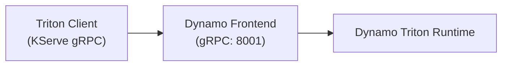

Dynamo Triton Runtime (DRT) integrates [NVIDIA Triton Inference Server](https://github.com/triton-inference-server/server) into Dynamo's distributed runtime.
Models, across its full backend ecosystem (TensorRT, ONNX Runtime, PyTorch, Python, DALI, ...), are served through the Dynamo Frontend over the [KServe gRPC protocol](https://kserve.github.io/website/latest/modelserving/data_plane/v2_protocol/).
This enabled the Dynamo Triton Runtime to benefit from Dynamo's service discovery and routing.

The runtime is composed exactly like the vLLM / SGLang / TensorRT-LLM runtimes: the Dynamo wheels are installed on top of the upstream Triton release image (`nvcr.io/nvidia/tritonserver:<tag>`).
That image is the build's `RUNTIME_IMAGE`, so the result is a single "Dynamo + Triton" artifact.

## Feature Support Matrix

### Core Dynamo Features

| Feature                                        |  Status  | Notes                                                               |
| :--------------------------------------------- | :------: | :------------------------------------------------------------------ |
| Tensor (KServe gRPC) Serving                   |  Ready   | Multiple models per Dynamo Triton Runtime instance.                 |
| Classification (`class_count` / top-K)         |  Ready   | Top-K `"<score>:<index>[:<label>]"` class strings.                  |
| OpenAI `/v1/classify`                          |  Ready   | Text-in classifier (leaf or ensemble) via `--task classify`.        |
| OpenAI `/v1/embeddings`                        |  Ready   | Text-in embedding (leaf or ensemble) via `--task embeddings`.       |
| Service Discovery / Routing                    |  Ready   | Via the Dynamo Frontend.                                            |
| Triton backends (TensorRT, ONNX, PyTorch, ...) |  Ready   | Which ever backends are included with the base Triton Server image. |
| TensorRT Plugins                               |  Ready   | Via `--backend-config='tensorrt,plugins=...'`.                      |
| Routing                                        |  Ready   | KV-aware routing is LLM-oriented.                                   |
| Disaggregated Serving                          |   N/A    | Not applicable to generic tensor models.                            |

### Known Limitations

The KServe gRPC tensor path is still being completed.
The Triton and KServe features below are not yet supported end-to-end through the Dynamo Frontend.

| Limitation               | Effect                                                                                                                                                                  |
| :----------------------- | :---------------------------------------------------------------------------------------------------------------------------------------------------------------------- |
| Model version selection  | Dynamo routes by model name only (`triton.tritonserver.<model_name>`) with no version concept, so version-specific requests are served by the model's default version.  |
| Shared-memory tensor I/O | System / CUDA shared-memory inputs and outputs are unsupported — the Dynamo Frontend does not expose the KServe shared-memory region control RPCs. Send tensors inline. |

> [!IMPORTANT]
> **Discovery backend at scale.**
> The `file` discovery backend suits small repositories and the examples below for a simple quickstart.
> A Dynamo Triton Runtime that registers a large repository (hundreds of models) in a single burst overflows the file watcher's channels and can tear the Dynamo Frontend down before it reports ready.
> Use the `etcd` discovery backend (`--discovery-backend=etcd`, with etcd running) for large repositories on bare-metal.
> On Kubernetes, native k8s discovery will be used by default.

### Container / Driver Matrix

| Triton release tag                      |  CUDA  | NVIDIA driver |
| :-------------------------------------- | :----: | :-----------: |
| `nvcr.io/nvidia/tritonserver:26.09-py3` | `13.4` |   `615.61`    |

The specific release of Triton Server is pinned in [`container/context.yaml`](https://github.com/ai-dynamo/dynamo/tree/main/container/context.yaml) under `triton.cuda13.4` (`runtime_image_tag`/`base_image_tag`), the same way the other framework runtimes pin their images.

## Prerequisites

- An NVIDIA GPU (Ampere or newer).
- NVIDIA device driver with a version greater-than-or-equal-to the version listed in the table above.
- Docker with the NVIDIA Container Toolkit installed.

## Quick Start _(prebuilt / release container)_

1. Build the release image using source-built Dynamo wheels on the latest Triton release:

   ```bash
   python container/render.py --framework=triton --target=runtime --output-short-filename
   docker buildx build --network=host -f container/rendered.Dockerfile -t dynamo:triton-latest .
   ```
   The `ai-dynamo` wheels are built from source and installed on top of the Triton release    image, so the running Dynamo matches this repository.
   `--network=host` is required at build time to fetch their Python dependencies from PyPI.

2. Run the container:

   ```bash
   ./container/run.sh --framework triton --image dynamo:triton-latest --workdir /workspace/ components/src/dynamo/triton -it
   ```

   Add `-v /path/to/models:/models` to mount your own model repository.

3. Start the Dynamo Frontend and Dynamo Triton Runtime inside the container:

   Mirroring the other Dynamo runtimes, run the Dynamo Frontend and the Dynamo Triton Runtime as two processes that find each other over file-based discovery (no etcd/NATS required).
   Triton serves *tensor* models, so the Dynamo Frontend exposes the KServe gRPC endpoint (`--kserve-grpc-server`) rather than the OpenAI HTTP API:

   ```bash
   # Frontend (KServe gRPC on the HTTP port, :8001 to match Triton's gRPC port)
   python3 -m dynamo.frontend --kserve-grpc-server --http-port=8001 --discovery-backend=file &

   # Dynamo Triton Runtime (serves every model in the repo; here the bundled identity sample)
   python3 -m dynamo.triton --discovery-backend=file &
   ```

   The Dynamo Triton Runtime exposes the full `triton_runtime.Options` surface as flags, named to match Triton's `tritonserver` CLI — run `python3 -m dynamo.triton --help` for the complete list.
   The in-process Triton server finds its backends via the image's `LD_LIBRARY_PATH` and the Dynamo Triton Runtime's default backend directory (`/opt/tritonserver/backends`), so no extra environment setup is needed.

4. Send an inference request:

   Tensor models use the KServe gRPC protocol, so requests go through the bundled gRPC client rather than `curl`.
   Point the client at the Dynamo Frontend's port — `client.py` defaults to `8787`, while the Dynamo Frontend above listens on `8001`, matching the `tritonserver` convention:

   ```bash
   python3 client.py --port=8001 --model=identity --shape 1 10
   ```

## Worker Configuration

The Dynamo Triton Runtime exposes the full `triton_runtime.Options` surface as CLI flags, named to match Triton's `tritonserver` CLI.
Run `python3 -m dynamo.triton --help` for the complete list.

### Common Flags

| Option                            | Description                                                                                    |
| :-------------------------------- | :--------------------------------------------------------------------------------------------- |
| `--model-repository <path>`       | Model repository to serve (default: `/models`)                                                 |
| `--backend-directory <path>`      | Triton backends directory (default: `/opt/tritonserver/backends`)                              |
| `--backend-config <cfg>`          | Triton backend config, repeatable, e.g. `--backend-config='tensorrt,plugins=/path/lib.so'`     |
| `--log-verbose <int>`             | Triton verbose logging level; `0` disables, `>= 1` enables (default: `0`)                      |
| `--discovery-backend <backend>`   | Service discovery backend: `kubernetes`, `etcd`, `file`, `mem` (default: `etcd`)               |
| `--task <task>`                   | Endpoints registered with the STR: `tensor` (default), `classify`, or `embeddings` (see below) |
| `--classify-input-name <name>`    | Override the `BYTES` input tensor name for `--task classify` (auto-detected by default)        |
| `--classify-output-name <name>`   | Override the `FP32` output tensor name for `--task classify` (auto-detected by default)        |
| `--embeddings-input-name <name>`  | Override the `BYTES` input tensor name for `--task embeddings` (auto-detected by default)      |
| `--embeddings-output-name <name>` | Override the `FP32` output tensor name for `--task embeddings` (auto-detected by default)      |

### Environment Variables

| Variable                | Description                                                                                   | Default                 |
| :---------------------- | :-------------------------------------------------------------------------------------------- | :---------------------- |
| `DYN_DISCOVERY_BACKEND` | Discovery backend: `kubernetes`, `etcd`, `file`, or `mem`                                     | `etcd`                  |
| `DYN_LOG`               | Log level (debug, info, warn, error)                                                          | `info`                  |
| `DYN_HTTP_PORT`         | Frontend HTTP port (serves KServe gRPC); this example uses `8001` to match Triton's gRPC port | `8000`                  |
| `ETCD_ENDPOINTS`        | etcd connection URL (only when `--discovery-backend=etcd`)                                    | `http://localhost:2379` |
| `NATS_SERVER`           | NATS connection URL (only for distributed mode)                                               | `nats://localhost:4222` |
| `DYN_SYSTEM_PORT`       | System metrics/health port, serving the DTR's `/metrics` endpoint (see [Metrics](#metrics))   | `-1` (disabled)         |

## Adding Your Own Models

1. Create a model directory in your repository:

   ```text
   /
   └── models/
       └── my_model/
           ├── config.pbtxt
           └── 1/
               └── model.plan  # or other model file
   ```

2. Define the model config (`config.pbtxt`):

   ```protobuf
   name: "my_model"  # name should match the name of the containing folder.
   backend: "tensorrt"  # or onnxruntime, python, etc.
   max_batch_size: 8

   input [
     {
       name: "input"
       data_type: TYPE_FP32
       dims: [3, 224, 224]
     }
   ]
   output [
     {
       name: "output"
       data_type: TYPE_FP32
       dims: [1000]
     }
   ]
   ```

3. Launch the Dynamo Triton Runtime:

   ```bash
   python3 -m dynamo.triton \
     --backend-config='tensorrt,plugins=/models/plugins/libmy_plugin.so' \
     --discovery-backend=file &
   ```

   > [!NOTE]
   > The Dynamo Triton Runtime will default to reading models from `/models` unless the `--model-repository` option is used to override the location.

## Serving `/v1/classify` _(OpenAI Classify)_

Start the Dynamo Triton Runtime with `--task classify` to expose a Triton classifier through the OpenAI-compatible `POST /v1/classify` endpoint on the Dynamo Frontend, instead of the KServe tensor path.
The Dynamo Frontend translates the classify JSON into a Dynamo tensor request.
The Dynamo Frontend then forwards it to the Dynamo Triton Runtime as a single `BYTES` text input, and reads a single `FP32` probability output back — no HuggingFace tokenizer or `config.json` fetch is required.

### Expected Model Shape

The Dynamo Triton Runtime reads the input/output tensor names from `config.pbtxt`.
Any model, leaf or ensemble, that declares exactly one `TYPE_STRING` input and exactly one `TYPE_FP32` output serves classify unchanged.
The `STRING` input must declare `dims: [ 1 ]` or `dims: [ -1 ]` (one string per request item); other layouts are rejected at startup.
An ensemble that runs tokenization inside Triton (Python-backend tokenizer plus a TensorRT plan wired through `ensemble_scheduling`) is the intended shape:

```protobuf
name: "text_classifier"
platform: "ensemble"
max_batch_size: 64
input  [ { name: "TEXT"  data_type: TYPE_STRING dims: [ 1 ] } ]
output [ { name: "probs" data_type: TYPE_FP32   dims: [ -1 ] } ]
ensemble_scheduling { ... }
```

When the model has more than one `BYTES` input or `FP32` output, disambiguate with `--classify-input-name` / `--classify-output-name`.
Class labels come from Triton's own `label_filename` on the output when set; when absent, response `label` fields are `null`.

### Launching the Worker and Issuing a Request

```bash
# Start the Dynamo Frontend (HTTP so /v1/classify is reachable)
python3 -m dynamo.frontend --http-port=8000 --discovery-backend=file &

# Start the Dynamo Triton Runtime and enable the classify handler.
python3 -m dynamo.triton --task=classify --discovery-backend=file &

# Send an inference request
curl -sX POST http://localhost:8000/v1/classify \
  -H 'Content-Type: application/json' \
  -d '{"model": "text_classifier", "input": ["hello world", "another example"]}'
```

The response shape mirrors vLLM's `/classify`:

```json
{
  "id": "classify-...",
  "object": "list",
  "created": 1735849200,
  "model": "text_classifier",
  "data": [
    {"index": 0, "label": "positive", "probs": [0.1, 0.7, 0.2], "num_classes": 3},
    {"index": 1, "label": "neutral",  "probs": [0.5, 0.4, 0.1], "num_classes": 3}
  ],
  "usage": {"prompt_tokens": 0, "total_tokens": 0, "completion_tokens": 0}
}
```

### Notes and Limits

- Text input only (`"input": "..."` or `"input": ["..."]`); token-ID variants (`Tokens` / `TokenBatch`) return HTTP 400.
- Pooling (`/v1/pooling`) is not yet served by the Dynamo Triton Runtime; requests with `encoding_format` set are rejected.
- `use_activation`, `add_special_tokens`, `truncate_prompt_tokens`, and `truncation_side` are rejected with HTTP 400.
  The model owns tokenization and the classify head's activation.
  The Dynamo Triton Runtime can neither apply nor skip them.
  A silent no-op would let clients relying on those semantics get a different classification per backend.
- To serve the same underlying model on both `/v2/models/{name}/infer` (tensor) and `/v1/classify`, run two Dynamo Triton Runtime processes against the same `--model-repository` — one with the default `--task=tensor` and one with `--task=classify`.
- Model aliases (multiple served names for one card) are not honored on this path.

## Serving `/v1/embeddings` _(OpenAI Embeddings)_

Start the Dynamo Triton Runtime with `--task embeddings` to expose an embedding model through the OpenAI-compatible `POST /v1/embeddings` endpoint on the Dynamo Frontend, instead of the KServe tensor path.
The Dynamo Frontend translates the embeddings JSON into a Dynamo tensor request, the Dynamo Triton Runtime forwards it to Triton as a single `BYTES` text input, and reads a single `FP32` vector output back, so no HuggingFace tokenizer or `config.json` fetch is required.

### Expected Model Shape

The Dynamo Triton Runtime auto-detects the input/output tensor names from `config.pbtxt`.
Any model (leaf plan or ensemble) that declares exactly one `TYPE_STRING` input and exactly one `TYPE_FP32` output serves embeddings unchanged.
The `STRING` input must declare `dims: [ 1 ]` or `dims: [ -1 ]` (one string per request item); other layouts are rejected at startup.
An ensemble that runs tokenization inside Triton (Python-backend tokenizer plus a TensorRT plan wired through `ensemble_scheduling`) is the intended shape:

```protobuf
name: "text_embedder"
platform: "ensemble"
max_batch_size: 64
input  [ { name: "TEXT"      data_type: TYPE_STRING dims: [ 1 ] } ]
output [ { name: "embedding" data_type: TYPE_FP32   dims: [ 768 ] } ]
ensemble_scheduling { ... }
```

When the model has more than one `BYTES` input or `FP32` output, disambiguate with `--embeddings-input-name` / `--embeddings-output-name`.
The output vector length is whatever the model's `FP32` output declares; the Dynamo Triton Runtime does not reshape or truncate it.

### Model Repository Layout

A single Dynamo Triton Runtime process serves one task.
`--task embeddings` registers every user-facing model in `--model-repository` as an embedding, so every model in the repo must be shaped `STRING`-in / `FP32`-out. A classifier or raw-tensor model mixed into the same repo makes startup fail with the mismatched model's name in the error.
Ensemble dependency models (tokenizer, encoder, anything referenced from another model's `ensemble_scheduling.step[].model_name`) are the exception: they stay loaded in Triton so their parent ensemble can call them, but they are not registered as `/v1/embeddings` endpoints, so an ensemble + its dependencies are the intended repo shape.
To serve multiple tasks from the same underlying models, run one Dynamo Triton Runtime process per task against repositories dedicated to that task.

### Launching the Worker and Issuing a Request

```bash
# Frontend (HTTP so /v1/embeddings is reachable)
python3 -m dynamo.frontend --http-port=8000 --discovery-backend=file &

# Worker: register as an embedding model
python3 -m dynamo.triton --task=embeddings --discovery-backend=file &

# Client request
curl -sX POST http://localhost:8000/v1/embeddings \
  -H 'Content-Type: application/json' \
  -d '{"model": "text_embedder", "input": ["hello world", "another example"]}'
```

The response shape mirrors OpenAI's `/v1/embeddings`:

```json
{
  "object": "list",
  "model": "text_embedder",
  "data": [
    {"index": 0, "object": "embedding", "embedding": [0.013, -0.027, ...]},
    {"index": 1, "object": "embedding", "embedding": [0.041,  0.009, ...]}
  ],
  "usage": {"prompt_tokens": 0, "total_tokens": 0}
}
```

The Dynamo Triton Runtime emits every vector as base64-encoded little-endian `FP32` bytes on the Dynamo wire.
The Dynamo Frontend decodes to a float array at the HTTP boundary when the client omits `encoding_format` or sets it to `"float"`.
The Dynamo Frontend then forwards the base64 string unchanged when the client sets `encoding_format: "base64"`.

### Notes and Limitations

- Text input only (`"input": "..."` or `"input": ["..."]`); token-ID variants (`Tokens` / `TokenBatch`) return HTTP 400.
- `dimensions` (Matryoshka truncation), `add_special_tokens`, and `truncate_prompt_tokens` are rejected with HTTP 400.
  The model owns tokenization and the output dimension is fixed by the model; a silent no-op would let clients relying on those semantics get a different embedding per backend.
- `encoding_format` only accepts `"float"` (default) and `"base64"`; other values return HTTP 400.
- To serve the same underlying model on both `/v2/models/{name}/infer` (tensor) and `/v1/embeddings`, run two Dynamo Triton Runtime processes against the same `--model-repository`: one with the default `--task=tensor` and one with `--task=embeddings`.
- Model aliases (multiple served names for one card) are not honored on this path.

## Configuring the Triton Version

The Triton release is pinned by `triton.cuda13.4.runtime_image_tag` in [`container/context.yaml`](https://github.com/ai-dynamo/dynamo/tree/main/container/context.yaml) (default `26.09-py3`), mirroring how the other framework runtimes pin their images.
The CUDA family is fixed by the Triton release, so `--cuda-version` is auto-derived; passing it explicitly is rejected.

To build with a different Triton release, override `RUNTIME_IMAGE_TAG` at build time (no `context.yaml` edit needed).

> [!WARNING]
> Keep `BASE_IMAGE_TAG` on CUDA 13.1 (default `26.02-cuda13.1-devel-ubuntu24.04`):
> the Rust `cudarc` crate rejects other CUDA versions at build time, and the wheels load CUDA dynamically so they run on the 13.4 runtime image regardless:

```bash
python container/render.py --framework=triton --target=runtime --output-short-filename
docker buildx build --network=host \
  --build-arg RUNTIME_IMAGE_TAG=26.09-py3 \
  --build-arg BASE_IMAGE_TAG=26.02-cuda13.1-devel-ubuntu24.04 \
  -f container/rendered.Dockerfile -t dynamo:triton-26.08 .
```

To make a release the default, edit `triton.cuda13.4` in `container/context.yaml`.

## Metrics

Metric collection and reporting is enabled by default (`--allow-metrics`).
The Dynamo Triton Runtime serves Triton's native `nv_*` metrics from Dynamo's `/metrics` endpoint alongside the `dynamo_*` metrics; set `DYN_SYSTEM_PORT` to expose that endpoint:

```bash
DYN_SYSTEM_PORT=8002 python3 -m dynamo.triton --discovery-backend=file &

curl -s http://localhost:8002/metrics
```

The `nv_*` metrics are collected on each scrape of `/metrics`.
Pass `--allow-metrics=false` to stop collection and exclude them from the endpoint.

## Troubleshooting

### "Model not found" Error

- Verify the model exists in `/models/<model_name>/`.
- Check that `config.pbtxt` is valid.
- Ensure the backend is available in the backend directory (`/opt/tritonserver/backends`).

### Worker Fails to Start

- Verify GPU is available: `nvidia-smi`.
- Confirm the model repository path is mounted into the container.
- Increase log verbosity: `--log-verbose=1` (or higher for more detail).

## How it Works



The Dynamo Triton Runtime ([`components/src/dynamo/triton/main.py`](https://github.com/ai-dynamo/dynamo/tree/main/components/src/dynamo/triton/main.py)):

1. Starts an in-process server object.
2. Loads all models from the model repository.
3. Reads each model's configuration (`config.pbtxt`).
4. Registers each model with the Dynamo runtime, keyed on `--task`:
   - `tensor` _(default)_: `ModelInput.Tensor` / `ModelType.TensorBased` — Dynamo Frontend hosted KServe gRPC endpoint.
     Requests are translated to Triton inference requests and streamed back as Dynamo tensors.
   - `classify`: `ModelInput.Text` / `ModelType.Classify` — Dynamo Frontend hosted `POST /v1/classify`.
     Requests are translated to a single `BYTES` text input and the `FP32` probability output is wrapped in the OpenAI classify response shape.
   - `embed`: `ModelInput.Text` / `ModelType.Embedding`: Dynamo Frontend hosted `POST /v1/embeddings`.
     Requests are translated to a single `BYTES` text input and the `FP32` vector output is base64-encoded on the wire.
     Then the Dynamo Frontend decodes to a float-array at the HTTP boundary when the client asks for float.
5. Each model is served on its own endpoint (`triton.<model_name>`), meaning a single Dynamo Triton Runtime can serve multiple models routed by name.
