> [!WARNING]
> **Experimental.** The sidecars and their deployment examples are
> experimental. Manifests, flags, and behavior may change without notice.

`dynamo-vllm-sidecar` connects a Dynamo worker to vLLM's native gRPC server
(`vllm-rs`). See [Sidecar Backends](../../../concepts/system-architecture/sidecar-backends.md)
for the architecture.

> [!TIP]
> For the best and latest support, use the upstream vLLM nightly image,
> which carries the latest gRPC server updates: [`vllm/vllm-openai:nightly`](https://hub.docker.com/r/vllm/vllm-openai/tags?name=nightly).

## Support Matrix

| Feature | Supported |
|---|---|
| Aggregated | Yes |
| Disaggregated | Yes |
| KV routing | Yes |
| Kubernetes multinode tensor parallelism (TP) and hybrid load balancing (hybrid-LB) data parallelism (DP) | Experimental |

## Launch Locally

See [`lib/sidecar/vllm/launch/`](https://github.com/ai-dynamo/dynamo/tree/main/lib/sidecar/vllm/launch)
for all topologies. For example, aggregated serving on one GPU:

```bash
export DYN_DISCOVERY_BACKEND=file   # single host: no etcd or NATS needed
./lib/sidecar/vllm/launch/agg.sh
```

In a second terminal:

```bash
curl -s localhost:8000/v1/chat/completions \
  -H 'Content-Type: application/json' \
  -d '{"model":"Qwen/Qwen3-0.6B","messages":[{"role":"user","content":"Hello"}],"max_tokens":32}'
```

## Deploy on Kubernetes

See [`lib/sidecar/vllm/deploy/`](https://github.com/ai-dynamo/dynamo/tree/main/lib/sidecar/vllm/deploy)
for all manifests. For example, aggregated serving:

Before applying, replace `<your-registry>/dynamo-sidecar` in the manifest with a
[sidecar image](../../../concepts/system-architecture/sidecar-backends.md#container-packaging).

```bash
kubectl apply -f lib/sidecar/vllm/deploy/agg.yaml -n <namespace>
kubectl port-forward -n <namespace> svc/vllm-sidecar-agg-frontend 8000:8000
```

Multinode deployments require complete `leader` and `worker` role PodTemplates. Set
`backendFramework: vllm` as the examples do: the operator does not infer a backend from
`vllm serve`, and compilation-cache defaults and inter-pod GMS admission depend on it.
The templates own the native engine commands and sidecar placement. The operator does
not inject executor or coordination flags.
See the [TP example](https://github.com/ai-dynamo/dynamo/blob/main/lib/sidecar/vllm/deploy/multinode_tp.yaml),
which uses the multiprocessing executor with a sidecar on the leader only, and the
[hybrid-LB DP example](https://github.com/ai-dynamo/dynamo/blob/main/lib/sidecar/vllm/deploy/multinode_dp.yaml),
where every Pod runs a sidecar for its local DP ranks. Unlike `agg.yaml`, which
launches `vllm-rs serve`, both multinode examples launch their serving ranks with
`vllm serve --grpc-port` and `VLLM_USE_RUST_FRONTEND=1`. The TP worker runs
`vllm serve --headless`. That entry point needs vLLM v0.32.0 or later. The examples
use it because `vllm-rs serve` does not support `--data-parallel-hybrid-lb`.
Engine-failure KV recovery remains incomplete and is tracked in
[DEP #14897](https://github.com/ai-dynamo/dynamo/issues/14897).

A multinode engine starts only when every rank has joined, and vLLM gives a late
rank 600 seconds by default. Two timeouts set that budget. The Rust frontend waits
`VLLM_ENGINE_READY_TIMEOUT_S` for its engine cores to register, and torch waits
`--distributed-timeout-seconds` for the cross-node rendezvous on both the leader
and the worker. When either expires, the leader's `main` container exits with
`engine input registration timed out` or a store timeout and restarts. The sidecar
is not affected. The TP example sets both to 1800 seconds, which matches the
sidecar's startup deadline and the example's startup probe, so a worker Pod that
pulls the engine image on a cold node still joins the first attempt. The torch
timeout also bounds collectives at run time, so a wedged NCCL call surfaces after
30 minutes instead of 10.

The examples use `DYNAMO_RANK` and `DYNAMO_LEADER_ADDRESS`, which exist only in
DGDs created by operator 1.6.0 or later. For an older DGD, see
[Use the variables in a DGD created before 1.6.0](../../../../../kubernetes/installation/multinode-orchestration.md#use-the-variables-in-a-dgd-created-before-160).

In sidecar mode the operator injects only the topology variables into `main`, not
the vLLM-specific environment. A disaggregated role template must set
`VLLM_NIXL_SIDE_CHANNEL_HOST` from `status.podIP` on its `main`
container, as `disagg.yaml` does, so the decode engine can reach the prefill
engine's NIXL handshake listener. vLLM adds each engine's global data-parallel
index to the side-channel port.

## Metrics

Both `vllm-rs serve` and `vllm serve` expose Prometheus metrics at `/metrics` on their HTTP port,
`8000` by default, bound to the address in `--host`. The example manifests bind `0.0.0.0` and
declare the port as `engine-metrics`, the name the platform chart's `dynamo-worker` PodMonitor
scrapes unless `dynamo-operator.dynamo.metrics.podMonitors.engineMetrics` is set to `false`. Chart settings,
the labels Prometheus adds, and verification steps are in
[Scrape Engine Metrics in Sidecar Mode](../../../../../kubernetes/operations/observability.mdx#scrape-engine-metrics-in-sidecar-mode).

Declare `engine-metrics` only on containers that run an HTTP server. In single-node and hybrid
multi-node DP deployments every `vllm serve` process runs one, so every pod serves its local ranks
with an `engine` label per DP rank. In multi-node TP only the leader does; the follower runs
`vllm serve --headless` and has no HTTP server.

## Topologies

The frontend reaches each sidecar over Dynamo's request, discovery, and event
planes; the sidecar reaches the engine over its native gRPC API. Dashed arrows
carry KV events.

### Single-Node TP

One engine on one node, with one sidecar.



### Multi-Node TP

One engine spans two nodes. Only the leader node has a sidecar; the follower
node holds the remaining TP ranks.



### Multi-Node DP

Hybrid DP load balancing: each node runs vLLM for its local DP ranks plus a
sidecar that serves requests. The frontend routes to either node.


