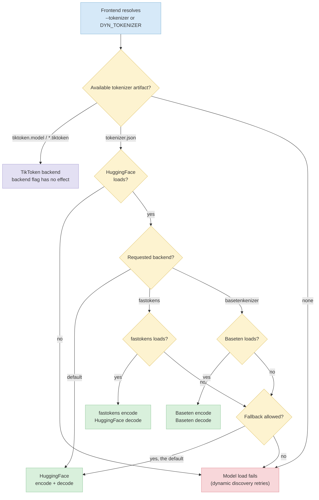

The Dynamo Frontend supports multiple tokenizer backends for BPE-based `tokenizer.json` models. `BPE` is the underlying tokenization algorithm, not a backend-specific feature: the default HuggingFace, `fastokens`, and `basetenkenizer` paths can all serve supported BPE models. The backend choice controls which implementation performs tokenization before requests are sent to the inference engine.

## Tokenizer Backends

#### `default` HuggingFace Tokenizers

The default backend uses the [HuggingFace `tokenizers`](https://github.com/huggingface/tokenizers) library (Rust).
It supports features in `tokenizer.json` files (normalizers, pre-tokenizers, post-processors, decoders, added tokens with special-token flags, and byte-fallback).

#### `fastokens` High-Performance Encoder

The `fastokens` backend uses the [`fastokens`](https://github.com/Atero-ai/fastokens) crate, a purpose-built encoder optimized for throughput on supported BPE `tokenizer.json` models.
It is a _hybrid_ backend: encoding uses `fastokens` while decoding falls back to HuggingFace so that incremental detokenization, byte-fallback, and special-token handling work correctly.
It supports segmented encoding so renderers can distinguish trusted control tokens from ordinary content.

Use this backend when tokenization is a measurable bottleneck, for example on high-concurrency prefill-heavy workloads.

#### `basetenkenizer` Native Encoder and Decoder

The `basetenkenizer` backend uses the Baseten Tokenizer implementation exposed by `dynamo-tokenizers`, a high-performance Rust BPE implementation for inference. It performs both encoding and decoding natively and supports segmented encoding for renderers that must preserve trusted control-token boundaries.

Use this backend for supported `tokenizer.json` models when you need Baseten Tokenizer behavior, including token-compatible Kimi tokenizer artifacts.

The frontend selects the tokenizer backend as follows. When both `tokenizer.json` and a TikToken artifact are present, `tokenizer.json` takes precedence.



#### Compatibility notes:

- Works with standard BPE `tokenizer.json` files (Qwen, LLaMA, GPT-family, Mistral, DeepSeek, etc.).
- If `fastokens` or `basetenkenizer` cannot load a particular tokenizer file, the frontend logs a warning and transparently falls back to HuggingFace by default. Use `--no-tokenizer-fallback` to reject incompatible tokenizers during model initialization.
- Special tokens declared only in a sibling `tokenizer_config.json` are merged into the
  HuggingFace and Baseten paths, and into Dynamo's L1 prefix-cache boundaries. The FastTokenizer
  encoder loads `tokenizer.json` alone and cannot receive that merge, so a model that declares a
  special token only in `tokenizer_config.json` encodes it as ordinary text under `fastokens` and
  produces different token IDs than the other two backends.
- Multimodal KV routing is disabled while `fastokens` is active, because image placeholders such as
  `<|image_pad|>` are frequently declared only in `tokenizer_config.json`. Requests still complete,
  and per-image token metrics remain available when the model is supported by the image-token
  counter; routing falls back to text-prefix overlap. See
  [Multimodal KV Routing](../../../../use-cases/multimodal-serving/multimodal-kv-routing.md).
- Has no effect on TikToken-format tokenizers (`.model` / `.tiktoken` files), which always use the TikToken backend.
- Dedicated vLLM embedding workers let vLLM tokenize raw text by default. When [`--embedding-frontend-tokenization`](../../../../reference/backends/vllm-configuration.mdx) is enabled, raw-text requests use a request-specific Dynamo tokenizer. The request's `add_special_tokens` value overrides `DYN_EMBEDDING_TOKENIZATION_ADD_SPECIAL_TOKENS`; the default is `true`. For `tokenizer.json` models, `true` selects HuggingFace while `false` follows the configured backend selection shown above. TikToken artifacts always use TikToken, and token-ID inputs bypass frontend tokenization.

## Configuration

Set the backend with a CLI flag or environment variable. The CLI flag takes precedence.

> [!WARNING]
> Automatic tokenizer fallback is deprecated and will be disabled by default in a future release.
> Set `--no-tokenizer-fallback` or `DYN_TOKENIZER_FALLBACK=false` to adopt the future behavior now.

| CLI Argument | Env Var | Valid values | Default |
|---|---|---|---|
| `--tokenizer` | `DYN_TOKENIZER` | `default`, `fastokens`, `basetenkenizer` | `default` |
| `--tokenizer-fallback` / `--no-tokenizer-fallback` | `DYN_TOKENIZER_FALLBACK` | `true`/`false`, `1`/`0`, `on`/`off`, `yes`/`no` | `true` |

**Examples:**

```bash
# CLI flag
python -m dynamo.frontend --tokenizer fastokens

# Environment variable
export DYN_TOKENIZER=fastokens
python -m dynamo.frontend

# Baseten Tokenizer
python -m dynamo.frontend --tokenizer basetenkenizer

# Require Baseten Tokenizer instead of falling back to HuggingFace
python -m dynamo.frontend --tokenizer basetenkenizer --no-tokenizer-fallback
```

## Dynamo Frontend Behavior

When a non-default backend is selected:

1. The frontend resolves `--tokenizer` / `DYN_TOKENIZER` and passes the selected backend to the Rust runtime.
2. `ModelDeploymentCard::tokenizer()` loads the HuggingFace tokenizer first for fallback behavior and L1 cache special-token metadata.
3. Dynamo constructs `FastTokenizer` for `fastokens` or `BasetenTokenizer` for `basetenkenizer` from the same `tokenizer.json` file.
4. If construction fails because the tokenizer uses unsupported features, Dynamo logs a warning and falls back to HuggingFace. With `--no-tokenizer-fallback`, model initialization fails and reports the backend loading error instead. In dynamic mode, discovery retries the load while the frontend continues running.
5. When the L1 prefix cache is enabled, Dynamo wraps the selected backend with the same special-token boundary metadata and cache metrics used by the default path.

## Experimental incremental prompt tokenization

**Experimental.** The optional TokTier adapter accelerates append-only, rendered
text prompts in the single-process Python SGLang HTTP Chat Completions frontend. It
wraps the configured Hugging Face reference; it adds no tokenizer backend choice
and changes no model-engine tokenization. The Rust frontend, gRPC, Responses,
Completions, Anthropic, embedding, native token-input, multimodal and
engine-specific conversation-template paths keep their existing behavior.

Install the `delta-tokenizer` extra and stage TokTier's certified tokenizer
artifacts before enabling `--experimental-delta-tokenizer`. Startup and request
handling never download tokenizer artifacts. Use `--dyn-chat-processor sglang`
and `--dyn-preprocess-workers 0`. Other processor/backend combinations are
rejected when the feature is enabled.

TokTier 0.3.0 is pinned. Admission requires a canonical artifact digest, a
standard Hugging Face fast-tokenizer loader, an equivalent effective pipeline
including added and special tokens, and a certified CPU execution report.
Python `tokenizers` 0.22.2, 0.23.2 and 0.23.3 are the initially admitted
oracle versions. Other versions and custom tokenizers use full reference
tokenization. This does not change the Rust frontend's reference dependency.

### Session scope

A trusted gateway supplies both `x-dynamo-meta-delta-tokenizer-session` and
`x-dynamo-meta-delta-tokenizer-scope` using the configured metadata-header
prefix. The scope identifies an authenticated tenant or equivalent isolation
domain. The gateway must strip client-supplied scope headers and set the scope
from its authentication result. These headers do not provide authentication.

Without both values, the frontend uses the existing full-tokenization path.
Dynamo marks the Chat Completions API origin internally and prevents callers
from forging that marker through metadata headers. Session affinity is separate;
tokenizer state never changes routing. Another frontend replica or a restarted
frontend has no state and performs a full encode.

### Exactness and lifecycle

Each model load captures a private reference tokenizer snapshot and binds it to
the model, artifact, loader versions, effective configuration and backend.
Tokenizer changes require a new model/preprocessor lifecycle. A chat-template
fingerprint accompanies each rendered prompt; changes invalidate session state.
Applications must not mutate the frontend's tokenizer core after model
initialization.

Cold requests return full reference tokens and retain a reference-only snapshot.
Only a confirmed second append justifies preparing TokTier state. Two bounded
background workers prepare admitted session seeds, compare them to the reference, and
publish only while the reservation remains live and uncancelled. Requests that
arrive before a seed is ready use the reference. Prompts below 4096 UTF-8 bytes
bypass session admission. Initial tokenizer preparation can consume seconds of
CPU, even though it runs outside the request's encode call. Avoid enabling the
feature for workloads with little session reuse.

Warm appends use TokTier's public `Session.append_patch` and apply its suffix
splice to retained token IDs. The downstream request still needs a full token
vector. No full TokTier session snapshot is requested. An absent or declined
repair certificate, a non-append edit, a template change, state loss, corruption,
a stale reservation or an unsupported input causes reference tokenization.
A cold seed may use TokTier's certified oracle because Dynamo compares the
complete seed before reuse.

`--delta-tokenizer-verify-rate` samples warm requests for a second reference
encode. Sampling is disabled by default. A mismatch returns the reference IDs,
increments a mismatch metric, discards affected cached state and disables reuse
for that manager. Verification never authorizes an otherwise uncertified route.

Entry count and conservative approximate retained bytes are bounded across
model-specific managers in one frontend process. The byte budget includes
reference snapshots, loaded per-session TokTier tables, retained text/tokens and
in-flight reservations. The estimate is not an operating-system RSS limit.
Each session owns a separate TokTier store, so independent sessions do not
serialize on TokTier's shared-tokenizer store lock.

Idle TTL cleanup removes at most 16 entries per pass. LRU eviction breaks ties
by access order. Busy entries delegate competing requests to the reference.
Eviction, expiry and retirement prevent a running worker from publishing stale
state. Already running native work cannot be interrupted; its charged state is
released when that worker exits.

Raw rendered prompts remain in process memory while sessions are retained.
Expiration and eviction drop reachable text and close the owned TokTier store.
No persistent session store is opened. Allocator memory is not guaranteed to be
zeroed. Logs and metrics contain no prompt text, token lists or session IDs.

For flags and defaults, see
[Frontend configuration](../../../../reference/components/frontend-configuration.mdx#experimental-delta-tokenizer).
