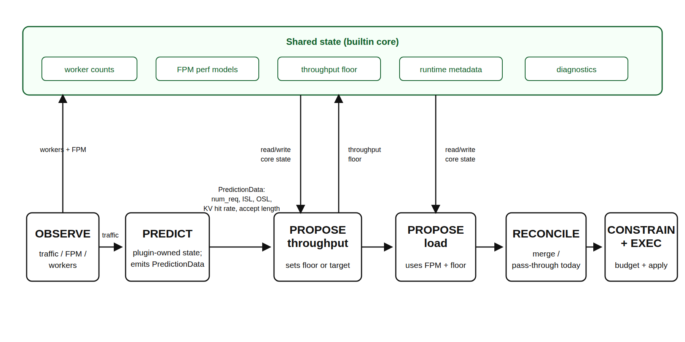

> **Tier 3 design documentation** for contributors and architects. For user-facing docs, see [docs/components/planner/](overview.md).

## Overview

The Planner is Dynamo's autoscaling controller. It supports two scaling modes: **throughput-based** (using profiling data and traffic prediction) and **load-based** (using real-time engine metrics and online regression). This document covers the internal architecture, algorithms, and design trade-offs for both modes.

## Runtime Pipeline

The runtime planner is driven by `OrchestratorEngineAdapter`, which wraps the
local scaling algorithms as builtin plugins and runs the same plugin pipeline
used by external gRPC plugins.

1. **OBSERVE**: `NativePlannerBase` and the engine adapter collect worker
   counts, traffic metrics, and forward-pass metrics. Observations are exposed
   through `PipelineContext.observations`.
2. **PREDICT**: `builtin_load_predict` runs on the throughput interval. It
   consumes traffic observations and emits predicted request count, ISL, OSL,
   KV hit rate, and speculative accept length for this tick.
3. **PROPOSE**: `builtin_throughput_propose` consumes same-tick predictions and
   updates the throughput lower bound. `builtin_load_propose` consumes FPM and
   worker observations and applies the load-based +/-1 scaling algorithm.
4. **RECONCILE / CONSTRAIN**: The generic pipeline merges proposals from
   builtin and external plugins. After CONSTRAIN, the engine adapter applies
   the local planner's final effective component minimums and GPU-budget invariants before
   returning any scaling effect.
5. **EXECUTE**: The adapter returns `PlannerEffects.scale_to`; `NativePlannerBase`
   applies those targets through the configured connector.

For compatibility with existing configs and DGDR-generated planner payloads,
`load_adjustment_interval_seconds` and `throughput_adjustment_interval_seconds`
still define the builtin plugin fire intervals. The base
`scheduling.scale_interval_seconds` defaults to the greatest common divisor of
those enabled intervals, so existing load and throughput fire times are preserved.



### Why Two Scaling Loops?

The two builtin scaling loops serve different control horizons.
Throughput-based scaling is the slower predictive capacity loop: it uses a
longer traffic window, load prediction, and profiling or perf-model capacity
estimates to provision for sustained demand. This avoids reacting to short-lived
metric noise and gives scale-out enough time to complete before the predicted
load arrives.

Load-based scaling is the faster reactive SLA-correction loop. It uses current
FPM, queue, worker-count, and online perf-model observations to handle short-term
overload, prediction or profiling error, runtime metadata changes such as KV hit
rate or speculative accept length, and the actual state observed after previous
scaling actions.

When both loops are enabled, throughput-based scaling sets the replica lower
bound, and load-based scaling runs more frequently above that floor. This keeps
capacity that was predicted for near-future demand from being removed because of
short idle periods, while still allowing the planner to react faster than the
throughput interval when real-time SLA pressure appears.

### Builtin Shared State

The pipeline context is a per-tick data plane: observations, predictions, and
proposals are produced for the current tick and passed through the public plugin
API. The builtin local planner also needs cross-tick state to preserve existing
planner behavior. That state is kept in `PlannerScalingState`, which is private
to the builtin plugins and the engine adapter rather than exposed as a public
gRPC plugin contract.

`PlannerScalingState` stores:

- **Worker inventory**: current ready prefill/decode counts, expected counts, and
  whether a prefill or decode scale operation is still in progress.
- **Perf models**: prefill, decode, or aggregated `PlannerEnginePerfModel`
  instances, including pre-deployment benchmark FPMs and online FPM updates.
- **Throughput lower bounds**: the current prefill/decode floor produced by
  throughput-based scaling. Load-based scaling can scale above this floor but
  cannot scale below it.
- **Runtime metadata**: last observed KV hit rate and speculative accept length.
  These use last-value semantics and are input features for capacity estimation.
- **Per-tick diagnostics scratch**: estimated TTFT/ITL, predicted traffic shape,
  engine RPS, decision reasons, lower bounds, and execution/audit metadata used
  by metrics and HTML reports.
- **Worker capabilities and budget inputs**: component GPU counts and runtime
  capabilities used to clamp final targets to the effective component minimums and GPU budgets.

Predictor history is intentionally not stored in `PlannerScalingState`.
`builtin_load_predict` owns the request-count, ISL, and OSL predictor state and
passes same-tick output through `PredictionData`. This keeps PREDICT -> PROPOSE
dependencies explicit while allowing the builtin proposer plugins to share the
state that is inherently cross-tick, such as perf-model fitting and throughput
floors.

## Throughput-Based Scaling

Throughput-based scaling is implemented by two builtin plugins:
`builtin_load_predict` and `builtin_throughput_propose`.

### Step 1: Traffic Observation

On throughput-cadence ticks, the engine adapter queries Prometheus for traffic
metrics from either the frontend or router, depending on
`throughput_metrics_source`:

- request count
- average input sequence length (ISL)
- average output sequence length (OSL)
- KV hit rate
- speculative decode accept length

The observation window is `throughput_adjustment_interval_seconds`, while the
outer pipeline cadence remains `scheduling.scale_interval_seconds`.

### Step 2: Load Prediction

The planner forecasts three traffic-shape values for the next interval:

- `next_num_req`: Number of requests
- `next_isl`: Average input sequence length
- `next_osl`: Average output sequence length

Four predictor implementations are available:


| Predictor    | Algorithm                                | Best For                         |
| ------------ | ---------------------------------------- | -------------------------------- |
| **Constant** | `next = current`                         | Stable workloads, long intervals |
| **ARIMA**    | Auto-ARIMA with optional log1p transform | Trending/seasonal patterns       |
| **Kalman**   | Local linear trend Kalman filter         | Bursty traffics                  |
| **Prophet**  | Facebook Prophet time-series model       | Complex seasonality              |


All predictors support warm-starting from trace files
(`load_predictor_warmup_trace`).

Runtime metadata that describes engine/router behavior is not forecast with
these predictors. KV hit rate and speculative decode accept length use
last-value semantics: the planner stores the latest valid Prometheus
observation and reuses it until a newer valid value arrives. Cold start falls
back to no KV hit-rate discount and accept length `1.0`.

### Step 3: Capacity Estimation

`builtin_throughput_propose` consumes same-tick predictions and asks the
planner perf model for prefill/decode capacity under the configured SLA
targets. The perf model is bootstrapped from the first available source:

1. worker `get_perf_metrics` self-benchmark data
2. AI Configurator interpolation when `aic_interpolation` is present
3. `profile_results_dir` NPZ/JSON fallback data
4. live FPM regression warmup when no pre-deployment data is available

The Planner constructs all estimators through
`aisimulate_core.sdk.RustForwardPassPerfModel.best_available(config)` using the
role-indexed canonical configurations in `ais_perf_model.roles`. AISimulate owns
schema validation, selection, tuning, and prediction. Dynamo binds immutable
worker identity and runtime limits, and derives queue drain, TTFT, ITL, and capacity.
New configurations default to `auto` selection with `deny` fallback. Auto still
searches op-level, FPM interpolation, then FPM regression. Without a native-model
configuration, the Planner explicitly constructs a cold regression model for its
worker role. Configuration changes rebuild that model and replay its retained
observations; training state is local to the consumer.
Runtime metadata such as KV hit rate and speculative accept length are applied
as input features, not as persistent correction-factor flags.

### Step 4: Proposal and Lower Bound

The throughput proposer converts predicted load and per-engine capacity into
replica targets. When both throughput and load scaling are enabled,
throughput-based scaling writes a lower bound; the faster load-based proposer
can scale above that bound but will not scale below it.

### Step 5: Scaling Execution

The merged pipeline result becomes `PlannerEffects.scale_to`. The runtime base
then calls the configured connector to apply component replica targets.

## Connector Design

### Interface

```python
class PlannerConnector(Protocol):
    async def async_init(self)
    async def validate_deployment(self, ...)
    async def wait_for_deployment_ready(self)
    def get_model_name(self, ...)
    def get_gpu_counts(self, ...)
    def get_worker_info(self, ...)
    async def get_actual_worker_counts(self, ...)
    async def set_component_replicas(self, targets, blocking=True)
```

### KubernetesConnector

Directly PATCHes the DGD resource to update replica counts. The operator watches for DGD changes and reconciles component deployments.

**Design decisions:**

- Uses `DYN_PARENT_DGD_K8S_NAME` to find its parent DGD (injected by operator)
- Resolves services by `subComponentType` field (prefill/decode), with fallback to legacy component names
- Validates deployment structure on startup: checks that prefill and decode services exist and model names match

### VirtualConnector

For non-native environments (e.g., custom orchestrators). Writes scaling decisions to the distributed runtime via `VirtualConnectorCoordinator` (Rust binding). External systems use `VirtualConnectorClient` to poll decisions and report completion.

**Scaling decision flow:**

1. Planner writes `(num_prefill, num_decode, decision_id)` to runtime
2. External system reads decision via `client.wait()`
3. External system executes scaling
4. External system reports completion via `client.complete(decision)`
5. Planner sees `scaled_decision_id >= decision_id` and proceeds

**Timeout**: If scaling isn't acknowledged within 1800s (configurable), the planner proceeds with new decisions anyway.

## Performance Interpolation

The planner uses pre-deployment profiling data (NPZ files) to map (throughput, ISL/OSL, context_length) -> (TTFT, ITL). This data comes from the SLA-driven profiling process (either online GPU profiling or AI Configurator estimation).

Two interpolators are maintained:

- **Prefill interpolator**: Maps (throughput_per_gpu, ISL) -> TTFT
- **Decode interpolator**: Maps (throughput_per_gpu, context_length) -> ITL

The interpolators use the profiling sweep granularity to determine precision. Finer granularity means more profiling samples but more accurate interpolation.

## Initialization

The `python -m dynamo.planner` entrypoint loads `PlannerConfig`, constructs
the mode-specific planner wrapper, and then initializes the selected
connector. The runtime base validates worker topology, discovers worker
capabilities, installs any available pre-deployment FPMs into the perf model,
bootstraps builtin and configured plugins, and enters the tick loop.

## Performance Considerations

- **Adjustment interval sizing**: The plugin execution interval must be long enough for scaling operations to complete. If `load_adjustment_interval_seconds` or `throughput_adjustment_interval_seconds` is shorter than the time to add/remove a worker (which includes pod scheduling, model loading, and registration), scaling decisions may observe an in-progress replica transition and hold until it completes.
- **Perf-model bootstrap quality**: Throughput-based scaling can start from worker self-benchmark data, AI Configurator interpolation, `profile_results_dir` files, or live FPM regression. Missing bootstrap data is allowed, but early decisions may hold until enough live FPM observations arrive.
- **Interpolation accuracy vs profiling cost**: Higher `prefillInterpolationGranularity` and `decodeInterpolationGranularity` in the profiler sweep produce more accurate bootstrap data but increase profiling time linearly. Default granularity (16 prefill, 6 decode) balances accuracy with profiling duration.
- **Predictor warm-up period**: All predictors need observation history before making reliable forecasts. ARIMA and Prophet need multiple adjustment intervals of data. Kalman starts forecasting after `kalman_min_points` observations. During warm-up, the planner uses the constant predictor as fallback.

## Load-Based Scaling

The load-based mode uses ForwardPassMetrics (FPM) from the Dynamo event plane to make SLA-aware scaling decisions without requiring profiling data or the KV Router.

### Metrics

Each engine emits per-iteration `ForwardPassMetrics` via ZMQ -> FpmEventRelay -> event plane. The planner subscribes via `FpmEventSubscriber` with automatic engine discovery and MDC-based lifecycle tracking. Key fields used:
- **wall_time**: per-iteration execution time (regression target)
- **scheduled_requests.sum_prefill_tokens**: prefill regression input
- **scheduled_requests.sum_decode_kv_tokens**: decode regression input
- **queued_requests**: queued prefill/decode load for TTFT/ITL simulation
- Idle heartbeats (wall_time=0) are skipped

### Diagnostics

Each tick, the scaling state machine fills `TickDiagnostics` with intermediate decision data—estimated latencies, predicted load, per-engine RPS, and decision reasons—via internal `_diag_*` fields. The adapter layer reads this from `PlannerEffects.diagnostics` and:

- Sets Prometheus gauges (e.g. `dynamo_planner_estimated_ttft_ms` and related estimates)
- Records enum metrics for load-scaling decision reasons (`dynamo_planner_load_scaling_decision`)
- Feeds `DiagnosticsRecorder`, which accumulates per-tick snapshots and emits Plotly-based HTML reports on a schedule

Per-engine FPM queue depths from `_collect_fpm()` are exported as labeled Prometheus gauges.

### Regression Models

Three specialized regression models live under
`components/src/dynamo/planner/core/perf_model/`:
- **PrefillRegressionModel**: 1D regression `sum_prefill_tokens -> wall_time`. Estimates TTFT by simulating chunked prefill scheduling (chunks of `max_num_batched_tokens`).
- **DecodeRegressionModel**: 1D regression `sum_decode_kv_tokens -> wall_time`. Estimates ITL for total decode load (scheduled + queued + avg decode length).
- **AggRegressionModel**: 2D regression `(sum_prefill_tokens, sum_decode_kv_tokens) -> wall_time`. Estimates both TTFT (simulated prefill with piggybacked decode) and ITL (decode with average piggybacked prefill).

### Scaling Decisions

- **Prefill/Decode**: Scale up if ALL engines' estimated TTFT/ITL > SLA; scale down if ALL < SLA * sensitivity
- **Agg**: Scale up if (ALL TTFT > SLA) OR (ALL ITL > SLA); scale down if (ALL TTFT < SLA * sensitivity) AND (ALL ITL < SLA * sensitivity)
- Only scales by +/-1 per interval (non-blocking with pending-desired guard: metrics continue to be observed while scaling is in progress, but no new scaling action is issued until the previous one completes)

### Co-existence with Throughput-Based Scaling

When both modes are enabled, throughput-based scaling (longer interval) sets a lower bound on replicas while load-based scaling (shorter interval) handles real-time adjustments above that floor.

### Aggregated Mode

In aggregated mode (`mode: agg`), engines handle both prefill and decode via chunked prefill. The planner maintains both TTFT and ITL regression models but uses per-worker time-averaged metrics (not instantaneous) for regression training to smooth out chunked prefill noise. Scale up if either prefill or decode signals overload; scale down only if both signal underload.

## Retune (Experimental, Simulation Only)

> [!WARNING]
> **Experimental.** Retune runs only in planner-in-the-loop offline replay in this release. A live
> Planner rejects a configuration that sets `retune` at startup.

Retune periodically replays the last window of recorded traffic against a grid of router and
Planner parameters and applies the best point. The [Planner Guide](planner-guide.md#periodic-retune-experimental)
covers the concept, the
[`retune` reference](../../../../reference/components/planner-configuration.mdx#retune-experimental-simulation-only)
the fields, and [Simulate Retune](aisimulate-planner-replay.mdx#simulate-retune-experimental) how to
run it. This section describes the mechanics.

### Engine Integration

Retune lives in the Planner engine (`OrchestratorEngineAdapter`), not in a plugin, for two reasons:

- A sweep runs for minutes to hours. A live plugin must answer within the pipeline's deadlines:
  5 seconds per call (`request_timeout_seconds` of the plugin transport) and 30 seconds per tick
  (`scheduling.tick_max_duration_seconds`). The engine instead launches the sweep in one tick and
  collects the result in a later tick, outside those deadlines.
- Retune's timing must behave the same in replay and live. In replay the sweep runs while virtual
  time is frozen; live, it runs in the background while wall-clock time moves on. Only the engine
  holds the clock abstraction (`VirtualClock` in replay, `WallClock` live).

- `OrchestratorEngineAdapter` builds a `RetuneController` only when `config.retune` is set. The
  constructor runs the checks that need the router bindings, the worker capabilities, or the full
  candidate set, and fails engine construction on any error, except that it drops Planner grid
  points that do not fit the deployment (see [Candidates and the Sweep](#candidates-and-the-sweep)).
- The adapter's `initial_tick(start_s)` anchors the window schedule at the Planner start `s0`, which
  is 0 in replay. The first tick fires one `scheduling.scale_interval_seconds` later.
- Every tick, after the plugin pipeline, the controller records the ready worker counts, harvests a
  finished sweep, and launches the sweep of a window that has come due. It returns
  `PlannerEffects.router_parameters`, the complete desired `/router_policy` parameter map per worker
  type, and `PlannerEffects.retune_decisions`, which carry the `planner_changes` for the host to
  apply. Router parameters are level-triggered desired state: the host applies the difference.
- In retune-only mode, `retune` set with both scaling flags explicitly `false`, the adapter returns
  no `scale_to`. The [`retune` field](../../../../reference/components/planner-configuration.mdx#retune-experimental-simulation-only)
  lists what else that mode turns off.
- The live runtime base, `NativePlannerBase`, raises `planner.retune is replay-only in this release`
  at construction.

### Windows

With `T` = `interval_seconds` and `G` = `grace_seconds`, window `k` covers Planner time
`[s0 + kT, s0 + (k+1)T)`, and its sweep launches at `L_k = s0 + (k+1)T + G`, which is also the
window's censoring cutoff. Replay maps Planner time `s` to trace time as the first trace arrival
plus `s × 1000 × arrival_speedup_ratio` milliseconds.

The window reader reads `dynamo.request.trace.v1` files:

- It keeps only `request_end` rows. Tool, `router_selection`, and `request_payload` rows are
  dropped, and `agent_context` is stripped, so the window replays open-loop.
- A request's arrival is `request_received_ms`, or `event_time_unix_ms` minus `total_time_ms`. Its
  completion is `request_received_ms` plus `total_time_ms` when both are present, otherwise
  `event_time_unix_ms`.
- A request belongs to the window when it arrived in the window and completed at or before `L_k`.
  In replay, completion comes from the latency recorded in the trace, not from the simulation.
- A repeated `request_id` keeps its first row. A malformed line or gzip stream fails the sweep, as
  it fails the replay itself.
- The sweep logs each window's non-zero row counts at INFO: `request_end` rows without
  `output_tokens` (dropped), `censored`, `duplicate`, rows without `total_time_ms`, which cannot be
  censored (`censor_unavailable`), rows whose `agent_context` was stripped, and `history_requests`.
  An empty window logs its counts too, so the log shows why it was empty.

Each candidate replay starts from the ready worker counts recorded at the window start. If no count
was recorded or a role had no ready worker then, the decision is `failed`.

### Candidates and the Sweep

`retune.router` and `retune.planner` use the AISimulate recommendation syntax of the Dynamo router
and Planner adapters. `planner/retune/domains.py` expands them into a Cartesian grid keyed by live
names: PATCH `/router_policy` parameters and `PlannerConfig` fields. The candidate set is the grid
plus the startup point plus the current point, at most `max_candidates` + 2 points in a canonical
order.

When the Planner starts, the controller validates each Planner grid point and each load-predictor
candidate once against the startup configuration, not their product. A grid point that fails
`PlannerConfig` validation or does not fit the deployment's worker capabilities is dropped, and one
warning reports how many points were dropped, with an example and its error. Engine construction
fails only when some value of a searched Planner knob fits in no remaining point, or when a
load-predictor candidate is invalid.
Before an `applied` decision changes Planner fields, the controller checks the combination the host
will apply against the live configuration again; if it no longer validates or fits, the decision is
`failed`.

`run_sweep` runs on the controller's single sweep thread and does no trace I/O itself. It starts
up to `max_parallel` worker processes with the `spawn` method, at niceness 10, and feeds each one
task at a time over its own pipe:

1. A read task writes the window to a temporary sweep directory. For an inner Planner that scales
   on throughput, it also reads the history before the window once and buckets it twice at the
   inner Planner's throughput interval: ending at the window end, with the window, for the
   pre-sweep and a predictor swap, and ending at the window start as the inner Planner's predictor
   warmup.
2. With a searched load predictor, one pre-sweep task per predictor candidate runs, as described
   below.
3. One `dynamo.replay.run_trace_replay` per distinct candidate replays the window file with
   `trace_format="dynamo"`, the pinned engine, and the candidate's router parameters. Candidates
   that resolve to the same configuration share one replay.
4. When the pre-sweep winner changes the load predictor, one more task prepares that predictor on
   the swap's warmup observations, as the host will (see [Predictor Swap](#predictor-swap)). It is
   queued ahead of the candidate replays, so a long ARIMA or Prophet fit overlaps them.

Every candidate replay, the current point's included, runs with the canonical router seed and
ordinal request ids, so all candidates of a window see common random numbers. Its result does not
depend on host speed: a replayed Planner tick runs to completion, without the live tick deadline. A
candidate that changes no routing or scaling decision scores exactly the current point; a candidate
that changes decisions is still compared on one sample path of the window. With the pinned
AISimulate release, a candidate replay whose inner Planner uses `optimization_target: sla` is not
guaranteed to be bitwise reproducible across processes: AISimulate's forward-pass performance model
iterates its samples in a per-process hash order, so its refits can differ in the last bits and flip
a scaling decision. Such a candidate can score differently from the current point even when its
parameters change nothing. The outer replay keeps its default, non-deterministic routing.

Without scaling, a candidate replay keeps the replica counts fixed. With scaling, it runs an inner
Planner: the current configuration with the candidate's Planner fields, retune disabled, no
diagnostics report, and, with throughput scaling, the history buckets that end at the window start
as its predictor warmup. A worker that dies fails only its task and is replaced. At
`timeout_seconds` of wall-clock time every worker is killed and the decision is `timeout`; closing
the controller kills them the same way. Workers keep their temporary files, such as Prophet's model
files, in the sweep directory, which is removed when the sweep ends.

### Load-Predictor Pre-Sweep

The load predictor is never a grid dimension. With `optimization_target: sla` and throughput
scaling, the sweep buckets the history and window traffic at the inner Planner's throughput
interval. Each predictor candidate observes the history buckets, then forecasts each bucket of the
window one step ahead and observes it. Its loss is the mean over window buckets of a weighted
forecast error: input tokens and output tokens 40% each, average input and output length 10% each.
A candidate therefore costs three forecasts per window bucket however long the history is. The lowest loss wins, the earliest candidate on ties, and a candidate
whose forecast fails cannot win.

Every candidate except the current point then uses the winner's predictor fields; the current point
keeps the current predictor. The decision records the result in `predictor_presweep`.

### Scoring and Outcomes

Each candidate's score is SLA-good output tokens per second of the window per GPU:

```text
score = objective_value(summary, GOODPUT_PER_GPU) × duration_ms / (window_s × 1000)
```

`objective_value` is AISimulate's goodput-per-GPU objective over the replay's `duration_ms`, which
includes the drain after the last arrival. Rescaling to the fixed window length `window_s` keeps
candidates whose drains differ on one time base. A replay whose summary lacks
`goodput_output_throughput_tok_s`, or has a non-positive `gpu_hours` or `duration_ms`, fails that
candidate instead of scoring zero. The current point is re-scored on every window, so every
comparison is paired on the same window file and the same random numbers.

Candidates rank by score, with ties going to the current point and then to the canonical order. The
best candidate is applied only when its score exceeds the current score × (1 +
`min_improvement_percentage` / 100) and it changes a router parameter or a Planner field. Each
decision has one outcome:

| Outcome | Meaning |
|---|---|
| `applied` | The best candidate replaces the current point |
| `kept` | No candidate cleared the threshold, the window was empty, or the best candidate equals the current configuration |
| `advisory` | The Planner runs with `advisory: true` and the decision would be `applied`: it records the chosen point and the `planner_changes` it recommends, and nothing changes. A decision that would fail, such as a predictor swap without enough warmup, is `failed` |
| `busy` | The window came due while a sweep was in flight and was skipped |
| `stale` | A searched parameter changed while the sweep ran |
| `timeout` | The sweep exceeded `timeout_seconds` |
| `failed` | The sweep failed (its read, the current point's replay, or an unexpected error), a predictor swap could not be warmed, no ready worker counts were recorded at the window start, or the Planner changes it would apply no longer validate or fit the deployment |

### Decision Timing

With `D` = `decision_latency_seconds` and `Δ` = `scheduling.scale_interval_seconds`, a sweep
launched at tick time `t` is ready at `t + max(D, Δ)`, and the decision lands on the first tick at
or after that time at which the sweep is done, never in the launch tick. With `measured`, `D` is
the modeled sweep time that the
[`decision_latency_seconds` field](../../../../reference/components/planner-configuration.mdx#retune-experimental-simulation-only)
defines.

Under a `VirtualClock`, the replay host, the controller waits for the sweep inside the launch tick,
so virtual time does not advance while the sweep runs, and a measured `D` is known at launch. The
replay then continues on the old parameters until the decision tick. A wall-clock host would poll
the sweep on later ticks instead.

The validation rules keep `D` and `timeout_seconds` within `interval_seconds`, so at most one sweep
is in flight. Router parameters change at the decision tick. The host applies `planner_changes`
after the tick, so Planner fields take effect from the next tick.

### Predictor Swap

A decision that changes the load predictor carries the history and window observations that warm
the new predictor (`predictor_warmup`). The sweep prepares the winning predictor on those
observations in a worker process, beside the candidate replays, the way the host will, so the
Planner tick never fits a predictor. If that traffic is too short for it, for example in the first
window of a replay without earlier history, the decision is `failed` and nothing changes. The
warmup ends at the window end, and the new predictor takes over after the decision tick, so the
traffic of the grace period and the decision latency, `G + max(D, Δ)`, is not in its history.

### Replay Integration

`run_trace_replay` derives the retune inputs from its own arguments: a `RetuneEngineSpec` that pins
the outer replay's engine arguments, router mode and configuration, and performance-model settings;
the trace paths; the first trace arrival as the time origin; and, when the Planner scales on
throughput, `load_predictor_warmup_trace` as extra history. That history must be a Dynamo request
trace that ends at or before the first replayed request; without throughput scaling it is not read.

`ReplayPlannerAdapter` (`planner/offline/replay_adapter.py`) hosts the engine in replay:

- It passes `router_parameters` to the Rust replay in each tick's decision. The replay patches the
  difference into each replay router's policy at that tick's virtual time. A patch changes the
  policy's scores only, while a candidate replay starts its router with the candidate's parameters.
  Retune therefore does not search `host_cache_hit_weight` and `disk_cache_hit_weight`: the startup
  router configuration also uses them to count cached tokens, which a patch leaves unchanged.
- It applies the `planner_changes` of `applied` decisions through `apply_runtime_configuration`,
  warming a new load predictor from the decision's observations.
- With `advisory: true`, it hands the Rust replay no scaling targets and no router parameters, so
  the deployment keeps its starting replicas and router parameters, and it records the
  recommendations in `PlannerReplayDetails.recommended_scaling_events`. It never sets the pending
  scaling targets, so the Planner sees its starting replicas as the expected counts. The controller
  records a decision that would apply as `advisory` before it changes its desired router map or
  pending Planner changes, so the next sweep searches from the deployed point; the adapter fails
  the replay if an `applied` decision arrives anyway. The inner Planner of the candidate replays
  (with load-based or throughput-based scaling) always runs with `advisory: false` and batch
  scheduling off.
- It keeps every decision for `PlannerReplayDetails.retune_events`, a list, possibly empty, whenever
  `retune` is set, and `None` otherwise. With tick capture, each tick record also holds
  `router_policies`, the replay router's revision and parameters before the tick's update. Tick
  `effects` have the same keys with or without retune; the desired router map is in
  `runtime_decision.router_parameters`.

The AISimulate Planner adapter (`planner/simulation/provider.py`) passes `planner.retune` through to
`PlannerConfig` and fills the scoring SLA from `evaluation.sla`. `dynamo.replay` (`run_trace_replay`,
and `prepare_planner_replay` for synthetic traffic) rejects traffic that is not an open-loop Dynamo
request trace, and its error names the AISimulate setting.

## Known Limitations

1. **Adjustment interval vs scaling latency**: If a plugin interval is shorter than the time to scale, later ticks may observe an in-progress transition and hold rather than stacking new replica changes.
2. **Average-based prediction**: Throughput-based scaling uses average ISL/OSL, which may not represent bimodal or heavy-tailed distributions well.
3. **Local Planner scope**: Each local Planner instance directly manages one DGD. Use GlobalPlanner for shared GPU budgets and coordination across multiple DGDs.
4. **Retune is experimental and simulation-only**: See the retune [limitations](aisimulate-planner-replay.mdx#limitations).

## Future Work

- Distribution-aware interpolation (beyond mean ISL/OSL)
- Adaptive adjustment interval based on observed scaling latency
- Retune on a live Planner: reading the frontend request traces as they are written, patching
  `/router_policy` on the frontends, and restoring the previous point when a deployment rejects an
  applied change

## File Map


| File / package | Purpose |
| --------------- | ------- |
| `components/src/dynamo/planner/core/base.py` | Runtime I/O loop: gathers observations and applies scaling effects. |
| `components/src/dynamo/planner/core/state_machine.py` | Shared builtin scaling state used by local planner plugins. |
| `components/src/dynamo/planner/core/load_scaling.py` | FPM-driven load scaling algorithm. |
| `components/src/dynamo/planner/core/throughput_scaling.py` | Prediction-driven throughput scaling algorithm. |
| `components/src/dynamo/planner/plugins/builtins/` | Builtin plugins that expose the local planner algorithms to the pipeline. |
| `components/src/dynamo/planner/plugins/orchestrator/` | PREDICT -> PROPOSE -> RECONCILE -> CONSTRAIN pipeline driver and engine adapter. |
| `components/src/dynamo/planner/plugins/proto/v1/` | Public gRPC/proto plugin API. |
| `components/src/dynamo/planner/monitoring/` | Prometheus, diagnostics reports, live dashboard, and worker metadata. |
| `components/src/dynamo/planner/connectors/` | K8s, virtual, global-planner, and remote connector implementations. |
| `components/src/dynamo/planner/config/` | PlannerConfig schema, defaults, backend component names, and profiling bootstrap specs. |
| `components/src/dynamo/planner/retune/controller.py` | `RetuneController`: window schedule, candidate checks, sweep launch and harvest, and scoring decisions. |
| `components/src/dynamo/planner/retune/sweep.py` | Sweep worker processes, candidate replays, scoring, and the load-predictor pre-sweep. |
| `components/src/dynamo/planner/retune/window.py` | Request-trace window and history reader for sweeps. |
| `components/src/dynamo/planner/retune/domains.py` | Expansion of `retune.router` and `retune.planner` into the candidate grid. |
| `components/src/dynamo/planner/offline/replay_adapter.py` | Replay host: tick records, scaling events, router parameter updates, and retune actuation. |
| `components/src/dynamo/planner/simulation/` | AISimulate Planner adapter: the `planner` section of `aisimulate predict` and `recommend`. |
| `components/src/dynamo/router/simulation/config.py` | AISimulate router section schemas, including `retune.router`. |
| `components/src/dynamo/aisimulate/domains.py` | Shared search-domain helpers for AISimulate sections and retune. |
