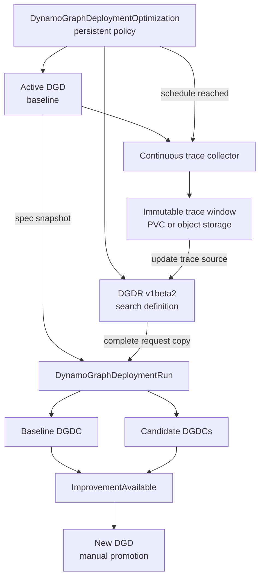
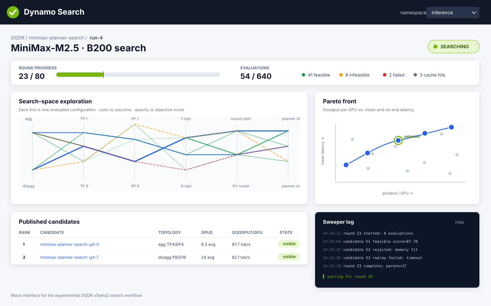
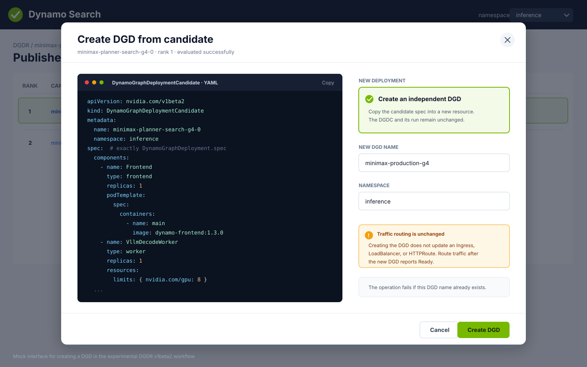

This design preserves the broader continuous-profiling and browser-UI proposals. It is separate
from the implemented [DGDR v1beta2 API](../../../../reference/kubernetes-api/dynamo-graph-deployment-request.mdx).

> [!WARNING]
> **Proposed, not implemented.** There is no `DynamoGraphDeploymentOptimization` resource or
> controller and no Dynamo Search browser service. All proposed resource, status, and UI shapes
> on this page are design sketches, not manifests accepted by the installed APIs.

## Existing Building Blocks

DGDR already supports scalar searches from static traffic or a Dynamo trace on a PVC, immutable
Runs, bounded Candidates with `status.parameters`, `status.metrics`, and `Valid` conditions, and
atomic `spec.overrides.dgd` application. Manual creation of an independent DGD is available today.

[Planner Live Retune](../../../../kubernetes/auto-deployment/planner-live-retune.md) already cuts
trace windows and periodically evaluates router and Planner parameter changes for a running DGD.
It is Experimental and not feature complete, requires its own opt-in, and does not implement the
broader Optimization resource proposed here.

The remaining proposals cover full deployment-configuration comparison against a baseline,
recurring optimization policies, trace artifact retention, direct object-storage trace sources,
Pareto publication, execution-Job overrides, and the browser UI. They do not change the current API
contract until their implementation and admission rules land.

## Planned Architecture

The planned long-lived `DynamoGraphDeploymentOptimization` represents the recurring policy. The
referenced DGD is the baseline for every Run. When a trace window closes, Dynamo stores it at a new
location and updates the referenced DGDR's future trace source. The resulting DGDR generation
creates an immutable `DynamoGraphDeploymentRun` with a complete, admitted copy of the Request.

The planned flow uses the implemented Run and Candidate resources from a manually created DGDR:



## Planned Optimization API

The design reuses existing v1beta2 trace workloads and DGD overrides. It still needs a baseline
comparison contract and an Optimization controller; Pareto comparison also needs Pareto admission
and publication. The Optimization would update the trace source to each completed window, creating
a new immutable Run through the existing Request-generation behavior. The current API does not
have `spec.rerun.reason`.

The following proposed resource references the DGDR and the active DGD and sketches a daily search
against the preceding 24 hours of traffic:

```yaml
apiVersion: nvidia.com/v1alpha1
kind: DynamoGraphDeploymentOptimization
metadata:
  name: qwen-daily
  namespace: inference
spec:
  targetRef:
    apiVersion: nvidia.com/v1beta1
    kind: DynamoGraphDeployment
    name: qwen-production

  requestRef:
    apiVersion: nvidia.com/v1beta2
    kind: DynamoGraphDeploymentRequest
    name: qwen-search

  schedule:
    interval: 24h

  trace:
    window: 24h
    retention: 7d
    storage:
      pvc:
        name: workload-traces
        path: qwen-production
    parameters: # unstructured
      format: dynamo
      records:
        - request_end

  comparison:
    parameters: # unstructured
      minimumRelativeImprovement: 0.10
```

At the end of a trace window, the planned controller writes the completed trace to a unique URI or
PVC path and updates the referenced DGDR's trace source. The DGDR controller then creates a Run
whose spec contains the complete admitted Request snapshot. The Request's trace format and Replay
controls remain unchanged.

The current DGDR v1beta2 controller supersedes an active Run when its Request spec changes. The
planned scheduler therefore waits for the active Run to become terminal before it updates the trace
source. If another interval expires while a Run is active, it records a skipped occurrence instead
of changing the Request and canceling useful work. Use a dedicated DGDR for each optimization
because the optimization owns trace-source updates.

The proposed `trace.parameters` and `comparison.parameters` objects leave collector-specific
settings and comparison knobs unstructured. Trace contents remain outside Kubernetes objects; the
future Optimization and Run status store only artifact references, time ranges, and summary
statistics.

## Planned Run Scheduling

One planned Optimization resource has at most one active Run. This behavior is not configurable.

When another interval expires during an active Run, the planned controller skips that occurrence
instead of queueing it. The next regular interval can create a Run after the active Run reaches a
terminal state. For an accepted occurrence, the controller closes the window, writes it to a new S3
URI or PVC path, and updates `workload.trace.source` in the referenced DGDR. The proposed status
records skipped occurrences:

```yaml
status:
  activeRunRef:
    name: qwen-daily-20260812
  lastSkippedScheduleTime: "2026-08-13T00:00:00Z"
```

The current DGDR API has no unchanged-input rerun trigger. Each scheduled trace has a distinct
artifact path, so updating the trace source creates the next generation. Bounded retry of transient
execution failures belongs inside the same immutable DGDRRun and is separate from scheduling.

## Planned Baseline Evaluation

The planned controller resolves `targetRef` for every Run instead of comparing new Candidates with
results from an older trace window. The future immutable Run records:

- the baseline DGD name, UID, generation, and complete spec snapshot;
- the trace artifact reference, start time, and end time;
- the referenced DGDR name, UID, generation, and complete request copy; and
- the versions of Sweeper, Replay, and their performance data.

The planned flow evaluates the baseline with the same trace and Replay implementation as every
alternative. It does not compare simulated Candidates with live baseline metrics because the two
measurement methods are not equivalent.

The planned baseline evaluation appears as a DGDC with a baseline role. Its spec would contain the
copied DGD spec, while its status would contain evaluation parameters, simulation metrics, and
validity, as current Candidates do.
The baseline role and comparison fields still require API design. The proposal excludes a baseline
Candidate from `recommendation.maxCandidates`; this would need an explicit exception to the current
publication bound, which counts every published Candidate, including invalid ones.

## Planned Improvement Semantics

AISimulate supports scalar ranking and Pareto search, but the DGDR API currently admits only
scalar objectives. Pareto evaluation in this workflow still needs DGDR admission and publication
support. The proposed continuous-profiling flow would compare the results with the evaluated
baseline.

For a scalar objective, compare each candidate score with the baseline score. Sweeper normalizes
scores so a larger value is always better, including objectives such as end-to-end latency that are
minimized in their natural units.

For a Pareto objective, classify every published candidate relative to the baseline:

| Classification | Meaning |
| --- | --- |
| `DominatesBaseline` | No worse in every objective and strictly better in at least one objective |
| `Tradeoff` | Better in at least one objective and worse in another |
| `DominatedByBaseline` | The baseline is no worse in every objective and strictly better in at least one objective |
| `EquivalentToBaseline` | No objective differs beyond the configured comparison margin |

This comparison is component-wise; it is not the minimum score across the candidates. Several
candidates can dominate the baseline while representing different positions on the Pareto front.
Dynamo publishes at most the referenced DGDR's `recommendation.maxCandidates` limit. Inspect the
published tradeoffs before selecting a replacement deployment.

Strict dominance treats any measurable difference as an improvement. The proposed comparison
policy needs an explicit margin to prevent simulation noise from creating recommendations. The
threshold keys under `comparison.parameters` still need to be defined.

The following Run status is a proposed comparison shape, not part of the current Run API:

```yaml
status:
  baselineCandidateRef:
    name: qwen-daily-20260812-baseline
  comparison:
    improvingCandidateRefs:
      - name: qwen-daily-20260812-0
      - name: qwen-daily-20260812-2
    tradeoffCandidateRefs:
      - name: qwen-daily-20260812-1
  conditions:
    - type: ImprovementAvailable
      status: "True"
      reason: CandidatesDominateBaseline
```

`ImprovementAvailable=False` means that the completed run found no candidate meeting the comparison
policy. It does not mean that the search failed. Use the run's `Completed` condition to report
execution success or failure separately.

## Planned Promotion Flow

Manual Candidate-to-DGD creation already exists in the DGDR v1beta2 workflow. Continuous profiling
keeps that boundary: create a new DGD from the selected Candidate's DGD fields, review it, move
traffic to it, and retain the old DGD for rollback.

After the new deployment becomes the production baseline, update `targetRef` to its name. The next
run snapshots and evaluates that DGD rather than continuing to compare with the retired deployment.
Continuous profiling does not modify or replace the active DGD automatically.

## Planned Trace Lifecycle

Configure the collector to capture only the request metadata needed by Replay. Prompt and response
payloads are not required for length, timing, and cache-reuse simulation and introduce additional
privacy and storage requirements.

The planned collector stores completed trace windows at distinct PVC paths or object-storage URIs.
DGDR treats each location as immutable and uses a changed location as the trigger for the next Run.
Delete an artifact only after no retained Run references it. The future controller garbage-collects
trace artifacts according to their configured retention periods; the current Request controller
independently retains the five newest terminal Runs.

See [Sweeper Traffic](../ai-simulate-experimental/sweeper-experimental/traffic.md)
for workload and trace semantics and [Sweeper Optimization
Goals](../ai-simulate-experimental/sweeper-experimental/optimization-goals.md)
for scalar and Pareto evaluation.

## Proposed Additional Trace Sources

The typed DGDR API currently supports `format: Dynamo` and
`source.persistentVolumeClaim: {claimName, subPath}`. Direct object-storage sources and other trace
decoders, including the earlier Mooncake sketch, require additional API, credential, mounting or
fetching, lifecycle, and replay validation. The old `source.pvc: {claimName, path}` sketch is not a
supported alias for the implemented PVC fields.

## Proposed Pareto Objectives

The Go API reserves `Pareto`, and Run progress already has a `paretoFront` counter, but admission
currently rejects Pareto authoring. The intended API uses a list of objective metrics:

```yaml
spec:
  objective:
    mode: Pareto
    metrics:
      - ThroughputPerGPU
      - ThroughputPerUser
```

The planned publisher will project a deterministic bounded subset of the non-dominated front without
assigning scalar ranks. The design does not yet promise a preference or representative-coverage
policy.

## Proposed Execution-Job Overrides

DGD overrides already exist under `spec.overrides.dgd`. The separate execution-Job override in the
original proposal remains unimplemented:

```yaml
spec:
  overrides:
    profilingJob:
      ttlSecondsAfterFinished: 3600
```

`profilingJob` is not a field in the current Overrides API. Before adding it, define which Job
settings users can change and which operator-owned image, credential, identity, and transport
settings remain protected. This proposal does not change AISimulate image or version ownership.

## Proposed Browser UI

The Dynamo Search UI remains the planned second phase. It will run as a long-lived cluster service,
independently of individual AISimulate Jobs, and retain detailed UI-local history outside Kubernetes
object status.

The UI is intended to show:

- Run lifecycle and effective input;
- completed rounds and evaluation outcomes;
- evaluated configurations across resolved search-space dimensions;
- scalar leaders or a Pareto front;
- published Candidates and optional AISimulate logs; and
- a separately authorized action that creates an independent DGD from a completed Candidate.



The UI will remain read-only for Request, Run, and Candidate resources. DGD creation uses a separate
create permission and does not update, replace, or move traffic away from an existing deployment.



The mocks preserve the original visual design rather than an authoritative API representation.
In the implemented Candidate contract, evaluation parameters are in `status.parameters`, the DGD
payload is in `spec`, and `Valid=True` must be checked before creating a deployment. A future UI must
use those current fields rather than the historical field placement shown in a mock.

## Design Tracking

The [DGDR v2 DEP](https://github.com/ai-dynamo/dynamo/issues/13092) tracks the design context. The
[current Kubernetes API reference](../../../../reference/kubernetes-api/dynamo-graph-deployment-request.mdx)
documents implemented behavior. Future sections should become operational documentation only after their API,
admission, execution, publication, and lifecycle behavior have landed.
