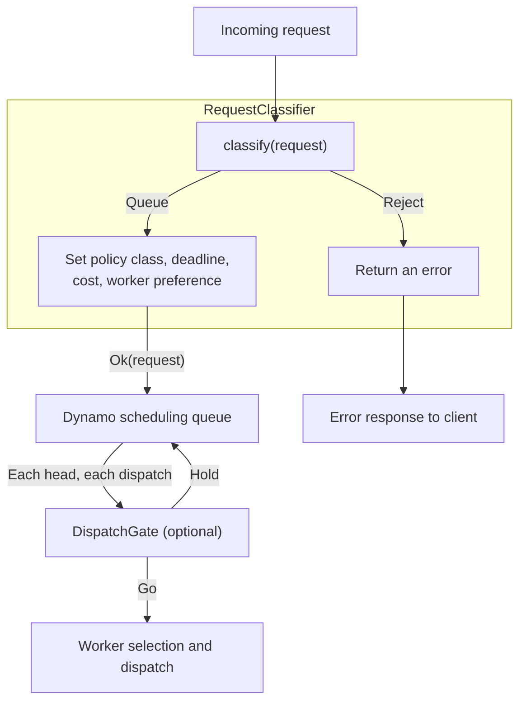

> [!WARNING]
> **Experimental.** The request-classifier API and its inputs can change.

Implement `RequestClassifier` to control how NVIDIA Dynamo queues a request in the KV router: assign its policy class, deadline, cost, or preferred worker, reject it, or, through a dispatch gate, hold it in the queue until capacity or a session is ready.

The built-in [ThunderAgent plugin](../../../../use-cases/agents/thunderagent-program-scheduler.md#native-frontend-plugin) uses this API to hold turns of paused or busy sessions. Select it through router-policy YAML if it fits your workload. Write a custom classifier when you need a different admission rule.

## How It Works

Dynamo calls `classify` before queueing a request. It runs synchronously: return `Ok(request)` to queue it, with its policy class, queue deadline, scheduling cost, or preferred worker set, or return an error to reject it. A classifier that must wait for something returns a dispatch gate, which Dynamo asks about each queue head before it dispatches.



A classifier can work with either built-in or [custom worker selection](custom-worker-selection.mdx). Dynamo enforces worker eligibility, hard pins, and reservations.

This guide uses the embedded KV router in `dynamo.frontend`. Classification runs on aggregated or decode routing; in disaggregated serving, remote prefill can start before this admission decision. Standalone selection, including standalone EPP, does not support a configured classifier.

## Build the Classifier

This example limits router queue waiting to a configured budget measured from request ingress. It rejects requests whose budget has already expired and admits the rest with that deadline.

### Create the Classifier and Catalog Crates

Set the checkout and plugin project paths, then create a classifier crate and a catalog crate for registration:

```bash
export DYNAMO_DIR=/work/dynamo
export PLUGIN_DIR=/work/acme-admission
mkdir -p "$PLUGIN_DIR"
cargo init --lib --name acme-admission "$PLUGIN_DIR/classifier"
cargo init --lib --name acme-admission-catalog "$PLUGIN_DIR/catalog"
```

Add the classifier's API, error, configuration, and time dependencies:

```bash
cargo add --manifest-path "$PLUGIN_DIR/classifier/Cargo.toml" --path "$DYNAMO_DIR/lib/router/kv-router" dynamo-kv-router
cargo add --manifest-path "$PLUGIN_DIR/classifier/Cargo.toml" --path "$DYNAMO_DIR/lib/runtime" dynamo-runtime
cargo add --manifest-path "$PLUGIN_DIR/classifier/Cargo.toml" serde --features derive
cargo add --manifest-path "$PLUGIN_DIR/classifier/Cargo.toml" tokio --features time
```

Add the classifier and registry API to the catalog:

```bash
cargo add --manifest-path "$PLUGIN_DIR/catalog/Cargo.toml" --path "$PLUGIN_DIR/classifier" acme-admission
cargo add --manifest-path "$PLUGIN_DIR/catalog/Cargo.toml" --path "$DYNAMO_DIR/lib/router/kv-router" dynamo-kv-router
```

### Classify Requests

Put the classifier in `classifier/src/lib.rs`. `set_due_at` tells Dynamo when to stop queueing the request. It takes precedence over the class's `slo_ttft_ms`, whether earlier or later, and an `edf` class orders the request by it:

```rust
use std::time::Duration;

use dynamo_kv_router::plugins::request_classifier::{
    ClassifierError, ClassifyRequest, RequestClassifier, WorkerView,
};
use dynamo_runtime::error::{DynamoError, ErrorClass};
use tokio::time::Instant;

struct QueueBudget {
    budget: Duration,
}

impl RequestClassifier for QueueBudget {
    fn classify(
        &mut self,
        mut request: ClassifyRequest,
        _workers: &dyn WorkerView,
    ) -> Result<ClassifyRequest, Box<ClassifierError>> {
        let deadline = request.ingress_at() + self.budget;
        if Instant::now() >= deadline {
            return Err(Box::new(
                DynamoError::builder()
                    .class(ErrorClass::CapacityExhausted)
                    .diagnostic("admission wait budget exhausted")
                    .public_message("Admission wait budget exhausted; retry later")
                    .build(),
            ) as Box<ClassifierError>);
        }
        request.set_due_at(deadline);
        Ok(request)
    }
}
```

For intentional rejection, return a typed `DynamoError`. `ErrorClass::CapacityExhausted` produces HTTP 529 by default; set `DYN_HTTP_OVERLOAD_STATUS_CODE=429` to return 429. Use `ErrorClass::RateLimited` for caller-specific limits, which return 429.

### Parse Parameters and Create the Factory

Add the provider below the classifier in `classifier/src/lib.rs`. Dynamo calls it at startup to validate the YAML parameters, then uses the returned factory to create a classifier for each model's router:

```rust
use std::sync::Arc;

use dynamo_kv_router::plugins::request_classifier::{
    RequestClassifierFactory, RequestClassifierParameters, RequestClassifierProviderError,
};

#[derive(serde::Deserialize)]
#[serde(deny_unknown_fields)]
struct Parameters {
    max_wait_ms: u64,
}

fn provider(
    parameters: &RequestClassifierParameters,
) -> Result<RequestClassifierFactory, RequestClassifierProviderError> {
    let parameters: Parameters = parameters.deserialize()?;
    if !(1..=60_000).contains(&parameters.max_wait_ms) {
        return Err(RequestClassifierProviderError::new(
            "max_wait_ms must be between 1 and 60000",
        ));
    }
    let budget = Duration::from_millis(parameters.max_wait_ms);
    Ok(Arc::new(move |_context| Box::new(QueueBudget { budget })))
}
```

Each factory-created classifier owns its state. Separate frontend replicas have separate admission budgets unless the plugin explicitly shares them.

### Register the Classifier

Expose a registration function from `classifier/src/lib.rs`:

```rust
use dynamo_kv_router::plugins::RouterPluginRegistry;
use dynamo_kv_router::plugins::request_classifier::RequestClassifierRegistryError;

pub fn register(
    registry: &mut RouterPluginRegistry,
) -> Result<(), RequestClassifierRegistryError> {
    registry.register_request_classifier("acme-queue-budget", Arc::new(provider))
}
```

Call it from `catalog/src/lib.rs`:

```rust
use dynamo_kv_router::plugins::RouterPluginRegistry;
use dynamo_kv_router::plugins::request_classifier::RequestClassifierRegistryError;

pub fn register(
    registry: &mut RouterPluginRegistry,
) -> Result<(), RequestClassifierRegistryError> {
    acme_admission::register(registry)
}
```

If you already have a worker-selection catalog, add the classifier to that catalog instead. One catalog can register both kinds of plugin.

### Configure the Classifier

Save this as `$PLUGIN_DIR/admission.yaml`:

```yaml
request_classifier:
  type: acme-queue-budget
  parameters:
    max_wait_ms: 2000

policy_classes:
  - name: standard
    queue_policy: fcfs
    quantum: 1
    prefill_busy_threshold_frac: 1.0
```

The `type` selects the registered provider; `parameters` supplies its configuration. Unknown types, duplicate registrations, and invalid parameters stop startup. Omit `request_classifier` to use Dynamo's pass-through behavior.

The policy class enables queueing when every eligible worker's active prefill tokens exceed its `max_num_batched_tokens`. Requests wait in the router until a worker is available or the two-second budget expires. Without a busy threshold, requests proceed to workers, where the classifier's deadline cannot limit their wait. See [Policy-Class Queues](configuration-and-tuning.md#policy-class-queues) to tune queueing for your workload.

## Available Inputs and Decisions

### Request Inputs

`classify` receives a `ClassifyRequest` with these accessors:

| Accessor | Meaning |
|---|---|
| `request_id()` | Optional request ID, also used in lifecycle events |
| `session_context()` | Optional session identity, final marker, input trigger, and captured [agent headers](../../../../use-cases/agents/session-ids.mdx#agent-headers) |
| `isl_tokens()` | Input sequence length in tokens, the size the scheduler uses |
| `scheduling_cost_tokens()` | Estimated uncached input tokens, or the classifier's override |
| `policy_class()` | Requested policy class, or the classifier's override |
| `queue_thresholds()` | Busy thresholds of the policy class the request resolves to now, including the classifier's override. The queue holds the request while every eligible worker is past them |
| `queue_thresholds_for(name)` | Busy thresholds of the policy class with that name, or `None` if the router does not know it |
| `reject_thresholds()` | Router-wide busy thresholds, read when classification started. Selection skips a worker past them and rejects the request when none remains |
| `ingress_at()` | Original router ingress time |
| `due_at()` | Queue deadline set by the classifier, if any |
| `progress().context_tokens()` | Live context high-water mark from input and generated tokens; this measures logical context, not physical KV occupancy |

### Router Context

The factory receives a `RequestClassifierContext` with router-wide information:

| Accessor | Meaning |
|---|---|
| `block_size()` | Tokens per KV block |
| `workers()` | Registered worker ranks from cached discovery information, updated as worker registrations change |

Each entry returned by `workers()` is the same `WorkerInfo` that [worker-selection plugins](custom-worker-selection.mdx) read:

| Accessor | Meaning |
|---|---|
| `worker()` | Worker ID and data-parallel rank, returned as `WorkerWithDpRank` |
| `max_num_batched_tokens()` | Advertised prefill tokens per engine step for this rank, or `None` when unavailable |
| `total_kv_blocks()` | Advertised total KV-block capacity for this rank, or `None` when unavailable; this is not the number of free blocks |

### Worker Inputs

A classifier can read the per-worker cache and load data that [worker-selection plugins](custom-worker-selection.mdx) receive. Declare the groups in `required_worker_inputs`; `classify` receives them as `workers`:

```rust
use dynamo_kv_router::plugins::request_classifier::{
    ClassifierError, ClassifyRequest, RequestClassifier, WorkerView,
};
use dynamo_kv_router::plugins::worker_selection::WorkerInputs;

struct LoadAwareClass {
    max_active_requests: usize,
}

impl RequestClassifier for LoadAwareClass {
    fn required_worker_inputs(&self) -> WorkerInputs {
        WorkerInputs::LOAD
    }

    fn classify(
        &mut self,
        mut request: ClassifyRequest,
        workers: &dyn WorkerView,
    ) -> Result<ClassifyRequest, Box<ClassifierError>> {
        // Count only observed loads, and require at least one.
        let mut loads = (0..workers.len())
            .filter_map(|row| workers.load(row))
            .filter(|load| load.available)
            .peekable();
        let saturated = loads.peek().is_some()
            && loads.all(|load| load.active_requests >= self.max_active_requests);
        if saturated {
            request.set_policy_class("batch");
        }
        Ok(request)
    }
}
```

Dynamo builds these rows with the same code that worker selection uses, so `CACHE`, `LOAD`, and `PREFERRED_TAINT` have the same meaning in both plugins. Dynamo reads `required_worker_inputs` once, when it installs the classifier. With the default `WorkerInputs::NONE`, Dynamo builds no rows and `workers` is empty.

- Rows cover each worker rank that is eligible for the request, including overloaded workers. Row order is unspecified.
- `workers` is a snapshot taken for this `classify` call and is lent only for its duration. Dynamo frees the rows when `classify` returns. Do not treat a copy as current load when the request dispatches later.
- Worker selection takes its own snapshot when it picks a worker, so it can pick a different worker than the classifier expected. Use `set_worker_selection_target` to state a preference.

Every row also returns its `WorkerInfo` from `info()` without a declaration. To ask whether a rank has room, declare `WorkerInputs::LOAD` and call `has_room` on the thresholds with the row's `load()` and `info().capacity()`. Both are rank-level checks on one row, the same ones the router runs: `queue_thresholds().has_room(...)` says whether this rank is within the class's queue thresholds (the queue holds a request only when every eligible rank is past them), and `reject_thresholds().has_room(...)` whether this rank is within the reject thresholds (selection skips a worker only when all of its ranks are past them).

### Admission Decisions

| Setter | Effect |
|---|---|
| `set_policy_class(name)` | Select a configured policy class by name |
| `set_due_at(instant)` | Set a deadline for router queue waiting; it replaces the class `slo_ttft_ms` as the request's due time |
| `set_scheduling_cost_tokens(tokens)` | Override the cost used by queue scheduling |
| `set_worker_selection_target(worker)` | Set a soft worker/rank preference, subject to hard pins and eligibility |
| `clear_worker_selection_target()` | Clear the soft preference |

Use a class name from the [router policy configuration](configuration-and-tuning.md) with `set_policy_class`. A name that matches no configured class fails the request; it does not fall back to the default class. Dynamo refreshes cache estimates when the admitted request enters the queue and applies the classifier's explicit overrides.

## Hold Requests and Track Their Lifecycle

`classify` cannot wait: it runs under the router-wide classifier lock and returns at once. A request that may become admissible later, such as when another request finishes or a paused session resumes, is held in the router queue by a dispatch gate. The queue keeps the request's order, class budget, expiry, and wakeups; the gate only answers whether the head of a lane may go now.

### Hold Queued Requests With a Dispatch Gate

Implement `DispatchGate` and return it from `dispatch_gate`. Dynamo queues every request at once and asks the gate about each queue head before it dispatches:

```rust
use dynamo_kv_router::plugins::request_classifier::{
    DispatchDecision, DispatchGate, DispatchHead, DispatchRecheck,
};
use tokio::time::Instant;

impl DispatchGate for SessionGate {
    fn check(&self, head: &DispatchHead<'_>) -> DispatchDecision {
        match self.room_for(head.session_context(), head.isl_tokens()) {
            Some(worker) => DispatchDecision::Go { target: Some(worker) },
            // Held long enough: let it go and leave placement to the selector.
            None if Instant::now() >= head.queued_at() + self.max_hold => {
                DispatchDecision::Go { target: None }
            }
            None => DispatchDecision::Hold { until: Some(head.queued_at() + self.max_hold) },
        }
    }

    fn dispatched(&self, head: &DispatchHead<'_>, target: Option<WorkerWithDpRank>) {
        self.reserve(head.request_id(), target);
    }

    fn attach(&self, recheck: DispatchRecheck) {
        self.recheck.set(recheck).ok();
    }
}
```

- `check` runs inside the router's dispatch loop and may be asked more than once about the same head: keep it a read, with no waiting.
- `Hold` keeps the request queued. Dynamo asks again when a worker's capacity changes, when the gate calls `notify` on the handle it received in `attach`, and no later than `until`. An `until` that has already passed sets no timer, so return `Go` once a hold should end rather than a past `until`. A held request still spends its policy class's waiting budget.
- `Go` lets the request through Dynamo's own capacity checks; `target` becomes its soft worker preference unless it carries a hard pin. `dispatched` runs once when Dynamo takes the request out of the queue, before selection. Admission can still fail, and the request's lifecycle then ends with `Aborted`.
- A request that has a session context waits in a lane of its own session, so a held session never blocks other sessions in its class. A held request without a session blocks the class's shared lane.
- A class with a zero queue limit never queues, so Dynamo admits its requests without asking the gate. The classifier learns of them from `Sent`. Do not give gated traffic such a class if every request must pass the gate.

Implement `on_event` when the classifier tracks active requests or session capacity. For example, use completion or abort events to release capacity and wake waiting requests:

| Event | Use |
|---|---|
| `Sent` | Record the worker/rank used for dispatch |
| `Responding` | Observe that the worker has started responding |
| `Completed` | Release request state and read final context-token usage when available |
| `Aborted` | Release request state after rejection, cancellation, or failure |

Dynamo delivers events in lifecycle order. Keep callbacks short so they do not delay new admission decisions, and release waiting-request state when a client cancels. For a working stateful implementation, see the [ThunderAgent classifier](https://github.com/ai-dynamo/dynamo/blob/main/lib/router-plugins/builtin/src/thunderagent/request_classifier/mod.rs).

## Link the Classifier Into Dynamo

Add the catalog to the Python binding manifest. Keep the dependency alias `dynamo-worker-selection-policy-catalog`, which supports both worker-selection policies and request classifiers:

```bash
cargo add \
  --manifest-path "$DYNAMO_DIR/lib/bindings/python/Cargo.toml" \
  --optional \
  --rename dynamo-worker-selection-policy-catalog \
  --path "$PLUGIN_DIR/catalog" \
  acme-admission-catalog
```

The catalog adds custom plugins alongside Dynamo's built-ins. Custom plugins are linked at build time; YAML selects the registered type at startup.

In a [source-build environment](../../../advanced-customizations/building-from-source.md), activate the checkout's virtual environment and build the extension with the catalog:

```bash
cd "$DYNAMO_DIR"
source .venv/bin/activate
cd lib/bindings/python
CARGO_TARGET_DIR="$DYNAMO_DIR/target" maturin develop --uv --features custom-policy
cd "$DYNAMO_DIR"
uv pip install -e .
```

Start the frontend against existing workers with matching discovery configuration:

```bash
DYN_HTTP_OVERLOAD_STATUS_CODE=429 python3 -m dynamo.frontend \
  --router-mode kv \
  --router-policy-config "$PLUGIN_DIR/admission.yaml"
```
