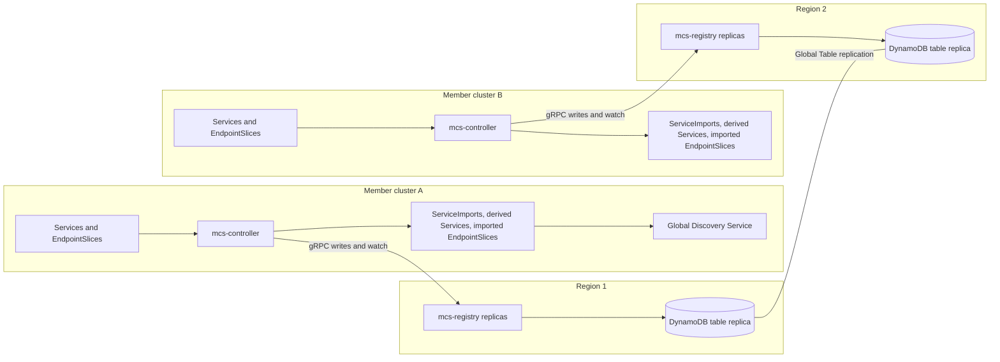
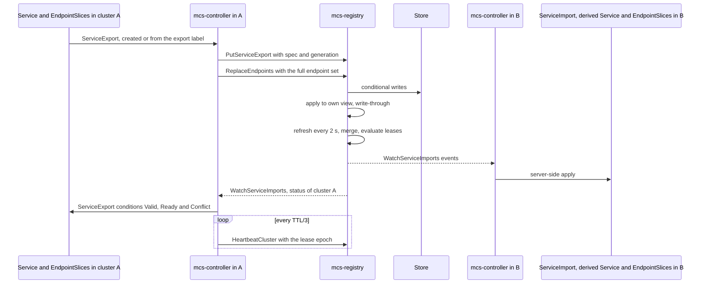

**Experimental.** The module
[`deploy/global-discovery-mcs`](https://github.com/ai-dynamo/dynamo/tree/main/deploy/global-discovery-mcs)
implements the Kubernetes Multi-Cluster Services (MCS) API (KEP-1645) with a central registry
instead of a Karmada control plane. A controller in every member cluster writes the cluster's
exports to the registry and materialises the merged imports of the whole clusterset, and the Global
Discovery Service reads those imports to find pools and Global Router replicas in every cluster.
This page describes the data model, the merge and consistency rules, the storage layout, the
controller, and the boundary with Karmada.

For deployment, see [Deploy Multi-Cluster Services](../../../../kubernetes/kv-aware-routing/multi-cluster-services.md).
For flags, conditions and metrics, see
[Multi-Cluster Services Configuration](../../../../reference/components/global-discovery-mcs-configuration.md).

## Background

KEP-1645 defines two resources in `multicluster.x-k8s.io`. A ServiceExport, created with the name
and in the namespace of a Service, makes that Service visible to the clusterset. An implementation
then creates a ServiceImport of the same name in every cluster of the clusterset where the
namespace exists ("namespace sameness"), with the union of the exported ports and either a
clusterset virtual IP (ClusterSetIP) or none (Headless). Endpoints arrive as EndpointSlices
labelled `multicluster.kubernetes.io/service-name` and `multicluster.kubernetes.io/source-cluster`,
one set per source cluster. When the exports of one Service disagree, the oldest export wins and
the others report a `Conflict` condition. Cluster identity comes from the KEP-2149 ClusterProperty
objects `cluster.clusterset.k8s.io` and `clusterset.k8s.io`.

The module follows the `sigs.k8s.io/mcs-api` v0.5.2 types, CRDs and derived Service naming. Its
merge and conflict rules implement the conflict resolution of KEP-1645 as expressed by the
`sigs.k8s.io/mcs-api` condition reasons. They run once, in the registry, so every cluster sees the
same result.

## Components

| Component | Role |
|---|---|
| `mcs-registry` | Stateless server. Keeps an in-memory view of each clusterset, merges exports into ServiceImports, evaluates leases, and serves the `dynamo.mcs.v1` API over gRPC and REST. Every replica runs every loop; no replica is elected. |
| Store | `memory` (one process) or `dynamodb` (one table, replicated between regions as a Global Table). |
| `mcs-controller` | One per member cluster, leader-elected. Registers the cluster, writes its exports and endpoints, and applies the clusterset's imports to its cluster. |
| `mcs-admin` | Inspects a store, deletes a cluster, creates the DynamoDB table. |
| `pkg/client` | Go client of the registry: ordered URL failover with DNS re-resolution, writer generations, and a reconnecting watch loop. |

The registry does not authenticate callers in this version. It belongs on a network that only the
member clusters reach.

## Data Model

### What the Registry Stores

The registry stores facts, each written by one writer: the `mcs-controller` of the cluster the
record belongs to.

| Record | Key | Content |
|---|---|---|
| Cluster | clusterset, cluster | Region, zones, provider, labels, the lease (epoch, TTL, last renewal) and a generation |
| ServiceExport | clusterset, cluster, namespace, name | Ports, type, session affinity and its client IP timeout, IP families, internal traffic policy, traffic distribution, exported labels and annotations, the export creation timestamp, and a writer generation |
| Endpoint set | clusterset, cluster, namespace, name | Every endpoint of the export in that cluster: addresses, address type, `ready`, `serving` and `terminating`, hostname, node name, zone, ports and attributes, with a writer generation. At most 1000 endpoints. |

An endpoint set is only ever replaced as a whole. The controller's source of truth is the set of
local EndpointSlices, so a full replace is idempotent across restarts, needs no tombstones, and
cannot leave a stale endpoint behind.

### What the Registry Computes

The registry derives, and never stores:

- the lease state of each cluster, at read time;
- one ServiceImport per (namespace, name) in a clusterset: the merged spec, the conflict if any,
  a status per exporting cluster (lease state, participation, its own conflict, endpoint counts,
  and `Valid`, `Ready` and `Conflict` conditions), and the endpoints grouped by source cluster.

Merge rules:

1. Only exports of clusters whose lease is active take part. They are ordered oldest first by
   export creation timestamp, then by cluster name; the first one wins.
2. Ports are the union by (port, protocol) in that order. A name or app protocol disagreement
   resolves to the oldest export, and a port whose name another (port, protocol) already uses is
   skipped.
3. IP families are intersected. An export with no family in common with the running intersection
   is skipped; an export that lists no family does not constrain the result.
4. Type, session affinity and its configuration, annotations, labels, internal traffic policy and
   traffic distribution come from the winner.

A conflict is set when a participating export disagrees with the winner. The registry reports one
reason, the first that applies in the order ports, IP families, type, session affinity, its client
IP timeout, annotations, labels, internal traffic policy and traffic distribution, using the
`sigs.k8s.io/mcs-api` reasons plus `IPFamilyConflict`. As KEP-1645 asks, the `Conflict` condition is
set on every participating cluster; the per-cluster `conflict` field additionally names the
clusters whose own export differs.

A cluster whose lease expired stops taking part: its endpoints leave every import, and its exports
no longer count in conflict resolution, so a dead cluster cannot pin the winner. An import whose
exporting clusters have all expired keeps its type and ports, with no endpoints, so derived
Services keep their virtual IPs while a controller restarts. The records stay for `--retention`
(24 h), so a returning controller keeps its export creation timestamps, then compaction removes
them. `DeregisterCluster` removes everything of a cluster at once.

## Writes, Generations and Leases

Writes are conditional in the store:

- Exports and endpoint sets carry a writer generation that must exceed the stored one. Writers use
  `max(previous + 1, unix milliseconds)`, which stays monotonic across restarts and across a
  failover to another registry region without remembering earlier values. A stale write fails with
  `STALE_GENERATION` and the stored generation; the controller retries once above it.
- `RegisterCluster` mints a lease epoch, `max(stored + 1, unix milliseconds)`. Heartbeats must
  carry the current epoch; any other epoch fails with `LEASE_EPOCH_MISMATCH`, and the controller
  registers again and resends every export.

A handler writes to the store, then applies the stored record to its own replica's view before it
responds (write-through), so a writer and every client of that replica read the write at once.
Sibling replicas pick it up on their next refresh. A record written through a replica wins over a
refresh snapshot for one refresh interval, unless the snapshot holds a newer version, so a refresh
that started before the write does not undo it.

Leases are evaluated at read time from server timestamps: a lease is expired once
`renewed_at + ttl + skew` is in the past. Nothing writes expiry to the store. Each replica
re-evaluates every lease every `--lease-eval-interval` (1 s) without a store read and publishes the
changes. Replicas may disagree on a lease by the skew allowance (2 s by default); the only effect
is an endpoint set that appears or disappears a moment earlier on one replica than on another.

## Watches and Revisions

Each replica refreshes every clusterset every `--refresh-interval` (2 s): it loads the clusterset
from the store, merges, diffs against its previous view, and publishes the changes to the
clusterset's watchers. It lists the store's clustersets every 30 s, and loads a clusterset at once
when a request names one it does not know.

A watch sends `SNAPSHOT_START`, one `UPSERT` per object, `SNAPSHOT_END` with a revision, then
deltas (`UPSERT` with the full object, `DELETE` with the last known one), and a `BOOKMARK` with the
current revision every 5 s, which keeps load balancer idle timeouts from closing quiet streams.

- A revision is `view_epoch:seq`. The view epoch is minted when the replica starts; the sequence
  counts the changes of one clusterset on that replica. Revisions of different replicas, or of one
  replica before and after a restart, are unrelated.
- Each replica keeps the last 10000 events per clusterset. A watch that resumes with a revision of
  the same replica whose later events are all still kept receives only those events. Any other
  revision yields a fresh snapshot, so a resume never fails and never skips an event; a client that
  fails over to another replica or region loses only the replay shortcut.
- Filters (namespace, label selector, endpoints or not) apply per watcher. An object that stops
  matching a watcher's filter arrives as `DELETE` with its new state. A bookmark's revision covers
  changes the filter skipped.
- A watcher that falls 1024 events behind is sent a new snapshot instead of being disconnected. A
  replica serves at most 5000 watch streams; beyond that a watch fails with `TOO_MANY_WATCHERS`.

## Storage

### Memory Store

The memory store keeps the same conditional semantics in the registry process. It suits tests and
evaluation with one replica. A restart loses every record: each controller's next heartbeat fails
with `CLUSTER_NOT_REGISTERED`, and the controller registers again and resends its exports. In
between, the importers receive a snapshot without those imports and delete them, then re-create
them as the exports return.

### DynamoDB Single-Table Layout

The DynamoDB store keeps every record in one table with a string partition key `pk` and sort key
`sk`. Record bodies are serialized protobuf; the values that write conditions need are top-level
attributes (`gen`, `lease_epoch`, `lease_renewed_at`, `updated_at`, `expires_at`).

| Item | `pk` | `sk` |
|---|---|---|
| Clusterset index | `CSX` | `CS#<clusterset>` |
| Cluster | `CS#<clusterset>` | `CL#<cluster>` |
| ServiceExport | `CS#<clusterset>` | `EX#<cluster>#<namespace>#<name>` |
| Endpoint partition marker | `CS#<clusterset>` | `EPX#<cluster>` |
| Endpoint set | `EP#<clusterset>#<cluster>` | `<namespace>#<name>` |

- The clusterset partition holds the small, heartbeat-heavy records. Endpoint sets, which are large
  and change often, live in one partition per cluster. Loading a clusterset or deleting a cluster
  needs prefix queries only; the table has no global secondary index.
- Registration writes on `attribute_not_exists(pk) OR (lease_epoch < :new AND gen = :seen)`,
  heartbeats on `lease_epoch = :epoch`, and export and endpoint set puts on
  `attribute_not_exists(pk) OR gen < :gen`, returning the stored item on failure.
- A refresh reads a clusterset with one query of its partition and one query per endpoint
  partition, eventually consistent and paginated.
- Cluster items carry a 7-day TTL (`expires_at`) as a garbage-collection safety net. Leases never
  depend on DynamoDB TTL timing.

The module's
[storage document](https://github.com/ai-dynamo/dynamo/blob/main/deploy/global-discovery-mcs/docs/storage.md)
has the full item catalogue, conditions, capacity estimates and table definition.

### Global Tables and Multi-Region Reads

With a Global Table, every registry replica reads and writes the table replica of its own region.
DynamoDB replicates each write to the other regions, usually within a second, and resolves
concurrent writes to one item by last writer wins. Conditions are evaluated only in the region
that accepts a write. The registry stays correct without cross-region conditions because of three
properties of its records:

1. **One logical writer per item.** A cluster's records are written only by that cluster's
   controller, which has one leader at a time.
2. **Monotonic generations.** A generation of `max(previous + 1, unix milliseconds)` puts
   generation order and wall-clock order in agreement, which is the order last writer wins uses.
   A controller that fails over to another region writes above everything it wrote before.
3. **Full-state writes.** Every put replaces a whole record and controllers resync periodically,
   so the writer's next write repairs whatever a conflict resolution kept.

A write is visible in its own region on the accepting replica at once, on sibling replicas within
one refresh interval, and in other regions after replication plus one refresh interval, under 5 s
in total. When the store does not answer, a replica keeps serving reads from its last view, fails
writes with `STORE_UNAVAILABLE`, and reports not ready once its view is older than three refresh
intervals, so load balancer and DNS health checks move clients to healthy replicas or regions.

## Controller

All parts run on one controller-runtime manager. Everything that writes to the registry or applies
imports runs on the leader only.

| Part | Role |
|---|---|
| Identity | Resolves the clusterset and cluster ids (flags, else the ClusterProperty objects), the region (flag, else node labels), zones and provider at startup. |
| Lease | Registers the cluster, then heartbeats every TTL/3. A refused heartbeat registers again and triggers a full resync. |
| ServiceExport reconciler | For each ServiceExport: adds the finalizer, validates the Service, writes the spec and the endpoint set when their hashes change, and writes the conditions. On deletion it deletes the registry record before removing the finalizer. |
| Resyncer | At startup, after each reconnect and after each re-registration: deletes this cluster's registry exports that have no local ServiceExport, then writes every export again. |
| Auto-export | Creates a ServiceExport, owned by the Service, for each Service labelled `dynamo.nvidia.com/mcs-export: "true"`, and deletes it when the label goes. It never touches a ServiceExport it did not create. |
| Importer | Holds one `WatchServiceImports` stream with endpoints and applies each import with server-side apply. |

The export side builds the endpoint set from the Service's EndpointSlices, skipping the slices it
imported itself. For each endpoint it records the addresses, the slice's address type, `ready`
(unset means ready), `serving` (unset follows ready), `terminating`, hostname, node, zone, the
slice's ports, and the endpoint's target reference as the attributes `targetRef.kind`,
`targetRef.name` and `targetRef.uid`. The Service's `dynamo.nvidia.com/mcs-*` labels and annotations
travel with the export as exported labels and annotations.

The import side writes, for each import in a namespace that exists locally:

| Object | Name | Content |
|---|---|---|
| ServiceImport | The exported Service's name | Merged type, ports, session affinity and IP families; the derived Service's ClusterIPs as `spec.ips`; the participating clusters and the `Ready` and `Conflict` conditions |
| Derived Service | `derived-<hash>` | No selector; ClusterIP, or `clusterIP: None` for Headless; merged ports; owned by the ServiceImport |
| EndpointSlices | `<derived Service>-<source cluster>-<index>` | One set per source cluster, the local cluster included, at most 100 endpoints each; ports filtered to the merged port names; conditions as exported; `targetRef` from the exported attributes; labels `kubernetes.io/service-name`, `multicluster.kubernetes.io/service-name`, `multicluster.kubernetes.io/source-cluster` and `endpointslice.kubernetes.io/managed-by` |

The importer deletes imports that are missing from the registry only after `SNAPSHOT_END`, so a
reconnect in the middle of a snapshot never removes an import. An import whose namespace does not
exist waits until the namespace appears. A ServiceImport without the controller's managed-by label
belongs to another implementation and is skipped.

### Derived Service Naming

The derived Service of the import `<namespace>/<name>` is `derived-` followed by the first ten
characters of the lowercase, unpadded base32hex encoding of the SHA-256 of `<namespace>/<name>`.
This is the `sigs.k8s.io/mcs-api` algorithm, so the name is the same in every cluster and in every
implementation that follows mcs-api, and a client can compute it to dial
`derived-<hash>.<namespace>.svc.cluster.local`. Names under `clusterset.local` need the CoreDNS
`multicluster` plugin, which reads the ServiceImports and slices the controller writes.

## How the Global Discovery Service Reads the Imports

The Global Discovery Service, with `--pool-discovery mcs`, never calls the registry. It runs in a
member cluster and watches the EndpointSlices that `mcs-controller` imports there:

- It selects every slice labelled `multicluster.kubernetes.io/source-cluster`, in every namespace,
  and groups the slices by `multicluster.kubernetes.io/service-name`. The source-cluster label tells
  apart the endpoints that each cluster exported for the same Service.
- A pool is a Service named `<DGD name><--pool-service-suffix>` (default `-pool-relay`) in one source
  cluster and namespace. It is live while one of its endpoints is Ready.
- The Global Router replicas are the Ready endpoints of the Service named by `--router-namespace`
  and `--router-service`, reached on the TCP port named `--router-port-name`. The controller keeps
  the port names of the merged import on every slice.
- A replica is named `<source cluster>/<pod>`, after the imported endpoint's `targetRef.name`,
  which the controller carries across clusters in the `targetRef.name` attribute; an endpoint
  without one is named after its address.

The contract between the module and the Global Discovery Service is these two labels, the
`targetRef.name` attribute, the copied endpoint conditions and the port names. An endpoint change
in one cluster reaches the other clusters' slices in roughly 3 to 6 seconds. A cluster whose lease
expires (30 s plus the 2 s skew by default) loses its slices in every cluster, so its pools and
replicas leave the lists.

## Compatibility with Karmada

The Global Discovery Service also reads Karmada's imports, with `--pool-discovery karmada`. The two
implementations share the export side and differ on the import side:

| Concern | Dynamo MCS | Karmada |
|---|---|---|
| Export | ServiceExport in the cluster that runs the Service | The same object |
| Where imports appear | Every member cluster with the controller | The Karmada control plane, and member clusters with a ServiceImport for the Service |
| Imported slice identification | Labels `multicluster.kubernetes.io/service-name` and `multicluster.kubernetes.io/source-cluster` | Name `imported-<cluster>-<source slice>`, label `kubernetes.io/service-name: derived-<service>` |
| Derived Service | `derived-<hash>` | `derived-<service>`, which limits Service names to 55 characters |
| Control plane | `mcs-registry`, with the memory store or a DynamoDB Global Table | The Karmada control plane |

Because the export side is the same, a deployment moves between the two by replacing the MCS
implementation and changing `--pool-discovery`; the exported Services and their ServiceExports
stay the same, subject to Karmada's 55-character limit on Service names. The ServiceExport and
ServiceImport CRDs from mcs-api v0.5.2 serve `v1alpha1` and `v1beta1`, so clients of either version
share them. Within one cluster, keep the
implementations apart by namespace: the controller adds its finalizer to, and writes conditions
on, every ServiceExport in the namespaces it watches, and it skips ServiceImports it did not create.
