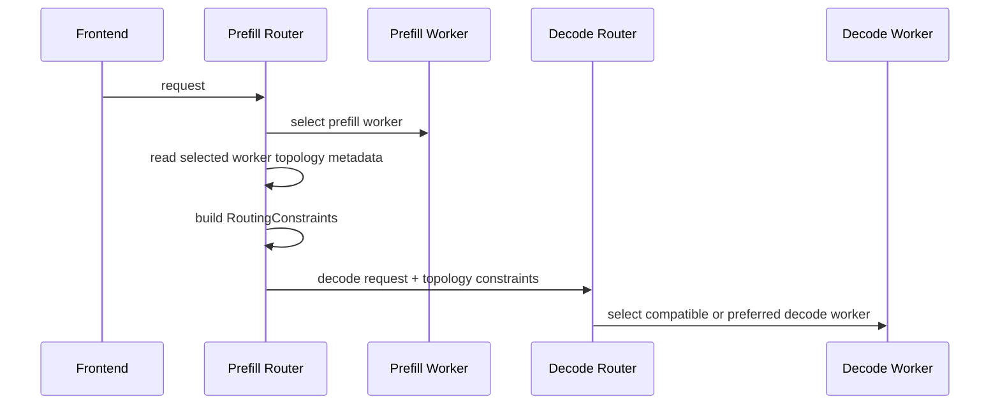

**Experimental.** Topology-aware KV transfer in NVIDIA Dynamo constrains or biases decode worker selection after a prefill worker has been selected. The router derives standard `RoutingConstraints` from the selected prefill worker's published topology metadata, then merges those constraints into the decode request. The same metadata limits [KV fetch hints](#kv-fetch-hints) to sources in the target worker's topology domain.

Use the Kubernetes operator path when possible. For the Kubernetes configuration fields, see the
[KvTransferPolicy API](../../../../reference/kubernetes-api/full-api-reference.mdx#kvtransferpolicy).

## Runtime Contract

Workers publish topology and policy fields through `ModelRuntimeConfig`:

| Field | Meaning |
|-------|---------|
| `topology_domains` | Map of logical domain name to this worker's topology value, for example `{"zone": "us-east-1a"}`. |
| `kv_transfer_domain` | Domain key used for KV transfer routing (prefill-to-decode and KV fetch hints), for example `zone`. |
| `kv_transfer_enforcement` | `required` or `preferred`. |
| `kv_transfer_preferred_weight` | Preferred-taint weight used only when enforcement is `preferred`. |

Each topology entry also becomes a canonical worker taint:

```text
dynamo.topology/<domain>=<value>
```

For example:

```json
{
  "topology_domains": {
    "zone": "us-east-1a",
    "rack": "rack-22"
  },
  "kv_transfer_domain": "zone",
  "kv_transfer_enforcement": "preferred",
  "kv_transfer_preferred_weight": 0.85
}
```

This creates worker taints:

```text
dynamo.topology/zone=us-east-1a
dynamo.topology/rack=rack-22
```

The KV-transfer policy uses only `kv_transfer_domain` to derive the decode constraint. Other topology domains remain available as ordinary routing taints.

### Domain Model and Limits

- A worker has at most one value per topology domain, and it can have values for several domains, for example a zone, a rack, and a host.
- `kv_transfer_domain` names one of those domains. Workers with the same value for it form an island; KV transfer routing, both prefill-to-decode and [KV fetch hints](#kv-fetch-hints), looks only at that domain.
- With the operator, `KvTransferPolicy` is graph-wide, so every worker in a deployment uses the same transfer domain.
- The router treats domains as independent labels and does not assume nesting, such as racks inside zones. An island contains whatever workers the chosen label groups together: with a host label, an island never spans zones, and with a zone label, it spans hosts.
- Islands partition the workers: each worker is in at most one island (none without a value for the domain). They cannot describe links where A reaches B and C over RDMA but B and C cannot reach each other.

## Request Flow



The prefill router builds the decode constraint before dispatching prefill when the selected worker is already known. This keeps `required` policy fail-closed: if the router cannot derive authoritative decode constraints for a required policy, it fails the request instead of dispatching prefill and then discovering that decode cannot be routed safely.

## Enforcement Modes

### Required

`required` turns the selected prefill worker's transfer-domain topology into a required taint.

```text
required_taints = {"dynamo.topology/zone=us-east-1a"}
```

Decode workers without that taint are ineligible. If no eligible decode worker exists, routing returns no endpoint for that request.

### Preferred

`preferred` turns the same topology into a preferred taint.

```text
preferred_taints = {"dynamo.topology/zone=us-east-1a": 0.85}
```

Decode workers that satisfy existing required constraints remain eligible, but matching workers receive a routing-cost bias. When enforcement is `preferred`, `preferredWeight` is required, must be from `0` to `1`, and controls the strength of that bias. It is not a probability and does not guarantee same-domain selection.

## Worker Environment Contract

The Python backend utility reads topology from files and transfer policy from environment variables:

| Environment variable | Description |
|----------------------|-------------|
| `DYN_TOPOLOGY_ENABLED` | Set to `true` to enable topology reading. |
| `DYN_TOPOLOGY_MOUNT_PATH` | Directory containing topology files. Defaults to `/etc/dynamo/topology`. |
| `DYN_KV_TRANSFER_DOMAIN` | Required when topology is enabled. Names the topology file and runtime domain to use for KV transfer constraints. |
| `DYN_KV_TRANSFER_ENFORCEMENT` | `required` or `preferred`. Defaults to `required` when a domain is set. |
| `DYN_KV_TRANSFER_PREFERRED_WEIGHT` | Required when enforcement is `preferred`; must be from `0` to `1`. |

Each non-hidden, non-empty file under `DYN_TOPOLOGY_MOUNT_PATH` is interpreted as one topology domain. The file name is the domain; the file content is the worker's value for that domain.

For example:

```bash
mkdir -p /tmp/dynamo-topology
printf 'us-east-1a\n' > /tmp/dynamo-topology/zone

export DYN_TOPOLOGY_ENABLED=true
export DYN_TOPOLOGY_MOUNT_PATH=/tmp/dynamo-topology
export DYN_KV_TRANSFER_DOMAIN=zone
export DYN_KV_TRANSFER_ENFORCEMENT=required
```

When topology is enabled, the worker polls once per second for up to 30 seconds until the selected transfer-domain file exists and has content. If it remains missing or empty, the worker exits so the bad topology source is visible during startup.

## Backend Support

The integrated Python backends apply the topology config during worker registration:

- vLLM
- SGLang
- TensorRT-LLM
- Mocker, for simulation and tests

The topology utility writes the fields onto `ModelRuntimeConfig`; Rust owns validation and canonical topology-taint generation.

## Interactions with Existing Routing Constraints

Topology-aware KV transfer uses the existing `RoutingConstraints` path. It does not add a topology-specific selector. If a request already has routing constraints, the prefill router merges the generated topology constraints into the decode request:

- Required topology taints are appended to existing `required_taints`.
- Preferred topology taints are appended to existing `preferred_taints`.

User-provided constraints still apply. A decode worker must satisfy all required constraints to be eligible.

## KV Fetch Hints

When workers advertise router-hint support, as vLLM workers with KVCR do, the router can attach a `kv.fetch` hint to the selected worker. The hint names a peer that holds a longer prefix of the request, so the worker can fetch that KV instead of computing it. A fetch over a slow link, such as TCP between hosts without RDMA, is usually slower than recomputing, so with topology enabled the fetch source must be in the target worker's island: its value for the target's `kv_transfer_domain` must equal the target's value.

- The target worker's `kv_transfer_domain` and `kv_transfer_enforcement` apply. This is the reverse of prefill-to-decode routing, where the prefill worker's policy applies.
- A source with no value for that domain is in no island.
- With `required`, or no enforcement set, only same-island sources are used. If none holds a longer prefix than the target, the router sends no hint and the target computes the prefix itself.
- With `preferred`, the longest same-island prefix is used. A cross-island source is used only when no same-island source qualifies. `preferredWeight` does not apply to fetch hints.
- A target without `kv_transfer_domain` is not filtered.
- Filtering never fails a request. It only changes or removes the hint.

Worker selection and the fetch source are one decision. For every candidate, the router finds the source the hint would name under these rules. With the default policy's `shared_cache_multiplier` above `0`, it credits the blocks that source would add, so an idle worker that can fetch a prefix can win over a busy worker that holds it. The selected worker's hint names the source that earned the credit, and a source the target cannot use earns no credit. The credit lowers only the score: booked prefill still counts the fetched blocks, because a fetch can miss.

KVCR caches are hint sources through their cache owners. A vLLM worker publishes its topology with each cache owner it creates, because KVCR runs in the worker's pod. An owner without published topology, for example one created by an older worker, takes the island of the worker it is attached to. An unattached owner without published topology is in no island.

A cache owner's published topology is fixed when its slot is first created, the same as its control endpoint.

For KVCR, use `required`. If each host is its own RDMA island, set `labelKey: kubernetes.io/hostname` on the `KvTransferPolicy` so nodes need no extra labels.

## Operational Notes

- Prefill-to-decode constraints apply only to disaggregated deployments. KV fetch hints also apply to aggregated workers, so configure topology there when workers fetch KV from peers, for example with KVCR.
- Keep `DYN_ROUTER_MODE=kv` on the frontend so the prefill and decode routing paths use the KV router.
- Make sure every prefill domain has enough decode capacity when using `required`; otherwise the router can legitimately fail requests in domains without decode workers.
- Use `preferred` during incremental rollouts when same-domain transfer is a latency preference rather than a hard placement requirement.
- Transport health is separate from topology selection. Topology-aware routing chooses a better peer, but RDMA, EFA, UCX, or libfabric still need to be configured correctly for NIXL KV transfer.

## Troubleshooting Signals

| Symptom | Likely cause | Check |
|---------|--------------|-------|
| Worker exits during startup | `DYN_KV_TRANSFER_DOMAIN` missing, or topology file never populated. | Worker logs and contents of `DYN_TOPOLOGY_MOUNT_PATH`. |
| Required policy returns no endpoint | No decode worker has the selected prefill worker's generated topology taint. | Worker `ModelRuntimeConfig` topology metadata and decode worker placement. |
| Preferred policy still routes cross-domain | Matching domain is overloaded or unavailable, or weight is too low relative to load. | Increase `preferredWeight`, add same-domain decode capacity, or switch to `required`. |
| Router sees no topology metadata | Worker did not publish topology fields. | Backend startup logs and runtime config metrics/discovery data. |
| KV fetch hints stop after enabling topology | No source with a longer prefix is in the target's island, or sources have no value for the transfer domain. | Worker `topology_domains` and placement of the workers that hold the cache. |

For the operator field definitions, see the
[KvTransferPolicy API](../../../../reference/kubernetes-api/full-api-reference.mdx#kvtransferpolicy).
