NVIDIA Dynamo is designed to run inside a trusted service network. The deployer,
the team that operates Dynamo and is distinct from the Dynamo Operator, owns the
external security boundary and the isolation of Dynamo's internal services.

> [!WARNING]
> Do not expose the Dynamo Frontend, Planner dashboard, standalone router services,
> NATS, etcd, or ZMQ endpoints directly to an untrusted network.

> [!IMPORTANT]
> The Docker Compose files and example manifests in this repository are for local
> development and demonstration. Use the Kubernetes deployment path and your
> platform's production security controls for a hardened deployment.

## Trust Model

Dynamo separates client-facing traffic from internal coordination:

- External clients reach the inference API through a gateway that authenticates
  and authorizes them, enforces request policy and quotas, and protects the
  client-to-gateway connection with TLS.
- Frontends, workers, and the discovery, event, and request planes run on a trusted
  network that external clients cannot reach.
- Infrastructure services such as NATS, ModelExpress, and the NIXL/RDMA fabric are
  part of that internal boundary and must be isolated and hardened by the deployer.

The Frontend does not authenticate or authorize end users. A gateway is therefore
the public security boundary, not merely a load balancer. TLS termination at the
gateway protects only the client-to-gateway hop. Protect the gateway-to-Frontend
hop separately when it crosses an untrusted segment.

## Security Principles

1. **Expose the smallest possible edge.** Route clients through an authenticating
   gateway and keep Frontend administrative and observability routes private.
2. **Treat every internal control surface as privileged.** Network reachability is
   not authorization; a ClusterIP remains reachable across the cluster. Restrict
   listeners to authorized workloads even when they provide their own authentication.
3. **Encrypt and authenticate transport peers where supported.** Use TLS or mTLS
   with trust roots constrained to the intended peers, and verify the expected
   server identity. Use authenticated NATS when a brokered plane crosses a trust
   boundary. Keep ZMQ and NIXL/RDMA on the trusted network.
4. **Treat models and operational data as executable or sensitive inputs.** Pin
   images and model revisions, review remote model code, and control access to
   traces, KV events, metrics, logs, and caches.

## Production Checklist

- [ ] **Protect the public request path.** Configure authentication,
  authorization, TLS, rate limits, and request policy at the gateway. If the
  gateway-to-Frontend hop is not already protected by the trusted network or a
  service mesh, enable Frontend TLS and configure the gateway to verify it. See
  [Frontend client authentication and exposure](../../reference/components/frontend-configuration.mdx#client-authentication-and-exposure)
  and [Secure the public request path](../../kubernetes/model-deployment/expose-the-frontend.md#secure-the-public-request-path).
- [ ] **Bind tenant state to authenticated identity.** Have the gateway replace
  client-supplied tenant headers and normalize cache salts from the authenticated
  identity. Disabling NvExt does not disable cache salts or `x-tenant-id`. See
  [tenant identity and cache salts](../../reference/components/frontend-configuration.mdx#tenant-identity-and-cache-salts).
- [ ] **Limit Frontend routes.** Keep metrics, health, model discovery, OpenAPI,
  and Swagger endpoints private. Disable client-controlled routing extensions and
  the `/router_policy`, `/router_policy/busy_threshold`, and legacy
  `/busy_threshold` administration routes when they are not required. See
  [Frontend HTTP endpoints](../../reference/components/frontend-configuration.mdx#http-endpoints)
  and [Frontend feature switches](../../reference/components/frontend-configuration.mdx#frontend-feature-switches).
- [ ] **Secure the request plane.** Keep request and response-stream ports private.
  Configure TCP TLS or mTLS on every component, or configure authenticated TLS to
  NATS when using the NATS request plane. Constrain client and server trust roots
  to the intended peers and verify the expected server identity. QUIC responses
  use a separate certificate-pinning model that depends on the request transport's
  integrity; TCP TLS settings do not configure QUIC. See the
  [QUIC response security guidance](../../reference/components/tls-configuration.mdx#quic-response-security), the
  [request-plane architecture](../knowledge-base/concepts/system-architecture/architecture.md#request-plane),
  [TLS trust-domain guidance](../../reference/components/tls-configuration.mdx#trust-domain-and-peer-verification),
  and [Operator TLS setup](../../kubernetes/installation/tls.md).
- [ ] **Secure the event plane and KV metadata.** Use authenticated TLS to NATS
  when events cross a trust boundary. Dynamo's ZMQ transports do not add
  authentication or encryption and must remain on the trusted network. Treat KV
  events as sensitive request-derived data. See the
  [event-plane architecture](../knowledge-base/concepts/system-architecture/architecture.md#event-plane)
  and [KV event security considerations](../advanced-customizations/writing-custom-backends/publish-kv-events.md#security-considerations).
- [ ] **Use Kubernetes-native discovery.** Use the operator's default Kubernetes
  discovery and namespace-scoped RBAC. etcd discovery is deprecated on Kubernetes;
  authenticate and encrypt it in supported local, bare-metal, or legacy deployments.
  See the [discovery-plane architecture](../knowledge-base/concepts/system-architecture/architecture.md#discovery-plane).
- [ ] **Isolate Planner control surfaces.** Disable the unauthenticated live
  dashboard when unused. Restrict optional system-port runtime reconfiguration
  separately from the loopback control API. Configure plugin registration
  authentication explicitly,
  keep the default Unix-domain registration socket where possible, and do not treat
  the Global Planner's caller namespace allowlist as caller authentication. See
  [Planner security](../knowledge-base/modular-components/planner/planner-guide.md#security),
  [Planner plugin configuration](../../reference/components/planner-configuration.mdx#scheduling-and-plugin-pipeline),
  and [Global Planner management modes](../knowledge-base/modular-components/planner/global-planner-guide.md#step-2-create-the-control-dgd).
- [ ] **Isolate component system servers.** These servers use plaintext HTTP and
  do not authenticate callers. A ClusterIP does not authorize callers; restrict
  health, metrics, metadata, `/engine/*`, and LoRA management routes to authorized
  workloads and namespaces, and verify the NetworkPolicy. See
  [system and metrics configuration](../../reference/observability/environment-variables.mdx#system-and-metrics).
- [ ] **Keep standalone router services private.** The standalone
  [KV indexer](../knowledge-base/modular-components/router/standalone-indexer.md#model-and-routing-group-support),
  [selection service](../knowledge-base/modular-components/router/standalone-selection.md#build-and-launch),
  and [slot tracker](../knowledge-base/modular-components/router/standalone-slot-tracker.md#build-and-launch)
  do not authenticate callers. Their `routing_group` values partition state; they
  do not establish identity.
- [ ] **Pin executable artifacts.** Pin container images by digest and models to
  immutable revisions or reviewed local snapshots. Enable model-supplied remote
  code only after review, and inspect generated DGDs before applying them. See
  [secure model and image provenance](../../kubernetes/model-deployment/introduction.mdx#secure-model-and-image-provenance).
- [ ] **Constrain media fetching.** Keep internal destinations blocked for
  untrusted media inputs. Opt into egress-proxy trust only when the proxy enforces
  destination policy, restrict local file access, and bound downloads and decoding.
  Verify the policy on both Dynamo-owned and engine-owned fetch paths. See
  [media input security](../../use-cases/multimodal-serving/overview.md#media-input-security).
- [ ] **Control operational data.** Apply access and retention policies to
  [request traces](../../reference/observability/request-traces.mdx),
  [request payload exports](../../reference/observability/logging.mdx#request-payload-export),
  metrics, Planner reports, and model or KV caches. Validate request-derived URLs,
  paths, and serialized values before using them in privileged operations.
- [ ] **Restrict workload creation.** Grant DGDR access only to principals trusted
  to create workloads in the namespace. Profiling runs even with `autoApply: false`;
  enforce Pod Security Admission on resulting Pods and control ServiceAccount
  selection separately. See
  [DGDR workload creation and trust](../../reference/kubernetes-api/dynamo-graph-deployment-request.mdx#workload-creation-and-trust).
- [ ] **Run with least privilege.** Use dedicated ServiceAccounts, narrow RBAC,
  NetworkPolicies, non-root containers, read-only filesystems where compatible,
  and minimal Linux capabilities. Review privileged features such as
  [checkpoint and restore](../../reference/kubernetes-api/full-api-reference.mdx#checkpointconfiguration),
  and configure gateway quotas plus [request rejection and load shedding](../../kubernetes/fault-tolerance/request-rejection.md).

## LPX Client Identity

For every LPX DynamoGraphDeployment (DGD), the operator creates Secret
`lpx-id-<DGD UID>` once. The DGD owns it, it is immutable, and the operator never
rewrites it or adopts a Secret the DGD does not control. It holds:

- `client.key` and `client.pem`: an Ed25519 key and a self-signed client certificate
  (client authentication only, not a CA, valid for 10 years). Only the `main`
  container of agent Pods mounts them, read-only at `/etc/lpx/identity`, together with
  the optional platform CA from Secret `lpx-server-ca`. Agent Pods also publish the certificate in the annotation
  `lpx.nvidia.com/client-cert`, so software on the LPU node can authenticate them.
- `private.key` and `private.key.pub`: the DGD's own SSH key pair. It replaces the
  cluster-wide MPI SSH Secret in the DGD's LPX Pods, so one DGD's key does not open
  another DGD's Pods.

Treat these Secrets as credentials: in workload namespaces, do not grant tenants
Secret read, Pod exec or Pod update.

The key is not rotated during the DGD's life. To rotate it, or after a suspected
leak, delete and recreate the DGD; the new DGD gets a new UID and so a new Secret,
key and certificate. Node-side software should accept the certificate only for the
hardware the DGD currently holds, so a leaked key stops working when the DGD ends,
whatever the certificate's validity period.

## Report a Vulnerability

Do not disclose suspected vulnerabilities in a public issue. Follow the private
reporting process in the [Dynamo Security Policy](https://github.com/ai-dynamo/dynamo/blob/main/SECURITY.md).
