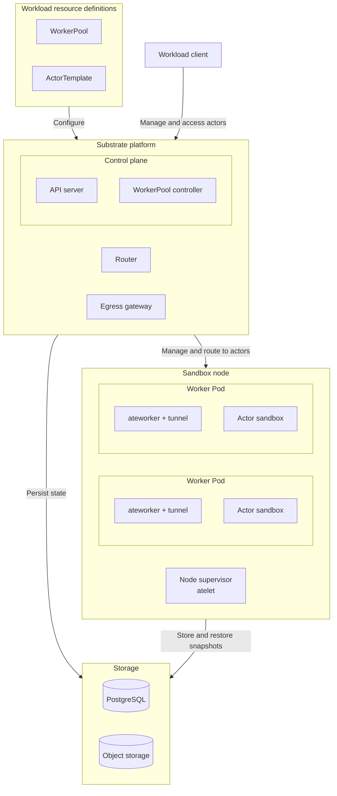

Install Agent Substrate's control plane, node runtime, and an in-cluster RustFS
object store for snapshots. Object storage is required by this Substrate release,
even when a workload does not use golden snapshots or suspend/resume.
Workloads configure their own client identities, worker pools, and actor images
after installation. This procedure does not require Harbor, Pi, or a model server.

<Warning>
This integration is experimental and uses Substrate `v1.0.0-rc.1`, commit
`f86fde9dfb5424c8d16f613de80469bdbef06541`. The S3 instructions below work
around limitations in that release's installer.
</Warning>

## Prerequisites

- Kubernetes 1.35 or newer, including kubelets on nodes that run Substrate or
  its clients. Kubernetes 1.37 or newer is recommended because the required
  certificate APIs and volume projections are stable and enabled by default.
  On 1.35 and 1.36, complete the explicit configuration in
  [Check cluster capabilities](#check-cluster-capabilities).
- Linux x86-64 (`amd64`) or ARM64 (`arm64`) nodes, with images and sandbox
  runtime assets built for the nodes where each component runs.
- For the default RustFS path, a StorageClass that can provision a
  `ReadWriteOnce` volume. This guide uses 50 GiB as a starting allocation;
  size it for retained snapshots.
- PostgreSQL and network access configured according to the pinned
  [Substrate operator installation guide](https://github.com/agent-substrate/substrate/blob/v1.0.0-rc.1/docs/guides/operator-install.md).
  This guide deploys object storage in the cluster; an external service is not required.
- Git, Go 1.27 or newer, and `kubectl` on the installation workstation, with the
  intended Kubernetes context already selected.

## What this installs

The installation prepares the Substrate platform and node runtime, backed by
PostgreSQL and object storage. WorkerPools, ActorTemplates, and actors are
workload resources you create afterward. The diagram shows two workers as an
example; each worker can host multiple actors when capacity allows.



| Boundary | Component | Responsibility |
| --- | --- | --- |
| Workload resource definitions | `WorkerPool` | Kubernetes resource that declares worker count, placement, capacity, and sandbox runtime. |
| Workload resource definitions | `ActorTemplate` | Substrate resource that defines actor images, resource limits, worker selection, and snapshot settings. |
| Control plane | API server (`ate-api-server`) | Manages actor records and lifecycle, selects workers, and coordinates activation and snapshots. |
| Control plane | WorkerPool controller (`ate-controller`) | Reconciles each WorkerPool into a Kubernetes Deployment that maintains worker Pods. |
| Substrate platform | Router (`atenet-router`) | Resolves an actor's worker assignment through the API, requests resume when needed, and forwards client traffic to the worker tunnel. |
| Substrate platform | Egress gateway (`atenet-egress`) | Applies actor egress policies to outbound requests. |
| Sandbox node | Node supervisor (`atelet`) | Prepares images and runtime assets, directs local workers, and transfers snapshots through an object-store plugin. |
| Sandbox node | Worker Pod (`ateworker` and its tunnel) | Runs the sandbox runtime and forwards incoming traffic to the assigned actor. |
| Worker Pod | Actor sandbox | Runs the workload's processes and holds its working state. Each actor has its own sandbox. |
| Storage | PostgreSQL | Stores control-plane records, including templates, actor lifecycle state, and worker assignments. |
| Storage | Object storage | Stores durable snapshots in S3 or GCS. Object-store plugins handle snapshot transfers and management. |

For lifecycle and networking details, see Substrate's
[architecture documentation](https://github.com/agent-substrate/substrate/blob/v1.0.0-rc.1/docs/concepts/architecture.md#system-components)
and [resource glossary](https://github.com/agent-substrate/substrate/blob/v1.0.0-rc.1/docs/reference/glossary.md).

Run commands from a working directory of your choice. Paths are relative to
that directory. Keep the installer configuration for future updates.

<Steps toc={true}>

<Step title="Check cluster capabilities" id="check-cluster-capabilities">

Substrate 1.0.0, pinned here to `v1.0.0-rc.1`, requires native
`PodCertificateRequest` and `ClusterTrustBundle` APIs and their Pod volume
projections. These APIs are built into Kubernetes; do not install CRDs for
them. The pinned [certificate client](https://github.com/agent-substrate/substrate/blob/v1.0.0-rc.1/cmd/podcertcontroller/internal/podcertificate/client.go)
supports `v1` and `v1beta1` PodCertificateRequests. Kubernetes 1.34's
`v1alpha1` API is incompatible, even with its feature gates enabled.

| Kubernetes version | Required preparation |
| --- | --- |
| 1.37 or newer, recommended | The certificate APIs and projections are stable and enabled by default. Verify API discovery below and check node versions, especially during upgrades. |
| 1.35 or 1.36 | Enable the feature gates on the API servers and kubelets, serve both beta APIs, and enable request cleanup in the controller manager as shown below. |

See the Kubernetes feature-gate reference for
[`PodCertificateRequest`](https://kubernetes.io/docs/reference/command-line-tools-reference/feature-gates/#PodCertificateRequest),
[`ClusterTrustBundle`](https://kubernetes.io/docs/reference/command-line-tools-reference/feature-gates/#ClusterTrustBundle),
and [`ClusterTrustBundleProjection`](https://kubernetes.io/docs/reference/command-line-tools-reference/feature-gates/#ClusterTrustBundleProjection).

<Accordion title="Configure Kubernetes 1.35 and 1.36">

Merge these settings into your cluster's existing configuration. For a managed
cluster, confirm that your provider supports these settings before proceeding.
The Substrate installer does not configure Kubernetes components for you.

On every **kube-apiserver**, enable the APIs and projection fields, and expose
both beta resource endpoints:

```text
--feature-gates=PodCertificateRequest=true,ClusterTrustBundle=true,ClusterTrustBundleProjection=true
--runtime-config=certificates.k8s.io/v1beta1/podcertificaterequests=true,certificates.k8s.io/v1beta1/clustertrustbundles=true
```

Feature gates alone do not expose these APIs. The `--runtime-config` entries
enable their REST endpoints. See the Kubernetes 1.35
[projected-volume requirements](https://v1-35.docs.kubernetes.io/docs/concepts/storage/projected-volumes/).

On every **kubelet** that hosts Substrate components or client Pods, merge
these gates into its `KubeletConfiguration`:

```yaml
featureGates:
  PodCertificateRequest: true
  ClusterTrustBundleProjection: true
```

Include nodes hosting the Substrate control plane, router, and workload clients as well
as sandbox workers. The kubelet requests certificates and mounts and refreshes
the certificate, private key, and trust-bundle files.

On every **kube-controller-manager**, enable cleanup of old certificate
requests:

```text
--feature-gates=PodCertificateRequest=true
```

This enables Kubernetes request cleanup; Substrate's certificate controller
issues the workload certificates. Preserve other configured gates and
runtime settings, then roll out the control-plane changes and restart the
affected kubelets using your cluster's configuration mechanism.

</Accordion>

Check the API-server and node versions, then discover the certificate APIs:

```bash
kubectl version
kubectl get nodes -o custom-columns=NAME:.metadata.name,KUBELET:.status.nodeInfo.kubeletVersion
kubectl api-resources --api-group=certificates.k8s.io
```

The resource list must include `podcertificaterequests` and
`clustertrustbundles` with API version `certificates.k8s.io/v1beta1` on 1.35
and 1.36, or `certificates.k8s.io/v1` on 1.37. API discovery does not verify
kubelet projections or certificate issuance. Complete those checks after
deployment in [Verify the installation](#verify-the-installation).

Substrate's certificate controller issues certificates and publishes CA trust
bundles. Substrate components use the projected credentials and trust bundles
for TLS. A mounted trust bundle does not update a container's system trust
store; custom clients must configure their TLS library to use it. Follow the
pinned [authentication setup](https://github.com/agent-substrate/substrate/blob/v1.0.0-rc.1/docs/guides/authentication.md)
for signer and trust configuration.

### Choose architecture per component

The Substrate control plane, sandbox workers, workload clients, and Dynamo can
run on separate nodes with different CPU architectures. Match each component's
binaries and images to its own nodes:

| Component | Architecture choice |
| --- | --- |
| `ate-setup` and workstation `kubectl-ate` | Build for the workstation where you execute them. |
| Substrate control plane and router | Use images for their scheduled nodes. The pinned release publishes multi-architecture images. |
| `atelet`, workers, and actors | Match each sandbox node's architecture. Actor images and guest executables must match that worker. |
| Workload clients | Use images and CLI binaries for the client's own node. |
| Dynamo | Select serving images for the inference hardware through the model recipe, independently of Substrate. |

For gVisor, the pinned
[`gvisor-default` SandboxConfig](https://github.com/agent-substrate/substrate/blob/v1.0.0-rc.1/manifests/ate-install/sandboxconfig-gvisor.yaml)
provides both architecture variants of the same runtime release. `atelet`
selects the matching assets. Inspect eligible nodes with the relevant tab:

<Tabs>
<Tab title="x86-64 (amd64)">

```bash
kubectl get nodes -l kubernetes.io/os=linux,kubernetes.io/arch=amd64
```

Use `linux/amd64` worker and actor images. The SandboxConfig's `assets.amd64`
entry supplies the `x86_64` gVisor release archive.

</Tab>
<Tab title="ARM64 (arm64)">

```bash
kubectl get nodes -l kubernetes.io/os=linux,kubernetes.io/arch=arm64
```

Use `linux/arm64` worker and actor images. The SandboxConfig's `assets.arm64`
entry supplies the `aarch64` gVisor release archive.

</Tab>
</Tabs>

Every node eligible for sandbox placement needs `atelet` and the assets
required by its runtime. For a different sandbox runtime, check that its
binaries, kernel requirements, and configured assets support the selected
architecture. Workload guides configure worker placement and actor images
separately after this platform installation.

</Step>

<Step title="Build the installation tools" id="build-the-installation-tools">

Fetch the same release as the control-plane images:

```bash
mkdir -p deps/bin
git clone --branch v1.0.0-rc.1 https://github.com/agent-substrate/substrate deps/substrate
go env GOHOSTOS GOHOSTARCH
```

Choose the architecture reported by Go for your **workstation**, independently
of the cluster nodes. These commands keep the workstation's operating system:

<Tabs>
<Tab title="x86-64 workstation (amd64)">

```bash
GOARCH=amd64 go -C deps/substrate build -o ../bin/ate-setup ./cmd/ate-setup
GOARCH=amd64 go -C deps/substrate build -o ../bin/kubectl-ate ./cmd/kubectl-ate
```

</Tab>
<Tab title="ARM64 workstation (arm64)">

```bash
GOARCH=arm64 go -C deps/substrate build -o ../bin/ate-setup ./cmd/ate-setup
GOARCH=arm64 go -C deps/substrate build -o ../bin/kubectl-ate ./cmd/kubectl-ate
```

</Tab>
</Tabs>

```bash
export PATH="$PWD/deps/bin:$PATH"
```

Keep this `bin` directory on `PATH` in shells where you manage Substrate or run
its tutorials. `ate-setup` installs the platform; `kubectl-ate` manages its API
objects.

</Step>

<Step title="Deploy in-cluster object storage" id="deploy-in-cluster-object-storage">

Deploy RustFS from the pinned Substrate checkout. Its manifest includes a
persistent volume claim, a single RustFS server, a ClusterIP Service, a bucket
initialization Job, and a NetworkPolicy allowing Substrate's snapshot plugins
and that Job to reach the S3 API.

<Note>
If you already have remote object storage, skip this RustFS deployment. Follow
Substrate's [snapshot storage setup](https://github.com/agent-substrate/substrate/blob/v1.0.0-rc.1/docs/guides/operator-install.md#snapshot-storage)
and [object-store plugin configuration](https://github.com/agent-substrate/substrate/blob/v1.0.0-rc.1/docs/concepts/architecture.md#system-components).
Update the bucket, endpoint, region, and credentials below for an existing S3
service. For GCS, use the upstream service-account setup and retain the plugins'
`gcs` backend instead of applying the S3 settings.
For static S3 credentials, create `ate-objectstore` in `ate-system` with the
`AWS_ACCESS_KEY_ID` and `AWS_SECRET_ACCESS_KEY` keys expected below. If you use
workload identity instead, omit those two Secret references from the plugins.
</Note>

The defaults used throughout this guide are:

| Setting | Value |
| --- | --- |
| Namespace | `ate-system` |
| S3 endpoint | `http://rustfs.ate-system.svc:9000` |
| Bucket | `ate-snapshots` |
| Snapshot location | `s3://ate-snapshots/` |
| Region | `us-east-1` |
| Credentials Secret | `ate-objectstore` |
| PersistentVolumeClaim | `rustfs-data` |

Create the namespace and a shared Secret for RustFS, the bucket Job, and
Substrate's object-store plugins. Enter an access key and secret key of your
choice; these become the RustFS credentials:

```bash
kubectl apply -f deps/substrate/manifests/ate-install/ate-system-namespace.yaml
read -rp 'RustFS access key: ' RUSTFS_ACCESS_KEY_ID
read -rsp 'RustFS secret key: ' RUSTFS_SECRET_ACCESS_KEY
printf '\n'
kubectl -n ate-system create secret generic ate-objectstore \
  --from-literal=AWS_ACCESS_KEY_ID="$RUSTFS_ACCESS_KEY_ID" \
  --from-literal=AWS_SECRET_ACCESS_KEY="$RUSTFS_SECRET_ACCESS_KEY"
unset RUSTFS_ACCESS_KEY_ID RUSTFS_SECRET_ACCESS_KEY
```

Edit `deps/substrate/manifests/ate-install/kind/rustfs.yaml` in place before
applying it. Despite the directory name, this manifest uses standard Kubernetes
resources and can run on a cluster with a suitable StorageClass.

In the `rustfs-data` PersistentVolumeClaim, increase the upstream `1Gi` request
to your chosen capacity:

```yaml
spec:
  accessModes:
    - ReadWriteOnce
  resources:
    requests:
      storage: 50Gi
```

If the cluster has no default StorageClass, add `spec.storageClassName` with
your class name. Check available classes with `kubectl get storageclass`.
Snapshots can include actor memory and writable filesystems. Retain the PVC
across RustFS restarts; deleting it can remove the snapshots stored there.
This single-server setup depends on that volume's availability.

In the `rustfs` Deployment's container `env`, replace the two literal credential
entries with Secret references. Preserve the other environment entries:

```yaml
- name: RUSTFS_ACCESS_KEY
  valueFrom:
    secretKeyRef:
      name: ate-objectstore
      key: AWS_ACCESS_KEY_ID
- name: RUSTFS_SECRET_KEY
  valueFrom:
    secretKeyRef:
      name: ate-objectstore
      key: AWS_SECRET_ACCESS_KEY
```

In the `rustfs-bucket-init` Job's container `env`, replace its two literal
credential entries with the same Secret. Keep its endpoint, region, and
`ate-snapshots` bucket name:

```yaml
- name: AWS_ACCESS_KEY_ID
  valueFrom:
    secretKeyRef:
      name: ate-objectstore
      key: AWS_ACCESS_KEY_ID
- name: AWS_SECRET_ACCESS_KEY
  valueFrom:
    secretKeyRef:
      name: ate-objectstore
      key: AWS_SECRET_ACCESS_KEY
```

The pinned RustFS and AWS CLI images contain both `linux/amd64` and
`linux/arm64` variants. Keep their image references for either architecture;
RustFS can run on a different node architecture from the sandbox workers.
Apply the edited manifest and wait for the bucket:

```bash
kubectl apply -f deps/substrate/manifests/ate-install/kind/rustfs.yaml
kubectl -n ate-system rollout status deployment/rustfs --timeout=300s
kubectl -n ate-system wait --for=condition=complete \
  job/rustfs-bucket-init --timeout=300s
kubectl -n ate-system logs job/rustfs-bucket-init
kubectl -n ate-system get pvc rustfs-data
```

The Job must report that `ate-snapshots` was created or already exists, and
the PVC must be `Bound`. If the Job fails, inspect its logs and the PVC and Pod
events before continuing. The completed Job confirms that the endpoint accepts
the configured credentials and the bucket exists.

</Step>

<Step title="Configure the installation" id="configure-the-installation">

Create `substrate-install.yaml` in your chosen working directory. The pinned
[operator installation reference](https://github.com/agent-substrate/substrate/blob/v1.0.0-rc.1/docs/guides/operator-install.md)
describes configuration keys; use the following checklist to prepare the
services and node assets before deployment:

| Requirement | Preparation and verification |
| --- | --- |
| PostgreSQL | Follow [PostgreSQL setup](https://github.com/agent-substrate/substrate/blob/v1.0.0-rc.1/docs/guides/postgres.md) for the database, schema, roles, and connection settings. Ensure the cluster can reach it. |
| Snapshot storage | Complete [Deploy in-cluster object storage](#deploy-in-cluster-object-storage), then use the RustFS settings below. Object storage remains required when golden snapshots are disabled. |
| Runtime assets | Check [sandbox asset caching](https://github.com/agent-substrate/substrate/blob/v1.0.0-rc.1/docs/concepts/sandbox-asset-cache.md) for the selected runtime's binaries, versions, and node cache. Ensure eligible nodes can obtain matching assets. |
| Certificates | Complete the API/projection checks above and the [authentication setup](https://github.com/agent-substrate/substrate/blob/v1.0.0-rc.1/docs/guides/authentication.md). Verify projected files after deployment. |
| Administrative access | Configure a global owner using the [authorization guide](https://github.com/agent-substrate/substrate/blob/v1.0.0-rc.1/docs/guides/authorization.md). This identity creates workload atespaces later. |
| Egress credential injection | Explicitly disable injection or configure a provider as described below. The installer rejects an omitted choice. |

Set these release fields in your installation document:

```yaml
apiVersion: install.ate.dev/v1alpha1
kind: SubstrateInstall
namespace: ate-system
images:
  repo: ghcr.io/agent-substrate/substrate
  tag: v1.0.0-rc.1
```

Use the same release settings for x86-64 and ARM64 nodes. Kubernetes selects
the matching platform from each multi-architecture image. If you replace a
release image with your own build, publish both architectures or constrain
that component's placement to nodes matching your image. A digest for one
architecture is different from a digest for the multi-architecture index.

This fragment selects the release; it is not a complete installation document.
Supply database credentials through the upstream installer's supported secret
settings. Configure your administrative identity using Substrate's
[authorization guide](https://github.com/agent-substrate/substrate/blob/v1.0.0-rc.1/docs/guides/authorization.md).

If workloads supply their own endpoint credentials, disable gateway credential
injection explicitly:

```yaml
atenet:
  egress:
    credentialProvider: '{"enabled":false}'
```

For gateway-managed credentials, configure a provider using
[egress credential injection](https://github.com/agent-substrate/substrate/blob/v1.0.0-rc.1/docs/guides/egress-credential-injection.md)
instead. The Harbor tutorial passes an API key through the agent environment
and does not require gateway injection.

The router's `ingressAllowedSPIFFEIDs` setting controls which clients can
reach actors. It has no default: without an allowlist, the platform accepts no
actor ingress. Add approved client identities through your installation
configuration when you configure a workload. Preserve existing identities when
adding another client.

### Point Substrate at RustFS

Add these defaults to `substrate-install.yaml`:

```yaml
storage:
  snapshotLocation: s3://ate-snapshots/
  transferGSAName: unused
gcp:
  projectID: not-a-gcp-project
```

The pinned installer requires `storage.transferGSAName` and `gcp.projectID`
on clusters that are not kind, even for S3. These two values satisfy that
check; the S3 backend does not use the GCS credential exchange. The deploy
command passes your current Kubernetes context to skip the GKE credential lookup.

The installer does not expose S3 endpoint or credential fields in
`SubstrateInstall`. Before deploying, edit these files in the pinned checkout:

- `deps/substrate/manifests/ate-install/ate-api-server.yaml`
- `deps/substrate/manifests/ate-install/atelet.yaml`

In each workload's `spec.template.spec.initContainers`, find the container
named `objectstore-plugin`. Change its existing `ATE_STORAGE_BACKEND` entry
to `s3` and add the following AWS entries to its `env` list. Preserve its
other environment entries, arguments, and mounts:

```yaml
- name: ATE_STORAGE_BACKEND
  value: s3
- name: AWS_REGION
  value: us-east-1
- name: AWS_ENDPOINT_URL
  value: http://rustfs.ate-system.svc:9000
- name: AWS_S3_USE_PATH_STYLE
  value: "true"
- name: AWS_ACCESS_KEY_ID
  valueFrom:
    secretKeyRef:
      name: ate-objectstore
      key: AWS_ACCESS_KEY_ID
- name: AWS_SECRET_ACCESS_KEY
  valueFrom:
    secretKeyRef:
      name: ate-objectstore
      key: AWS_SECRET_ACCESS_KEY
```

These settings belong on the plugin sidecars. The `ate-api-server` and `atelet`
main containers do not read S3 credentials. The API server's plugin manages
stored snapshots; the node plugin uploads and downloads their contents.

<Note>
For another S3 service, update `storage.snapshotLocation`, `AWS_ENDPOINT_URL`,
`AWS_REGION`, path-style addressing, and the credentials or workload identity
to match that service. For Amazon S3, omit `AWS_ENDPOINT_URL` when using the
standard regional endpoint. For GCS, follow the upstream
[snapshot storage instructions](https://github.com/agent-substrate/substrate/blob/v1.0.0-rc.1/docs/guides/operator-install.md#snapshot-storage)
with a `gs://` location and real transfer-service-account settings; keep
`ATE_STORAGE_BACKEND=gcs` and omit the AWS entries.
</Note>

Keep these manifest edits with your installation configuration. `ate-setup`
renders this checkout, so subsequent deploys reuse the settings. Reapply your
edits if you replace or upgrade the checkout.

</Step>

<Step title="Deploy the control plane" id="deploy-the-control-plane">

Pass the current Kubernetes context explicitly so the installer uses your
existing cluster credentials. Run the installer inside its source checkout:
it locates deployment assets relative to that repository. The subshell returns
you to your chosen working directory afterward:

```bash
(
  cd deps/substrate
  ate-setup deploy ate-system --context "$(kubectl config current-context)" \
    --config ../../substrate-install.yaml
)
```

Omit or adapt optional Google `PodMonitoring` resources on clusters without
that API. For an existing installation, update its managed configuration
instead of replacing it with a new document.

The installer reads the plugin settings edited above before it waits for
readiness. No post-deployment S3 patch is needed.

</Step>

<Step title="Verify the installation" id="verify-the-installation">

Wait for the control plane and node runtime:

```bash
kubectl -n ate-system rollout status deployment/ate-api-server --timeout=600s
kubectl -n ate-system rollout status deployment/atenet-router --timeout=600s
kubectl -n ate-system rollout status deployment/ate-controller --timeout=600s
kubectl -n ate-system rollout status daemonset/atelet --timeout=600s
kubectl -n ate-system get pods -o wide
kubectl -n ate-system get podcertificaterequests
kubectl get clustertrustbundles
```

Check that `atelet` is ready on every node intended for sandbox placement.
For the certificate configuration, verify that:

- The admitted Pod specifications retain both `podCertificate` and
  `clusterTrustBundle` volume sources. API-server feature gates can cause
  unsupported fields to be silently pruned, so a successful dry run is insufficient.
- The Pods' certificate requests have an `Issued` condition with status `True`.
  Inspect request status and Pod events if issuance or volume mounting fails.
- The running containers receive nonempty certificate, private-key, and CA
  bundle files at the paths declared by their volume mounts and projections.

Inspect requests during Pod startup or certificate renewal; Kubernetes removes
old requests after issuance.

Readiness alone does not verify a workload's client permissions, guest image,
or durable snapshot restoration; check those when configuring the workload.

If a Pod reports a port-443 permission error, use the conditional fix below
and repeat these checks.

</Step>

</Steps>

For a coding-agent workload, continue with
[Run SWE-bench Verified with Harbor, Pi, and Substrate](../../use-cases/agents/harbor-substrate.mdx).
That tutorial configures its runner identity, guest image, worker capacity, and
request timeouts, then validates them with a task.

## Resolve low-port permission failures when needed

<Accordion title="Fix a port-443 permission error">

If a Substrate API or worker Pod cannot bind port 443, the installation may
need a Pod-local sysctl:

```yaml
spec:
  template:
    spec:
      securityContext:
        sysctls:
          - name: net.ipv4.ip_unprivileged_port_start
            value: "0"
```

Apply it only to the affected deployment through the installation's supported
configuration. The rc1 WorkerPool API does not expose Pod sysctls. When a manual
patch to its generated Deployment is necessary, record it and reapply after
recreation. The generated deployment has the same name as its WorkerPool.
This is a Pod setting, not a host sysctl change.

</Accordion>
