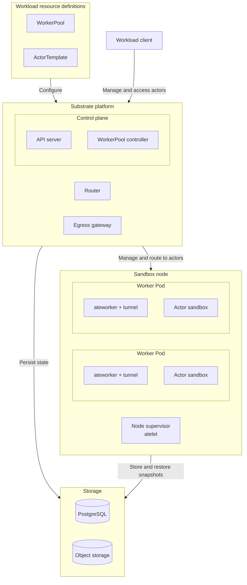

Install Agent Substrate's control plane and node runtime on Kubernetes, with an
in-cluster RustFS object store for snapshots by default. When you finish, your
cluster is ready for you to configure and run agent workloads.

<Warning>
This integration is experimental and uses Substrate `v1.0.0-rc.1`, commit
`f86fde9dfb5424c8d16f613de80469bdbef06541`. The S3 instructions below work
around limitations in that release's installer.
</Warning>

## Prerequisites

- Kubernetes 1.35 or newer. See
  [Check cluster capabilities](#check-cluster-capabilities) for the required
  certificate APIs and volume projections.
- Linux x86-64 (`amd64`) or ARM64 (`arm64`) nodes.
- For the default RustFS deployment, a StorageClass that can provision a
  50 GiB `ReadWriteOnce` volume.
- For the bundled PostgreSQL installation, storage capacity for its default
  500 GiB `ReadWriteOnce` volume.
- Git, Go 1.27 or newer, `kubectl`, `curl`, and `shasum` on the installation
  workstation.

## What this installs

The installation prepares the Substrate platform and node runtime, backed by
PostgreSQL and object storage. WorkerPools, ActorTemplates, and actors are
workload resources you create afterward. The diagram shows two workers as an
example; each worker can host multiple actors when capacity allows.



| Boundary | Component | Responsibility |
| --- | --- | --- |
| Workload resource definitions | `WorkerPool` | Kubernetes resource that declares worker count, placement, capacity, and sandbox runtime. |
| Workload resource definitions | `ActorTemplate` | Substrate resource that defines actor images, resource limits, worker selection, and snapshot settings. |
| Control plane | API server (`ate-api-server`) | Manages actor records and lifecycle, selects workers, and coordinates activation and snapshots. |
| Control plane | WorkerPool controller (`ate-controller`) | Reconciles each WorkerPool into a Kubernetes Deployment that maintains worker Pods. |
| Substrate platform | Router (`atenet-router`) | Resolves an actor's worker assignment through the API, requests resume when needed, and forwards client traffic to the worker tunnel. |
| Substrate platform | Egress gateway (`atenet-egress`) | Applies actor egress policies to outbound requests. |
| Sandbox node | Node supervisor (`atelet`) | Prepares images and runtime assets, directs local workers, and transfers snapshots through an object-store plugin. |
| Sandbox node | Worker Pod (`ateworker` and its tunnel) | Runs the sandbox runtime and forwards incoming traffic to the assigned actor. |
| Worker Pod | Actor sandbox | Runs the workload's processes and holds its working state. Each actor has its own sandbox. |
| Storage | PostgreSQL | Stores control-plane records, including templates, actor lifecycle state, and worker assignments. |
| Storage | Object storage | Stores durable snapshots in S3 or GCS. Object-store plugins handle snapshot transfers and management. |

For lifecycle and networking details, see Substrate's
[architecture documentation](https://github.com/agent-substrate/substrate/blob/v1.0.0-rc.1/docs/concepts/architecture.md#system-components)
and [resource glossary](https://github.com/agent-substrate/substrate/blob/v1.0.0-rc.1/docs/reference/glossary.md).

<Steps toc={true}>

<Step title="Check cluster capabilities" id="check-cluster-capabilities">

Substrate 1.0.0, pinned here to `v1.0.0-rc.1`, requires the native
`PodCertificateRequest` and `ClusterTrustBundle` APIs and their Pod volume
projections. Both APIs must be available as `certificates.k8s.io/v1` or
`certificates.k8s.io/v1beta1`.

| Kubernetes version | Required preparation |
| --- | --- |
| 1.37 or newer, recommended | The required APIs and projections are stable and enabled by default. Verify availability below. |
| 1.35 or 1.36 | Enable the required feature gates and beta API endpoints. Follow the Kubernetes configuration documentation below. |

For configuration instructions, see the Kubernetes
[feature-gate reference](https://kubernetes.io/docs/reference/command-line-tools-reference/feature-gates/)
and the versioned documentation for
[`podCertificate` projections](https://v1-35.docs.kubernetes.io/docs/concepts/storage/projected-volumes/#podcertificate-projected-volumes)
and [`clusterTrustBundle` projections](https://v1-35.docs.kubernetes.io/docs/concepts/storage/projected-volumes/#clustertrustbundle-projected-volumes).

Check the API-server version:

```bash title="Command"
kubectl version
```

```text title="Example output (excerpt)"
Client Version: v1.37.0
Server Version: v1.37.0
```

The server version must be 1.35 or newer.

Check the node versions:

```bash title="Command"
kubectl get nodes -o custom-columns=NAME:.metadata.name,KUBELET:.status.nodeInfo.kubeletVersion
```

```text title="Example output"
NAME            KUBELET
control-plane   v1.37.0
worker-01       v1.37.0
worker-02       v1.37.0
```

Nodes that run Substrate or its clients must use Kubernetes 1.35 or newer.

Discover the certificate APIs:

```bash title="Command"
kubectl api-resources --cached=false --api-group=certificates.k8s.io
```

```text title="Example output" {3-4}
NAME                         SHORTNAMES   APIVERSION               NAMESPACED   KIND
certificatesigningrequests   csr          certificates.k8s.io/v1   false        CertificateSigningRequest
clustertrustbundles                       certificates.k8s.io/v1   false        ClusterTrustBundle
podcertificaterequests                    certificates.k8s.io/v1   true         PodCertificateRequest
```

Confirm that `clustertrustbundles` and `podcertificaterequests` appear with API
version `certificates.k8s.io/v1` or `certificates.k8s.io/v1beta1`. Other resources
in this group require no additional checks here.

These checks confirm API availability. After deploying Substrate, verify
certificate issuance and volume projection in
[Verify the installation](#verify-the-installation).

### Identify node architecture

This guide assumes the Substrate control plane, atelets, workers, and actors
run on nodes with the same CPU architecture. Identify that architecture before
continuing:

```bash title="Command"
kubectl get nodes -L kubernetes.io/arch
```

```text title="Example output"
NAME            STATUS   ROLES           AGE   VERSION   ARCH
control-plane   Ready    control-plane   1d    v1.37.0   amd64
worker-01       Ready    <none>          1d    v1.37.0   amd64
worker-02       Ready    <none>          1d    v1.37.0   amd64
```

Read the `ARCH` column: `amd64` means x86-64, and `arm64` means ARM64.

Use this architecture for workload builds and configuration. If your deployment
uses both architectures, match each component's binaries, images, and runtime
assets to the nodes where it runs.

The supplied
[`gvisor-default` SandboxConfig](https://github.com/agent-substrate/substrate/blob/v1.0.0-rc.1/manifests/ate-install/sandboxconfig-gvisor.yaml)
selects the runtime assets for each node.

</Step>

<Step title="Prepare the installation tools" id="prepare-the-installation-tools">

Fetch the pinned release for its installer and manifests:

```bash
mkdir -p deps/bin
git clone --branch v1.0.0-rc.1 https://github.com/agent-substrate/substrate deps/substrate
```

Download `kubectl-ate` and its checksum from the
[rc1 release](https://github.com/agent-substrate/substrate/releases/tag/v1.0.0-rc.1).
Set `ATE_CLI` to the asset for your workstation: `linux` or `darwin` for the
operating system, and `amd64` or `arm64` for the architecture. The example below
uses Linux x86-64:

```bash
ATE_CLI=kubectl-ate-linux-amd64
ATE_RELEASE=https://github.com/agent-substrate/substrate/releases/download/v1.0.0-rc.1
curl -fL "$ATE_RELEASE/$ATE_CLI" -o "deps/bin/$ATE_CLI"
curl -fL "$ATE_RELEASE/$ATE_CLI.sha256" -o "deps/bin/$ATE_CLI.sha256"
(
  cd deps/bin
  shasum -a 256 -c "$ATE_CLI.sha256" && install -m 0755 "$ATE_CLI" kubectl-ate
)
export PATH="$PWD/deps/bin:$PATH"
kubectl-ate --help
```

The checksum check must report `OK`, and the CLI must print its help text.
Keep this `bin` directory on `PATH` when managing Substrate. The deployment
step runs `ate-setup` directly from the checkout with `go run`.

</Step>

<Step title="Deploy in-cluster object storage" id="deploy-in-cluster-object-storage">

Deploy RustFS from the pinned Substrate checkout. Its manifest includes a
persistent volume claim, a single RustFS server, a ClusterIP Service, a bucket
initialization Job, and a NetworkPolicy allowing Substrate's snapshot plugins
and that Job to reach the S3 API.

<Note>
If you already have remote object storage, skip this RustFS deployment. Follow
Substrate's [snapshot storage setup](https://github.com/agent-substrate/substrate/blob/v1.0.0-rc.1/docs/guides/operator-install.md#snapshot-storage)
and [object-store plugin configuration](https://github.com/agent-substrate/substrate/blob/v1.0.0-rc.1/docs/concepts/architecture.md#system-components).
Update the bucket, endpoint, region, and credentials below for an existing S3
service. For GCS, use the upstream service-account setup and retain the plugins'
`gcs` backend instead of applying the S3 settings.
For static S3 credentials, create `ate-objectstore` in `ate-system` with the
`AWS_ACCESS_KEY_ID` and `AWS_SECRET_ACCESS_KEY` keys expected below. If you use
workload identity instead, omit those two Secret references from the plugins.
</Note>

The defaults used throughout this guide are:

| Setting | Value |
| --- | --- |
| Namespace | `ate-system` |
| S3 endpoint | `http://rustfs.ate-system.svc:9000` |
| Bucket | `ate-snapshots` |
| Snapshot location | `s3://ate-snapshots/` |
| Region | `us-east-1` |
| Credentials Secret | `ate-objectstore` |
| PersistentVolumeClaim | `rustfs-data` |

Create the namespace and a shared Secret for RustFS, the bucket Job, and
Substrate's object-store plugins. Enter an access key and secret key of your
choice; these become the RustFS credentials:

```bash
kubectl apply -f deps/substrate/manifests/ate-install/ate-system-namespace.yaml
read -rp 'RustFS access key: ' RUSTFS_ACCESS_KEY_ID
read -rsp 'RustFS secret key: ' RUSTFS_SECRET_ACCESS_KEY
printf '\n'
kubectl -n ate-system create secret generic ate-objectstore \
  --from-literal=AWS_ACCESS_KEY_ID="$RUSTFS_ACCESS_KEY_ID" \
  --from-literal=AWS_SECRET_ACCESS_KEY="$RUSTFS_SECRET_ACCESS_KEY"
unset RUSTFS_ACCESS_KEY_ID RUSTFS_SECRET_ACCESS_KEY
```

Edit `deps/substrate/manifests/ate-install/kind/rustfs.yaml` in place before
applying it. Despite the directory name, this manifest uses standard Kubernetes
resources and can run on a cluster with a suitable StorageClass.

In the `rustfs-data` PersistentVolumeClaim, increase the upstream `1Gi` request
to your chosen capacity:

```yaml
spec:
  accessModes:
    - ReadWriteOnce
  resources:
    requests:
      storage: 50Gi
```

If the cluster has no default StorageClass, add `spec.storageClassName` with
your class name. Check available classes with `kubectl get storageclass`.
Snapshots can include actor memory and writable filesystems. Retain the PVC
across RustFS restarts; deleting it can remove the snapshots stored there.
This single-server setup depends on that volume's availability.

In the `rustfs` Deployment's container `env`, replace the two literal credential
entries with Secret references. Preserve the other environment entries:

```yaml
- name: RUSTFS_ACCESS_KEY
  valueFrom:
    secretKeyRef:
      name: ate-objectstore
      key: AWS_ACCESS_KEY_ID
- name: RUSTFS_SECRET_KEY
  valueFrom:
    secretKeyRef:
      name: ate-objectstore
      key: AWS_SECRET_ACCESS_KEY
```

In the `rustfs-bucket-init` Job's container `env`, replace its two literal
credential entries with the same Secret. Keep its endpoint, region, and
`ate-snapshots` bucket name:

```yaml
- name: AWS_ACCESS_KEY_ID
  valueFrom:
    secretKeyRef:
      name: ate-objectstore
      key: AWS_ACCESS_KEY_ID
- name: AWS_SECRET_ACCESS_KEY
  valueFrom:
    secretKeyRef:
      name: ate-objectstore
      key: AWS_SECRET_ACCESS_KEY
```

Apply the edited manifest and wait for the bucket:

```bash
kubectl apply -f deps/substrate/manifests/ate-install/kind/rustfs.yaml
kubectl -n ate-system rollout status deployment/rustfs --timeout=300s
kubectl -n ate-system wait --for=condition=complete \
  job/rustfs-bucket-init --timeout=300s
kubectl -n ate-system logs job/rustfs-bucket-init
kubectl -n ate-system get pvc rustfs-data
```

On a fresh installation, the apply and wait commands end with output like:

```text
persistentvolumeclaim/rustfs-data created
service/rustfs created
deployment.apps/rustfs created
job.batch/rustfs-bucket-init created
networkpolicy.networking.k8s.io/rustfs created
deployment "rustfs" successfully rolled out
job.batch/rustfs-bucket-init condition met
```

When you reapply the manifest, resources can report `unchanged` or `configured`
instead of `created`.

The Job logs can include startup retries before the bucket is available.
A successful log excerpt looks like:

```text
waiting for rustfs to become available... (1/60)
bucket ate-snapshots created
```

The success message can also be `bucket ate-snapshots already exists`.

For the 50 GiB allocation above, expect PVC output like:

```text
NAME          STATUS   VOLUME       CAPACITY   ACCESS MODES   STORAGECLASS      VOLUMEATTRIBUTESCLASS   AGE
rustfs-data   Bound    pvc-<uuid>   50Gi       RWO            <storage-class>   <unset>                 1m
```

The volume name, storage class, and age depend on your cluster. Confirm that
the rollout succeeded, the Job completed, and the PVC is `Bound` before
continuing. The completed Job confirms that the endpoint accepts the configured
credentials and the bucket exists. If a command fails or times out, inspect
the Job logs and the PVC and Pod events.

</Step>

<Step title="Configure the installation" id="configure-the-installation">

Open the checked-in
[`substrate-install.yaml`](https://github.com/ai-dynamo/dynamo/blob/main/examples/agents/harbor-substrate/substrate-install.yaml)
and edit it for your cluster. Continue working from
`examples/agents/harbor-substrate`.

`ate-setup --config` reads this installer configuration. Do not apply it with
`kubectl`. The file uses bundled PostgreSQL and the RustFS bucket created above:

```yaml
# Consumed by ate-setup --config, not kubectl apply.
apiVersion: install.ate.dev/v1alpha1
kind: SubstrateInstall
# Install Substrate resources in the namespace created earlier.
namespace: ate-system
images:
  # Control-plane and node-runtime images for amd64 and arm64.
  # Keep the version aligned with the CLI and installer checkout.
  repo: ghcr.io/agent-substrate/substrate
  tag: v1.0.0-rc.1

ateapi:
  authz:
    # Initial global administrators. Replace the development identity for shared use.
    # Use one comma-separated string for multiple authenticated principals.
    bootstrapOwners: system:serviceaccount:ate-system:ate-client
  postgres:
    # Use the default StorageClass for the bundled PostgreSQL PVC (500 GiB).
    # Set a StorageClass name here if your cluster has no suitable default.
    storageClass: ""

storage:
  # Snapshot bucket created in the RustFS step. Object storage is required.
  snapshotLocation: s3://ate-snapshots/
  # GCS transfer identity: required by rc1 on non-kind clusters, unused with S3.
  transferGSAName: unused
gcp:
  # GCP project: required by rc1 on non-kind clusters, unused with S3.
  projectID: not-a-gcp-project

atenet:
  egress:
    # Disable gateway credential injection. Workloads supply their own credentials.
    # Keep an explicit setting: the installer rejects an omitted choice.
    credentialProvider: '{"enabled":false}'

# No actor ingress until a workload adds its clients' SPIFFE IDs.
# Use one comma-separated string. Preserve existing clients when adding another.
ingressAllowedSPIFFEIDs: ""
```

To use an external database, follow
[Substrate's PostgreSQL setup](https://github.com/agent-substrate/substrate/blob/v1.0.0-rc.1/docs/guides/postgres.md).
Supply connection credentials through the installer's supported environment
settings. Keep them out of the checked-in YAML.

For a shared installation, select administrator principals using the
[authorization guide](https://github.com/agent-substrate/substrate/blob/v1.0.0-rc.1/docs/guides/authorization.md#bootstrap-owners).
The development owner lets `kubectl-ate` use its default `ate-client`
ServiceAccount token. Anyone who can mint that token has global ownership.
If you replace the owner, authenticate subsequent CLI commands with the
configured administrator's token using `--token-file`.

To have the egress gateway supply credentials, configure a provider using
[egress credential injection](https://github.com/agent-substrate/substrate/blob/v1.0.0-rc.1/docs/guides/egress-credential-injection.md).

Before deploying, also check [sandbox asset caching](https://github.com/agent-substrate/substrate/blob/v1.0.0-rc.1/docs/concepts/sandbox-asset-cache.md)
for your runtime's binaries and node cache, and complete the certificate
API/projection checks above. Verify projected files after deployment using
[authentication setup](https://github.com/agent-substrate/substrate/blob/v1.0.0-rc.1/docs/guides/authentication.md).

### Point Substrate at RustFS

The installer does not expose S3 endpoint or credential fields in
`SubstrateInstall`. Before deploying, edit these files in the pinned checkout:

- `deps/substrate/manifests/ate-install/ate-api-server.yaml`
- `deps/substrate/manifests/ate-install/atelet.yaml`

In each workload's `spec.template.spec.initContainers`, find the container
named `objectstore-plugin`. Change its existing `ATE_STORAGE_BACKEND` entry
to `s3` and add the following AWS entries to its `env` list. Preserve its
other environment entries, arguments, and mounts:

```yaml
- name: ATE_STORAGE_BACKEND
  value: s3
- name: AWS_REGION
  value: us-east-1
- name: AWS_ENDPOINT_URL
  value: http://rustfs.ate-system.svc:9000
- name: AWS_S3_USE_PATH_STYLE
  value: "true"
- name: AWS_ACCESS_KEY_ID
  valueFrom:
    secretKeyRef:
      name: ate-objectstore
      key: AWS_ACCESS_KEY_ID
- name: AWS_SECRET_ACCESS_KEY
  valueFrom:
    secretKeyRef:
      name: ate-objectstore
      key: AWS_SECRET_ACCESS_KEY
```

These settings belong on the plugin sidecars. The `ate-api-server` and `atelet`
main containers do not read S3 credentials. The API server's plugin manages
stored snapshots; the node plugin uploads and downloads their contents.

<Note>
For another S3 service, update `storage.snapshotLocation`, `AWS_ENDPOINT_URL`,
`AWS_REGION`, path-style addressing, and the credentials or workload identity
to match that service. For Amazon S3, omit `AWS_ENDPOINT_URL` when using the
standard regional endpoint. For GCS, follow the upstream
[snapshot storage instructions](https://github.com/agent-substrate/substrate/blob/v1.0.0-rc.1/docs/guides/operator-install.md#snapshot-storage)
with a `gs://` location and real transfer-service-account settings; keep
`ATE_STORAGE_BACKEND=gcs` and omit the AWS entries.
</Note>

Keep these manifest edits with your installation configuration. `ate-setup`
renders this checkout, so subsequent deploys reuse the settings. Reapply your
edits if you replace or upgrade the checkout.

</Step>

<Step title="Deploy the control plane" id="deploy-the-control-plane">

Pass the current Kubernetes context explicitly so the installer uses your
existing cluster credentials. Run the installer inside its source checkout:
it locates deployment assets relative to that repository. The subshell returns
you to your chosen working directory afterward:

```bash
(
  cd deps/substrate
  go run ./cmd/ate-setup deploy ate-system --context "$(kubectl config current-context)" \
    --config ../../substrate-install.yaml
)
```

Omit or adapt optional Google `PodMonitoring` resources on clusters without
that API. For an existing installation, update its managed configuration
instead of replacing it with a new document.

The installer reads the plugin settings edited above before it waits for
readiness. No post-deployment S3 patch is needed.

</Step>

<Step title="Verify the installation" id="verify-the-installation">

Wait for the control plane and node runtime:

```bash
kubectl -n ate-system rollout status deployment/ate-api-server --timeout=600s
kubectl -n ate-system rollout status deployment/atenet-router --timeout=600s
kubectl -n ate-system rollout status deployment/ate-controller --timeout=600s
kubectl -n ate-system rollout status daemonset/atelet --timeout=600s
kubectl -n ate-system get pods -o wide
kubectl -n ate-system get podcertificaterequests
kubectl get clustertrustbundles
```

Check that `atelet` is ready on every node intended for sandbox placement.
For the certificate configuration, verify that:

- The admitted Pod specifications retain both `podCertificate` and
  `clusterTrustBundle` volume sources. API-server feature gates can cause
  unsupported fields to be silently pruned, so a successful dry run is insufficient.
- `PodCertificateRequest`: the Pods' requests reach `Issued=True`, and the
  running containers receive nonempty credential bundles containing their
  certificates and private keys at the configured projection paths.
- `ClusterTrustBundle`: Substrate publishes trust bundles matching the Pods'
  configured signer names and label selectors. The running containers receive
  nonempty CA files at the configured projection paths.

Check the Pods on each node that hosts Substrate components. Inspect request
status and Pod events if issuance or volume mounting fails. Check credential
files without printing private keys.

Inspect requests during Pod startup or certificate renewal; Kubernetes removes
old requests after issuance.

Readiness alone does not verify a workload's client permissions, guest image,
or durable snapshot restoration; check those when configuring the workload.

If a Pod reports a port-443 permission error, use the conditional fix below
and repeat these checks.

</Step>

</Steps>

To configure and run a coding-agent workload, continue with
[Run SWE-bench Verified with Harbor, Pi, and Substrate](../../use-cases/agents/harbor-substrate.mdx).

## Resolve low-port permission failures when needed

<Accordion title="Fix a port-443 permission error">

If a Substrate API or worker Pod cannot bind port 443, the installation may
need a Pod-local sysctl:

```yaml
spec:
  template:
    spec:
      securityContext:
        sysctls:
          - name: net.ipv4.ip_unprivileged_port_start
            value: "0"
```

Apply it only to the affected deployment through the installation's supported
configuration. The rc1 WorkerPool API does not expose Pod sysctls. When a manual
patch to its generated Deployment is necessary, record it and reapply after
recreation. The generated deployment has the same name as its WorkerPool.
This is a Pod setting, not a host sysctl change.

</Accordion>
