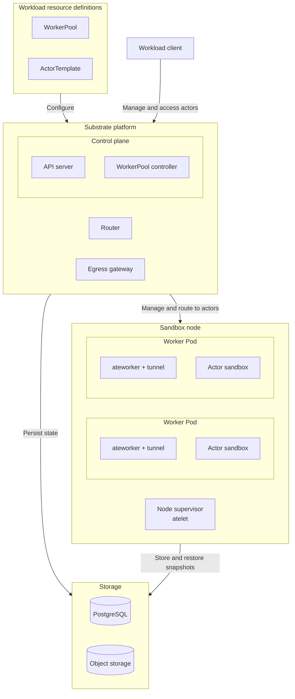

Install Agent Substrate's control plane, node runtime, and snapshot storage.
Workloads configure their own client identities, worker pools, and actor images
after installation. This procedure does not require Harbor, Pi, or a model server.

<Warning>
This integration is experimental and uses Substrate `v1.0.0-rc.1`, commit
`f86fde9dfb5424c8d16f613de80469bdbef06541`. The S3 instructions below work
around limitations in that release's installer.
</Warning>

## Prerequisites

- A Kubernetes cluster with permission to install controllers, CRDs, and the
  native certificate APIs and projections described below.
- Linux nodes compatible with your selected sandbox runtime and its assets.
- PostgreSQL, object storage, and network access configured according to the
  pinned [Substrate operator installation guide](https://github.com/agent-substrate/substrate/blob/v1.0.0-rc.1/docs/guides/operator-install.md).
- Git, Go 1.27 or newer, and `kubectl` on the installation workstation, with the
  intended Kubernetes context already selected.

## What this installs

The installation prepares the Substrate platform and node runtime, backed by
PostgreSQL and object storage. WorkerPools, ActorTemplates, and actors are
workload resources you create afterward. The diagram shows two workers as an
example; each worker can host multiple actors when capacity allows.



| Boundary | Component | Responsibility |
| --- | --- | --- |
| Workload resource definitions | `WorkerPool` | Kubernetes resource that declares worker count, placement, capacity, and sandbox runtime. |
| Workload resource definitions | `ActorTemplate` | Substrate resource that defines actor images, resource limits, worker selection, and snapshot settings. |
| Control plane | API server (`ate-api-server`) | Manages actor records and lifecycle, selects workers, and coordinates activation and snapshots. |
| Control plane | WorkerPool controller (`ate-controller`) | Reconciles each WorkerPool into a Kubernetes Deployment that maintains worker Pods. |
| Substrate platform | Router (`atenet-router`) | Resolves an actor's worker assignment through the API, requests resume when needed, and forwards client traffic to the worker tunnel. |
| Substrate platform | Egress gateway (`atenet-egress`) | Applies actor egress policies to outbound requests. |
| Sandbox node | Node supervisor (`atelet`) | Prepares images and runtime assets, directs local workers, and transfers snapshots through an object-store plugin. |
| Sandbox node | Worker Pod (`ateworker` and its tunnel) | Runs the sandbox runtime and forwards incoming traffic to the assigned actor. |
| Worker Pod | Actor sandbox | Runs the workload's processes and holds its working state. Each actor has its own sandbox. |
| Storage | PostgreSQL | Stores control-plane records, including templates, actor lifecycle state, and worker assignments. |
| Storage | Object storage | Stores durable snapshots in S3 or GCS. Object-store plugins handle snapshot transfers and management. |

For lifecycle and networking details, see Substrate's
[architecture documentation](https://github.com/agent-substrate/substrate/blob/v1.0.0-rc.1/docs/concepts/architecture.md#system-components)
and [resource glossary](https://github.com/agent-substrate/substrate/blob/v1.0.0-rc.1/docs/reference/glossary.md).

Run commands from a working directory of your choice. Paths are relative to
that directory. Keep the installer configuration for future updates.

<Steps toc={true}>

<Step title="Check cluster capabilities" id="check-cluster-capabilities">

Check that Kubernetes serves both native certificate APIs:

```bash
kubectl api-resources --api-group=certificates.k8s.io
```

Require `PodCertificateRequest` and `ClusterTrustBundle`, and their respective
Pod volume projections. Check API-server and kubelet feature configuration
with your cluster administrator. A server-side dry run is insufficient if
unsupported fields are silently pruned. Verify that the admitted Pod retains
both projections and that a real Pod receives its files.

The node architecture, sandbox runtime build, and workload image architecture
must match. Every node eligible for sandbox placement needs `atelet` and the
assets required by its sandbox runtime.

</Step>

<Step title="Build the installation tools" id="build-the-installation-tools">

Build the tools from the same release as the control-plane images:

```bash
mkdir -p deps/bin
git clone --branch v1.0.0-rc.1 https://github.com/agent-substrate/substrate deps/substrate
go -C deps/substrate build -o ../bin/ate-setup ./cmd/ate-setup
go -C deps/substrate build -o ../bin/kubectl-ate ./cmd/kubectl-ate
export PATH="$PWD/deps/bin:$PATH"
```

Keep this `bin` directory on `PATH` in shells where you manage Substrate or run
its tutorials. `ate-setup` installs the platform; `kubectl-ate` manages its API
objects.

</Step>

<Step title="Configure the installation" id="configure-the-installation">

Create `substrate-install.yaml` in your chosen working directory. The pinned
[operator installation reference](https://github.com/agent-substrate/substrate/blob/v1.0.0-rc.1/docs/guides/operator-install.md)
describes configuration keys; use the following checklist to prepare the
services and node assets before deployment:

| Requirement | Preparation and verification |
| --- | --- |
| PostgreSQL | Follow [PostgreSQL setup](https://github.com/agent-substrate/substrate/blob/v1.0.0-rc.1/docs/guides/postgres.md) for the database, schema, roles, and connection settings. Ensure the cluster can reach it. |
| Snapshot storage | Create a bucket and configure access using [snapshot storage settings](https://github.com/agent-substrate/substrate/blob/v1.0.0-rc.1/docs/guides/operator-install.md#snapshot-storage); use the S3 workaround below when applicable. |
| Runtime assets | Check [sandbox asset caching](https://github.com/agent-substrate/substrate/blob/v1.0.0-rc.1/docs/concepts/sandbox-asset-cache.md) for the selected runtime's binaries, versions, and node cache. Ensure eligible nodes can obtain matching assets. |
| Certificates | Complete the API/projection checks above and the [authentication setup](https://github.com/agent-substrate/substrate/blob/v1.0.0-rc.1/docs/guides/authentication.md). Verify projected files after deployment. |
| Administrative access | Configure a global owner using the [authorization guide](https://github.com/agent-substrate/substrate/blob/v1.0.0-rc.1/docs/guides/authorization.md). This identity creates workload atespaces later. |
| Egress credential injection | Explicitly disable injection or configure a provider as described below. The installer rejects an omitted choice. |

Set these release fields in your installation document:

```yaml
apiVersion: install.ate.dev/v1alpha1
kind: SubstrateInstall
namespace: ate-system
images:
  repo: ghcr.io/agent-substrate/substrate
  tag: v1.0.0-rc.1
```

This fragment selects the release; it is not a complete installation document.
Supply database credentials through the upstream installer's supported secret
settings. Configure your administrative identity using Substrate's
[authorization guide](https://github.com/agent-substrate/substrate/blob/v1.0.0-rc.1/docs/guides/authorization.md).

If workloads supply their own endpoint credentials, disable gateway credential
injection explicitly:

```yaml
atenet:
  egress:
    credentialProvider: '{"enabled":false}'
```

For gateway-managed credentials, configure a provider using
[egress credential injection](https://github.com/agent-substrate/substrate/blob/v1.0.0-rc.1/docs/guides/egress-credential-injection.md)
instead. The Harbor tutorial passes an API key through the agent environment
and does not require gateway injection.

The router's `ingressAllowedSPIFFEIDs` setting controls which clients can
reach actors. It has no default: without an allowlist, the platform accepts no
actor ingress. Add approved client identities through your installation
configuration when you configure a workload. Preserve existing identities when
adding another client.

For Google Cloud Storage, follow the upstream bucket and transfer-service-account
setup. For an S3-compatible store, use the release-specific settings below.

### Use an S3-compatible snapshot store

In `v1.0.0-rc.1`, the installer assumes Google Cloud Storage on every cluster
that is not kind.
It refuses to deploy `ate-api-server` unless `storage.transferGSAName` and
`gcp.projectID` are set, because on GCS the object-store plugin impersonates
that service account to mint per-actor credentials. The S3 backend never reads
the value. Its plugin transfers with the Pod's own credentials and answers the
credential exchange as unimplemented. Give the two settings placeholder values
to pass the check:

```yaml
storage:
  snapshotLocation: s3://your-bucket/
  transferGSAName: unused
gcp:
  projectID: not-a-gcp-project
```

The deploy command below passes the current Kubernetes context explicitly,
which skips the installer's GKE credential lookup. Any S3-compatible service
works, including the small in-cluster RustFS from
upstream's `manifests/ate-install/kind/rustfs.yaml`. Create the bucket before
the first actor.

</Step>

<Step title="Deploy the control plane" id="deploy-the-control-plane">

Pass the current Kubernetes context explicitly so the installer uses your
existing cluster credentials. Run the installer inside its source checkout:
it locates deployment assets relative to that repository. The subshell returns
you to your chosen working directory afterward:

```bash
(
  cd deps/substrate
  ate-setup deploy ate-system --context "$(kubectl config current-context)" \
    --config ../../substrate-install.yaml
)
```

Omit or adapt optional Google `PodMonitoring` resources on clusters without
that API. For an existing installation, update its managed configuration
instead of replacing it with a new document.

### Configure S3 plugin credentials

Complete this step only when using S3-compatible snapshot storage.

The installer does not carry S3 endpoint or credential settings yet, so point
the object-store plugin at your store after the deploy. The plugin runs as the
`objectstore-plugin` init container of both the `ate-api-server` Deployment and
the `atelet` DaemonSet:

```bash
kubectl -n ate-system create secret generic ate-objectstore \
  --from-literal=AWS_ACCESS_KEY_ID=your-access-key \
  --from-literal=AWS_SECRET_ACCESS_KEY=your-secret-key
cat > objectstore-s3.json <<'EOF'
{"spec":{"template":{"spec":{"initContainers":[{"name":"objectstore-plugin","env":[
  {"name":"ATE_STORAGE_BACKEND","value":"s3"},
  {"name":"AWS_REGION","value":"us-east-1"},
  {"name":"AWS_ENDPOINT_URL","value":"http://rustfs.ate-system.svc:9000"},
  {"name":"AWS_S3_USE_PATH_STYLE","value":"true"},
  {"name":"AWS_ACCESS_KEY_ID","valueFrom":{"secretKeyRef":{"name":"ate-objectstore","key":"AWS_ACCESS_KEY_ID"}}},
  {"name":"AWS_SECRET_ACCESS_KEY","valueFrom":{"secretKeyRef":{"name":"ate-objectstore","key":"AWS_SECRET_ACCESS_KEY"}}}
]}]}}}}
EOF
kubectl -n ate-system patch deployment ate-api-server --patch-file objectstore-s3.json
kubectl -n ate-system patch daemonset atelet --patch-file objectstore-s3.json
kubectl -n ate-system rollout status deployment/ate-api-server --timeout=300s
kubectl -n ate-system rollout status daemonset/atelet --timeout=600s
```

Replace the endpoint and region with your store's values. Running
`ate-setup deploy` again rewrites both workloads, so reapply the patch after
each deploy.

</Step>

<Step title="Verify the installation" id="verify-the-installation">

Wait for the control plane and node runtime:

```bash
kubectl -n ate-system rollout status deployment/ate-api-server --timeout=600s
kubectl -n ate-system rollout status deployment/atenet-router --timeout=600s
kubectl -n ate-system rollout status deployment/ate-controller --timeout=600s
kubectl -n ate-system rollout status daemonset/atelet --timeout=600s
kubectl -n ate-system get pods -o wide
kubectl get clustertrustbundles
```

Check that `atelet` is ready on every node intended for sandbox placement and
that the admitted Pods retain their certificate projections and receive their
credential files. Readiness alone does not verify a workload's client
permissions, guest image, or durable snapshot restoration; check those when
configuring the workload.

If a Pod reports a port-443 permission error, use the conditional fix below
and repeat these checks.

</Step>

</Steps>

For a coding-agent workload, continue with
[Run SWE-bench Verified with Harbor, Pi, and Substrate](../../use-cases/agents/harbor-substrate.mdx).
That tutorial configures its runner identity, guest image, worker capacity, and
request timeouts, then validates them with a task.

## Resolve low-port permission failures when needed

<Accordion title="Fix a port-443 permission error">

If a Substrate API or worker Pod cannot bind port 443, the installation may
need a Pod-local sysctl:

```yaml
spec:
  template:
    spec:
      securityContext:
        sysctls:
          - name: net.ipv4.ip_unprivileged_port_start
            value: "0"
```

Apply it only to the affected deployment through the installation's supported
configuration. The rc1 WorkerPool API does not expose Pod sysctls. When a manual
patch to its generated Deployment is necessary, record it and reapply after
recreation. The generated deployment has the same name as its WorkerPool.
This is a Pod setting, not a host sysctl change.

</Accordion>
