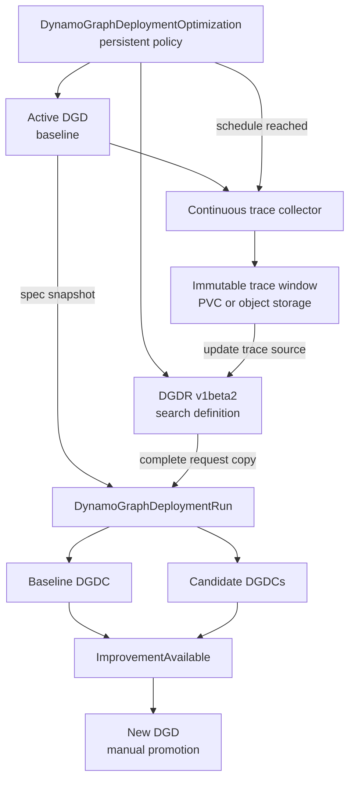

This page preserves the planned continuous-profiling design. The design periodically captures
traffic from an active `DynamoGraphDeployment` (DGD), searches alternative configurations, and
reports whether any Candidate is a meaningful improvement. It extends the implemented
[DGDR v1beta2 search workflow](dgdr-v1beta2.md) with trace collection, scheduling, baseline
evaluation, comparison, and retention.

> [!WARNING]
> **Planned, not implemented.** Dynamo does not currently install a
> `DynamoGraphDeploymentOptimization` API or continuous-profiling controller. DGDR v1beta2
> currently accepts static workloads and scalar `Optimize` objectives only. The resource, trace,
> Pareto, comparison, and retention shapes below are design sketches and can change.

## Planned Architecture

The planned long-lived `DynamoGraphDeploymentOptimization` represents the recurring policy. The
referenced DGD is the baseline for every Run. When a trace window closes, Dynamo stores it at a new
location and updates the referenced DGDR's future trace source. The resulting DGDR generation
creates an immutable `DynamoGraphDeploymentRun` with a complete, admitted copy of the Request.

The planned flow uses the implemented Run and Candidate resources from a manually created DGDR:



## Planned Optimization API

The design extends a v1beta2 DGDR with a trace workload and later adds Pareto objectives, DGD
overrides, and any additional comparison input. The optimization updates the trace source to the
location of each completed trace window. That meaningful DGDR spec change starts a new immutable
Run. The current API does not have `spec.rerun.reason`.

The following proposed resource references the DGDR and the active DGD and sketches a daily search
against the preceding 24 hours of traffic:

```yaml
apiVersion: nvidia.com/v1alpha1
kind: DynamoGraphDeploymentOptimization
metadata:
  name: qwen-daily
  namespace: inference
spec:
  targetRef:
    apiVersion: nvidia.com/v1beta1
    kind: DynamoGraphDeployment
    name: qwen-production

  requestRef:
    apiVersion: nvidia.com/v1beta2
    kind: DynamoGraphDeploymentRequest
    name: qwen-search

  schedule:
    interval: 24h

  trace:
    window: 24h
    retention: 7d
    storage:
      pvc:
        name: workload-traces
        path: qwen-production
    parameters: # unstructured
      format: dynamo
      records:
        - request_end

  comparison:
    parameters: # unstructured
      minimumRelativeImprovement: 0.10
```

Once the planned API exists, the resource can use the normal Kubernetes workflow:

```bash
kubectl apply -f qwen-daily.yaml
kubectl get dynamographdeploymentoptimization qwen-daily -n inference -w
```

At the end of a trace window, the planned controller writes the completed trace to a unique URI or
PVC path and updates the referenced DGDR's trace source. The DGDR controller then creates a Run
whose spec contains the complete admitted Request snapshot. The Request's trace format and Replay
controls remain unchanged.

The current DGDR v1beta2 controller supersedes an active Run when its Request spec changes. The
planned scheduler therefore waits for the active Run to become terminal before it updates the trace
source. If another interval expires while a Run is active, it records a skipped occurrence instead
of changing the Request and canceling useful work. Use a dedicated DGDR for each optimization
because the optimization owns trace-source updates.

The proposed `trace.parameters` and `comparison.parameters` objects leave collector-specific
settings and comparison knobs unstructured. Trace contents remain outside Kubernetes objects; the
future Optimization and Run status store only artifact references, time ranges, and summary
statistics.

## Planned Run Scheduling

One planned Optimization resource has at most one active Run. This behavior is not configurable.

When another interval expires during an active Run, the planned controller skips that occurrence
instead of queueing it. The next regular interval can create a Run after the active Run reaches a
terminal state. For an accepted occurrence, the controller closes the window, writes it to a new S3
URI or PVC path, and updates `workload.trace.source` in the referenced DGDR. The proposed status
records skipped occurrences:

```yaml
status:
  activeRunRef:
    name: qwen-daily-20260812
  lastSkippedScheduleTime: "2026-08-13T00:00:00Z"
```

The current DGDR API has no unchanged-input rerun trigger. Each scheduled trace has a distinct
artifact path, so updating the trace source creates the next generation. Bounded retry of transient
execution failures belongs inside the same immutable DGDRRun and is separate from scheduling.

## Planned Baseline Evaluation

The planned controller resolves `targetRef` for every Run instead of comparing new Candidates with
results from an older trace window. The future immutable Run records:

- the baseline DGD name, UID, generation, and complete spec snapshot;
- the trace artifact reference, start time, and end time;
- the referenced DGDR name, UID, generation, and complete request copy; and
- the versions of Sweeper, Replay, and their performance data.

The planned flow evaluates the baseline with the same trace and Replay implementation as every
alternative. It does not compare simulated Candidates with live baseline metrics because the two
measurement methods are not equivalent.

The planned baseline evaluation appears as a DGDC with a baseline role. Its spec contains the flat
copied DGD fields plus resolved evaluation parameters, while its status contains simulation
metrics. Current Candidate status contains only `metrics`; the role and baseline-comparison status
shape still require API design. A baseline Candidate does not count against
`recommendation.maxCandidates`.

## Planned Improvement Semantics

AISimulate ranks scalar Candidates. After full Pareto support lands, it can also return a
non-dominated Candidate set. Continuous profiling compares those results with the evaluated
baseline.

For a scalar objective, compare each candidate score with the baseline score. Sweeper normalizes
scores so a larger value is always better, including objectives such as end-to-end latency that are
minimized in their natural units.

For a Pareto objective, classify every published candidate relative to the baseline:

| Classification | Meaning |
| --- | --- |
| `DominatesBaseline` | No worse in every objective and strictly better in at least one objective |
| `Tradeoff` | Better in at least one objective and worse in another |
| `DominatedByBaseline` | The baseline is no worse in every objective and strictly better in at least one objective |
| `EquivalentToBaseline` | No objective differs beyond the configured comparison margin |

This comparison is component-wise; it is not the minimum score across the candidates. Several
candidates can dominate the baseline while representing different positions on the Pareto front.
Dynamo publishes at most the referenced DGDR's `recommendation.maxCandidates` limit. Inspect the
published tradeoffs before selecting a replacement deployment.

Strict dominance treats any measurable difference as an improvement. Apply an explicit comparison
margin to prevent simulation noise from creating recommendations. Set the supported threshold keys
under `comparison.parameters`.

The following Run status is a proposed comparison shape, not part of the current Run API:

```yaml
status:
  baselineCandidateRef:
    name: qwen-daily-20260812-baseline
  comparison:
    improvingCandidateRefs:
      - name: qwen-daily-20260812-0
      - name: qwen-daily-20260812-2
    tradeoffCandidateRefs:
      - name: qwen-daily-20260812-1
  conditions:
    - type: ImprovementAvailable
      status: "True"
      reason: CandidatesDominateBaseline
```

`ImprovementAvailable=False` means that the completed run found no candidate meeting the comparison
policy. It does not mean that the search failed. Use the run's `Completed` condition to report
execution success or failure separately.

Resolve the active run from the optimization and inspect its status:

```bash
RUN=$(kubectl get dynamographdeploymentoptimization qwen-daily -n inference \
  -o jsonpath='{.status.activeRunRef.name}')

kubectl get dynamographdeploymentrun "$RUN" -n inference -o yaml
```

## Planned Promotion Flow

Manual Candidate-to-DGD creation already exists in the DGDR v1beta2 workflow. Continuous profiling
keeps that boundary: create a new DGD from the selected Candidate's DGD fields, review it, move
traffic to it, and retain the old DGD for rollback.

After the new deployment becomes the production baseline, update `targetRef` to its name. The next
run snapshots and evaluates that DGD rather than continuing to compare with the retired deployment.
Continuous profiling does not modify or replace the active DGD automatically.

## Planned Trace Lifecycle

Configure the collector to capture only the request metadata needed by Replay. Prompt and response
payloads are not required for length, timing, and cache-reuse simulation and introduce additional
privacy and storage requirements.

The planned collector stores completed trace windows at distinct PVC paths or object-storage URIs.
DGDR treats each location as immutable and uses a changed location as the trigger for the next Run.
Delete an artifact only after no retained Run references it. The future controller garbage-collects
trace artifacts according to their configured retention periods; the current Request controller
independently retains the five newest terminal Runs.

See [Sweeper Traffic](../../developer-guide/knowledge-base/modular-components/ai-simulate-experimental/sweeper-experimental/traffic.md)
for workload and trace semantics and [Sweeper Optimization
Goals](../../developer-guide/knowledge-base/modular-components/ai-simulate-experimental/sweeper-experimental/optimization-goals.md)
for scalar and Pareto evaluation.
