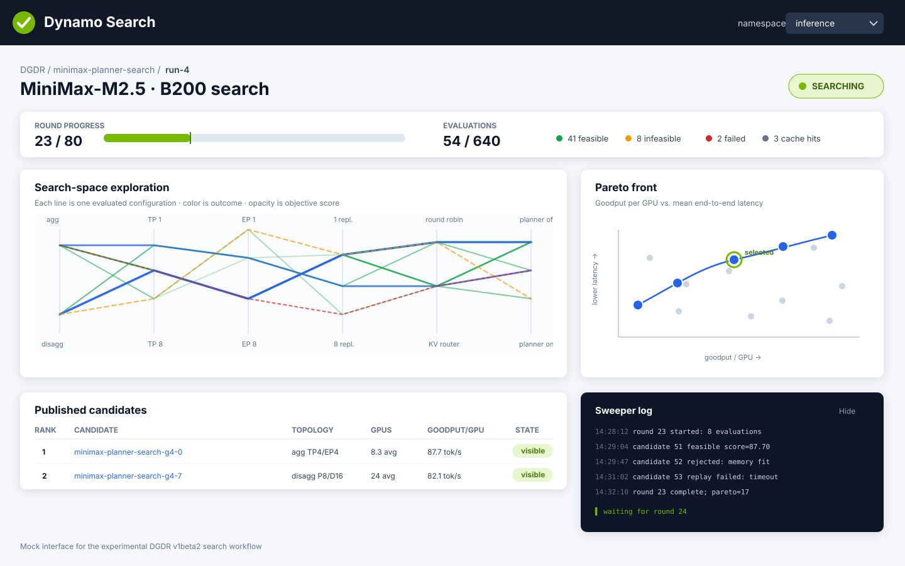
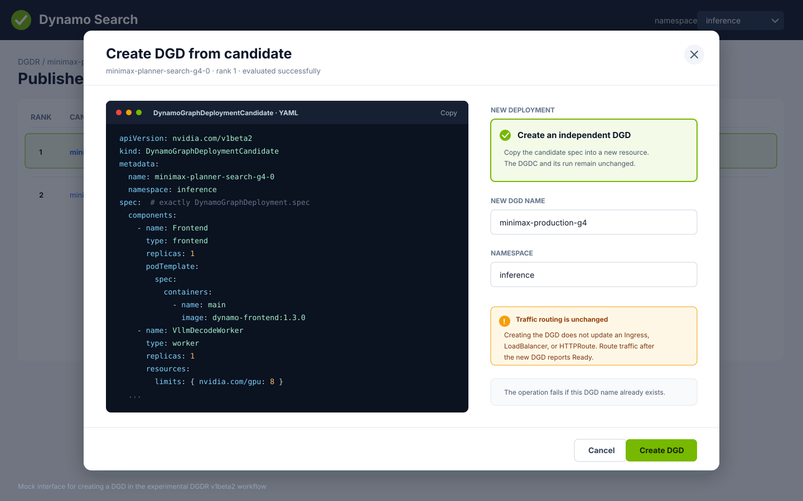

`DynamoGraphDeploymentRequest` (DGDR) `v1beta2` uses AISimulate to evaluate deployment
configurations without creating one Kubernetes resource per optimizer trial. A mutable Request
creates immutable `DynamoGraphDeploymentRun` resources. Each Run publishes a bounded set of
immutable `DynamoGraphDeploymentCandidate` (DGDC) resources.

Each Candidate represents one evaluated point. Its spec contains the flat
`DynamoGraphDeployment` (DGD) fields plus resolved evaluation `parameters`; its status contains
evaluation `metrics`. Copy the DGD fields into an independent DGD when you choose a result.

> [!WARNING]
> **Experimental.** Enable DGDR v1beta2 only on development clusters. The feature gate is disabled
> by default, and incompatible schema changes can make persisted Request, Run, or Candidate objects
> unreadable during an upgrade.

The current MVP supports a static workload and a scalar `Optimize` objective. Sections marked
**Planned** preserve the intended trace, Pareto, override, browser-UI, and continuous-profiling
design; those manifests are sketches and are not accepted by the current API.

## Enable DGDR v1beta2

Enable the Request schema, Run and Candidate CRDs, admission behavior, and controllers with this
platform chart value during installation or upgrade:

```yaml
dynamo-operator:
  dgdrV1Beta2:
    enabled: true
```

Use the same value when upgrading an existing installation. When it is `false`, the CRD installer
removes the v1beta2 Request schema and conversion carriers and does not install the Run or Candidate
CRDs.

The operator selects the planner image configured by its Helm release. Requests and Runs cannot
select a different AISimulate image or version.

## Create a Search

The following Request pins the hardware topology, so admission does not need cluster discovery:

```yaml
apiVersion: nvidia.com/v1beta2
kind: DynamoGraphDeploymentRequest
metadata:
  name: qwen-search
  namespace: inference
spec:
  model:
    name: Qwen/Qwen3-32B
  hardware:
    gpu:
      sku: h200_sxm
      budget: 8
    numGpusPerNode: 8
```

Admission supplies the omitted stable defaults. The accepted Request is equivalent to this shape:

```yaml
spec:
  model:
    name: Qwen/Qwen3-32B
  backends: [vllm, sglang, trtllm]
  hardware:
    gpu:
      sku: h200_sxm
      budget: 8
    numGpusPerNode: 8
  workload:
    static:
      inputTokens: 1024
      outputTokens: 128
      load:
        concurrency: 10
  objective:
    mode: Optimize
    metric: ThroughputPerGPU
    sla:
      ttftMs: 2000
      itlMs: 30
  recommendation:
    maxCandidates: 1
```

Apply the Request and wait for admission and the Request controller to accept it:

```bash
kubectl apply -f qwen-search.yaml
kubectl get dgdr qwen-search -n inference -w
```

The Request reports the active immutable Run:

```yaml
status:
  observedGeneration: 1
  activeRunRef:
    name: qwen-search-1
  conditions:
    - type: Accepted
      status: "True"
      reason: RunCreated
```

The exact generated name can differ when the Request name needs truncation.

## Configure Stable Search Intent

### Backends and Hardware

Set `backends` to one or more of `vllm`, `sglang`, and `trtllm`. Omit the field to search all three.

Omit `hardware` to let admission discover the GPU SKU, available capacity, and GPUs per node. The
default budget uses the selected homogeneous node shape and is capped at 32 GPUs unless the operator
is configured with a lower cap. An explicit budget is authoritative.

Use AISimulate catalog identifiers for `hardware.gpu.sku`. The bundled release currently documents
these values:

```text
a100_pcie, a100_sxm, a30, b200_sxm, b300_sxm, b60, gb200, gb300,
h100_pcie, h100_sxm, h200_sxm, l4, l40s, rtx_pro_6000_server
```

The field remains open. Admission accepts an unknown SKU when both `budget` and `numGpusPerNode`
are explicit and returns a warning that the installed AISimulate catalog may reject it. Without
those two values, admission cannot discover capacity or topology for an unknown SKU and rejects the
Request with guidance to set them.

Set an exact empty object to bypass all operator hardware discovery and typed hardware defaults:

```yaml
spec:
  hardware: {}
  aisimulate:
    inputOverrides:
      engine:
        hardware: h200_sxm
      optimization:
        constraints:
          max_candidate_gpus: 8
```

`hardware: {}` is an advanced escape hatch. Prefer the typed hardware fields so admission can
validate and persist a complete Run snapshot. With the escape hatch, AISimulate's system-spec
resolution supplies any node-width default; `dgdr_run.num_gpus_per_node` remains operator-owned and
cannot be overridden.

### Static Workload

The current native workload is static. Set token lengths and exactly one load discriminator:

```yaml
spec:
  workload:
    static:
      inputTokens: 2048
      outputTokens: 256
      load:
        requestsPerSecond: 10
        # concurrency: 32
        # kvCapacityFraction:
        #   value: 0.75
        #   range:
        #     min: 0.25
        #     max: 1.0
```

Choose one load form:

| Field | Meaning |
|---|---|
| `requestsPerSecond` | Fixed open-loop arrival rate in requests per second |
| `concurrency` | Fixed closed-loop in-flight request cap |
| `kvCapacityFraction.value` | Fixed fraction of each candidate's estimated KV capacity; `1.0` uses the full estimate |
| `kvCapacityFraction.range` | Search a fraction between `min` and `max` |

Omitting `workload` supplies the complete 1024-input-token, 128-output-token, concurrency-10
default. A nonempty `workload.static` object receives any missing token or load defaults. Set
`workload.static: {}` to opt out of all typed traffic defaults and provide the complete upstream
traffic input through `aisimulate.inputOverrides`.

### Scalar Objective

The current API admits only the case-sensitive `Optimize` mode:

```yaml
spec:
  objective:
    mode: Optimize
    metric: GoodputPerGPU
    sla:
      ttftMs: 2000
      itlMs: 30
```

Valid scalar metrics are `Throughput`, `ThroughputPerGPU`, `ThroughputPerUser`, `TTFT`,
`E2ELatency`, `Goodput`, and `GoodputPerGPU`. `Goodput` and `GoodputPerGPU` require at least one
Service Level Agreement (SLA) bound.

Set any combination of `ttftMs` and `itlMs`, or set `e2eMs`. Do not combine `e2eMs` with either
per-token bound. Omit `objective` to receive the default `Optimize`, `ThroughputPerGPU`, and
2000/30 ms SLA. Set `objective.sla: {}` to keep the mode and metric defaults while disabling the
typed SLA defaults.

### Candidate Limit

`recommendation.maxCandidates` defaults to `1`, accepts values from 1 through 100, and limits only
the number of DGDC resources published by the Run. It does not limit AISimulate optimizer trials.

```yaml
spec:
  recommendation:
    maxCandidates: 5
```

## Override Native AISimulate Input

Use `spec.aisimulate.inputOverrides` for supported AISimulate input that is not part of the stable
typed API:

```yaml
spec:
  aisimulate:
    inputOverrides:
      engine:
        mode: aggregated
        context_length: 32768
      traffic:
        stop:
          requests: 1000
      optimizer:
        algorithm: random
        max_trials: 50
        parallelism: 4
        candidate_timeout_seconds: 120
      dgdr_run:
        snapshot_interval_seconds: 30
```

The object uses the upstream AISimulate field names, including `snake_case`. The operator applies
it as an RFC 7386 JSON Merge Patch over the typed lowering. Override values win; JSON `null` deletes
a lowered field.

The effective input is assembled in this order:

```text
operator underlay
  + typed Request lowering
  + spec.aisimulate.inputOverrides
  + protected operator-owned dgdr_run values
```

Admission rejects overrides of `dgdr_run.name`, `max_candidates`, `snapshot_dir`, `runtime_image`,
`runtime_version_override`, `derive_runtime_images`, `num_gpus_per_node`, and `namespace`. These
values define the Run identity, trust boundary, and transport.

The current webhook validates the merge-patch shape and protected fields, not the complete nested
AISimulate schema. AISimulate validates the effective input before running the search. Use the
[AISimulate Sweeper configuration](../../developer-guide/knowledge-base/modular-components/ai-simulate-experimental/sweeper-experimental/configuration.md)
that matches the operator release.

## Monitor the Run

Resolve the active Run from the Request:

```bash
RUN=$(kubectl get dgdr qwen-search -n inference \
  -o jsonpath='{.status.activeRunRef.name}')

kubectl get dgdrrun "$RUN" -n inference -o yaml
```

The Run spec is an immutable, fully defaulted copy of the accepted Request spec. The Run controller
lowers that snapshot exactly once, writes the effective input to an immutable Run-owned ConfigMap,
and reports the same public input at `status.aisimulate.input`.

While execution is active, an abridged status resembles:

```yaml
status:
  phase: Running
  jobRef:
    name: qwen-search-1
  aisimulate:
    input:
      engine:
        model: Qwen/Qwen3-32B
        backend:
          choices: [vllm, sglang, trtllm]
      optimizer:
        max_trials: 320
  progress:
    branches:
      - name: aggregated
        rounds:
          completed: 2
          total: 10
    evaluations:
      scheduled: 12
      running: 4
      feasible: 6
      infeasible: 1
      failed: 1
    candidates:
      published: 1
  candidateRefs:
    - name: qwen-search-1-evaluated-point-0123456789ab
  conditions:
    - type: Completed
      status: "False"
      reason: JobRunning
```

Treat `status.aisimulate.input` as the authoritative record of what the Job received. For a native
static workload, lowering also sets `traffic.stop.requests` to 1000. It independently defaults
`optimizer.max_trials` to 320. An input override can replace or delete either value.

`Completed=True` marks a terminal Run. `phase: Succeeded` with reason `SearchSucceeded` reports a
successful search. A failed Job or publisher protocol error sets `phase: Failed` with a diagnostic
reason and message.

The Job has two containers. The planner image runs `aisimulate recommend` and writes atomic
`dgdr_run` snapshots to a shared `emptyDir`. The publisher in the operator image reads those
snapshots, updates Run progress, and reconciles Candidates. Only the publisher receives projected
Kubernetes credentials.

## Inspect Candidates

Use the Run's ordered `candidateRefs`; list order is the scalar ranking, best first:

```bash
CANDIDATE=$(kubectl get dgdrrun "$RUN" -n inference \
  -o jsonpath='{.status.candidateRefs[0].name}')

kubectl get dgdc "$CANDIDATE" -n inference -o yaml
```

An abridged Candidate resembles:

```yaml
apiVersion: nvidia.com/v1beta2
kind: DynamoGraphDeploymentCandidate
metadata:
  name: qwen-search-1-evaluated-point-0123456789ab
  labels:
    nvidia.com/dgdr-run-uid: 59aeff3d-5d41-4981-85a2-822edeb7976f
    nvidia.com/dgdr-candidate-id: evaluated-point-0123456789ab
spec:
  backendFramework: vllm
  components:
    - name: Frontend
      type: frontend
      replicas: 1
      podTemplate:
        spec:
          containers:
            - name: main
              image: nvcr.io/nvidia/ai-dynamo/dynamo-runtime:latest
    - name: VllmWorker
      type: worker
      replicas: 1
      podTemplate:
        spec:
          containers:
            - name: main
              image: nvcr.io/nvidia/ai-dynamo/vllm-runtime:latest
              resources:
                limits:
                  nvidia.com/gpu: "8"
  parameters:
    backend: vllm
status:
  metrics:
    score: 87.7
    usedGpus: 8
```

The inline DGD fields and `parameters` are immutable. `parameters` contains resolved evaluation
input that distinguishes this evaluated point from another point with the same deployable DGD.
Candidate status contains evaluation metrics, not deployment-health conditions.

## Create a DGD from a Candidate

Create an independent DGD after the owning Run reports `Completed=True`. Copy the flat DGD fields
and omit the Candidate-only `parameters`:

```bash
kubectl get dgdc "$CANDIDATE" -n inference -o json \
  | jq '{
      apiVersion: "nvidia.com/v1beta1",
      kind: "DynamoGraphDeployment",
      metadata: {name: "qwen-production", namespace: "inference"},
      spec: (.spec | del(.parameters))
    }' \
  | kubectl create -f -
```

The DGD has no owner reference to the Request or Run. Deleting the search history does not delete a
DGD created from a Candidate.

## Start a New Search

Change any native Request spec field to create a new generation. If the previous Run is active, the
Request controller marks it for supersession. The Run controller deletes only the execution Job,
waits for it to disappear, marks the immutable Run terminal with reason `Superseded`, and lets the
newest Request generation start. Rapid successive edits can coalesce intermediate generations.

The Request retains the five newest terminal Runs in `status.recentRunRefs`; older owned Runs and
their Candidates are garbage-collected. Metadata-only Request changes do not create a Run.

The current API has no unchanged-input `spec.rerun` trigger. To execute another search, change an
execution input, such as a seed in `inputOverrides`, and apply it as a new generation.

## Work with v1beta1 Clients

`v1beta1` and `v1beta2` represent different workflows. Conversion preserves the complete native
payload instead of attempting a semantic conversion:

- A native v1beta2 Request stores its fields directly under `spec`. A v1beta1 client sees that
  payload under `spec.v1beta2`.
- A native v1beta1 Request keeps its profiler fields directly under `spec`. A v1beta2 client sees
  that payload under `spec.v1beta1`.
- Native fields and the foreign-version carrier are mutually exclusive. The carrier is read-only
  through the foreign API version.

Use the native API version to modify a Request. Run and Candidate resources have no v1beta1 form.

## Planned: Trace Workloads

The vision includes timestamped trace replay from a PersistentVolumeClaim (PVC) or object storage.
The following shape is a design sketch, not a currently admitted v1beta2 Request:

```yaml
spec:
  workload:
    trace:
      format: mooncake
      source:
        pvc:
          claimName: workload-traces
          path: qwen/trace.jsonl
      replay:
        arrivalSpeedupRatio: 1.0
```

Trace support will preserve request timestamps and sequence lengths and will provide the input to
the [continuous-profiling vision](continuous-profiling.md).

## Planned: Pareto Objectives

The Go API reserves `Pareto`, and Run progress already has a `paretoFront` counter, but admission
currently rejects Pareto authoring. The intended API uses a list of objective metrics:

```yaml
spec:
  objective:
    mode: Pareto
    metrics:
      - ThroughputPerGPU
      - ThroughputPerUser
```

The planned publisher will project a deterministic bounded subset of the non-dominated front without
assigning scalar ranks. The design does not yet promise a preference or representative-coverage
policy.

## Planned: DGD and Job Overrides

The vision includes protected patches for generated DGD fields and selected execution-Job settings.
These fields are not in the current v1beta2 API:

```yaml
spec:
  overrides:
    dgd:
      apiVersion: nvidia.com/v1beta1
      kind: DynamoGraphDeployment
      spec:
        components:
          - name: Frontend
            podTemplate:
              spec:
                nodeSelector:
                  workload.nvidia.com/class: inference
    profilingJob:
      ttlSecondsAfterFinished: 3600
```

The DGD override is intended to reuse the profiler's patch machinery while preventing changes that
invalidate the evaluated topology, GPU allocation, backend arguments, or provider configuration.

## Planned: Browser UI

The Dynamo Search UI remains the planned second phase. It will run as a long-lived cluster service,
independently of individual AISimulate Jobs, and retain detailed UI-local history outside Kubernetes
object status.

The UI is intended to show:

- Run lifecycle and effective input;
- completed rounds and evaluation outcomes;
- evaluated configurations across resolved search-space dimensions;
- scalar leaders or a Pareto front;
- published Candidates and optional AISimulate logs; and
- a separately authorized action that creates an independent DGD from a completed Candidate.



The UI will remain read-only for Request, Run, and Candidate resources. DGD creation uses a separate
create permission and does not update, replace, or move traffic away from an existing deployment.



## Clean Up

Delete the Request and its owned Runs and Candidates:

```bash
kubectl delete dgdr qwen-search -n inference
```

Independently created DGDs remain until you delete them:

```bash
kubectl delete dgd qwen-production -n inference
```

## Related Documentation

- [Auto Deployment Overview](overview.mdx)
- [Auto Deploy with DGDR v1beta1](auto-deploy-with-dgdr.md)
- [Continuous Profiling Vision](continuous-profiling.md)
- [DynamoGraphDeployment Reference](../../reference/kubernetes-api/dynamo-graph-deployment.mdx)
- [Full Kubernetes API Reference](../../reference/kubernetes-api/full-api-reference.mdx#v1beta2-dynamographdeploymentrequest)
- [AISimulate Sweeper Overview](../../developer-guide/knowledge-base/modular-components/ai-simulate-experimental/sweeper-experimental/overview.md)
- [AISimulate Sweeper Configuration](../../developer-guide/knowledge-base/modular-components/ai-simulate-experimental/sweeper-experimental/configuration.md)
- [AISimulate Traffic](../../developer-guide/knowledge-base/modular-components/ai-simulate-experimental/sweeper-experimental/traffic.md)
- [AISimulate Optimization Goals](../../developer-guide/knowledge-base/modular-components/ai-simulate-experimental/sweeper-experimental/optimization-goals.md)
- [Dynamo AISimulate Integration](../../developer-guide/knowledge-base/modular-components/ai-simulate-experimental/sweeper-experimental/dynamo-integration.md)
