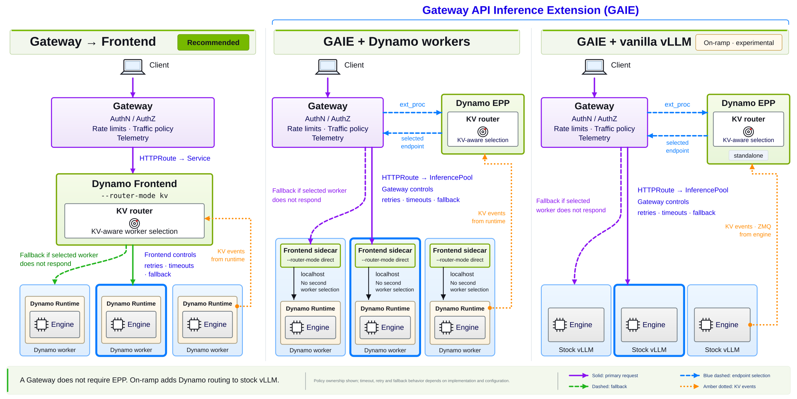

Dynamo supports two KV-aware request-routing topologies on Kubernetes. They use the same routing
concepts but place worker selection in different components. Choose based on how your platform accepts
and governs traffic, not because one topology uses a different KV-routing algorithm:

1. [Dynamo Frontend Routing](#dynamo-frontend-routing)
2. [Gateway API Inference Extension (GAIE) Routing](#gaie-routing)

GAIE follows the upstream
[Gateway API Inference Extension](https://github.com/kubernetes-sigs/gateway-api-inference-extension).

## Recommendation

Use **Dynamo Frontend routing**. It has fewer components and requires neither an
`InferencePool` nor an EPP.

If traffic must enter through a Kubernetes Gateway, for example because a platform team
standardizes ingress, authentication, rate limiting, traffic policy, or gateway-level telemetry
through Gateway API, use Dynamo Frontend routing with the Frontend Service as the Gateway's
backend. An `HTTPRoute` can send requests to the Frontend Service, with or without GAIE
installed. See
[Expose the Frontend](../model-deployment/expose-the-frontend.md#option-3-a-gateway-api-httproute-to-the-frontend-service).

For GAIE routing, in which the Gateway calls the Dynamo EPP through the `ext_proc` protocol to pick
the worker for each request, see [Using GAIE with Dynamo](gateway-api.mdx). GAIE routing does not
have full feature parity with Dynamo Frontend routing. Before you choose it, review
[Features Not Supported by the Dynamo EPP](#features-not-supported-by-the-dynamo-epp).

| Choose | When it fits | Additional infrastructure | Where routing is configured |
|---|---|---|---|
| Using the Dynamo Frontend | Recommended for most deployments, whether clients call the Frontend Service directly or through a Kubernetes Gateway. | None beyond the normal Dynamo platform for direct calls. Behind a Gateway, also Gateway API and a compatible Gateway implementation, but not GAIE. | Frontend with `--router-mode kv`. |
| Using GAIE with Dynamo | You want the Gateway to manage worker-facing connections, including endpoint health, timeouts, and fallback, rather than the Dynamo Frontend. | Gateway API, GAIE, a compatible Gateway implementation, and a Dynamo EPP. | EPP; worker Frontend sidecars use `--router-mode direct`. |
| Using GAIE with vanilla vLLM | You already run upstream vLLM pods and want to add Dynamo's advanced KV-aware routing without migrating the fleet to Dynamo workers. | Gateway API, GAIE, a compatible Gateway implementation, and standalone Dynamo EPP support. | EPP with direct vLLM worker discovery and vLLM token rendering. |

Frontend routing and GAIE routing are mutually exclusive for a given request path. After the EPP
selects a worker, the worker's Frontend sidecar must use `--router-mode direct`, not
`--router-mode kv`.

Gateway policies apply to all three paths below. The component that connects to the workers
controls worker-facing retries, timeouts, and fallback; the KV router selects the worker.

[View the diagram at full size](../../../assets/img/gateway-routing-comparison.svg).

## Dynamo Frontend Routing

The Dynamo Frontend receives the client request, tokenizes it, scores eligible workers, and forwards
the request to the selected worker. Router flags and environment variables belong on the Frontend
component.

Choose this topology when:

- Each deployment can expose its own Frontend Service.
- You want the fewest routing components to install and operate.
- Dynamo should own both HTTP request handling and worker selection.

This topology works out of the box with the normal Dynamo platform; no Gateway API components are
required. When your platform requires a Gateway, route it to the Frontend Service as shown in
[Expose the Frontend](../model-deployment/expose-the-frontend.md#option-3-a-gateway-api-httproute-to-the-frontend-service).
Use [the Dynamo Frontend](dynamo-frontend.md) to enable KV-aware worker selection in a DGD.

## GAIE Routing

GAIE routing moves worker selection into the Gateway's request path. A Kubernetes `Gateway` receives
the request and asks the Dynamo Endpoint Picker Plugin (EPP) to select an endpoint before forwarding
the request to a worker pod.

Teams often give these reasons for GAIE routing:

- Your organization already uses Gateway API as the standard ingress layer.
- Authentication, authorization, rate limiting, traffic policy, or telemetry belongs at the Gateway.
- Multiple model routes should share a platform-managed address and listener.
- A platform team manages the Gateway while an application team manages the DGD and `HTTPRoute`.

These Gateway-level requirements apply to either topology. Choose GAIE routing when the Gateway must
connect directly to the selected workers and manage worker-facing transport behavior, rather than
delegate that hop to the Dynamo Frontend. The upstream
[GAIE implementation guide](https://gateway-api-inference-extension.sigs.k8s.io/guides/implementers/)
defines the endpoint-selection contract. Health checking, fallback, and EPP reselection on retries
depend on the Gateway implementation and its configuration. GAIE routing does not have full feature
parity with Dynamo Frontend routing; see
[Features Not Supported by the Dynamo EPP](#features-not-supported-by-the-dynamo-epp).

GAIE routing requires a separate installation. See
[Install Gateway API Inference Extension](../installation/gateway-api-routing.mdx), then
[GAIE with Dynamo](gateway-api.mdx) or [GAIE with vanilla vLLM](vanilla-vllm-onramp.mdx).

## What Is the Dynamo EPP?

The Dynamo **Endpoint Picker Plugin (EPP)** is a service that implements the GAIE endpoint-selection
protocol. The Gateway calls it before forwarding an inference request. The EPP tokenizes the request,
reads Dynamo worker and KV cache state, scores eligible endpoints, and returns the selected worker to
the Gateway.

The EPP is not a public inference endpoint and does not run the model. The Dynamo operator deploys it
when a DGD contains a component with `type: epp`. In this topology, worker Frontend sidecars run with
`--router-mode direct` because the EPP has already made the routing decision.

For the operator-managed setup and request flow, see
[Using GAIE with Dynamo](gateway-api.mdx).

## Shared Routing Behavior

Both topologies can use worker-published KV cache events to account for prefix overlap and active
load. Both can also operate with predicted state when precise KV events are unavailable, with one
exception: in an aggregated deployment, the Dynamo EPP does not record its routing decisions, so
with `DYN_USE_KV_EVENTS=false` repeated prompts get no predicted cache credit. The core selection
algorithm and its tuning concepts are shared, but the Dynamo EPP does not support every Frontend
feature that shapes a routing decision, such as session affinity and multimodal KV routing.

For the cost model, see [Routing Concepts](../../developer-guide/knowledge-base/modular-components/router/routing-concepts.md). For shared tuning
guidance, see [Configuration and Tuning](../../developer-guide/knowledge-base/modular-components/router/configuration-and-tuning.md).

## Features Not Supported by the Dynamo EPP

This section covers the Dynamo EPP in Dynamo mode (`DYN_EPP_MODE=dynamo`, the default), which the
Dynamo operator deploys from a DGD component with `type: epp`, as in
[Using GAIE with Dynamo](gateway-api.mdx). It does not cover standalone mode, which
[Using GAIE with vanilla vLLM](vanilla-vllm-onramp.mdx) uses.

The Dynamo EPP routes OpenAI Chat Completions and Completions requests with KV-aware routing, in
aggregated and disaggregated prefill and decode deployments. It does not have full feature parity
with Dynamo Frontend routing: the features below work when the Dynamo Frontend routes requests, but
not when the Dynamo EPP does. If your deployment needs any of them, use Dynamo Frontend routing,
behind a Gateway if your platform requires one.

> [!NOTE]
> This list changes over time. For the current status of each feature, check
> [DEP #16595](https://github.com/ai-dynamo/dynamo/issues/16595).

### Request Handling

- **[Session affinity](../../developer-guide/knowledge-base/modular-components/router/configuration-and-tuning.md#session-affinity):**
  the EPP does not read session IDs, so requests from one multi-turn or agent session can land on
  different workers and lose the KV cache from earlier turns.
- **Priority headers:** the EPP's router queue reads priority only from `nvext.agent_hints` in the
  request body, not from the `x-dynamo-request-priority` and `x-dynamo-request-strict-priority`
  headers. The worker's Frontend sidecar still applies `x-dynamo-request-priority` to engine
  scheduling, so the header loses only router-queue ordering, which applies when router queueing is
  enabled. To set [request priority](../../use-cases/agents/priority-scheduling.md) in both places,
  use `nvext.agent_hints`.
- **[Request classification](../../developer-guide/knowledge-base/modular-components/router/custom-admission-control.md):**
  request classifiers do not run for requests the EPP routes, and the EPP does not run custom
  worker-selection policies.
- **[Request rejection](../fault-tolerance/request-rejection.md):** the EPP does not apply worker
  load thresholds, so it does not shed load before workers saturate. When the EPP rejects a request,
  the client receives HTTP 503, not the HTTP 429 or 529 that the Frontend returns.

### Routing

- **[Multimodal KV routing](../../use-cases/multimodal-serving/multimodal-kv-routing.md):** the EPP
  serves multimodal requests but routes them on text tokens only, so images and video do not count
  toward cache matches.
- **[Topology-aware KV transfer](../../developer-guide/knowledge-base/modular-components/router/topology-aware-kv-transfer.md):**
  the EPP does not keep the decode worker in the prefill worker's topology domain, such as the same
  zone or rack.
- **[Output-block tracking](../../developer-guide/knowledge-base/modular-components/router/configuration-and-tuning.md#block-tracking):**
  the EPP does not add generated tokens to a worker's load, so `DYN_ROUTER_TRACK_OUTPUT_BLOCKS` has
  no effect.
- **[Routing modes](../../developer-guide/knowledge-base/modular-components/router/router-guide.md#choose-a-routing-mode) other than KV:**
  the EPP always routes with KV-aware scoring. Round-robin, random, power-of-two, least-loaded, and
  device-aware-weighted modes are not available.
- **[Remote KV indexer](../../developer-guide/knowledge-base/modular-components/router/router-operations.md#dynamo-native-remote-indexer):**
  not supported.

### Disaggregated Serving

- **[Conditional disaggregation](../../developer-guide/advanced-customizations/conditional-disaggregation.md):**
  the EPP always tries to select a separate prefill worker. It never lets a decode worker prefill a
  short or cached prompt locally.
- **[Encoder disaggregation](../../use-cases/multimodal-serving/encoder-disaggregation.md):** in an
  encode, prefill, and decode deployment, the EPP does not choose the encode worker. The Frontend
  sidecar on the selected decode worker picks one round-robin, without regard to encode load across
  the deployment.

### APIs

The EPP supports the OpenAI Chat Completions (`/v1/chat/completions`) and Completions
(`/v1/completions`) APIs. It does not support the other APIs the Frontend serves, including the
OpenAI Responses API (`/v1/responses`), the Anthropic Messages API (`/v1/messages`), embeddings,
rerank, images, video, audio, batches, files, realtime, and KServe gRPC. To serve those APIs, route
them to a deployment that uses Dynamo Frontend routing. For the Frontend's endpoints, see
[HTTP endpoints](../../reference/components/frontend-configuration.mdx#http-endpoints).

### Observability

- **Router metrics:** the EPP does not publish the router queue, worker load, rejection, and
  routing-time metrics that the Frontend publishes. See the
  [Metrics Catalog](../../reference/observability/metrics-catalog.mdx).
- **[Distributed tracing](../operations/observability.mdx#export-distributed-traces-and-logs):** the
  EPP does not emit OpenTelemetry traces, so the time it spends tokenizing a request and picking its
  worker does not appear in traces. Dynamo traces start at the Frontend sidecar on the worker.

### Operations and Integrations

- **[Request migration](../fault-tolerance/request-migration.md):** when a worker fails during a
  request, the request does not move to another worker. The EPP pins each request to the worker it
  picks, and the Frontend sidecar does not migrate a request that is pinned to a worker.
- **[LoRA adapters](../operations/lora-adapters.md):** not supported.
- **[Auto deployment with DGDR](../auto-deployment/auto-deploy-with-dgdr.md):** a
  DynamoGraphDeploymentRequest (DGDR) cannot generate or add an EPP component.
- **[Reinforcement learning (RL) rollouts](../../use-cases/reinforcement-learning/overview.md):** not
  supported.
