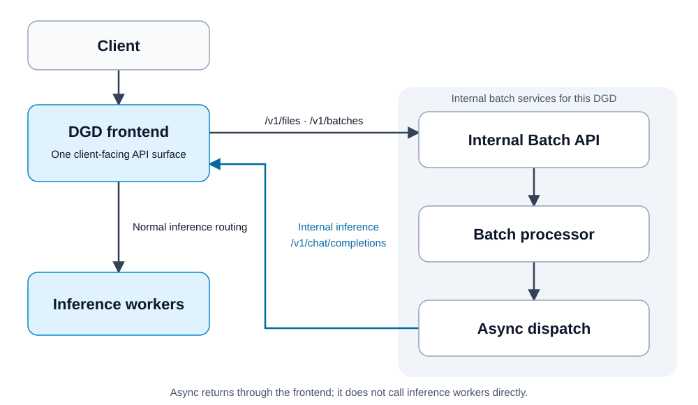

Submit files and batch jobs to the same Dynamo frontend used for inference. One `dynamo-batch` Helm
release deploys the batch services for your DGD, using pinned Batch Gateway and Async components
internally. Provision metadata, queue, and object storage separately; this chart only connects to
them. The chart, sample DGD, and helper scripts live in
[`examples/deployments/batch-gateway`](https://github.com/ai-dynamo/dynamo/tree/main/examples/deployments/batch-gateway).

> [!WARNING]
> **Experimental.** This integration provides an experimental OpenAI Batch lifecycle for a
> DynamoGraphDeployment. Validate it against your workload, storage, and ingress before relying on
> it in production.

Use dedicated offline inference capacity for this profile. Requests use the standard inference API,
but model readiness is not a measure of spare capacity and does not reserve GPU capacity for online
traffic. Sharing the worker pool requires a separately configured and validated admission policy;
this example does not promise online latency isolation.

> [!WARNING]
> For untrusted clients, require an authenticating ingress that strips client-supplied
> `X-MaaS-Username` headers and injects a tenant identity from validated credentials. Reject
> unauthenticated requests before they reach the frontend. Restrict direct access to the frontend
> and internal Batch API with network policies or gateway-to-frontend mTLS so callers cannot bypass
> that ingress. Neither the proxy nor the pinned Batch Gateway validates bearer tokens; forwarding
> `Authorization` is not authentication. Follow the
> [Dynamo secure deployment guidelines](../../developer-guide/security/secure-deployment-guidelines.md).



## Set Up

You need the Dynamo Kubernetes operator, one GPU for the sample model, Helm, `kubectl`, Python with
PyYAML, and existing PostgreSQL, Redis/Valkey, and S3-compatible storage reachable from the batch
pods. Create the object bucket before installing. Use a Dynamo runtime image built from this
checkout; set both image fields in `dynamo.yaml` to that image, following the
[container build guide](https://github.com/ai-dynamo/dynamo/blob/main/container/README.md). The
example serves `Qwen/Qwen3-0.6B`.

From the repository root:

```bash
cd examples/deployments/batch-gateway
kubectl create namespace dynamo-batch-example
kubectl apply -n dynamo-batch-example -f dynamo.yaml
```

Create a Secret named `dynamo-batch-storage` in `dynamo-batch-example` through your secret manager
or Kubernetes tooling. Include the following keys, and keep credentials out of the checked-in
profile and generated values:

- `postgresql-url`: PostgreSQL connection URL for batch metadata.
- `redis-url`: Redis/Valkey connection URL for queues and request/result exchange.
- `s3-secret-access-key`: secret access key for the object bucket.

In `profile-external-storage.yaml`, set the bucket, region, access key ID, and optional S3
endpoint/path-style settings. Set `storage.secretName` if your Secret has a different name. The
sample DGD and profile already have matching model, namespace, and service names. Install the batch
integration from `examples/deployments/batch-gateway`:

```bash
helm dependency build chart
python3 render_values.py profile-external-storage.yaml --output-dir /tmp/dynamo-batch-values
helm upgrade --install qwen-batch ./chart \
  --namespace dynamo-batch-example \
  --values /tmp/dynamo-batch-values/dynamo-batch-values.yaml --wait --timeout 5m
```

The chart does not create databases, queue storage, object buckets, storage credentials, or
persistent volumes. Manage storage availability, backups, and access policies separately.

Use separate metadata databases and object prefixes for independently managed DGDs. Queue names and
default object prefixes include the DGD namespace and name. Uninstalling the batch release does not
delete externally managed storage or its credentials.

In another terminal, expose **only the Dynamo frontend** and leave the port-forward running:

```bash
kubectl port-forward -n dynamo-batch-example \
  service/qwen3-0-6b-batch-frontend 8000:8000
```

Verify the model is available before submitting a batch:

```bash
curl --fail http://localhost:8000/v1/models
curl --fail http://localhost:8000/v1/chat/completions \
  -H 'Content-Type: application/json' \
  -d '{"model":"Qwen/Qwen3-0.6B","messages":[{"role":"user","content":"Say hello"}],"max_tokens":16}'
```

## Submit a Batch

From `examples/deployments/batch-gateway`:

```bash
python3 run_example.py --base-url http://localhost:8000 --success-only
```

This uploads `batch-input.jsonl`, creates a job, polls it, downloads its output, and verifies that
both request IDs have successful results. Each JSONL line contains a unique `custom_id`, `method`,
`url`, and request `body`. For example:

```json
{"custom_id":"question-1","method":"POST","url":"/v1/chat/completions","body":{"model":"Qwen/Qwen3-0.6B","messages":[{"role":"user","content":"What is Dynamo?"}],"max_tokens":64}}
```

Your own client uses the same frontend base URL:

1. `POST /v1/files` with multipart fields `purpose=batch` and `file=<your JSONL file>`; save its `id`.
2. `POST /v1/batches` with `{"input_file_id":"<file id>","endpoint":"/v1/chat/completions","completion_window":"24h"}`; save the batch `id`.
3. `GET /v1/batches/<batch id>` until the job reaches a terminal state.
4. Download `GET /v1/files/<output_file_id>/content`, and the error file if `error_file_id` is present.

The localhost example uses a development tenant and placeholder bearer token; use it only within a
trusted development environment. For production, send real credentials to your authenticating
ingress and let that ingress supply the tenant header. Before exposing the service, verify that
absent or invalid credentials and forged tenant headers cannot list, retrieve, or delete another
tenant's files or jobs, and verify that direct frontend/Batch API access is blocked.

Input files are limited to 200 MiB in this profile; for larger workloads, split the JSONL into
multiple input files and submit a job for each. `DYN_BATCH_UPLOAD_BODY_LIMIT_MB` defaults to
202 MiB, including multipart framing, without changing the online JSON limit
(`DYN_HTTP_BODY_LIMIT_MB`, default 45 MiB). `DYN_BATCH_MAX_FILE_TRANSFERS` defaults to four
concurrent uploads/downloads per frontend replica; excess transfers receive 503 and should retry
with backoff. Permits remain held through the response body lifetime. Configure bandwidth and tenant
quotas at your ingress. The Batch API has a disk-backed, 1 GiB temporary volume at `/tmp` for
multipart uploads above 32 MiB. Size this budget for the combined permitted upload concurrency
across frontend replicas. Increasing the file limit also requires sizing the batch upload limit, API
temporary volume, Processor work directory, and storage capacity.

File transfers also have a 600-second maximum lifetime (`DYN_BATCH_FILE_TRANSFER_TIMEOUT_SECS`). The
frontend closes the connection when a transfer expires, even if the client stops consuming an HTTP/2
response. This also interrupts other HTTP/2 streams sharing that connection. Reconnect before
retrying reads; for interrupted uploads or job creation, check whether the operation succeeded
before resubmitting. Size the limit for your file sizes and network speed. Stalled socket writes
have a separate 120-second limit (`DYN_HTTP_WRITE_IDLE_TIMEOUT_SECS`).

## Tune Concurrency and Result Delivery

This example already dispatches requests concurrently. The profile's `asyncConcurrency` setting
defaults to `64` per Async replica. The two-request demo checks that submission and retrieval work;
its one-second status polling doesn't make inference run one request at a time.

### Adjust Inference Concurrency

Use `asyncConcurrency` to change how many requests each Async replica can dispatch. Include all
replicas that share the same inference pool when choosing a limit. The model may run fewer requests
because of its own limits, a dispatch gate or a lack of queued work.

To compare `32` with the existing `64`, copy your storage-configured profile and render a new values
file. From `examples/deployments/batch-gateway`:

```bash
python3 - <<'PYTHON'
from pathlib import Path
import yaml

profile = yaml.safe_load(Path("profile-external-storage.yaml").read_text())
profile["asyncConcurrency"] = 32
with Path("profile-concurrency-32.yaml").open("x") as output:
    yaml.safe_dump(profile, output, sort_keys=False)
PYTHON
python3 render_values.py profile-concurrency-32.yaml \
  --output-dir /tmp/dynamo-batch-values-32
```

Both commands refuse to overwrite existing output. Before installing, check the generated
`async.ap.concurrency`, `async.ap.transportConfig.batch_size`, Processor settings, target DGD and
storage references. Keep credentials in the existing Secret.

Run a larger workload on dedicated offline capacity and change one setting at a time. Keep the
model, input and output lengths, worker setup, caching and client processing the same. Compare
usable outputs per second and the time to save and read back every result.

Have enough work queued to exercise the limit, within storage, queue, memory and tenant budgets.
Watch queue growth, latency, errors and CPU/GPU/storage use. A busy GPU sample or full HTTP pool
alone doesn't show sustained capacity. Stop raising concurrency if completion time, latency, errors
or resource pressure worsens.

<details>
<summary>Other limits that affect concurrency</summary>

This profile uses Async dispatch. Benchmark it separately from synchronous Batch, which uses
different dispatch controls. The renderer sets Async queue `batch_size` to `asyncConcurrency`. It
also keeps the Processor's synchronous limit fields at least that large. These values don't
multiply together.

| Setting | Default | Meaning |
| --- | --- | --- |
| `batch-gateway.processor.config.numWorkers` | `5` | Jobs each Processor replica can work on at once. Each job can contain many model requests. |
| `batch-gateway.processor.config.concurrency.global` and `.perEndpoint` | `256` each | Synchronous dispatch limits. The pinned Processor doesn't create these semaphores in Async mode, so increasing them won't raise Async concurrency. |

Disk space can reduce the job worker count to the smaller of `numWorkers` and
`floor(input-file disk budget / maximum input-file size)`. The chart provides a 10 GiB work
directory, reserves 10% for inputs and allows files up to 200 MiB. Leave space for outputs,
checkpoints and other files before raising those limits. See the
[Batch Gateway chart configuration](https://github.com/llm-d/llm-d-batch-gateway/blob/v0.6.0/charts/batch-gateway/values.yaml).

</details>

### Get Completed Results Back Sooner

If inference has finished but your application is still waiting for results, check how it collects
them. Keep every accepted job ID so you can return for its results. Download each completed job
without waiting for unrelated jobs. Match results by `custom_id`. Check each result's error and HTTP
status, then inspect the endpoint's completion fields inside `response.body`. For
`/v1/chat/completions`, check each choice's `finish_reason`; `"length"` means generation reached
the token limit, so assess whether the output is usable before marking the request complete. Save
and verify each result before checkpointing it. When resuming, keep completed requests separate
from unfinished ones and requests whose outcome is still unknown.

For slow decoding or file writes, process independent results in a bounded worker pool and cap the
bytes held by pending downloads and output work. More inference requests or job workers won't speed
up this work. Smaller jobs can make the first usable result available sooner, but add upload,
validation and finalization work. Measure both the first-result time and full completion time
before changing job size.

Use dedicated offline capacity unless you've configured and validated a separate admission policy.
The readiness gate doesn't reserve capacity for online requests.

## Use an Existing DGD

Set `targetDGD.name`, `targetDGD.namespace`, and `model` in the profile to match your deployment.
Add `--batch-gateway-url http://<dgd>-batch-api.<namespace>.svc:8000` to every frontend replica,
using a runtime image containing the proxy. The integration calls the standard `<dgd>-frontend`
Service on port 8000. Regenerate the values into a new output directory, then install the chart in
that namespace.

If `model` is a served alias, also set `readinessModel` to the primary served name (the first
`--served-model-name` value). Dynamo exports readiness only under that primary name. Batch requests
retain the `model` alias; `readinessModel` selects the readiness metric and defaults to `model` when
omitted.

For error and cancellation examples, run `run_example.py` without `--success-only`. Cancelling a job
does not interrupt inference requests already accepted by Dynamo.

Keep inference workers ready for this example. Async checks model readiness before dispatching
requests, but this chart does not add backlog-driven Planner scaling or scale-from-zero.
