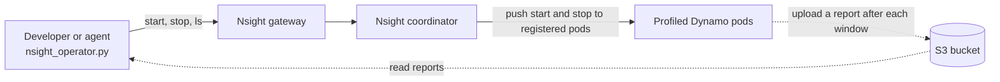

[NVIDIA Nsight Operator](https://docs.nvidia.com/nsight-operator/) adds Nsight Systems (`nsys`) to the pods you
select when they are created. It starts and stops capture windows on request, and each profiled pod uploads one report
per profiled process to S3 or to Nsight's in-cluster storage. Its CLI and web UI are called Nsight Cloud.

[Nsight's Dynamo Quick Start Documentation](https://docs.nvidia.com/nsight-operator/GettingStarted/index.html#quick-start-example-nvidia-dynamo)
covers installing and running the operator. This page adds only the parts that need Dynamo knowledge:

- which pod labels select each Dynamo component;
- a profile config with process patterns and `nsys` arguments for each component;
- the NVTX settings that add Dynamo's own ranges to the reports;
- pitfalls seen with Dynamo, and what has been tested.

You can use the [published Dynamo runtime images](../../reference/general/release-artifacts.mdx) from NGC without a
custom build, and the DynamoGraphDeployment (DGD) needs no new fields.

## Who Does What

Nsight's [multitenant quickstart](https://docs.nvidia.com/nsight-operator/GettingStarted/index.html#quickstart-example-multitenant-mode)
defines three roles. To profile a Dynamo deployment, each role does the following:

| Role | Does | How often |
|---|---|---|
| Cluster admin | Installs the Nsight Operator chart, as in [Install Operator](https://docs.nvidia.com/nsight-operator/GettingStarted/index.html#cluster-admin-install-operator), and [limits its injector webhook to opted-in namespaces](https://docs.nvidia.com/nsight-operator/InstallationGuide/index.html#multi-tenant-configuration) with `clusterWideInjectionFilter` | Once per cluster |
| Namespace admin | Creates the S3 storage config ([external S3](https://docs.nvidia.com/nsight-operator/UserGuide/index.html#using-external-s3)); without auto-provisioning, also the coordinator and gateway | Once per namespace |
| Developer or coding agent | Applies a profile config, then deploys the DGD | Once per DGD deployment |
| Developer or coding agent | Captures with `nsight_operator.py` | Once per profiling session |

Commands and reports take different paths:



By default, Nsight adds no privileged flag, capabilities, or host access to profiled pods, and `nsys` runs as the
container's user. To keep it that way, do not turn on GPU metrics sampling (the `nsys` option `--gpu-metrics-devices`).
[Nsight's GPU metrics setup](https://docs.nvidia.com/nsight-operator/Troubleshooting/index.html#gpu-metrics) needs
extra privileges: it adds a collector DaemonSet whose pods run with `privileged: true` (or the `SYS_ADMIN` capability).
Tracing CUDA API calls and GPU kernels, as the worker configs below do, needs no extra privileges.

## Try Nsight's Dynamo Helper First

Nsight ships a Dynamo helper, `nsight_operator_dynamo.py`, with a
[Dynamo quick start](https://docs.nvidia.com/nsight-operator/GettingStarted/index.html#quick-start-example-nvidia-dynamo).
On a cluster where the operator already runs with auto-provisioning, its `configure` command (Option B) gives the
fastest first look. Adjust it as follows:

- Pass lowercase component types, such as `--components frontend` or `--components prefill decode`. The helper
  compares them with the lowercase `nvidia.com/dynamo-component-type` label, so capitalized component names such as
  `Frontend` select no pod.
- Pass `--deployment-name <your DGD>`. The helper selects every pod whose name contains that string, so pick a name
  that no other DGD's name contains.
- Set `--nsys-profile-args "-t cuda,nvtx,osrt --python-sampling=true"`. The helper's default adds
  `--pytorch=autograd-nvtx` (see [Pitfalls](#pitfalls)).
- Leave out `--gpu-metrics`. It installs Nsight's GPU metrics collector: a DaemonSet whose pods run with
  `privileged: true`, plus a profile config that runs `nsys --gpu-metrics-devices=all` in those pods.

For example, to profile the frontend and the aggregated workers of one DGD:

```bash
python3 nsight_operator_dynamo.py -n <namespace> configure \
    --deployment-name <dgd> \
    --components frontend worker \
    --nsys-profile-args "-t cuda,nvtx,osrt --python-sampling=true"
```

The helper then prints the next steps: deploy the DGD or recreate its pods, then start a capture, stop it, and list
the reports with `nsight_operator.py`.

## Select Components

Select pods with the labels the Dynamo operator already sets on every pod. Always include
`nvidia.com/dynamo-graph-deployment-name`, so that other DGDs in the namespace are not matched.

| Component | Selector |
|---|---|
| Frontend, including its built-in KV router | `nvidia.com/dynamo-component-type: frontend` |
| Aggregated worker | `nvidia.com/dynamo-component-type: worker` |
| Prefill or decode worker | `nvidia.com/dynamo-component-type: prefill` or `decode`. A worker generation that already served alpha-era selectors before an operator upgrade keeps type `worker`; for those pods, match `nvidia.com/dynamo-sub-component-type: prefill` or `decode` instead. |
| Planner, or Endpoint Picker Plugin (EPP) | `nvidia.com/dynamo-component-type: planner` or `epp` |
| Component without a `type`, such as a standalone router | `nvidia.com/dynamo-component: <component name>` |

Check the labels of your pods with:

```bash
kubectl get pods -n <namespace> -l nvidia.com/dynamo-graph-deployment-name=<dgd> --show-labels
```

## Write a Profile Config

Apply one `NsightOperatorProfileConfig` for each DGD you profile, before you deploy that DGD; only pods created after
the config exists are profiled. This config follows Nsight's
[per-tenant storage example](https://docs.nvidia.com/nsight-operator/UserGuide/index.html#per-tenant-storage-with-nsightcloudstorageconfig)
and uses the field names of Nsight Operator 26.3. Replace `my-dgd` everywhere with your DGD name, `my-namespace` with
your namespace, and `team-s3` with your storage config. Keep one rule for each component you want to record.

```yaml
apiVersion: nvidia.com/v1
kind: NsightOperatorProfileConfig
metadata:
  name: nsys-my-dgd
  namespace: my-namespace
spec:
  nsightToolConfigs:
  - name: my-dgd-cpu           # frontend: OS runtime calls, Python stacks, NVTX
    coordinator: true          # record only between profiler-start and its stop
    nsightToolCommand: profile --start-later=true
    nsightToolArgs: "-t nvtx,osrt --python-sampling=true"
    opentelemetryTrace: false  # no OpenTelemetry trace mirroring
  - name: my-dgd-gpu           # workers: adds CUDA API calls and every kernel
    coordinator: true
    nsightToolCommand: profile --start-later=true
    nsightToolArgs: "-t cuda,nvtx,osrt --cuda-graph-trace=node --python-sampling=true"
    opentelemetryTrace: false
  injectionRules:              # rule names must be unique in the namespace
  - name: my-dgd-frontend
    nsightToolConfigRef: my-dgd-cpu
    nsightTags: [my-dgd]                # literal text; the same tag on every rule
    cloudStorageConfigRef: team-s3      # omit to use Nsight's in-cluster storage
    podObjectSelector:
      matchLabels:
        nvidia.com/dynamo-graph-deployment-name: my-dgd
        nvidia.com/dynamo-component-type: frontend
    processIncludePatterns: ['^(.*/)?python(3([.][0-9]+)?)? -m dynamo[.]frontend( .*)?$']
  - name: my-dgd-decode
    nsightToolConfigRef: my-dgd-gpu
    nsightTags: [my-dgd]
    cloudStorageConfigRef: team-s3
    podObjectSelector:
      matchLabels:
        nvidia.com/dynamo-graph-deployment-name: my-dgd
        nvidia.com/dynamo-component-type: decode
    processIncludePatterns: ['^(.*/)?python(3([.][0-9]+)?)? -m dynamo[.](vllm|sglang|trtllm)( .*)?$']
```

- **Tags.** Every rule uses the same literal tag, the DGD name, so one window profiles every selected component over
  the same period. A tag holds one profiling session at a time. For separate windows per component, give each rule its
  own tag.
- **Names.** Nsight looks up tool configs by name across the whole namespace, so give each profile config in a
  namespace its own tool-config names. Do not name the config `dynamo-profile-config`, which Nsight's helper writes and
  deletes.
- **Patterns.** They match Dynamo's launch commands, `python -m dynamo.<module>` and `python3 -m dynamo.<module>`, so
  helper commands such as `python3 -c ...` are not wrapped. Write `[.]` rather than `\.`: on Nsight Operator 26.2, a
  backslash in a pattern silently disabled injection.
- **Field names.** Nsight Operator 26.2 uses older names, such as `matchConditions` and `injectionIncludePatterns`, and
  rejects the 26.3 names above. Nsight Operator 26.3 still accepts the 26.2 names.
- **Fork tracing.** The config leaves out `--trace-fork-before-exec=true`, which Nsight's template sets. The
  [nsys documentation](https://docs.nvidia.com/nsight-systems/UserGuide/index.html#cli-profile-command-switch-options)
  warns that it can make the application crash or deadlock.

## Settings per Component

| Component | `nsightToolArgs` | NVTX environment |
|---|---|---|
| Frontend | `-t nvtx,osrt --python-sampling=true` | `DYN_ENABLE_RUST_NVTX=1` adds per-request ranges: `preprocess.*`, `transport.*`, `detokenize`, and `route.*` with KV routing. Dynamo 1.6.0 and newer only. |
| Workers | `-t cuda,nvtx,osrt --cuda-graph-trace=node --python-sampling=true` | vLLM: `VLLM_NVTX_SCOPES_FOR_PROFILING=1` adds scheduler ranges. Leave `DYN_NVTX` unset (see [Pitfalls](#pitfalls)). |

- `--cuda-graph-trace=node` shows every kernel inside CUDA graphs and costs the most. For lower overhead, use
  `--cuda-graph-trace=graph`, which shows each graph launch as one item.
- Set the NVTX variables in the component's container `env`, or in the DGD's `spec.env` to set them on every
  component, before the pods start.
- Keep each window at 300 seconds or less; Nsight Systems does not officially support longer runs.

## Capture

Get `nsight_operator.py` from the
[NGC resources](https://catalog.ngc.nvidia.com/orgs/nvidia/teams/devtools/resources/nsight-operator-resources) of the
same release as the operator. It needs Python 3.12 or newer. Install its dependencies from the unpacked bundle:

```bash
pip install -r requirements.txt
```

Deploy the DGD after the profile config, wait until every selected pod is ready, and start your load. Then run:

```bash
NS=my-namespace
T=my-dgd
python3 nsight_operator.py autoconfigure -n $NS
python3 nsight_operator.py --tag $T status                # one collection agent per selected pod
python3 nsight_operator.py --tag $T session-begin --title $T
python3 nsight_operator.py --tag $T profiler-start --delay 120 --duration 60
python3 nsight_operator.py --tag $T ls                    # repeat until every pod has a report
python3 nsight_operator.py --tag $T download -o ./reports
python3 nsight_operator.py --tag $T session-end
```

`--delay` gives the load time to warm up. The coordinator starts and stops the window itself, so the CLI does not need
to stay connected. Download before `session-end`: without `--session <UUID>`, `ls` and `download` use the tag's active
session. To download later, pass the session ID that `session-begin` printed. Reports appear after the delay, the
window, and the upload; a 30-second window on one GPU worker produced a report of about 100 MB. Each file name carries
the tag, the process, and the pod name. An `otlp-converter` entry in `status` or `ls` comes from Nsight's OpenTelemetry
converter, not from a Dynamo pod. Open the reports with an Nsight Systems version at least as new as the `nsys` that the
operator injects.

<Note>
`autoconfigure` copies the gateway's storage key into `~/.nsight-cloud.conf` on the machine that runs the CLI. To keep
the key off that machine:

- Set up the CLI with [`configure`](https://docs.nvidia.com/nsight-operator/UserGuide/index.html#configure) instead
  of `autoconfigure`.
- Download reports with your own storage credentials, as described in
  [Configuring Storage Access for Downloads](https://docs.nvidia.com/nsight-operator/UserGuide/index.html#configuring-storage-access-for-downloads).
</Note>

## Profile One Pod with kubectl exec

To profile a single pod, you can also run `nsys` inside it with `kubectl exec`, without `nsight_operator.py`. The pod
must already be injected, which means a profile config selected it when the pod was created. The injected `nsys` is
at `/mnt/nv/bin/nsight-systems/target-linux-x64/nsys` on x86_64 nodes and
`/mnt/nv/bin/nsight-systems/target-linux-sbsa-armv8/nsys` on Arm nodes. Dynamo's container is named `main`:

```bash
POD=my-dgd-0-worker-abcde
NSYS=/mnt/nv/bin/nsight-systems/target-linux-x64/nsys
kubectl exec -n $NS $POD -c main -- $NSYS sessions list    # the session name, such as coordinated-default-1
kubectl exec -n $NS $POD -c main -- $NSYS start --session=coordinated-default-1
kubectl exec -n $NS $POD -c main -- $NSYS stop --session=coordinated-default-1
```

`nsys stop` waits until the report is written, which can take up to a minute for a GPU worker, and then prints its path
after `Generated:`, for example `/tmp/tmpkro1yevt/<report>.nsys-rep`. That file exists only inside the pod's `main`
container: the operator does not upload it, `nsight_operator.py ls` and `download` do not list it, and it is lost if the
container restarts. Copy it out as soon as `nsys stop` returns:

```bash
kubectl exec -n $NS $POD -c main -- cat /tmp/tmpkro1yevt/<report>.nsys-rep > ./reports/worker.nsys-rep
```

## Pitfalls

- **Apply the profile config before the pods start.** Only pods created after the config exists are profiled. After
  you change rules or arguments, recreate the pods.
- **Use literal tags.** A tag with a placeholder, such as `{NVDT_POD_NAME}`, silently puts the pod on the `default`
  tag.
- **Leave out `--pytorch=autograd-nvtx`.** Nsight's helper adds it by default. It can create a CUDA context on GPU 0
  for every rank, which can shrink the KV cache.
- **Leave `DYN_NVTX` unset on workers.** On Dynamo 1.6.0, `DYN_NVTX=1` makes `python -m dynamo.vllm` fail at import
  under `nsys`, because some NVTX color names need matplotlib, which the runtime images do not ship. SGLang workers
  load the same module.
- **Keep profiled runs out of measured benchmarks.** During a 30-second window with node-level CUDA graph tracing on one
  vLLM worker, end-to-end latency rose by about 18%; a frontend-only window changed it by less than 1%.
- **Use one profiler per process.** If your image already starts Dynamo under `nsys`, use an image without that
  wrapper.
- **TensorRT-LLM on Blackwell GPUs:** `-t cuda` can use hardware CUDA trace. If a worker crashes in a device-to-device
  copy under tracing, use `-t cuda-sw,nvtx,osrt`. This was seen with `nsys` outside Kubernetes.
- **If a pod is not profiled,** follow Nsight's
  [sidecar injection checks](https://docs.nvidia.com/nsight-operator/Troubleshooting/index.html#sidecar-injection-issues).
  Setting `logOutput: /tmp/injector.log` on a rule writes the process hook's log inside the pod.

## Tested Configurations

Tested with Nsight Operator 26.2.1 and its 26.2 field names, pods created by the Dynamo 1.5.0 operator, and Dynamo 1.6.0
pre-release runtime images:

- Selection by `nvidia.com/dynamo-component-type` with lowercase values profiled the selected frontend and worker pods.
  Capitalized values matched no pod and left the pods unchanged. Selection by a custom pod label also worked.
- A literal tag limited a coordinator window to the pods with that tag, and one window produced one report per pod.
- A 30-second capture of a non-root vLLM worker on one H100 GPU recorded about 2.3 million kernels and 0.58 million CUDA
  API calls. That window was started with `kubectl exec`, as in
  [Profile One Pod with kubectl exec](#profile-one-pod-with-kubectl-exec), rather than by the coordinator.
- `DYN_ENABLE_RUST_NVTX=1` added per-request ranges on the frontend, and `VLLM_NVTX_SCOPES_FOR_PROFILING=1` added
  scheduler ranges on a vLLM worker.

Not yet tested:

- The profile config above on Nsight Operator 26.3; its field names were checked against the 26.3 schema only.
- Upload to external S3, and a coordinator window on a GPU worker.
- Workers with more than one GPU, and SGLang and TensorRT-LLM workers.
- Prefill and decode selection in a disaggregated DGD, and a standalone router.
- Dynamo sidecar mode.
- Namespaces that enforce Pod Security `restricted`, and `opentelemetryTrace: false`.
