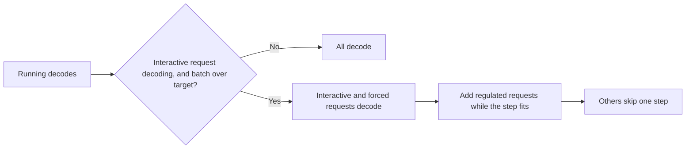

> [!WARNING]
> Decode regulation is experimental and available for vLLM workers only. The environment variables, defaults and metric names can change.

Decode regulation is an opt-in vLLM scheduler policy. While agentic workloads and interactive users share a worker, it defers some agent decodes by one step at a time so that each step finishes fast enough for interactive requests to meet an end-to-end deadline. Deferred requests keep their KV cache and their place in the running batch. When the batch already fits the deadline, the policy does nothing.

Regulation is by priority, not by workload type: any traffic below the interactive priority is regulated the same way, whether it comes from agents, batch jobs or offline evaluation.

The policy builds on published work: per-step admission of extra decodes against a step-time predictor within a slack budget, with a progress guarantee for every request ([TAPER](https://arxiv.org/abs/2605.06914), [HyGen](https://arxiv.org/abs/2501.14808)), and a target computed from each real-time request's remaining deadline ([BROS](https://arxiv.org/abs/2504.09590)).

## The Problem

Agentic workloads, such as coding, research and browsing agents, keep many long-context sessions in the decode batch at once, and agent frameworks add subagents on top. Each decode step reads every running request's KV cache, so step time grows with the number of running requests and their total context. An interactive request that joins this batch gets its first token on time but then waits for every step:

- In a 24-agent Claude Code workload on MiniMax-M2, 81–85% of interactive requests that missed a 3× unloaded inter-token-latency deadline had an on-time first token. Their inter-token latency was 30–35 ms against an 18.5 ms budget.
- Request priority does not help. Router and engine priority order requests that are waiting; they do not change which running requests decode in a step. See [Priority Scheduling](priority-scheduling.md).

## How It Works

Every scheduler step, over the running requests in the decode phase:

1. **Classify.** Requests with priority at or above `DYN_DECODE_REGULATION_PRIORITY_MIN` are interactive and are never deferred. Every other request is regulated.
2. **Set the step target.** With `DYN_DECODE_REGULATION_DEADLINE` set, each interactive request gets the per-token time it can still afford:

   ```text
   tau = margin × (arrival + ttft_ms + per_token_ms × max_tokens − now) / (max_tokens − generated)
   ```

   The step target is the smallest `tau` among running interactive requests. Without `DYN_DECODE_REGULATION_DEADLINE`, the target is the fixed `DYN_DECODE_REGULATION_TAU_INTERACTIVE_MS`.
3. **Predict step time** as `bias × (a + b × n + c × L)`, where `n` is the number of decodes in the step and `L` their total context in tokens. `a, b, c` come from `DYN_DECODE_REGULATION_COEFFS`; `bias` tracks the ratio of measured to predicted time on decode-only steps.
4. **Choose decodes.** If no interactive request is decoding, or every running decode fits the target, all of them run. Otherwise interactive requests run, plus any regulated request that has been deferred `K − 1` steps in a row. The remaining regulated requests are added longest-deferred first, then smallest context first, while the predicted step stays within the target. The rest skip this step.
5. **Fail open.** If `bias` stays pinned at its 0.5 or 2.0 limit for `DYN_DECODE_REGULATION_FAILSAFE_STEPS` decode-only steps, the coefficients do not fit this deployment. Regulation turns off and the worker schedules like stock vLLM until it restarts.



Because the target comes from each request's remaining deadline, a request with time to spare protects less than one that is behind. Taking the deadline at `max_tokens` keeps it valid for any shorter reply. With a very large `max_tokens`, the target approaches `margin × per_token_ms`.

A skip is one step long. vLLM's own scheduling loop passes over the request for that step; the request stays in the running set, so preemption, the running-request cap and the KV cache work as they do without regulation.

## Enable Decode Regulation

Interactive requests are identified by priority. Clients send `nvext.agent_hints.priority`, or the `x-dynamo-request-priority` header:

```json
{
    "model": "MiniMaxAI/MiniMax-M2",
    "messages": [
        { "role": "user", "content": "Explain the difference between a mutex and a semaphore." }
    ],
    "max_tokens": 256,
    "nvext": {
        "agent_hints": {
            "priority": 1
        }
    }
}
```

Agent and other background traffic sends no priority, or a lower one. Set `max_tokens` on interactive requests: the deadline is computed from it.

Start each vLLM worker with regulation enabled. The deadline below allows 500 ms to the first token and 18.48 ms per output token after it:

```bash
export DYN_DECODE_REGULATION_MODE=class_blind
export DYN_DECODE_REGULATION_PRIORITY_MIN=1
export DYN_DECODE_REGULATION_DEADLINE=500,18.48
export DYN_DECODE_REGULATION_COEFFS=6.4013,0.227066,0.000016055   # fit for your deployment
python3 -m dynamo.vllm --model MiniMaxAI/MiniMax-M2 --tensor-parallel-size 4
```

Setting `DYN_DECODE_REGULATION_MODE` selects Dynamo's `DecodeRegulationScheduler`. Do not also pass a different `--scheduler-cls`; the worker refuses to start with both.

Choose the deadline from the unloaded latency of the model on your hardware. A per-token budget of about 3× the unloaded inter-token latency leaves regulated requests room to decode; a budget close to the unloaded latency forces regulation on almost every step.

## Calibrate the Step-Time Model

The coefficients above were fitted for MiniMax-M2 with tensor parallelism 4 and an FP8 KV cache on H200. Fit your own for any other model, GPU or parallelism:

1. Run the worker in observe mode with a trace under representative load. Observe mode makes every decision but skips nothing:

   ```bash
   export DYN_DECODE_REGULATION_MODE=observe
   export DYN_DECODE_REGULATION_PRIORITY_MIN=1
   export DYN_DECODE_REGULATION_TRACE=/tmp/decode-regulation-trace.jsonl
   ```

2. Fit the coefficients from the trace:

   ```bash
   python3 -m dynamo.vllm.decode_regulation_fit /tmp/decode-regulation-trace.jsonl
   ```

   The tool reports the fit error by batch size, then prints a `DYN_DECODE_REGULATION_COEFFS=a,b,c` line to use.

Observe mode is also a way to see what regulation would do before enabling it: its log lines and metrics report the steps it would engage and the decodes it would skip.

After enabling regulation, check the `step_time_bias` metric. Values near 1.0 mean the coefficients fit. The bias corrects errors up to 2× either way; persistent values near 0.5 or 2.0 mean the coefficients need refitting, and the fail-open guard will turn regulation off.

## Configuration

Set these on the vLLM worker.

| Environment variable | Default | Description |
|---|---|---|
| `DYN_DECODE_REGULATION_MODE` | `off` | `off`, `observe` (decide and report, never skip) or `class_blind` (regulate). |
| `DYN_DECODE_REGULATION_PRIORITY_MIN` | unset | Requests with priority at or above this value are interactive. Unset: requests without agent session headers are interactive, and requests with them are regulated. |
| `DYN_DECODE_REGULATION_DEADLINE` | unset | `ttft_ms,per_token_ms` of the interactive end-to-end deadline. Unset: the fixed per-token target below. |
| `DYN_DECODE_REGULATION_SLACK_MARGIN` | `0.9` | Share of the remaining deadline the target plans on. Lower values protect more. |
| `DYN_DECODE_REGULATION_TAU_INTERACTIVE_MS` | `18.48` | Fixed per-token target, used when `DYN_DECODE_REGULATION_DEADLINE` is unset. |
| `DYN_DECODE_REGULATION_K` | `4` | A regulated request decodes at least once every `K` steps. |
| `DYN_DECODE_REGULATION_RHO` | `0.8` | Share of the remaining step budget that regulated requests may fill. |
| `DYN_DECODE_REGULATION_COEFFS` | MiniMax-M2, TP4, H200 | `a,b,c` of the step-time model, in ms, with `L` in tokens. |
| `DYN_DECODE_REGULATION_PREFILL_COEFFS` | `0,0` | `q,p`: a step that also carries `P` prefill tokens takes `q + p × P` ms longer. |
| `DYN_DECODE_REGULATION_FAILSAFE_STEPS` | `200` | Decode-only steps with the bias at its limit before regulation turns off. `0` disables the guard. |
| `DYN_DECODE_REGULATION_TRACE` | unset | Path for a per-step JSONL trace. |
| `DYN_DECODE_REGULATION_LOG_S` | `10` | Seconds between summary log lines. |

Regulation turns itself off, with a warning, when the worker uses pipeline parallelism or speculative decoding.

## Observability

At startup the worker logs the active settings:

```text
decode_regulation mode=class_blind coeffs=(6.4013, 0.227066, 1.6055e-05) tau=18.48 ms rho=0.80 K=4 guard=0 deadline=(500.0, 18.48) margin=0.90
```

Every `DYN_DECODE_REGULATION_LOG_S` seconds it logs a summary of the interval:

```text
decode_regulation steps=1830 interactive=2410 regulated=61200 engaged=1090 skipped=11800 skip_share=21.4% forced=420 max_skip_run=3 pred_err_p50=2.6% bias=1.041 decide_p50/p99=88/190us
```

- `steps`, `engaged`: scheduler steps, and steps where the batch did not fit the target.
- `interactive`, `regulated`: decode request-steps of each class.
- `skipped`, `skip_share`: regulated request-steps deferred, and their share of regulated request-steps in engaged steps.
- `forced`, `max_skip_run`: request-steps run because of the `K` bound, and the longest run of consecutive skips.
- `pred_err_p50`, `bias`: median step-time prediction error and the current bias.
- `decide_p50/p99`: time spent choosing the step's decodes.

The line ends with `DISABLED` after the fail-open guard trips, and the worker logs a warning naming the bias.

The worker's `/metrics` endpoint exposes the same counts, labeled by `model` and `dp_rank`:

| Metric | Type | Description |
|---|---|---|
| `dynamo_component_decode_regulation_steps_total` | counter | Scheduler steps evaluated. |
| `dynamo_component_decode_regulation_engaged_steps_total` | counter | Steps where the batch did not fit the target. |
| `dynamo_component_decode_regulation_interactive_total` | counter | Interactive decode request-steps. |
| `dynamo_component_decode_regulation_regulated_total` | counter | Regulated decode request-steps. |
| `dynamo_component_decode_regulation_skipped_total` | counter | Regulated request-steps deferred. |
| `dynamo_component_decode_regulation_forced_total` | counter | Request-steps run because of the `K` bound. |
| `dynamo_component_decode_regulation_decision_seconds_total` | counter | Time spent choosing decodes. |
| `dynamo_component_decode_regulation_enabled` | gauge | `1` while regulating, `0` after the fail-open guard trips. |
| `dynamo_component_decode_regulation_step_time_bias` | gauge | Measured over predicted step time. |

`skipped_total / regulated_total` is the share of regulated decode work deferred. `engaged_steps_total / steps_total` is how often the worker ran over the target.

## Measured Effect

Measured so far with coding agents only. MiniMax-M2 on 4 H200 GPUs (tensor parallelism 4, FP8 KV cache), 24 Claude Code agents on 64 SWE-bench Verified tasks, and one interactive request every 2 s on average with `max_tokens` 64. Deadline: 500 ms plus 18.48 ms per token after the first.

| Configuration (runs) | Interactive requests on deadline | Agent tasks per hour | Agent task time, p90 |
|---|---|---|---|
| Stock vLLM (6) | 34% | 226 | 9.9 min |
| vLLM `--scheduling-policy priority` (1) | 24% | 203 | 9.6 min |
| `DYN_DECODE_REGULATION_MODE=class_blind`, `DYN_DECODE_REGULATION_DEADLINE=500,18.48` (2) | 94% | 273 | 7.0 min |

Regulation deferred 4.6% of agent decode steps. Stock runs varied by up to 20% in tasks per hour and 1.5× in task p90 between identical runs, so the agent differences are within run-to-run noise.

Two choices matter for the agents' cost. A fixed per-token target (`DYN_DECODE_REGULATION_DEADLINE` unset) protects every step as if an interactive request were about to miss: in an earlier version it reached 97% on deadline but cut agent throughput to 173 tasks per hour, with a 14.0 min task p90. An earlier version that also regulated agents while no interactive request was running deferred 20% of agent decode steps instead of 4.6%.

## Limitations

- vLLM only. SGLang and TensorRT-LLM need their own adapters.
- One deadline per worker. Requests cannot set their own deadline.
- An interactive request that is already past its deadline keeps the target at its tightest until it finishes.
- Not supported with pipeline parallelism or speculative decoding. Not verified with the vLLM V2 model runner.
- The decision runs in Python on every step. It costs about 1.3 µs per running request, under 1% of step time on the reference deployment.

## Related Pages

- [Priority Scheduling](priority-scheduling.md)
- [Agent Hints](agent-hints.md)
- [Session IDs](session-ids.mdx)
- [ThunderAgent Program Scheduler](thunderagent-program-scheduler.md)
