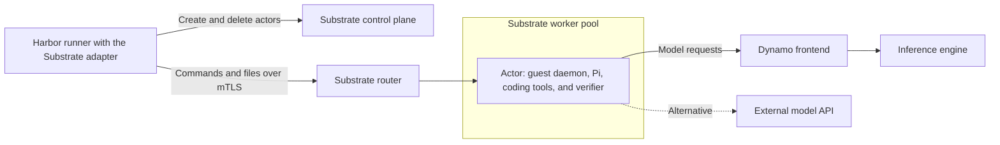

Run a SWE-bench Verified task with Harbor and Pi inside an Agent Substrate
sandbox. Then run a small concurrent batch and inspect its agent logs,
inference timings, and sandbox metrics. Use NVIDIA Dynamo to serve the model,
or connect to a compatible external API from a cluster without GPUs.

The runnable files are in the
[Harbor Substrate example](https://github.com/ai-dynamo/dynamo/tree/main/examples/agents/harbor-substrate).
This tutorial uses pinned dependencies. Keep those pins together when reproducing
it. The [model recipes](../../recipes/model-recipes/overview.mdx) own model
installation and hardware requirements.

<Warning>
This integration is experimental. It includes compatibility patches for the
pinned Pi adapter. Check the installation requirements before allocating
model-serving resources.
</Warning>

## What you build



Harbor selects tasks, limits concurrent trials, runs the agent and verifier,
and collects results. Pi calls the model and executes coding tools in the task
workspace. Substrate places isolated actors on CPU workers. Dynamo serves
inference outside those actors.

The Harbor environment adapter talks to Substrate directly. It creates and
deletes actors through `kubectl-ate`, and it runs commands and moves files
through the Substrate router to a small guest daemon inside the actor. The
model does not grade its own answer. Harbor runs the task's verifier after Pi
finishes.

## Check prerequisites

Prepare these resources:

- A local clone of the Dynamo repository.
- A Kubernetes cluster with [Substrate installed](../../kubernetes/agent-sandboxes/install-substrate.md)
  and the pinned `kubectl-ate` CLI on `PATH`. Administrative access is needed
  to create the tutorial's atespace and authorize its runner.
- Linux `amd64` CPU nodes compatible with the pinned gVisor runtime and the
  SWE-bench task images. Start with capacity for a worker requesting two CPUs
  and 6 GiB of memory, plus the control plane and Harbor runner.
- An image registry that the workers can pull from. The prepared task images
  can be large; reserve node image-cache space before adding tasks.
- Git, `kubectl`, `curl`, `sha256sum`, OpenSSL, Python 3.12 or newer,
  Docker with image build and push support, Go 1.27 or newer, and `ko` on the
  preparation workstation.
- For Grafana panels, Prometheus Operator and Grafana. The example can use an
  existing `kube-prometheus-stack` installation.

Complete the installation and its capability checks before continuing. Golden
snapshots require working durable snapshot storage. The steps below configure
Harbor on that installation.

From the root of your Dynamo clone, enter the example directory. Run workstation
commands here unless a step identifies the runner shell. Edit the supplied
configuration files in place as you follow the tutorial.

```bash
cd examples/agents/harbor-substrate
```

The commands use your current Kubernetes context. The configuration lives
in the YAML files below. Keep API keys out of those files.

## Choose an inference endpoint

For self-hosted inference, use the [GLM-5.3-Flash recipe](../../recipes/model-recipes/glm-5-3-flash.mdx).
Select the recipe for your hardware and complete its smoke test. In
`harbor-job.yaml`, edit `agents[0].model_name` to match the exact served model ID,
keeping the `dynamo/` provider prefix. Set `agents[0].env.DYNAMO_BASE_URL` to the
frontend URL reachable from the sandbox, including `/v1`. The supplied values
are:

```yaml
model_name: dynamo/RadixArk/GLM-5.3-Flash-NVFP4
env:
  DYNAMO_BASE_URL: http://model-frontend.inference.svc.cluster.local:8000/v1
  DYNAMO_CONTEXT_WINDOW: ""
  DYNAMO_MAX_TOKENS: "8192"
  DYN_AGENT_SESSION_FINAL: "1"
```

Keep `DYN_AGENT_SESSION_FINAL: "1"` for Dynamo. This tutorial adds tracing to
the frontend later; it does not change the recipe's engine or GPU configuration.

For an external service, change `DYN_AGENT_SESSION_FINAL` to `"0"`, use its
HTTPS base URL including the API prefix, and set `model_name` to
`dynamo/` followed by its served model ID. No GPU is required in the sandbox
cluster. The pinned provider requires:

- `GET /models` that lists the selected model.
- Streaming Chat Completions with tool calls, tool-result continuation,
  `max_tokens`, and streaming usage support.
- A model context window and output limit that you can configure explicitly.

`DYNAMO_MAX_TOKENS: "8192"` caps each response at 8,192 tokens. Leave
`DYNAMO_CONTEXT_WINDOW` empty for an endpoint that advertises its limit.
Dynamo lists the engine's serving limit as `context_window` in `GET /v1/models`,
and the provider patch reads it. To override that value, set
`DYNAMO_CONTEXT_WINDOW` to a quoted token count. The provider uses the explicit
value first, then the advertised value, then a default of 128,000 tokens.
A provider with a different protocol needs its own Pi provider configuration.
An OpenAI-compatible label alone is not a compatibility check.

External jobs disable Dynamo's session-final control requests. Harbor
results and Substrate metrics remain available. Dynamo's server-side
inference traces require a Dynamo endpoint you control.

## Verify Substrate

Confirm that the installed platform is ready:

```bash
kubectl -n ate-system rollout status deployment/ate-api-server --timeout=600s
kubectl -n ate-system rollout status deployment/atenet-router --timeout=600s
kubectl -n ate-system rollout status daemonset/atelet --timeout=600s
kubectl -n ate-system get pods -o wide
```

`atelet` must be ready on each node eligible for sandbox placement. If these
checks fail, return to [Install Substrate](../../kubernetes/agent-sandboxes/install-substrate.md).

## Create the namespace, atespace, and access policy

A Kubernetes namespace and a Substrate atespace are separate objects. This
tutorial uses `ate-env` for both. Run the Substrate commands as an administrator
with global ownership; an atespace-scoped owner cannot create an atespace:

```bash
kubectl create namespace ate-env
kubectl-ate create atespace ate-env
kubectl-ate create access-policy \
  -a ate-env -f runner-access-policy.yaml
```

The policy grants the runner's ServiceAccount token the editor role on the
atespace. That covers creating and deleting actors, creating egress policies,
and listing templates. The ServiceAccount itself is created with the runner
Pod in the tutorial. If these objects already exist, inspect and reuse them.
For an existing access policy, preserve its current bindings and update with
its `uid` and `version`.

Two identities, one ServiceAccount: `kubectl-ate` sends the projected token,
whose principal is `user:system:serviceaccount:ate-env:harbor-runner`. The
adapter's guest calls present the projected pod certificate, whose SPIFFE ID is
the one in `ingressAllowedSPIFFEIDs`. The access policy covers the first. The
router allowlist covers the second.

### Authorize the runner at the router

In the `atenet-router` Deployment's container arguments, append
`spiffe://cluster.local/ns/ate-env/sa/harbor-runner` to the comma-separated
`--ingress-allowed-spiffe-ids` value. Use your installation's trust domain if it
differs from `cluster.local`, and preserve existing identities. If the argument
is absent, add it with this identity as its value:

```bash
kubectl -n ate-system edit deployment atenet-router
kubectl -n ate-system rollout status deployment/atenet-router --timeout=300s
```

Also add the identity to `ingressAllowedSPIFFEIDs` in the installation's managed
configuration so a later deploy preserves it:

```yaml
ingressAllowedSPIFFEIDs:
  - spiffe://cluster.local/ns/ate-env/sa/harbor-runner
```

The list above shows the identity to add, not a replacement for other clients.
On a shared installation, have its operator make these changes.

### Align request timeouts

The rc1 router defaults to a five-minute route timeout, which also bounds guest
process-output streams. In the `atenet-router` container's deployment arguments,
set `--route-timeout=60m` for the unmodified 3,000-second task deadlines:

```bash
kubectl -n ate-system edit deployment atenet-router
kubectl -n ate-system rollout status \
  deployment/atenet-router --timeout=300s
```

Preserve the other arguments. Make this change before running actors. If you
choose shorter task deadlines, choose a route budget longer than the longest
command. The parking retry budget is a separate setting and does not suspend
actors to free capacity.

Check the router arguments before creating actors:

```bash
kubectl -n ate-system get deployment atenet-router \
  -o jsonpath='{.spec.template.spec.containers[*].args}' | tr ' ' '\n' \
  | grep -E 'ingress-allowed-spiffe-ids|route-timeout'
```

The allowlist must include `spiffe://cluster.local/ns/ate-env/sa/harbor-runner`,
and the route timeout must be `60m`. Keep that timeout in the installation's
managed router configuration when updating Substrate.

## Build the guest image

`ate-env-guest` is the daemon that runs commands and moves files inside an
actor. It comes from the env repository and does not depend on the Substrate Go
module, so it builds from the pinned commit without changes. Replace
`registry.example.com/harbor-substrate` in the build command with your image
repository:

```bash
git clone https://github.com/agent-substrate/env deps/env
git -C deps/env checkout 281e86085bb0b6d3090ff3fa82d722cf0d9f2f0b
(
	cd deps/env
	umask 022
	KO_DOCKER_REPO=registry.example.com/harbor-substrate/env-guest ko build --bare \
	  --platform=linux/amd64 ./cmd/ate-env-guest
)
```

In `actor-template.yaml`, replace `volumes[0].image.reference` with the printed
digest reference. The actor template mounts this image as a volume at `/ate`,
so the task image stays untouched. Configure image-pull credentials separately
if the registry is private. The same checkout supplies the Python client the
runner installs later; the adapter uses its generated gRPC stubs for the guest.

## Create sandbox capacity

In `workerpool.yaml`, replace `spec.template.nodeSelector.kubernetes.io/hostname`
with an `amd64` node that runs `atelet`. Check the node's architecture first:

```bash
kubectl get node your-amd64-sandbox-node \
  -o jsonpath='{.metadata.labels.kubernetes\.io/arch}{"\n"}'
```

Replace the node name in the command too. It must report `amd64`; the model
server can run on other nodes. The relevant part of the worker pool is:

```yaml
spec:
  replicas: 1
  template:
    nodeSelector:
      kubernetes.io/arch: amd64
      kubernetes.io/hostname: your-amd64-sandbox-node
    resources:
      limits:
        cpu: '2'
        memory: 6Gi
      requests:
        cpu: '2'
        memory: 6Gi
```

Keep the initial replica count and resources, then apply the edited file:

```bash
kubectl apply -f workerpool.yaml
kubectl -n ate-env rollout status \
  deployment/harbor-workers --timeout=600s
```

`spec.replicas` counts worker Pods. The pool's `nodeSelector` places those Pods
on the node you selected. Its resource requests reserve two CPUs and 6 GiB
per worker. The actor template allocates one CPU and 4 GiB per task, leaving
room for one such actor per worker with capacity headroom.

The pool label `demo.harbor.dev/sandbox=gvisor` matches the actor template's
`workerSelector`. Changing either side alone prevents actors from finding the
intended workers. To add nodes, first ensure that `atelet` and runtime assets
are present there, then adjust placement and replica count. To fit more actors
per worker, increase worker capacity while preserving per-actor limits.

The [installation guide](../../kubernetes/agent-sandboxes/install-substrate.md#resolve-low-port-permission-failures-when-needed)
includes the conditional low-port permission fix for platforms that need it.

## Prepare Pi and the task image

Fetch the pinned Pi integration and task dataset:

```bash
git clone https://github.com/ai-dynamo/agent-plugins deps/agent-plugins
git -C deps/agent-plugins checkout 223a0b8823610d042e7479bfff9b93eeac4a23ec
for patch in pi-provider-limits pi-harbor-adapter; do
	git -C deps/agent-plugins apply < "$patch.patch"
done

git clone https://github.com/harbor-framework/harbor-datasets deps/harbor-datasets
git -C deps/harbor-datasets checkout 86723674f04e4209ac479d0fb75d9d9f44b4377e
export TASK=astropy__astropy-12907
```

The provider patch applies the model limits described above. The adapter patch
detects the prepared runtime, starts the optional TLS tool-event transport, and
otherwise falls back to the upstream installation, which needs registry egress.
The image contains Pi 0.72.1 and its compiled provider. It also holds the
repository's build requirements as wheels and the grader's packages in the uv
cache, so neither the agent nor the verifier needs registry access. Those two
steps read the repository's `pyproject.toml`, so they work for other tasks
without changes.

Build the first task image. Replace `registry.example.com/harbor-substrate`
in both commands with a repository you can push to and the workers can pull from:

```bash
mkdir -p .build/image
cp -a deps/agent-plugins/pi-plugin .build/image/pi-plugin
docker build --platform linux/amd64 -f Dockerfile.pi \
  -t registry.example.com/harbor-substrate/astropy-pi:prepared .build/image
docker push registry.example.com/harbor-substrate/astropy-pi:prepared
```

In `actor-template.yaml`, replace `containers[0].image` with the pushed
repository and digest, such as `registry.example.com/harbor-substrate/astropy-pi@sha256:...`.
Use the digest printed by `docker push`, not the mutable tag, for the run.
`Dockerfile.pi` defaults to the pinned image for this Astropy task. For another
task, build a separate prepared image with `--build-arg TASK_IMAGE=...`, using
that task's `environment/Dockerfile` base image resolved to a digest.

Do not reuse one task's repository image for another task. Keep endpoint
credentials, task instructions, candidate changes, and session state outside
the prepared image. Build time and the first image pull are preparation costs.

## Prepare the Harbor runner

For an authenticated endpoint, provide the key as `DYNAMO_API_KEY`, the name
used by the current Dynamo Pi adapter. The optional Secret reference in
`harbor-runner.yaml` supplies that environment variable. Create the Secret
before starting the runner:

```bash
read -rsp 'Model API key: ' MODEL_API_KEY
printf '\n'
printf '%s' "$MODEL_API_KEY" | kubectl -n ate-env \
  create secret generic harbor-model-api --from-file=api-key=/dev/stdin
unset MODEL_API_KEY
```

Skip this step for an unauthenticated endpoint. Keep the key out of saved job
files and images. The pinned adapter passes it through Harbor's command
execution environment, which Harbor includes in debug log records. Configure
your logging and artifact handling accordingly before using an authenticated
endpoint. A Kubernetes Secret does not redact those logs. Use a scoped key for
the run and treat captured logs as potentially credential-bearing.

Start the runner and install its pinned dependencies:

```bash
kubectl apply -f harbor-runner.yaml
kubectl -n ate-env wait --for=condition=Ready \
  pod/harbor-runner --timeout=300s
kubectl -n ate-env exec harbor-runner -- \
  mkdir -p /work/example /work/tasks
kubectl -n ate-env cp deps/env/clients/python harbor-runner:/work/env-client
kubectl -n ate-env cp deps/agent-plugins/pi-plugin harbor-runner:/work/pi-plugin
kubectl -n ate-env cp substrate_environment.py harbor-runner:/work/example/substrate_environment.py
kubectl -n ate-env cp runner-kubeconfig.yaml harbor-runner:/work/kubeconfig
kubectl -n ate-env exec harbor-runner -- \
  pip install harbor==0.16.0 /work/env-client
```

`runner-kubeconfig.yaml` selects the in-cluster Kubernetes API and the runner's
projected ServiceAccount token. The Pod sets `KUBECONFIG` to that file. Substrate
uses a separate token projected for the audience `api.ate-system.svc`. The job
passes its file path and the control-plane endpoint to the adapter for
`kubectl-ate`, and the paths of the projected pod certificate and trust bundle
for the router. The env client is installed only for its generated gRPC stubs.
Harbor runs outside the actor. Pi, its tools, and the verifier run inside it.
The runner does not need a Docker daemon.

Download the Substrate CLI for the runner's architecture and verify its checksum:

```bash
RUNNER_MACHINE="$(kubectl -n ate-env exec harbor-runner -- uname -m)"
case "$RUNNER_MACHINE" in
	x86_64) RUNNER_ARCH=amd64 ;;
	aarch64) RUNNER_ARCH=arm64 ;;
	*) echo "Unsupported runner architecture: $RUNNER_MACHINE" >&2; exit 1 ;;
esac
export RUNNER_ARCH
mkdir -p deps/runner-bin
export ATE_RELEASE=https://github.com/agent-substrate/substrate/releases/download/v1.0.0-rc.1
curl -fL "$ATE_RELEASE/kubectl-ate-linux-$RUNNER_ARCH" -o deps/runner-bin/kubectl-ate
curl -fL "$ATE_RELEASE/kubectl-ate-linux-$RUNNER_ARCH.sha256" -o deps/runner-bin/kubectl-ate.sha256
(cd deps/runner-bin && printf '%s  kubectl-ate\n' "$(cut -d ' ' -f1 kubectl-ate.sha256)" | sha256sum -c -)
chmod +x deps/runner-bin/kubectl-ate
kubectl -n ate-env cp deps/runner-bin/kubectl-ate harbor-runner:/work/kubectl-ate
```

Check the runner's control-plane access:

```bash
kubectl -n ate-env exec harbor-runner -- \
  /work/kubectl-ate --context in-cluster --endpoint api.ate-system.svc:443 \
  --token-file /var/run/secrets/ateapi/token get actor-templates -a ate-env
```

The command must succeed, even if the template list is empty. It checks the
CLI connection, trust configuration, and the access policy for the runner's
token. A `PermissionDenied` error names the principal that is missing a role.

Edit `egress.yaml` to match `DYNAMO_BASE_URL` in `harbor-job.yaml`.
The supplied rule permits the example frontend's hostname and port:

```yaml
rules:
  - http:
      hostnames: ["model-frontend.inference.svc.cluster.local"]
      ports:
        numbers: [8000]
```

Set `hostnames` to the URL's hostname without a scheme or path, and `numbers`
to its port. For an HTTPS endpoint, replace the `http` key with `tlsPassthrough`;
the default HTTPS port is 443. For HTTP without an explicit port, use 80.
Upload the edited policy:

```bash
kubectl -n ate-env cp egress.yaml harbor-runner:/work/example/egress.yaml
```

This is a Substrate egress policy, not a Kubernetes NetworkPolicy. The adapter
applies it separately to each actor. The policy allows only the model endpoint.
Inside the actor, any other name resolves to NXDOMAIN, so a command that reaches
for the internet fails within a second with a clear error. The prepared image
carries what the verifier needs, and the Harbor job tells pip and uv to work
offline.

### Allow more egress

Add a rule only when a task needs one. Each rule names hosts and ports, and the
gateway decides by protocol:

```yaml
rules:
  - http: # cleartext HTTP, authorized per request
      hostnames: [mirror.example.internal]
      ports:
        numbers: [80]
  - tlsPassthrough: # TLS forwarded by server name, not inspected
      hostnames: [pypi.org, files.pythonhosted.org]
      ports:
        numbers: [443]
  - https: # TLS intercepted by the gateway
      hostnames: [api.example.com]
      ports:
        numbers: [443]
```

An `https` rule requires the actor to trust the gateway's interception CA. The
Substrate guide on
[MITM egress interception](https://github.com/agent-substrate/substrate/blob/v1.0.0-rc.1/docs/guides/egress-trust-bundle.md)
shows the `systemInfo` volume that mounts it. Raw TCP is not supported, which is
why the optional tool-event transport wraps its stream in TLS.

Opening source hosting changes what a pass means. In an earlier batch with
GitHub reachable, most passing trials had copied the upstream fix. Keep the
default policy for results you intend to compare.

## Configure the task template and Harbor job

Open `actor-template.yaml`. Check that `containers[0].image` contains the
prepared task image digest and `volumes[0].image.reference` contains the guest
image digest from the guest-image build step. Keep `metadata.name` as
`swe-astropy-12907-pi` for this first task.

The actor template is a Substrate API object. Register it with `kubectl-ate`.
The Harbor job is a client configuration file, consumed by `harbor run`.
Neither file is a Kubernetes Job or a manifest for `kubectl apply`.

The template defines the sandbox that each trial starts:

| Field | Purpose and adjustment |
| --- | --- |
| `metadata.name` | Identifies this task image and runtime configuration. Choose a new name when either changes. |
| `containers[].image` | Pins the prepared task image. Each task needs its own image. |
| `volumes[].image.reference` | Supplies the environment guest executable mounted at `/ate`. |
| `containers[].wakeupProbe` | Requires the guest's `/readyz` endpoint before the actor is ready. |
| `resources.limits` | Allocates one CPU and 4 GiB to the actor. Increase these limits for tasks that need more resources, and increase worker capacity accordingly. |
| `workerSelector` | Matches the worker pool label. Use it to constrain placement for prewarming or capacity isolation. |
| `snapshotConfig` | Starts with golden snapshots disabled. Enable them in a separate template after checking the prepared image. |

In `harbor-job.yaml`, keep the initial one-trial settings and the Astropy
task-to-template mapping. The model settings are the ones you edited earlier:

```yaml
job_name: swe-one
n_attempts: 1
n_concurrent_trials: 1
agents:
  - import_path: dynamo_pi:DynamoPi
    model_name: dynamo/RadixArk/GLM-5.3-Flash-NVFP4
    kwargs:
      version: "0.72.1"
      thinking: "off"
verifier:
  env:
    UV_OFFLINE: "1"
    PIP_NO_INDEX: "1"
    PIP_FIND_LINKS: /opt/wheels
environment:
  import_path: substrate_environment:SubstrateEnvironment
  delete: true
  kwargs:
    template_map:
      astropy__astropy-12907: swe-astropy-12907-pi
tasks:
  - path: /work/tasks/astropy__astropy-12907
```

This excerpt shows the selection fields. Keep the endpoint, environment
variables, and CLI settings from the complete `harbor-job.yaml`. The adapter
reads `/opt/pi-runtime.json` from the image and uses the baked Pi when its
version matches `version`. Without that file it installs Pi, which needs
registry egress and fails under the default policy. The verifier variables point
pip and uv at the wheels and cache in the image, so the unchanged test script
runs without a registry. `delete: true` removes the actor after result
collection.
The task directory name must match a key in `template_map`, and its value must
name the template built for that task. Set `DYN_AGENT_SESSION_FINAL` to `"0"`
for an external API. All values under `agents[].env` are strings.

Copy the original task without changing its instructions or verifier. The
selected task retains its 3,000-second agent and verifier deadlines:

```bash
kubectl -n ate-env cp "deps/harbor-datasets/datasets/swebench-verified/$TASK" "harbor-runner:/work/tasks/$TASK"
kubectl-ate create actor-template -f actor-template.yaml
kubectl-ate get actor-template swe-astropy-12907-pi -a ate-env -o yaml
```

Actor templates are immutable in the pinned Substrate release. To change an
image, resource limit, or snapshot setting, edit a copy, give it a new
`metadata.name`, and create it with the same CLI command. Update the job's
`template_map` to use that name. Keep the old template while existing trials
use it. To change a Harbor job, edit its YAML and upload the file again before
starting a new run. Use a new `job_name` for each run you want to compare.

## Enable capture before running tasks

For Dynamo inference, follow
[Capture inference and tool traces](https://github.com/ai-dynamo/dynamo/blob/main/examples/agents/harbor-substrate/TRACING.md).
It shows the frontend manifest additions and the corresponding job and egress
settings. Keep the frontend's model-serving configuration from the recipe.

For sandbox metrics, follow
[Collect Substrate metrics](https://github.com/ai-dynamo/dynamo/blob/main/examples/agents/harbor-substrate/METRICS.md).
Confirm that Prometheus scrapes the collector and Grafana shows its health.
Set up collection while workers are idle because telemetry changes can restart
them. Harbor collects Pi's raw event log and verifier output without a separate
trajectory conversion step.

Upload the job after making any tracing changes:

```bash
kubectl -n ate-env cp harbor-job.yaml harbor-runner:/work/harbor-job.yaml
```

## Prewarm and check the environment

Open a runner shell:

```bash
kubectl -n ate-env exec -it harbor-runner -- \
  bash
```

Inside the runner, create a disposable actor from the template and watch it
start:

```bash
ATE="/work/kubectl-ate --context in-cluster --endpoint api.ate-system.svc:443 --token-file /var/run/secrets/ateapi/token"
$ATE create actor harbor-check-one -a ate-env --template swe-astropy-12907-pi
$ATE get actor harbor-check-one -a ate-env
```

The first image pull can take several minutes. Repeat the `get` until the
state is `ACTOR_STATE_RUNNING` and a worker Pod is listed. Investigate a start
that takes longer than the job's 1,200-second readiness budget. Then delete
the actor:

```bash
$ATE delete actor harbor-check-one -a ate-env
exit
```

This pulls the image onto the worker that placed the actor and proves that the
template, the access policy, and the worker pool fit together. The guest, the
baked runtime, and the verifier are checked by the oracle job below, which
runs them through the same adapter path a trial uses. Every trial starts a
fresh actor from the template, so nothing carries over between trials.

A prepared image avoids repeated package installation. Prewarming caches its
layers on the selected node. When adding nodes, repeat these checks with
placement constrained to each eligible node. A warm image on one worker does
not establish warmth on other workers.

### Check the verifier offline with the oracle

Harbor's oracle agent applies the task's reference patch instead of calling a
model, then the verifier runs as usual. Under the default egress policy, a
reward of 1 proves that the image and the job carry everything the verifier
needs. Copy the job on the workstation:

```bash
cp harbor-job.yaml oracle-job.yaml
```

In `oracle-job.yaml`, set `job_name: swe-oracle` and replace the `agents` list
with the built-in agent:

```yaml
agents:
  - name: oracle
```

Upload and run it, then read the reward:

```bash
kubectl -n ate-env cp oracle-job.yaml harbor-runner:/work/oracle-job.yaml
kubectl -n ate-env exec harbor-runner -- \
  harbor run --config /work/oracle-job.yaml -y
kubectl -n ate-env exec harbor-runner -- \
  sh -c 'cat /work/jobs/swe-oracle/*/verifier/reward.txt'
```

A reward of 0 here means the image or the policy is incomplete, not that the
model failed. Read `verifier/test-stdout.txt` in the trial directory for the
command that could not run. Repeat this check for every new task image.

### Optionally restore from a golden snapshot

Create separate files for the optional golden configuration on the workstation:

```bash
cp actor-template.yaml golden-template.yaml
cp harbor-job.yaml golden-job.yaml
```

In `golden-template.yaml`, change `metadata.name` to
`swe-astropy-12907-pi-golden` and set:

```yaml
snapshotConfig:
  preferredFidelity: SNAPSHOT_FIDELITY_MEMORY
  goldenSnapshotConfig:
    mode: GOLDEN_SNAPSHOT_MODE_ENABLED
```

In `golden-job.yaml`, set `job_name: swe-golden` and map
`astropy__astropy-12907` to `swe-astropy-12907-pi-golden`. Create and inspect the
template:

```bash
kubectl-ate create actor-template -f golden-template.yaml
kubectl-ate get actor-template swe-astropy-12907-pi-golden -a ate-env -o json
```

Read `status.goldenSnapshotStatus.goldenTag`, then fetch that tag:

```bash
export GOLDEN_TAG=the-tag-from-template-status
kubectl-ate get tag "$GOLDEN_TAG" -a ate-env -o json
```

Wait for `status.snapshot.durableSnapshot.state` to become
`SNAPSHOT_STORAGE_STATE_COMPLETED`, and require `SNAPSHOT_FIDELITY_MEMORY`.
Repeat the prewarm actor creation and deletion with
`--template swe-astropy-12907-pi-golden`. Then upload the golden job:

```bash
kubectl -n ate-env cp golden-job.yaml harbor-runner:/work/golden-job.yaml
```

Golden snapshots reuse initial sandbox state. The prepared guest snapshot does
not contain an initialized Pi conversation. Verify restore events and storage
fidelity before attributing startup behavior to snapshots. Keep prepared-image
and golden-snapshot runs in separate output directories.

## Run one trial, then increase concurrency

Open a runner shell:

```bash
kubectl -n ate-env exec -it harbor-runner -- sh
```

Inside the runner, run the uploaded job:

```bash
cd /work
harbor run --config /work/harbor-job.yaml -y
# For the optional golden path, use /work/golden-job.yaml instead.
```

Inspect `/work/jobs/swe-one` (or `/work/jobs/swe-golden` for the optional path).
A complete integration run has a trial result,
Pi tool events, a verifier report, and collected artifacts. Check
`exception_info` in the trial result and assistant errors in `agent/pi.txt`.
A zero reward can mean the agent failed to fix the bug even when the system
worked. A reward alone does not establish successful model transport.

Before a batch, confirm that Pi can call a tool, receive its result, and make
another model request from inside the actor. This validates endpoint semantics
and actor egress together.

To add tasks, return to the workstation and repeat the image build and template
creation for each task. Give every template its own name, copy the corresponding
dataset directories to `/work/tasks`, and add each task to both `tasks` and
`environment.kwargs.template_map` in a copy of the job YAML. Keep each image
digest in its template.

Copy the job before configuring a batch:

```bash
cp harbor-job.yaml batch-job.yaml
```

For a two-task batch, set `job_name: swe-batch` and
`n_concurrent_trials: 2` in `batch-job.yaml`. In `workerpool.yaml`, set
`spec.replicas: 2` to provide two workers. Apply the pool, upload the edited
job, and run it:

```bash
kubectl apply -f workerpool.yaml
kubectl -n ate-env rollout status deployment/harbor-workers --timeout=600s
kubectl -n ate-env cp batch-job.yaml harbor-runner:/work/batch-job.yaml
kubectl -n ate-env exec harbor-runner -- \
  harbor run --config /work/batch-job.yaml -y
```

The selected node needs capacity for both worker Pods. Prewarm each additional
task image and validate any golden snapshots before starting the batch. Start
with a small task selection before expanding to the full Verified dataset.

A Harbor concurrency slot covers environment setup, agent setup, execution,
verification, and cleanup. It is not a count of simultaneous model requests.
Worker capacity limits resident actors, while the inference service has its own
request limit. This example keeps actors resident through each trial. It does
not automatically suspend Pi between model calls.

## Save and inspect the results

Exit the runner shell and copy the job before removing resources:

```bash
mkdir -p results
# Use swe-golden or swe-batch here to collect the corresponding job.
export JOB_NAME=swe-one
kubectl -n ate-env cp \
  "harbor-runner:/work/jobs/$JOB_NAME" "results/$JOB_NAME"
```

Retain the edited job YAML, templates and policies, dataset revision, and
all result files together. Each trial includes `substrate.json`, which maps the
Harbor trial to its actor, and `substrate-timing.jsonl`, which records preparation
phases. Pi's raw events are in `agent/pi.txt`; verifier output is in `verifier/`.

### Inspect the job in Harbor

Use a separate viewer environment so the viewer version does not change the
pinned execution environment:

```bash
python3 -m venv .venv/viewer
.venv/viewer/bin/pip install harbor==0.25.0
.venv/viewer/bin/harbor view results --host 127.0.0.1 --port 8080
```

Open `http://localhost:8080` to inspect the job and trial results. Read the
collected `agent/pi.txt` and verifier files alongside those results. This
example does not convert Pi events to ATIF, so it does not populate Harbor's
structured trajectory view. Differences between raw event timestamps are not
isolated inference durations.

### Inspect measured spans in Perfetto

Export the native capture using the commands in
[Capture inference and tool traces](https://github.com/ai-dynamo/dynamo/blob/main/examples/agents/harbor-substrate/TRACING.md).
Use the session ID to find the same trial in Perfetto. Inspect model requests,
time to first token, and measured tool spans. Check tool IDs against Pi's log.
Do not present inferred waits as measured tool execution.

### Inspect sandbox activity in Grafana

Select the job's time window in the Substrate dashboard. Inspect worker
occupancy, lifecycle operations, image-cache requests, resource usage, and
checkpoint or restore activity. Empty restore panels are expected for a run
that only boots fresh actors.

The native parking metrics are aggregate. They do not identify which Harbor
session waited, and their duration can include restoration. Use `substrate.json`
for actor correlation, without assuming a shared distributed trace across all
three viewers.

## Clean up

First save the results and native trace files. Confirm that Harbor deleted its
actors. Use the CLI to list actors before removing any retained resources:

```bash
kubectl-ate get actors -a ate-env
kubectl -n ate-env delete pod harbor-runner
kubectl -n ate-env delete workerpool harbor-workers
```

Delete only templates, golden tags, Secrets, and collector resources created
for this walkthrough. Keep shared Substrate services, storage, and inference
endpoints. Follow the metrics guide's restore procedure before removing the
Collector. If you added tracing to an existing frontend, remove the tutorial's
trace additions by comparing with `.build/frontend-before.yaml`. Apply the
updated frontend manifest and stop the local viewer.

## Validation scope

The CLI checks above verify guest startup, the prepared runtime, and actor
isolation. The oracle job checks the verifier and the egress policy without a
model. The first Harbor trial checks model access, tool execution, result
collection, and verification together.

After changing a dependency pin, endpoint, image, or cluster configuration,
repeat the one-trial check before running a batch. Golden restore and external
API compatibility need validation on the selected environment. A saved task
result does not establish a full-dataset accuracy score or a performance gain.
