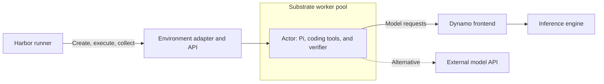

Run a SWE-bench Verified task with Harbor and Pi inside an Agent Substrate
sandbox. Then run a small concurrent batch and inspect its agent logs,
inference timings, and sandbox metrics. Use NVIDIA Dynamo to serve the model,
or connect to a compatible external API from a cluster without GPUs.

The runnable files are in the
[Harbor Substrate example](https://github.com/ai-dynamo/dynamo/tree/main/examples/agents/harbor-substrate).
This tutorial uses pinned dependencies. Keep those pins together when reproducing
it. The [model recipes](../../recipes/model-recipes/overview.mdx) own model
installation and hardware requirements.

<Warning>
This integration is experimental. It includes compatibility patches for the
pinned Substrate environment service and Pi adapter. Check the installation
requirements before allocating model-serving resources.
</Warning>

## What you build



Harbor selects tasks, limits concurrent trials, runs the agent and verifier,
and collects results. Pi calls the model and executes coding tools in the task
workspace. Substrate places isolated actors on CPU workers. Dynamo serves
inference outside those actors.

The Harbor environment adapter translates lifecycle, command, and file
operations into Substrate calls. The model does not grade its own answer.
Harbor runs the task's verifier after Pi finishes.

## Check prerequisites

Prepare these resources:

- A Kubernetes cluster that supports Substrate's native certificate APIs and
  projected volumes, with permission to install its controllers and CRDs.
- Linux `amd64` CPU nodes compatible with the pinned gVisor runtime and the
  SWE-bench task images. Start with capacity for a worker requesting two CPUs
  and 6 GiB of memory, plus the control plane and Harbor runner.
- The database, object storage, runtime assets, and network configuration
  required by the pinned Substrate installer. Golden snapshots need working
  durable snapshot storage.
- An image registry that the workers can pull from. The prepared task images
  can be large; reserve node image-cache space before adding tasks.
- Git, `kubectl`, `curl`, `sha256sum`, `envsubst`, OpenSSL, Python 3.12 or newer,
  Docker with image build and push support, Go 1.27 or newer, and `ko` on the
  preparation workstation.
- For Grafana panels, Prometheus Operator and Grafana. The example can use an
  existing `kube-prometheus-stack` installation.

Installing CRDs does not enable Kubernetes certificate APIs or kubelet volume
projections. Follow the capability checks in
[Install the Substrate integration](https://github.com/ai-dynamo/dynamo/blob/main/examples/agents/harbor-substrate/INSTALL.md)
before continuing.

Clone Dynamo and enter the example directory. Run workstation commands from
that directory unless a step identifies the runner shell.

```bash
git clone https://github.com/ai-dynamo/dynamo.git
cd dynamo/examples/agents/harbor-substrate
export EXAMPLE_DIR="$PWD"
mkdir -p .local
chmod 700 .local
cp config.example.env .local/config.env
```

Edit `.local/config.env` with your Kubernetes context, sandbox node, registry,
and endpoint settings. Image fields are populated after building the images.
Keep API keys out of this file and out of Harbor configuration.

```bash
set -a
source .local/config.env
set +a
kubectl --context "$KUBE_CONTEXT" get node "$SANDBOX_NODE" \
  -o jsonpath='{.metadata.labels.kubernetes\.io/arch}{"\n"}'
```

The selected node must report `amd64`. The installer must place `atelet` on
that node. The model server can run on other nodes.

## Choose an inference endpoint

For self-hosted inference, use the [GLM-5.3-Flash recipe](../../recipes/model-recipes/glm-5-3-flash.mdx).
Select the recipe for your hardware and complete its smoke test. Record its
base URL and exact served model ID in `MODEL_BASE_URL` and `SERVED_MODEL`.
Set `DYN_AGENT_SESSION_FINAL=1`. This tutorial adds tracing to the frontend later;
it does not change the recipe's engine or GPU configuration.

For an external service, set `DYN_AGENT_SESSION_FINAL=0` and use its HTTPS base
URL, including the API prefix. No GPU is required in the sandbox cluster.
The pinned provider requires:

- `GET /models` that lists the selected model.
- Streaming Chat Completions with tool calls, tool-result continuation,
  `max_tokens`, and streaming usage support.
- A model context window and output limit that you can configure explicitly.

Set `MODEL_CONTEXT_WINDOW` and `MODEL_MAX_TOKENS` to limits accepted by the
endpoint. The supplied patch makes those limits explicit when model discovery
does not advertise them. A provider with a different protocol needs its own Pi
provider configuration. An OpenAI-compatible label alone is not a compatibility
check.

External jobs disable Dynamo's session-final control requests. Harbor
results and Substrate metrics remain available. Dynamo's server-side
inference traces require a Dynamo endpoint you control.

## Install Substrate and its environment API

Complete [Install the Substrate integration](https://github.com/ai-dynamo/dynamo/blob/main/examples/agents/harbor-substrate/INSTALL.md).
That procedure installs or checks the pinned control plane, creates the
`ate-env` atespace, builds the compatible environment API and guest images, and
grants the runner access.

A Kubernetes namespace and a Substrate atespace are separate objects. The
example uses `ate-env` for both. The environment API receives Harbor requests
on port 7777 and uses authenticated connections to Substrate. Its client-facing
Service stays internal and is restricted to runner Pods by NetworkPolicy.

Before continuing, verify the deployment:

```bash
kubectl --context "$KUBE_CONTEXT" -n ate-env rollout status \
  deployment/ate-env-api --timeout=300s
kubectl --context "$KUBE_CONTEXT" -n ate-system get daemonset atelet
```

The environment API must be Ready, and `atelet` must be ready on each node
eligible for sandbox placement.

## Create sandbox capacity

Render and apply the worker pool:

```bash
envsubst '${SANDBOX_NODE}' < workerpool.yaml > .local/workerpool.yaml
kubectl --context "$KUBE_CONTEXT" apply -f .local/workerpool.yaml
kubectl --context "$KUBE_CONTEXT" -n ate-env rollout status \
  deployment/harbor-workers --timeout=600s
```

`spec.replicas` counts worker Pods. The pool's `nodeSelector` places those Pods
on the node you selected. Its resource requests reserve two CPUs and 6 GiB
per worker. The actor template allocates one CPU and 4 GiB per task, leaving
room for one such actor per worker with capacity headroom.

The pool label `demo.harbor.dev/sandbox=gvisor` matches the actor template's
`workerSelector`. Changing either side alone prevents actors from finding the
intended workers. To add nodes, first ensure that `atelet` and runtime assets
are present there, then adjust placement and replica count. To fit more actors
per worker, increase worker capacity while preserving per-actor limits.

The [installation guide](https://github.com/ai-dynamo/dynamo/blob/main/examples/agents/harbor-substrate/INSTALL.md)
includes the conditional low-port permission fix for platforms that need it.

## Prepare Pi and the task image

Fetch the pinned Pi integration and task dataset:

```bash
git clone https://github.com/ai-dynamo/agent-plugins deps/agent-plugins
git -C deps/agent-plugins checkout 223a0b8823610d042e7479bfff9b93eeac4a23ec
for patch in pi-context-window pi-model-limits pi-tool-trace-tls pi-preinstalled; do
	git -C deps/agent-plugins apply "$EXAMPLE_DIR/$patch.patch"
done
export PI_PLUGIN_DIR="$EXAMPLE_DIR/deps/agent-plugins/pi-plugin"

git clone https://github.com/harbor-framework/harbor-datasets deps/harbor-datasets
git -C deps/harbor-datasets checkout 86723674f04e4209ac479d0fb75d9d9f44b4377e
export DATASET_DIR="$EXAMPLE_DIR/deps/harbor-datasets/datasets/swebench-verified"
export TASK=astropy__astropy-12907
```

The patches preserve served context limits, accept explicit model limits,
and support the prepared image and optional TLS tool-event transport. The image
contains Pi 0.72.1 and its compiled provider.

Build the first task image:

```bash
mkdir -p .local/image
cp -a "$PI_PLUGIN_DIR" .local/image/pi-plugin
export AGENT_IMAGE="$IMAGE_REPO/astropy-pi:prepared"
docker build --platform linux/amd64 -f Dockerfile.pi \
  -t "$AGENT_IMAGE" .local/image
docker push "$AGENT_IMAGE"
```

Set `PREPARED_IMAGE` in `.local/config.env` to the pushed digest reference,
then source the file again. Use the digest, not the mutable tag, for the run.
`Dockerfile.pi` defaults to the pinned image for this Astropy task. For another
task, build a separate prepared image with `--build-arg TASK_IMAGE=...`, using
that task's `environment/Dockerfile` base image resolved to a digest.

Do not reuse one task's repository image for another task. Keep endpoint
credentials, task instructions, candidate changes, and session state outside
the prepared image. Build time and the first image pull are preparation costs.

## Prepare the Harbor runner

For an authenticated endpoint, provide the key as `DYNAMO_API_KEY`, the name
used by the current Dynamo Pi adapter. The optional Secret reference in
`harbor-runner.yaml` supplies that environment variable. Create the Secret
before starting the runner:

```bash
read -rsp 'Model API key: ' MODEL_API_KEY
printf '\n'
printf '%s' "$MODEL_API_KEY" | kubectl --context "$KUBE_CONTEXT" -n ate-env \
  create secret generic harbor-model-api --from-file=api-key=/dev/stdin
unset MODEL_API_KEY
```

Skip this step for an unauthenticated endpoint. Keep the key out of saved job
files and images. The pinned adapter passes it through Harbor's command
execution environment, which Harbor includes in debug log records. Configure
your logging and artifact handling accordingly before using an authenticated
endpoint. A Kubernetes Secret does not redact those logs. Use a scoped key for
the run and treat captured logs as potentially credential-bearing.

Start the runner and install its pinned dependencies:

```bash
kubectl --context "$KUBE_CONTEXT" apply -f harbor-runner.yaml
kubectl --context "$KUBE_CONTEXT" -n ate-env wait --for=condition=Ready \
  pod/harbor-runner --timeout=300s
kubectl --context "$KUBE_CONTEXT" -n ate-env exec harbor-runner -- \
  mkdir -p /work/example /work/tasks
kubectl --context "$KUBE_CONTEXT" -n ate-env cp deps/env/clients/python harbor-runner:/work/env-client
kubectl --context "$KUBE_CONTEXT" -n ate-env cp "$PI_PLUGIN_DIR" harbor-runner:/work/pi-plugin
kubectl --context "$KUBE_CONTEXT" -n ate-env cp substrate_environment.py harbor-runner:/work/example/substrate_environment.py
kubectl --context "$KUBE_CONTEXT" -n ate-env cp runner-kubeconfig.yaml harbor-runner:/work/kubeconfig
kubectl --context "$KUBE_CONTEXT" -n ate-env exec harbor-runner -- \
  pip install harbor==0.16.0 /work/env-client
```

`runner-kubeconfig.yaml` selects the in-cluster Kubernetes API and the runner's
projected ServiceAccount token. The Pod sets `KUBECONFIG` to that file. Substrate
uses a separate token projected for the audience `api.ate-system.svc`. The job
passes its file path and the Substrate endpoint to the environment adapter.
Harbor runs outside the actor. Pi, its tools, and the verifier run inside it.
The runner does not need a Docker daemon.

Download the Substrate CLI for the runner's architecture and verify its checksum:

```bash
RUNNER_MACHINE="$(kubectl --context "$KUBE_CONTEXT" -n ate-env exec harbor-runner -- uname -m)"
case "$RUNNER_MACHINE" in
	x86_64) RUNNER_ARCH=amd64 ;;
	aarch64) RUNNER_ARCH=arm64 ;;
	*) echo "Unsupported runner architecture: $RUNNER_MACHINE" >&2; exit 1 ;;
esac
export RUNNER_ARCH
export ATE_RELEASE=https://github.com/agent-substrate/substrate/releases/download/v1.0.0-rc.1
curl -fL "$ATE_RELEASE/kubectl-ate-linux-$RUNNER_ARCH" -o .local/kubectl-ate
curl -fL "$ATE_RELEASE/kubectl-ate-linux-$RUNNER_ARCH.sha256" -o .local/kubectl-ate.sha256
(cd .local && printf '%s  kubectl-ate\n' "$(cut -d ' ' -f1 kubectl-ate.sha256)" | sha256sum -c -)
chmod +x .local/kubectl-ate
kubectl --context "$KUBE_CONTEXT" -n ate-env cp .local/kubectl-ate harbor-runner:/work/kubectl-ate
```

Build the upstream environment CLI from the patched source installed earlier.
Use it for the sandbox checks below:

```bash
(cd deps/env && CGO_ENABLED=0 GOOS=linux GOARCH="$RUNNER_ARCH" \
  go build -o "$EXAMPLE_DIR/.local/ate-env" ./cmd/ate-env)
kubectl --context "$KUBE_CONTEXT" -n ate-env cp .local/ate-env harbor-runner:/work/ate-env
kubectl --context "$KUBE_CONTEXT" -n ate-env exec harbor-runner -- \
  /work/kubectl-ate --context in-cluster --endpoint api.ate-system.svc:443 \
  --token-file /var/run/secrets/ateapi/token get actor-templates -a ate-env
```

The final command must succeed, even if the template list is empty. It checks
the CLI connection, trust configuration, and the runner's Substrate permissions.

Render the actor's model egress rule from the selected endpoint:

```bash
export MODEL_HOST="$(python3 -c 'import os,urllib.parse; print(urllib.parse.urlsplit(os.environ["MODEL_BASE_URL"]).hostname)')"
export MODEL_PORT="$(python3 -c 'import os,urllib.parse; u=urllib.parse.urlsplit(os.environ["MODEL_BASE_URL"]); print(u.port or (443 if u.scheme=="https" else 80))')"
export MODEL_EGRESS_PROTOCOL="$(python3 -c 'import os,urllib.parse; u=urllib.parse.urlsplit(os.environ["MODEL_BASE_URL"]); print("tlsPassthrough" if u.scheme=="https" else "http")')"
envsubst '${MODEL_HOST} ${MODEL_PORT} ${MODEL_EGRESS_PROTOCOL}' < egress.yaml > .local/egress.yaml
kubectl --context "$KUBE_CONTEXT" -n ate-env cp .local/egress.yaml harbor-runner:/work/example/egress.yaml
```

This is a Substrate egress policy, not a Kubernetes NetworkPolicy. The adapter
applies it separately to each actor. The supplied dependency hosts allow the
original verifier to install packages. Review network requirements for each
new task. Public source access can also let an agent retrieve an existing
solution; a demonstration with that access is not an unaided accuracy result.

## Configure the task template and Harbor job

Render the two manifests, then inspect and edit them before creating resources:

```bash
envsubst '${ACTOR_TEMPLATE} ${PREPARED_IMAGE} ${GUEST_IMAGE}' \
  < actor-template.yaml > .local/actor-template.yaml
envsubst '${SERVED_MODEL} ${MODEL_BASE_URL} ${MODEL_CONTEXT_WINDOW} ${MODEL_MAX_TOKENS} ${DYN_AGENT_SESSION_FINAL} ${ACTOR_TEMPLATE}' \
  < harbor-job.yaml > .local/harbor-job.yaml
```

The actor template is a Substrate API object. Register it with `kubectl-ate`.
The Harbor job is a client configuration file, consumed by `harbor run`.
Neither file is a Kubernetes Job or a manifest for `kubectl apply`.

The template defines the sandbox that each trial starts:

| Field | Purpose and adjustment |
| --- | --- |
| `metadata.name` | Identifies this task image and runtime configuration. Choose a new name when either changes. |
| `containers[].image` | Pins the prepared task image. Each task needs its own image. |
| `volumes[].image.reference` | Supplies the environment guest executable mounted at `/ate`. |
| `containers[].wakeupProbe` | Requires the guest's `/readyz` endpoint before the actor is ready. |
| `resources.limits` | Allocates one CPU and 4 GiB to the actor. Increase these limits for tasks that need more resources, and increase worker capacity accordingly. |
| `workerSelector` | Matches the worker pool label. Use it to constrain placement for prewarming or capacity isolation. |
| `snapshotConfig` | Starts with golden snapshots disabled. Enable them in a separate template after checking the prepared image. |

The job selects the agent, endpoint, tasks, and templates:

```yaml
job_name: swe-one
n_attempts: 1
n_concurrent_trials: 1
agents:
  - import_path: dynamo_pi:DynamoPi
    model_name: dynamo/your-served-model
    kwargs:
      version: "0.72.1"
      thinking: "off"
      preinstalled: true
environment:
  import_path: substrate_environment:SubstrateEnvironment
  delete: true
  kwargs:
    template_map:
      astropy__astropy-12907: swe-astropy-12907-pi
tasks:
  - path: /work/tasks/astropy__astropy-12907
```

This excerpt shows the selection fields. Keep the endpoint, environment
variables, and CLI settings from the complete `harbor-job.yaml`.
`preinstalled` checks the Pi runtime baked into the image instead of installing
it for every trial. `delete: true` removes the actor after result collection.
The task directory name must match a key in `template_map`, and its value must
name the template built for that task. Set `DYN_AGENT_SESSION_FINAL` to `"0"`
for an external API. All values under `agents[].env` are strings.

Copy the original task without changing its instructions or verifier. The
selected task retains its 3,000-second agent and verifier deadlines:

```bash
kubectl --context "$KUBE_CONTEXT" -n ate-env cp "$DATASET_DIR/$TASK" "harbor-runner:/work/tasks/$TASK"
kubectl-ate --context "$KUBE_CONTEXT" create actor-template -f .local/actor-template.yaml
kubectl-ate --context "$KUBE_CONTEXT" get actor-template "$ACTOR_TEMPLATE" -a ate-env -o yaml
```

Actor templates are immutable in the pinned Substrate release. To change an
image, resource limit, or snapshot setting, edit a copy, give it a new
`metadata.name`, and create it with the same CLI command. Update the job's
`template_map` to use that name. Keep the old template while existing trials
use it. To change a Harbor job, edit its YAML and upload the file again before
starting a new run. Use a new `job_name` for each run you want to compare.

## Enable capture before running tasks

For Dynamo inference, follow
[Capture inference and tool traces](https://github.com/ai-dynamo/dynamo/blob/main/examples/agents/harbor-substrate/TRACING.md).
It shows the frontend manifest additions and the corresponding job and egress
settings. Keep the frontend's model-serving configuration from the recipe.

For sandbox metrics, follow
[Collect Substrate metrics](https://github.com/ai-dynamo/dynamo/blob/main/examples/agents/harbor-substrate/METRICS.md).
Confirm that Prometheus scrapes the collector and Grafana shows its health.
Set up collection while workers are idle because telemetry changes can restart
them. Harbor collects Pi's raw event log and verifier output without a separate
trajectory conversion step.

Upload the job after making any tracing changes:

```bash
kubectl --context "$KUBE_CONTEXT" -n ate-env cp .local/harbor-job.yaml harbor-runner:/work/harbor-job.yaml
```

## Prewarm and check the environment

Open a runner shell with the selected template name:

```bash
kubectl --context "$KUBE_CONTEXT" -n ate-env exec -it harbor-runner -- \
  env ACTOR_TEMPLATE="$ACTOR_TEMPLATE" bash
```

Inside the runner, create a disposable actor. `SUBSTRATE_ENV_API` is set by the
runner Pod manifest. The CLI uses it to reach the environment API:

```bash
/work/ate-env create harbor-check-one --atespace ate-env --template "$ACTOR_TEMPLATE"
/work/ate-env harbor-check-one --atespace ate-env shell --timeout 10s 'true'
```

The first image pull can take several minutes. If the shell command reports
that the guest is not ready, inspect the actor with `kubectl-ate get actor`
from the workstation, wait for it to run, and repeat the harmless `true` probe.
Investigate failures that persist beyond the job's 1,200-second readiness budget.

Once the probe succeeds, check the task repository, Pi version, and provider:

```bash
/work/ate-env harbor-check-one --atespace ate-env shell --timeout 60s \
  'set -e; cd /testbed; test -z "$(git status --porcelain --untracked-files=no)"; git rev-parse HEAD; node --version; pi --version; cd /root/pi-dynamo-provider; sha256sum -c /opt/pi-provider.sha256'
/work/ate-env harbor-check-one --atespace ate-env shell --timeout 10s \
  'touch /tmp/harbor-clone-marker'
/work/ate-env delete harbor-check-one --atespace ate-env
/work/ate-env create harbor-check-two --atespace ate-env --template "$ACTOR_TEMPLATE"
/work/ate-env harbor-check-two --atespace ate-env shell --timeout 10s 'true'
```

Wait for the second actor's guest if necessary, then check that it did not
inherit the marker. Delete the actor after the check succeeds:

```bash
/work/ate-env harbor-check-two --atespace ate-env shell --timeout 10s \
  'test ! -e /tmp/harbor-clone-marker'
/work/ate-env delete harbor-check-two --atespace ate-env
exit
```

Expect a clean tracked workspace, the task's repository
commit, Pi `0.72.1`, successful provider checksums, and no marker in the second
actor. These checks exercise startup and isolation. The first Harbor trial
checks model access and the full agent-verifier sequence.

A prepared image avoids repeated package installation. Prewarming caches its
layers on the selected node. When adding nodes, repeat these checks with
placement constrained to each eligible node. A warm image on one worker does
not establish warmth on other workers.

### Optionally restore from a golden snapshot

Copy the rendered template and job on the workstation:

```bash
cp .local/actor-template.yaml .local/golden-template.yaml
cp .local/harbor-job.yaml .local/golden-job.yaml
```

In `golden-template.yaml`, change `metadata.name` to
`swe-astropy-12907-pi-golden` and set:

```yaml
snapshotConfig:
  preferredFidelity: SNAPSHOT_FIDELITY_MEMORY
  goldenSnapshotConfig:
    mode: GOLDEN_SNAPSHOT_MODE_ENABLED
```

In `golden-job.yaml`, set `job_name: swe-golden` and map
`astropy__astropy-12907` to `swe-astropy-12907-pi-golden`. Create and inspect the
template:

```bash
kubectl-ate --context "$KUBE_CONTEXT" create actor-template -f .local/golden-template.yaml
kubectl-ate --context "$KUBE_CONTEXT" get actor-template swe-astropy-12907-pi-golden -a ate-env -o json
```

Read `status.goldenSnapshotStatus.goldenTag`, then fetch that tag:

```bash
export GOLDEN_TAG=the-tag-from-template-status
kubectl-ate --context "$KUBE_CONTEXT" get tag "$GOLDEN_TAG" -a ate-env -o json
```

Wait for `status.snapshot.durableSnapshot.state` to become
`SNAPSHOT_STORAGE_STATE_COMPLETED`, and require `SNAPSHOT_FIDELITY_MEMORY`.
Repeat the two-actor CLI checks with
`ACTOR_TEMPLATE=swe-astropy-12907-pi-golden`. Then upload the golden job:

```bash
kubectl --context "$KUBE_CONTEXT" -n ate-env cp .local/golden-job.yaml harbor-runner:/work/golden-job.yaml
```

Golden snapshots reuse initial sandbox state. The prepared guest snapshot does
not contain an initialized Pi conversation. Verify restore events and storage
fidelity before attributing startup behavior to snapshots. Keep prepared-image
and golden-snapshot runs in separate output directories.

## Run one trial, then increase concurrency

Open a runner shell:

```bash
kubectl --context "$KUBE_CONTEXT" -n ate-env exec -it harbor-runner -- sh
```

Inside the runner, run the uploaded job:

```bash
cd /work
harbor run --config /work/harbor-job.yaml -y
# For the optional golden path, use /work/golden-job.yaml instead.
```

Inspect `/work/jobs/swe-one` (or `/work/jobs/swe-golden` for the optional path).
A complete integration run has a trial result,
Pi tool events, a verifier report, and collected artifacts. Check
`exception_info` in the trial result and assistant errors in `agent/pi.txt`.
A zero reward can mean the agent failed to fix the bug even when the system
worked. A reward alone does not establish successful model transport.

Before a batch, confirm that Pi can call a tool, receive its result, and make
another model request from inside the actor. This validates endpoint semantics
and actor egress together.

To add tasks, return to the workstation and repeat the image build and template
creation for each task. Give every template its own name, copy the corresponding
dataset directories to `/work/tasks`, and add each task to both `tasks` and
`environment.kwargs.template_map` in a copy of the job YAML. Keep each image
digest in its rendered template.

Copy the job before configuring a batch:

```bash
cp .local/harbor-job.yaml .local/batch-job.yaml
```

For a two-task batch, set `job_name: swe-batch` and
`n_concurrent_trials: 2` in `.local/batch-job.yaml`. Scale the worker pool, upload
the edited job, and run it:

```bash
kubectl --context "$KUBE_CONTEXT" -n ate-env scale workerpool harbor-workers --replicas=2
kubectl --context "$KUBE_CONTEXT" -n ate-env rollout status deployment/harbor-workers --timeout=600s
kubectl --context "$KUBE_CONTEXT" -n ate-env cp .local/batch-job.yaml harbor-runner:/work/batch-job.yaml
kubectl --context "$KUBE_CONTEXT" -n ate-env exec harbor-runner -- \
  harbor run --config /work/batch-job.yaml -y
```

The selected node needs capacity for both worker Pods. Prewarm each additional
task image and validate any golden snapshots before starting the batch. Start
with a small task selection before expanding to the full Verified dataset.

A Harbor concurrency slot covers environment setup, agent setup, execution,
verification, and cleanup. It is not a count of simultaneous model requests.
Worker capacity limits resident actors, while the inference service has its own
request limit. This example keeps actors resident through each trial. It does
not automatically suspend Pi between model calls.

## Save and inspect the results

Exit the runner shell and copy the job before removing resources:

```bash
mkdir -p .local/results
# Use swe-golden or swe-batch here to collect the corresponding job.
export JOB_NAME=swe-one
kubectl --context "$KUBE_CONTEXT" -n ate-env cp \
  "harbor-runner:/work/jobs/$JOB_NAME" ".local/results/$JOB_NAME"
```

Retain the job YAML, rendered templates and policies, dataset revision, and
all result files together. Each trial includes `substrate.json`, which maps the
Harbor trial to its actor, and `substrate-timing.jsonl`, which records preparation
phases. Pi's raw events are in `agent/pi.txt`; verifier output is in `verifier/`.

### Inspect the job in Harbor

Use a separate viewer environment so the viewer version does not change the
pinned execution environment:

```bash
python3 -m venv .local/viewer
.local/viewer/bin/pip install harbor==0.25.0
.local/viewer/bin/harbor view .local/results --host 127.0.0.1 --port 8080
```

Open `http://localhost:8080` to inspect the job and trial results. Read the
collected `agent/pi.txt` and verifier files alongside those results. This
example does not convert Pi events to ATIF, so it does not populate Harbor's
structured trajectory view. Differences between raw event timestamps are not
isolated inference durations.

### Inspect measured spans in Perfetto

Export the native capture using the commands in
[Capture inference and tool traces](https://github.com/ai-dynamo/dynamo/blob/main/examples/agents/harbor-substrate/TRACING.md).
Use the session ID to find the same trial in Perfetto. Inspect model requests,
time to first token, and measured tool spans. Check tool IDs against Pi's log.
Do not present inferred waits as measured tool execution.

### Inspect sandbox activity in Grafana

Select the job's time window in the Substrate dashboard. Inspect worker
occupancy, lifecycle operations, image-cache requests, resource usage, and
checkpoint or restore activity. Empty restore panels are expected for a run
that only boots fresh actors.

The native parking metrics are aggregate. They do not identify which Harbor
session waited, and their duration can include restoration. Use `substrate.json`
for actor correlation, without assuming a shared distributed trace across all
three viewers.

## Clean up

First save the results and native trace files. Confirm that Harbor deleted its
actors. Use the CLI to list actors before removing any retained resources:

```bash
kubectl-ate --context "$KUBE_CONTEXT" get actors -a ate-env
kubectl --context "$KUBE_CONTEXT" -n ate-env delete pod harbor-runner
kubectl --context "$KUBE_CONTEXT" -n ate-env delete workerpool harbor-workers
```

Delete only templates, golden tags, Secrets, and collector resources created
for this walkthrough. Keep shared Substrate services, storage, and inference
endpoints. Follow the metrics guide's restore procedure before removing the
Collector. If you added tracing to an existing frontend, remove the tutorial's
trace additions using the saved pre-change manifest. Stop the local viewer.

## Validation scope

The CLI checks above verify guest startup, the prepared runtime, and actor
isolation. The first Harbor trial checks model access, tool execution, result
collection, and verification together.

After changing a dependency pin, endpoint, image, or cluster configuration,
repeat the one-trial check before running a batch. Golden restore and external
API compatibility need validation on the selected environment. A saved task
result does not establish a full-dataset accuracy score or a performance gain.
