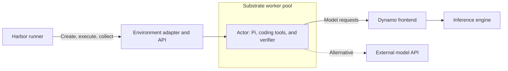

Run a SWE-bench Verified task with Harbor and Pi inside an Agent Substrate
sandbox. Then run a small concurrent batch and inspect its trajectories,
inference timings, and sandbox metrics. Use NVIDIA Dynamo to serve the model,
or connect to a compatible external API from a cluster without GPUs.

The runnable files are in the
[Harbor Substrate example](https://github.com/ai-dynamo/dynamo/tree/main/examples/agents/harbor-substrate).
This tutorial uses pinned dependencies. Keep those pins together when reproducing
it. The [model recipes](../../recipes/model-recipes/overview.mdx) own model
installation and hardware requirements.

<Warning>
This integration is experimental. It includes compatibility patches for the
pinned Substrate environment service and Pi adapter. Check the installation
requirements before allocating model-serving resources.
</Warning>

## What you build



Harbor selects tasks, limits concurrent trials, runs the agent and verifier,
and collects results. Pi calls the model and executes coding tools in the task
workspace. Substrate places isolated actors on CPU workers. Dynamo serves
inference outside those actors.

The Harbor environment adapter translates lifecycle, command, and file
operations into Substrate calls. The model does not grade its own answer.
Harbor runs the task's verifier after Pi finishes.

## Check prerequisites

Prepare these resources:

- A Kubernetes cluster that supports Substrate's native certificate APIs and
  projected volumes, with permission to install its controllers and CRDs.
- Linux `amd64` CPU nodes compatible with the pinned gVisor runtime and the
  SWE-bench task images. Start with capacity for a worker requesting two CPUs
  and 6 GiB of memory, plus the control plane and Harbor runner.
- The database, object storage, runtime assets, and network configuration
  required by the pinned Substrate installer. Golden snapshots need working
  durable snapshot storage.
- An image registry that the workers can pull from. The prepared task images
  can be large; reserve node image-cache space before adding tasks.
- Git, `kubectl`, `envsubst`, Python 3.12 or newer, Docker with image build and
  push support, Go 1.27 or newer, and `ko` on the preparation workstation.
- For Grafana panels, Prometheus Operator and Grafana. The example can use an
  existing `kube-prometheus-stack` installation.

Installing CRDs does not enable Kubernetes certificate APIs or kubelet volume
projections. Follow the capability checks in
[Install the Substrate integration](https://github.com/ai-dynamo/dynamo/blob/main/examples/agents/harbor-substrate/INSTALL.md)
before continuing.

Clone Dynamo and enter the example directory. Run workstation commands from
that directory unless a step identifies the runner shell.

```bash
git clone https://github.com/ai-dynamo/dynamo.git
cd dynamo/examples/agents/harbor-substrate
export EXAMPLE_DIR="$PWD"
mkdir -p .local
chmod 700 .local
cp config.example.env .local/config.env
```

Edit `.local/config.env` with your Kubernetes context, sandbox node, registry,
and endpoint settings. Image fields are populated after building the images.
Keep API keys out of this file and out of Harbor configuration.

```bash
set -a
source .local/config.env
set +a
kubectl --context "$KUBE_CONTEXT" get node "$SANDBOX_NODE" \
  -o jsonpath='{.metadata.labels.kubernetes\.io/arch}{"\n"}'
```

The selected node must report `amd64`. The installer must place `atelet` on
that node. The model server can run on other nodes.

## Choose an inference endpoint

For self-hosted inference, use the [GLM-5.3-Flash recipe](../../recipes/model-recipes/glm-5-3-flash.mdx).
Select the recipe for your hardware and complete its smoke test. Record its
base URL and exact served model ID in `MODEL_BASE_URL` and `SERVED_MODEL`.
Set `ENDPOINT_KIND=dynamo`. This tutorial adds tracing to the frontend later;
it does not change the recipe's engine or GPU configuration.

For an external service, set `ENDPOINT_KIND=external` and use its HTTPS base
URL, including the API prefix. No GPU is required in the sandbox cluster.
The pinned provider requires:

- `GET /models` that lists the selected model.
- Streaming Chat Completions with tool calls, tool-result continuation,
  `max_tokens`, and streaming usage support.
- A model context window and output limit that you can configure explicitly.

Set `MODEL_CONTEXT_WINDOW` and `MODEL_MAX_TOKENS` to limits accepted by the
endpoint. The supplied patch makes those limits explicit when model discovery
does not advertise them. A provider with a different protocol needs its own Pi
provider configuration. An OpenAI-compatible label alone is not a compatibility
check.

External jobs disable Dynamo's session-final control requests. Harbor
trajectories and Substrate metrics remain available. Dynamo's server-side
inference traces require a Dynamo endpoint you control.

## Install Substrate and its environment API

Complete [Install the Substrate integration](https://github.com/ai-dynamo/dynamo/blob/main/examples/agents/harbor-substrate/INSTALL.md).
That procedure installs or checks the pinned control plane, creates the
`ate-env` atespace, builds the compatible environment API and guest images, and
grants the runner access.

A Kubernetes namespace and a Substrate atespace are separate objects. The
example uses `ate-env` for both. The environment API receives Harbor requests
on port 7777 and uses authenticated connections to Substrate. Its client-facing
Service stays internal and is restricted to runner Pods by NetworkPolicy.

Before continuing, verify the deployment:

```bash
kubectl --context "$KUBE_CONTEXT" -n ate-env rollout status \
  deployment/ate-env-api --timeout=300s
kubectl --context "$KUBE_CONTEXT" -n ate-system get daemonset atelet
```

The environment API must be Ready, and `atelet` must be ready on each node
eligible for sandbox placement.

## Create sandbox capacity

Render and apply the worker pool:

```bash
envsubst '${SANDBOX_NODE}' < workerpool.yaml > .local/workerpool.yaml
kubectl --context "$KUBE_CONTEXT" apply -f .local/workerpool.yaml
kubectl --context "$KUBE_CONTEXT" -n ate-env rollout status \
  deployment/harbor-workers --timeout=600s
```

`spec.replicas` counts worker Pods. The pool's `nodeSelector` places those Pods
on the node you selected. Its resource requests reserve two CPUs and 6 GiB
per worker. The actor template allocates one CPU and 4 GiB per task, leaving
room for one such actor per worker with capacity headroom.

The pool label `demo.harbor.dev/sandbox=gvisor` matches the actor template's
`workerSelector`. Changing either side alone prevents actors from finding the
intended workers. To add nodes, first ensure that `atelet` and runtime assets
are present there, then adjust placement and replica count. To fit more actors
per worker, increase worker capacity while preserving per-actor limits.

The [installation guide](https://github.com/ai-dynamo/dynamo/blob/main/examples/agents/harbor-substrate/INSTALL.md)
includes the conditional low-port permission fix for platforms that need it.

## Prepare Pi and the task image

Fetch the pinned Pi integration and task dataset:

```bash
git clone https://github.com/ai-dynamo/agent-plugins deps/agent-plugins
git -C deps/agent-plugins checkout 223a0b8823610d042e7479bfff9b93eeac4a23ec
for patch in pi-context-window pi-model-limits pi-atif pi-tool-trace-tls pi-preinstalled; do
	git -C deps/agent-plugins apply "$EXAMPLE_DIR/$patch.patch"
done
cp pi_trajectory.py deps/agent-plugins/pi-plugin/harbor/
export PI_PLUGIN_DIR="$EXAMPLE_DIR/deps/agent-plugins/pi-plugin"

git clone https://github.com/harbor-framework/harbor-datasets deps/harbor-datasets
git -C deps/harbor-datasets checkout 86723674f04e4209ac479d0fb75d9d9f44b4377e
export DATASET_DIR="$EXAMPLE_DIR/deps/harbor-datasets/datasets/swebench-verified"
export TASK=astropy__astropy-12907
```

The patches preserve served context limits, accept explicit model limits,
export Harbor trajectories, and support the prepared image and optional TLS
tool-event transport. The image contains Pi 0.72.1 and its compiled provider.

Build the first task image:

```bash
mkdir -p .local/image
cp -a "$PI_PLUGIN_DIR" .local/image/pi-plugin
export AGENT_IMAGE="$IMAGE_REPO/astropy-pi:prepared"
docker build --platform linux/amd64 -f Dockerfile.pi \
  -t "$AGENT_IMAGE" .local/image
docker push "$AGENT_IMAGE"
```

Set `PREPARED_IMAGE` in `.local/config.env` to the pushed digest reference,
then source the file again. Use the digest, not the mutable tag, for the run.
`Dockerfile.pi` defaults to the pinned image for this Astropy task. For another
task, build a separate prepared image with `--build-arg TASK_IMAGE=...`, using
that task's `environment/Dockerfile` base image resolved to a digest.

Do not reuse one task's repository image for another task. Keep endpoint
credentials, task instructions, candidate changes, and session state outside
the prepared image. Build time and the first image pull are preparation costs.

## Prepare the Harbor runner

For an endpoint that requires authentication, create a Secret before starting
the runner. The following command reads the key without putting it in shell
history or a command-line argument:

```bash
read -rsp 'Model API key: ' MODEL_API_KEY
printf '\n'
printf '%s' "$MODEL_API_KEY" | kubectl --context "$KUBE_CONTEXT" -n ate-env \
  create secret generic harbor-model-api --from-file=api-key=/dev/stdin
unset MODEL_API_KEY
```

Skip that command for an unauthenticated local endpoint. The runner's optional
Secret reference provides `MODEL_API_KEY` only at runtime. `TutorialPi` injects
it into guest execution after Harbor's command-logging boundary. Do not pass
credentials through `--ae`, `agent.env`, or a saved job file. The agent process
can access its credential; do not run untrusted tasks with a broadly privileged
API key.

Start the runner and install its pinned dependencies:

```bash
kubectl --context "$KUBE_CONTEXT" apply -f harbor-runner.yaml
kubectl --context "$KUBE_CONTEXT" -n ate-env wait --for=condition=Ready \
  pod/harbor-runner --timeout=300s
kubectl --context "$KUBE_CONTEXT" -n ate-env exec harbor-runner -- \
  mkdir -p /work/example /work/tasks /work/templates /work/golden-templates
kubectl --context "$KUBE_CONTEXT" -n ate-env cp deps/env/clients/python harbor-runner:/work/env-client
kubectl --context "$KUBE_CONTEXT" -n ate-env cp "$PI_PLUGIN_DIR" harbor-runner:/work/pi-plugin
for file in substrate_environment.py tutorial_pi.py prepare-runner.py check_environment.py; do
	kubectl --context "$KUBE_CONTEXT" -n ate-env cp "$file" "harbor-runner:/work/example/$file"
done
kubectl --context "$KUBE_CONTEXT" -n ate-env exec harbor-runner -- \
  pip install harbor==0.16.0 /work/env-client
kubectl --context "$KUBE_CONTEXT" -n ate-env exec harbor-runner -- \
  python /work/example/prepare-runner.py
```

The preparation script verifies the Substrate CLI checksum and configures its
in-cluster identity. Harbor runs outside the actor; Pi, its tools, and the
verifier run inside it. The runner does not need a Docker daemon.

Render the actor's model egress rule from the selected endpoint:

```bash
export MODEL_HOST="$(python3 -c 'import os,urllib.parse; print(urllib.parse.urlsplit(os.environ["MODEL_BASE_URL"]).hostname)')"
export MODEL_PORT="$(python3 -c 'import os,urllib.parse; u=urllib.parse.urlsplit(os.environ["MODEL_BASE_URL"]); print(u.port or (443 if u.scheme=="https" else 80))')"
export MODEL_EGRESS_PROTOCOL="$(python3 -c 'import os,urllib.parse; u=urllib.parse.urlsplit(os.environ["MODEL_BASE_URL"]); print("tlsPassthrough" if u.scheme=="https" else "http")')"
envsubst '${MODEL_HOST} ${MODEL_PORT} ${MODEL_EGRESS_PROTOCOL}' < egress.yaml > .local/egress.yaml
kubectl --context "$KUBE_CONTEXT" -n ate-env cp .local/egress.yaml harbor-runner:/work/example/egress.yaml
```

This is a Substrate egress policy, not a Kubernetes NetworkPolicy. The adapter
applies it separately to each actor. The supplied dependency hosts allow the
original verifier to install packages. Review network requirements for each
new task. Public source access can also let an agent retrieve an existing
solution; a demonstration with that access is not an unaided accuracy result.

## Enable capture before running tasks

For Dynamo inference, follow
[Capture inference and tool traces](https://github.com/ai-dynamo/dynamo/blob/main/examples/agents/harbor-substrate/TRACING.md).
It adds request capture to the existing frontend and carries Pi tool events
through Substrate egress. Keep the frontend's model-serving configuration from
the selected recipe.

For sandbox metrics, follow
[Collect Substrate metrics](https://github.com/ai-dynamo/dynamo/blob/main/examples/agents/harbor-substrate/METRICS.md).
Confirm that Prometheus scrapes the collector and Grafana shows its health.
Set up collection while workers are idle because applying telemetry changes
can restart them.

Harbor's ATIF export is enabled by the adapter patch. No separate service is
needed to record trajectories. Viewing the artifacts comes after the run.

## Freeze the workload and prewarm the environment

Create the task-to-image map and generate the job:

```bash
python3 -m venv .venv
.venv/bin/pip install pyyaml
python3 - <<'PY'
import json, os
from pathlib import Path
Path('.local/images.json').write_text(json.dumps({os.environ['TASK']: os.environ['PREPARED_IMAGE']}, indent=2))
PY
.venv/bin/python prepare_workload.py \
  --dataset "$DATASET_DIR" --images .local/images.json \
  --guest-image "$GUEST_IMAGE" --output .local/one \
  --base-url "$MODEL_BASE_URL" --model "$SERVED_MODEL" \
  --context-window "$MODEL_CONTEXT_WINDOW" --max-tokens "$MODEL_MAX_TOKENS" \
  --endpoint-kind "$ENDPOINT_KIND" --concurrency 1 --job-name swe-one
```

If you configured native tool tracing, add `--trace` to that command. The
helper copies the selected tasks, pins the images, and records file hashes.
It adds a pre-verifier collection hook for candidate changes without changing
the instructions, tests, or grading. It retains the dataset's deadlines. The
selected task allows up to 3,000 seconds each for the agent and verifier.

Copy the inputs and register the template:

```bash
kubectl --context "$KUBE_CONTEXT" -n ate-env cp .local/one/tasks/. harbor-runner:/work/tasks
kubectl --context "$KUBE_CONTEXT" -n ate-env cp .local/one/templates/. harbor-runner:/work/templates
kubectl --context "$KUBE_CONTEXT" -n ate-env cp .local/one/job.json harbor-runner:/work/job.json
kubectl --context "$KUBE_CONTEXT" -n ate-env exec harbor-runner -- sh -c \
  'for file in /work/templates/*.yaml; do kubectl-ate --context in-cluster create actor-template -f "$file"; done'
export ACTOR_TEMPLATE="$(python3 -c 'import json; print(json.load(open(".local/one/task-lock.json"))[0]["template"])')"
kubectl --context "$KUBE_CONTEXT" -n ate-env exec harbor-runner -- \
  python /work/example/check_environment.py --template "$ACTOR_TEMPLATE"
```

The check creates two fresh actors, verifies Pi and the provider, checks that
the tracked workspace is clean, and deletes the actors. The second actor must
not contain the marker written by the first. Expect a repository commit, runtime
versions, successful provider checksums, and two timing records.

A prepared image avoids repeated package installation. Prewarming caches its
layers on the selected node. When adding nodes, repeat prewarming with placement
constrained to each eligible node. A warm image on one worker does not establish
warmth on other workers.

### Optionally restore from a golden snapshot

To use a golden snapshot, generate a separate workload and replace the runner's
job with its template mapping:

```bash
.venv/bin/python prepare_workload.py \
  --dataset "$DATASET_DIR" --images .local/images.json \
  --guest-image "$GUEST_IMAGE" --output .local/golden \
  --base-url "$MODEL_BASE_URL" --model "$SERVED_MODEL" \
  --context-window "$MODEL_CONTEXT_WINDOW" --max-tokens "$MODEL_MAX_TOKENS" \
  --endpoint-kind "$ENDPOINT_KIND" --golden --job-name swe-golden
kubectl --context "$KUBE_CONTEXT" -n ate-env cp .local/golden/templates/. harbor-runner:/work/golden-templates
kubectl --context "$KUBE_CONTEXT" -n ate-env cp .local/golden/job.json harbor-runner:/work/job.json
kubectl --context "$KUBE_CONTEXT" -n ate-env exec harbor-runner -- sh -c \
  'for file in /work/golden-templates/*.yaml; do kubectl-ate --context in-cluster create actor-template -f "$file"; done'
export ACTOR_TEMPLATE="$(python3 -c 'import json; print(json.load(open(".local/golden/task-lock.json"))[0]["template"])')"
kubectl --context "$KUBE_CONTEXT" -n ate-env exec harbor-runner -- \
  kubectl-ate --context in-cluster get actor-template "$ACTOR_TEMPLATE" -a ate-env -o json
```

Add `--trace` again if you configured native tool tracing. The task files are
identical to the prepared-image run, so the copies in `/work/tasks` remain valid.
For the golden template, inspect `status.goldenSnapshotStatus.goldenTag`, then
fetch that tag with `kubectl-ate get tag TAG -a ate-env -o json`. Wait for
`status.snapshot.durableSnapshot.state` to become
`SNAPSHOT_STORAGE_STATE_COMPLETED`, and require `SNAPSHOT_FIDELITY_MEMORY`.
Verify fresh clones of that template:

```bash
kubectl --context "$KUBE_CONTEXT" -n ate-env exec harbor-runner -- \
  python /work/example/check_environment.py --template "$ACTOR_TEMPLATE"
```

Golden snapshots reuse initial sandbox state. The prepared guest snapshot does
not contain an initialized Pi conversation. Verify restore events and storage
fidelity before attributing startup behavior to snapshots. Keep prepared-image
and golden-snapshot runs in separate output directories.

## Run one trial, then increase concurrency

Open a runner shell:

```bash
kubectl --context "$KUBE_CONTEXT" -n ate-env exec -it harbor-runner -- sh
```

Inside the runner, run the frozen job:

```bash
cd /work
harbor run --config /work/job.json -y
```

Inspect `/work/jobs/swe-one` (or `/work/jobs/swe-golden` for the optional path).
A complete integration run has a trial result,
Pi tool events, a verifier report, and collected artifacts. Check
`exception_info` in the trial result and assistant errors in `agent/pi.txt`.
A zero reward can mean the agent failed to fix the bug even when the system
worked. A reward alone does not establish successful model transport.

Before a batch, confirm that Pi can call a tool, receive its result, and make
another model request from inside the actor. This validates endpoint semantics
and actor egress together.

To run distinct tasks, build a prepared image for each selected task, add the
pinned references to another image map, and rerun `prepare_workload.py` with a
new output directory and job name. Start with a small selection and increase
`--concurrency` only when the worker pool has sufficient capacity. Upload the
new inputs and register their templates before starting the new job.

For example, after saving a map of two distinct tasks and their prepared image
digests in `.local/batch-images.json`, return to the workstation shell and run:

```bash
kubectl --context "$KUBE_CONTEXT" -n ate-env scale workerpool harbor-workers --replicas=2
kubectl --context "$KUBE_CONTEXT" -n ate-env rollout status deployment/harbor-workers --timeout=600s
.venv/bin/python prepare_workload.py \
  --dataset "$DATASET_DIR" --images .local/batch-images.json \
  --guest-image "$GUEST_IMAGE" --output .local/batch \
  --base-url "$MODEL_BASE_URL" --model "$SERVED_MODEL" \
  --context-window "$MODEL_CONTEXT_WINDOW" --max-tokens "$MODEL_MAX_TOKENS" \
  --endpoint-kind "$ENDPOINT_KIND" --concurrency 2 --job-name swe-batch
kubectl --context "$KUBE_CONTEXT" -n ate-env exec harbor-runner -- mkdir -p /work/batch-templates
kubectl --context "$KUBE_CONTEXT" -n ate-env cp .local/batch/tasks/. harbor-runner:/work/tasks
kubectl --context "$KUBE_CONTEXT" -n ate-env cp .local/batch/templates/. harbor-runner:/work/batch-templates
kubectl --context "$KUBE_CONTEXT" -n ate-env cp .local/batch/job.json harbor-runner:/work/batch-job.json
kubectl --context "$KUBE_CONTEXT" -n ate-env exec harbor-runner -- sh -c \
  'for file in /work/batch-templates/*.yaml; do kubectl-ate --context in-cluster create actor-template -f "$file"; done'
kubectl --context "$KUBE_CONTEXT" -n ate-env exec harbor-runner -- \
  harbor run --config /work/batch-job.json -y
```

The selected node needs capacity for both worker Pods. Reuse existing templates
if their names and definitions match the frozen inputs. Add `--trace` or
`--golden` only after validating those paths for the selected task images.

A Harbor concurrency slot covers environment setup, agent setup, execution,
verification, and cleanup. It is not a count of simultaneous model requests.
Worker capacity limits resident actors, while the inference service has its own
request limit. This example keeps actors resident through each trial. It does
not automatically suspend Pi between model calls.

## Save and inspect the results

Exit the runner shell and copy the job before removing resources:

```bash
mkdir -p .local/results
# Use swe-golden or swe-batch here to collect the corresponding job.
export JOB_NAME=swe-one
kubectl --context "$KUBE_CONTEXT" -n ate-env cp \
  "harbor-runner:/work/jobs/$JOB_NAME" ".local/results/$JOB_NAME"
```

Retain `job.json`, `task-lock.json`, the rendered templates and policies, and
all result files together. Each trial includes `substrate.json`, which maps the
Harbor trial to its actor, and `substrate-timing.jsonl`, which records preparation
phases. Candidate changes are under `artifacts/logs/artifacts/candidate`.

### Read the trajectory in Harbor

Use a separate viewer environment so the viewer version does not change the
pinned execution environment:

```bash
python3 -m venv .local/viewer
.local/viewer/bin/pip install harbor==0.25.0
.local/viewer/bin/harbor view .local/results --host 127.0.0.1 --port 8080
```

Open `http://localhost:8080`, select the trial, and inspect its trajectory,
tool results, and verifier output. Compare the candidate patch with the test
report. Trajectory timestamps describe recorded events; differences between
adjacent timestamps are not isolated inference durations.

### Inspect measured spans in Perfetto

Export the native capture using the commands in
[Capture inference and tool traces](https://github.com/ai-dynamo/dynamo/blob/main/examples/agents/harbor-substrate/TRACING.md).
Use the session ID to find the same trial in Perfetto. Inspect model requests,
time to first token, and measured tool spans. Check tool IDs against Pi's log.
Do not present inferred waits as measured tool execution.

### Inspect sandbox activity in Grafana

Select the job's time window in the Substrate dashboard. Inspect worker
occupancy, lifecycle operations, image-cache requests, resource usage, and
checkpoint or restore activity. Empty restore panels are expected for a run
that only boots fresh actors.

The native parking metrics are aggregate. They do not identify which Harbor
session waited, and their duration can include restoration. Use `substrate.json`
for actor correlation, without assuming a shared distributed trace across all
three viewers.

## Clean up

First save the results and native trace files. Confirm that Harbor deleted its
actors. Use the CLI to list actors before removing any retained resources:

```bash
kubectl --context "$KUBE_CONTEXT" -n ate-env exec harbor-runner -- \
  kubectl-ate --context in-cluster get actors -a ate-env
kubectl --context "$KUBE_CONTEXT" -n ate-env delete pod harbor-runner
kubectl --context "$KUBE_CONTEXT" -n ate-env delete workerpool harbor-workers
```

Delete only templates, golden tags, Secrets, and collector resources created
for this walkthrough. Keep shared Substrate services, storage, and inference
endpoints. Follow the metrics guide's restore procedure before removing the
Collector. If you added tracing to an existing frontend, remove the tutorial's
trace additions using the saved pre-change manifest. Stop the local viewer.

## Validation scope

The example includes local tests for guest execution and file transfer,
trajectory conversion, credential handling, and workload generation. Run them
using the commands in the example's installation guide. Guest integration tests
need a real guest daemon and are distinct from a full Kubernetes trial.

After changing a dependency pin, endpoint, image, or cluster configuration,
repeat the one-trial check before running a batch. Golden restore and external
API compatibility need validation on the selected environment. A saved task
result does not establish a full-dataset accuracy score or a performance gain.
