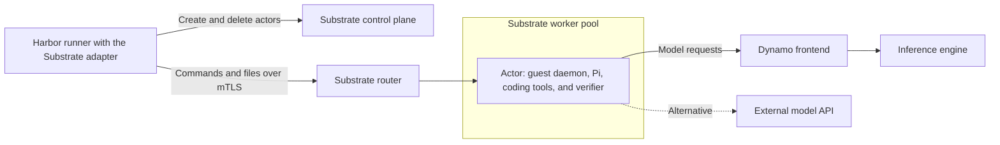

Run one SWE-bench Verified task with Harbor and Pi inside an Agent Substrate
sandbox, then inspect its agent logs and verification results. Use NVIDIA
Dynamo to serve the model, or connect to a compatible external API from a
cluster without GPUs. Optional steps add traces, sandbox metrics, golden
snapshots, and concurrent trials. The final section outlines a planned
full-dataset workflow using published SWE-bench images.

The runnable files are in the
[Harbor Substrate example](https://github.com/ai-dynamo/dynamo/tree/main/examples/agents/harbor-substrate).
This tutorial uses pinned dependencies. Keep those pins together when reproducing
it. The [model recipes](../../recipes/model-recipes/overview.mdx) own model
installation and hardware requirements.

<Warning>
This integration is experimental. It includes compatibility patches for the
pinned Pi adapter. Check the installation requirements before allocating
model-serving resources.
</Warning>

## What you build



| Component | Responsibility |
| --- | --- |
| **Harbor** | Orchestrates evaluation: selects tasks, limits concurrent trials, runs the agent and task verifier, and collects results. |
| **Pi** | Runs the coding-agent loop inside the sandbox: sends requests to the model, executes its tool calls against the task workspace, and returns tool results to the model. |
| **Substrate** | Provides the sandboxes: places actors on CPU workers, controls their lifecycle and network access, and supports checkpoint and restore. |
| **Dynamo** | Serves model inference outside the sandboxes: accepts Pi's API requests and routes them to the inference engine. A compatible external API can fill this role instead. |

For each trial, Harbor creates a sandbox actor, runs Pi and the task verifier
inside it, collects the results, and deletes the actor. Pi calls the model
endpoint and executes tools against the task workspace. The verifier grades
the resulting solution.

## Check prerequisites

Prepare these resources:

- A local clone of the Dynamo repository.
- A Kubernetes cluster with [Substrate installed and verified](../../kubernetes/agent-sandboxes/install-substrate.mdx#verify-the-installation),
  the pinned `kubectl-ate` CLI on `PATH`, and administrative access.
- Linux x86-64 (`amd64`) or ARM64 (`arm64`) sandbox nodes with capacity for a
  worker requesting 2 CPUs and 6 GiB of memory.
- An image registry for publishing guest and task images. The tutorial assumes
  anonymous image pulls; for private registries, follow
  [Configure image-pull authentication](../../kubernetes/agent-sandboxes/install-substrate.mdx#configure-image-pull-authentication).
- Git, `kubectl`, `curl`, `sha256sum`, OpenSSL, Python 3.12 or newer,
  Docker with BuildKit, Go 1.27 or newer, and `ko` on the preparation workstation.

<Note>
The ARM64 task base image is published, but this tutorial's ARM64 oracle and Pi
runs have not been validated. SWE-bench describes ARM64 support as
[experimental](https://github.com/SWE-bench/SWE-bench/blob/main/README.md).
</Note>

Follow [Install Substrate](../../kubernetes/agent-sandboxes/install-substrate.mdx)
to install and verify the platform.

From the root of your Dynamo clone, enter the tutorial directory:

```bash title="Workstation"
cd examples/agents/harbor-substrate
```

The steps below use the configuration files in this directory. Edit them as
directed.

<Accordion title="Configuration files">

| File | Consumer | What you configure |
| --- | --- | --- |
| `workerpool.yaml` | Kubernetes: `kubectl apply` | CPU worker placement and capacity |
| `harbor-runner.yaml` | Kubernetes: `kubectl apply` | Harbor runner Pod, ServiceAccount, and credentials |
| `runner-access-policy.yaml` | Substrate: `kubectl-ate` | Runner permissions within the atespace |
| `actor-template.yaml` | Substrate: `kubectl-ate` | Task image, guest executable, actor resources, and placement |
| `egress.yaml` | Environment adapter | Hosts and ports each actor may reach |
| `harbor-job.yaml` | Harbor: `harbor run` | Model, tasks, template mapping, and concurrency |

</Accordion>

<Steps toc={true}>

<Step title="Choose an inference endpoint" id="choose-an-inference-endpoint">

Use the [GLM-5.3-Flash recipe](../../recipes/model-recipes/glm-5-3-flash.mdx)
or another [model recipe](../../recipes/model-recipes/overview.mdx), and complete
its smoke test. The supplied Harbor configuration defaults to the SGLang
aggregated GB200 recipe in namespace `inference`.

For an external endpoint, no GPU is required in the sandbox cluster. The
endpoint must list the selected model through `GET /models` under its API
base URL and support streaming Chat Completions with tool calls, tool-result
continuation, `max_tokens`, and streaming usage.

Record the API base URL and served model ID for the
[job configuration](#configure-the-task-template-and-harbor-job). Use an
address reachable from the sandbox; your workstation's `localhost`
port-forward address will not work. For Dynamo recipes, the frontend address is
`http://<dgd-name>-frontend.<namespace>.svc.cluster.local:8000/v1`.

Choose a model with reliable tool calling and enough context for repository
files and tool results. The first Pi trial checks tool calls and continuation.
Harbor results and sandbox metrics work with either endpoint; the inference
trace walkthrough requires a Dynamo endpoint you control.

</Step>

<Step title="Configure Harbor access to Substrate" id="create-the-namespace-atespace-and-access-policy">

The Harbor runner runs outside the sandboxes. Through the Substrate adapter,
it creates and deletes actors, executes guest commands inside them, and
transfers task files and results. It needs access to both the Substrate API
and the router:

| Access | Purpose | Authorization |
| --- | --- | --- |
| Substrate API | Manage actors and egress policies; list templates | Projected ServiceAccount token authorized by `runner-access-policy.yaml` |
| Substrate router | Execute guest commands and transfer files | Projected Pod certificate whose SPIFFE identity is allowed by the router |

### Create the namespace and access policy

This tutorial uses `ate-env` for both the Kubernetes namespace and the Substrate
atespace. These are separate objects. Run the Substrate commands as an
administrator with global ownership.

<Accordion title="Use an existing atespace">

Inspect and reuse an existing namespace, atespace, or access policy instead of
creating it again. When updating an access policy, preserve its current
bindings and supply its `uid` and `version`.

</Accordion>

```bash title="Workstation"
kubectl create namespace ate-env
kubectl-ate create atespace ate-env
kubectl-ate create access-policy \
  -a ate-env -f runner-access-policy.yaml
```

The policy grants the `harbor-runner` ServiceAccount the editor role in
`ate-env`. You will create this ServiceAccount when deploying the Harbor runner.

### Authorize the Harbor runner at the router

Substrate's default Envoy router blocks ingress to actors until a client
identity is explicitly allowed. Add the Harbor runner so it can execute guest
commands and transfer files.

The Harbor runner's certificate identifies it with this **SPIFFE ID**, a
workload identity derived from its namespace and ServiceAccount:

```text
spiffe://cluster.local/ns/ate-env/sa/harbor-runner
```

Use your installation's trust domain if it differs from `cluster.local`.
In this release, the [router allowlist grants access to all actors reachable through that router](https://github.com/agent-substrate/substrate/blob/v1.0.0-rc.1/cmd/atenet/internal/router/README.md#ingress-client-authentication-and-authorization).

Update the `atenet-router` Deployment's container arguments:

| Argument | Change |
| --- | --- |
| `--ingress-allowed-spiffe-ids` | Append the Harbor runner's SPIFFE ID, preserving existing identities. Add the argument if absent. |
| `--route-timeout` | Set to `60m` to accommodate the task's 50-minute command deadlines. |

The default route timeout is **five minutes per request**, including streamed
command output. A 12-minute test command would lose its output stream after
five minutes. This timeout does not limit the actor's lifetime.

Preserve existing identities and other arguments. On a shared installation,
have its operator make these changes:

```bash title="Workstation"
kubectl -n ate-system edit deployment atenet-router
kubectl -n ate-system rollout status deployment/atenet-router --timeout=300s
```

To preserve these settings across deployments, save the allowlist in
`substrate-install.yaml` and the timeout in your managed router manifest,
`deps/substrate/manifests/ate-install/atenet-router.yaml`. The installer accepts
the allowlist as a comma-separated string. For an initially empty allowlist:

```yaml
ingressAllowedSPIFFEIDs: spiffe://cluster.local/ns/ate-env/sa/harbor-runner
```

Check the router arguments:

```bash title="Workstation"
kubectl -n ate-system get deployment atenet-router \
  -o jsonpath='{.spec.template.spec.containers[*].args}' | tr ' ' '\n' \
  | grep -E 'ingress-allowed-spiffe-ids|route-timeout'
```

```text title="Example output"
--ingress-allowed-spiffe-ids=spiffe://cluster.local/ns/ate-env/sa/harbor-runner
--route-timeout=60m
```

The allowlist may contain additional identities. If you change the task
deadlines, keep the route timeout longer than the longest command.

</Step>

<Step title="Create the worker pool" id="create-sandbox-capacity">

Select a node that runs `atelet` and has matching gVisor runtime assets.
Check its architecture:

```bash title="Workstation"
kubectl get node your-sandbox-node \
  -o jsonpath='{.metadata.labels.kubernetes\.io/arch}{"\n"}'
```

Edit the labels and placement in
[`workerpool.yaml`](https://github.com/ai-dynamo/dynamo/blob/main/examples/agents/harbor-substrate/workerpool.yaml).
Replace the hostname with your node's name. For ARM64, change both `amd64`
values to `arm64`:

```yaml title="workerpool.yaml: labels and placement"
metadata:
  labels:
    demo.harbor.dev/sandbox: gvisor
    demo.harbor.dev/arch: amd64
spec:
  template:
    nodeSelector:
      kubernetes.io/arch: amd64
      kubernetes.io/hostname: your-amd64-sandbox-node
```

Keep the other fields, including the multi-architecture worker image and
`gvisor-default` SandboxConfig reference. The supplied capacity settings are:

| Field | Meaning |
| --- | --- |
| `spec.replicas: 1` | Starts one worker Pod. |
| `spec.template.nodeSelector` | Places workers on the selected node and architecture. |
| `spec.template.resources.requests` | Reserves 2 CPUs and 6 GiB per worker. The supplied limits match these requests. |

Each task actor uses 1 CPU and 4 GiB, allowing one such actor per worker with
capacity headroom. Reserve additional node capacity for the Harbor runner
and any Substrate control-plane Pods placed there.

```bash title="Workstation"
kubectl apply -f workerpool.yaml
kubectl -n ate-env rollout status \
  deployment/harbor-workers --timeout=600s
```

Wait for the Deployment to roll out successfully. For port-binding failures,
follow the installation guide's
[low-port permission fix](../../kubernetes/agent-sandboxes/install-substrate.mdx#resolve-low-port-permission-failures-when-needed).

</Step>

<Step title="Prepare the images for the first task" id="prepare-the-sandbox-images">

Each SWE-bench task has its own instance image containing the repository
checkout and task environment. This tutorial adds Pi, the Dynamo provider,
and dependencies needed by the task verifier. The guest daemon uses a separate
image shared across tasks. An ActorTemplate references both images. Each trial
creates a fresh actor from the template.

For the first task, prepare the additional tools and dependencies ahead of time
to reduce trial startup latency. The planned full-dataset workflow uses the
published instance images and installs these additions during trial setup:

| | Single-task walkthrough | Planned full-dataset workflow |
| --- | --- | --- |
| Task image | Prepared Astropy instance image | Published instance image for each task |
| Pi and Dynamo provider | Installed during image build | Installed during trial setup |
| Verifier dependencies | Prepared for offline use | Downloaded as needed |
| Actor egress | Inference endpoint and optional telemetry | Also allows installation destinations |
| ActorTemplates | One | One per task, generated from the task catalog |

The single-task path needs no package-download egress during the trial. Pi
still needs access to the inference endpoint. See
[Run the full dataset](#run-the-full-dataset) for the planned extension and its
remaining implementation and validation work.

Build the guest and task images for the worker pool's architecture. The supplied
configuration defaults to `amd64`; use the `arm64` instructions for ARM64 nodes.
Use a native builder or configure
[Docker cross-platform builds](https://docs.docker.com/build/building/multi-platform/).
Prepared task images can be large. Reserve node image-cache space before adding tasks.

### Build the guest image

`ate-env-guest` runs commands and moves files inside the actor. Clone its
pinned source, then build and publish it for the worker architecture. Replace
`registry.example.com/harbor-substrate` with a repository you can push to and
the workers can pull from:

```bash title="Workstation"
git clone https://github.com/agent-substrate/env deps/env
git -C deps/env checkout 281e86085bb0b6d3090ff3fa82d722cf0d9f2f0b
```

Build the guest image for your node architecture:

<Tabs>
<Tab title="x86-64 (amd64)">

```bash title="Workstation"
(
	cd deps/env
	umask 022
	KO_DOCKER_REPO=registry.example.com/harbor-substrate/env-guest ko build --bare \
	  --platform=linux/amd64 ./cmd/ate-env-guest
)
```

</Tab>
<Tab title="ARM64 (arm64)">

```bash title="Workstation"
(
	cd deps/env
	umask 022
	KO_DOCKER_REPO=registry.example.com/harbor-substrate/env-guest ko build --bare \
	  --platform=linux/arm64 ./cmd/ate-env-guest
)
```

</Tab>
</Tabs>

Record the digest reference printed by `ko build` for task registration.
The actor mounts this image at `/ate`. Keep `deps/env`; runner setup also uses
its Python client.

### Build the prepared task image

The Astropy base image contains the repository checkout and Conda test
environment. `Dockerfile.pi` adds Pi 0.72.1, the Dynamo provider, and cached
verifier dependencies. Fetch the pinned sources, apply the compatibility
patches, and prepare the build context:

```bash title="Workstation"
git clone https://github.com/ai-dynamo/agent-plugins deps/agent-plugins
git -C deps/agent-plugins checkout 223a0b8823610d042e7479bfff9b93eeac4a23ec
for patch in pi-provider-limits pi-harbor-adapter; do
	git -C deps/agent-plugins apply < "$patch.patch"
done

git clone https://github.com/harbor-framework/harbor-datasets deps/harbor-datasets
git -C deps/harbor-datasets checkout 86723674f04e4209ac479d0fb75d9d9f44b4377e
export TASK=astropy__astropy-12907
mkdir -p .build/image
cp -a deps/agent-plugins/pi-plugin .build/image/pi-plugin
```

Select the sandbox architecture and replace `registry.example.com/harbor-substrate`
with a repository you can push to and the workers can pull from. Each tab pins
a task base image for that architecture:

<Tabs>
<Tab title="x86-64 (amd64)">

```bash title="Workstation"
docker build --platform linux/amd64 -f Dockerfile.pi \
  --build-arg TASK_IMAGE=swebench/sweb.eval.x86_64.astropy_1776_astropy-12907@sha256:7485c1e3c8861efd0c6a4a78b952857592e541031039000d25e9481f045dc4a3 \
  -t registry.example.com/harbor-substrate/astropy-pi:prepared-amd64 .build/image
docker push registry.example.com/harbor-substrate/astropy-pi:prepared-amd64
```

</Tab>
<Tab title="ARM64 (arm64)">

```bash title="Workstation"
docker build --platform linux/arm64 -f Dockerfile.pi \
  --build-arg TASK_IMAGE=swebench/sweb.eval.arm64.astropy_1776_astropy-12907@sha256:6373496b634a2e95077bfa3407ea8d334fd3520439832f003a0d631ab8a0d348 \
  -t registry.example.com/harbor-substrate/astropy-pi:prepared-arm64 .build/image
docker push registry.example.com/harbor-substrate/astropy-pi:prepared-arm64
```

</Tab>
</Tabs>

Record the repository and digest printed by `docker push`, such as
`registry.example.com/harbor-substrate/astropy-pi@sha256:...`. Use that immutable
reference at registration. Build time and the first image pull are preparation
costs, separate from trial wall time.

<Accordion title="Prepare an image for another task">

Each task needs its own repository image. Inspect its `environment/Dockerfile`
and resolve the base image for the worker architecture to a digest. Build with
`--build-arg TASK_IMAGE=...`. Not every task publishes an ARM64 image;
`--platform` does not convert an x86-64 base image into ARM64.

The wheel step reads `build-system.requires` from the repository's
`pyproject.toml`; the grader cache uses versions pinned in `Dockerfile.pi`.
Other tasks may need different dependencies or setup. Validate each prepared
image with its own offline oracle trial. Keep credentials, task instructions,
candidate changes, and session state outside the image.

</Accordion>

</Step>

<Step title="Configure and register the task" id="configure-the-task-template-and-harbor-job">

### Register the actor template

Edit
[`actor-template.yaml`](https://github.com/ai-dynamo/dynamo/blob/main/examples/agents/harbor-substrate/actor-template.yaml)
with both image digests from the builds. Set these fields together and keep
the remaining defaults:

| Field | Value for this task |
| --- | --- |
| `containers[0].image` | Prepared Astropy Pi image, including its `@sha256:...` digest |
| `volumes[0].image.reference` | Guest image digest reference printed by `ko build` |
| `workerSelector.matchLabels.demo.harbor.dev/arch` | `amd64` or `arm64`, matching the worker pool and both images |
| `metadata.name` | Keep `swe-astropy-12907-pi` for this first task |

The template allocates 1 CPU and 4 GiB per actor. Keep its readiness probe,
`demo.harbor.dev/sandbox: gvisor` selector, and disabled golden snapshots.
Register it through the Substrate API:

```bash title="Workstation"
kubectl-ate create actor-template -f actor-template.yaml
kubectl-ate get actor-template swe-astropy-12907-pi -a ate-env -o yaml
```

The `get` command must return the template with both image digests and the
selected architecture. ActorTemplates are immutable in this release. For a
later change, create a copy with a new `metadata.name` and update the job's
`template_map`. Keep the old template while existing trials use it.

### Configure the Harbor job and egress

Edit
[`harbor-job.yaml`](https://github.com/ai-dynamo/dynamo/blob/main/examples/agents/harbor-substrate/harbor-job.yaml)
and
[`egress.yaml`](https://github.com/ai-dynamo/dynamo/blob/main/examples/agents/harbor-substrate/egress.yaml)
for the endpoint selected earlier. Substrate denies actor egress by default;
the adapter applies `egress.yaml` to each actor. Match its protocol, hostname,
and port to `DYNAMO_BASE_URL`.

<Tabs>
<Tab title="Serve with Dynamo">

The defaults match the SGLang aggregated GB200 recipe in namespace
`inference`. For another deployment, update the served model ID and frontend
address. Keep the remaining settings in each file.

```yaml title="harbor-job.yaml: agents"
agents:
  - import_path: dynamo_pi:DynamoPi
    # Keep "dynamo/" and match the served model ID from /v1/models.
    model_name: dynamo/RadixArk/GLM-5.3-Flash-NVFP4
    kwargs:
      version: "0.72.1"
      thinking: "off"
    env:
      # SGLang aggregated GB200 recipe in namespace inference. Update for your deployment.
      DYNAMO_BASE_URL: http://glm53-flash-sglang-agg-gb200-frontend.inference.svc.cluster.local:8000/v1
      # Blank means "use the context window the endpoint advertises".
      DYNAMO_CONTEXT_WINDOW: ""
      DYNAMO_MAX_TOKENS: "8192"
      # Enable only for a scheduler that consumes session-final notifications.
      DYN_AGENT_SESSION_FINAL: "0"
```

The matching egress rule allows HTTP requests to that frontend:

```yaml title="egress.yaml: rules"
rules:
  - http:
      # Hostname only: no scheme or path.
      hostnames:
        - glm53-flash-sglang-agg-gb200-frontend.inference.svc.cluster.local
      ports:
        # Match the endpoint's port.
        numbers: [8000]
```

For a frontend served over HTTPS, use `tlsPassthrough` and its HTTPS port as
shown in the external-endpoint tab.

</Tab>
<Tab title="Use an external endpoint">

Set the API base URL and served model ID selected earlier. Keep the `dynamo/`
provider prefix and the rest of `harbor-job.yaml`:

```yaml title="harbor-job.yaml: agents"
agents:
  - import_path: dynamo_pi:DynamoPi
    # Keep the provider prefix; replace your-model-id with the served model ID.
    model_name: dynamo/your-model-id
    kwargs:
      version: "0.72.1"
      thinking: "off"
    env:
      # Use your provider's base URL, including its API prefix.
      DYNAMO_BASE_URL: https://api.example.com/v1
      # Set a quoted token count if the endpoint does not advertise its limit.
      DYNAMO_CONTEXT_WINDOW: ""
      DYNAMO_MAX_TOKENS: "8192"
      # Disable the extra session-final request for external endpoints.
      DYN_AGENT_SESSION_FINAL: "0"
```

Replace the HTTP rule with a TLS-passthrough rule matching your provider's
hostname and port. This permits HTTPS without intercepting its TLS connection:

```yaml title="egress.yaml: rules"
rules:
  - tlsPassthrough:
      # Match DYNAMO_BASE_URL, without the scheme or API path.
      hostnames: ["api.example.com"]
      ports:
        numbers: [443]
```

Supply the API key when [setting up the runner](#prepare-the-harbor-runner).

</Tab>
</Tabs>

Keep `DYN_AGENT_SESSION_FINAL: "0"` for the recommended recipe and external
endpoints. Set it to `"1"` only for a scheduler that consumes session-final
notifications, such as ThunderAgent. It sends an extra request when Pi exits
normally so the scheduler can release session state. Tracing does not require
this notification.

<Accordion title="Configure context and output limits">

`DYNAMO_MAX_TOKENS: "8192"` caps each response at 8,192 tokens.
`DYNAMO_CONTEXT_WINDOW` accepts a quoted token count. When it is blank, the
provider reads `context_window` from the endpoint's model listing, falling
back to 128,000 tokens if absent. Set the value explicitly if your endpoint
does not advertise its limit. Dynamo advertises the engine's serving limit.

</Accordion>

Keep the job's supplied task and runtime settings:

| Setting | Required value or relationship |
| --- | --- |
| `tasks[0].path` | `/work/tasks/astropy__astropy-12907` |
| `environment.kwargs.template_map` | Maps `astropy__astropy-12907` to `swe-astropy-12907-pi` |
| `agents[0].kwargs.version` | `"0.72.1"`, matching Pi in the prepared image |
| `verifier.env` | Keep `UV_OFFLINE: "1"`, `PIP_NO_INDEX: "1"`, and `PIP_FIND_LINKS: /opt/wheels` |
| `n_attempts` and `n_concurrent_trials` | `1` for the first run |
| `environment.delete` | `true` to delete the actor after result collection |

Keep all values under `agents[].env` as strings, along with the supplied CLI
and credential paths. The verifier still rebuilds the modified repository,
using the image's cached dependencies without package downloads.

<Accordion title="How the prepared Pi runtime is selected">

The adapter reads `/opt/pi-runtime.json` and uses the prepared Pi runtime when
its version matches `agents[].kwargs.version`. Without that file, the adapter
falls back to installation, which requires registry egress and fails under
the default policy. The [full-dataset extension](#run-the-full-dataset)
describes the additional setup needed for published task images.

</Accordion>

<Accordion title="Allow additional egress">

Add a rule only when a task needs one. Each rule names hosts and ports, and the
gateway decides by protocol:

```yaml
rules:
  - http: # cleartext HTTP, authorized per request
      hostnames: [mirror.example.internal]
      ports:
        numbers: [80]
  - tlsPassthrough: # TLS forwarded by server name, not inspected
      hostnames: [pypi.org, files.pythonhosted.org]
      ports:
        numbers: [443]
  - https: # TLS intercepted by the gateway
      hostnames: [api.example.com]
      ports:
        numbers: [443]
```

An `https` rule requires the actor to trust the gateway's interception CA. The
Substrate guide on
[MITM egress interception](https://github.com/agent-substrate/substrate/blob/v1.0.0-rc.1/docs/guides/egress-trust-bundle.md)
shows the `systemInfo` volume that mounts it. Raw TCP is not supported, which is
why the optional tool-event transport wraps its stream in TLS.

</Accordion>

Opening source hosting lets an agent retrieve an upstream fix, which changes
what a passing benchmark result means. Keep the default policy for results you
intend to compare.

The ActorTemplate belongs to the Substrate API; the Harbor job is consumed by
`harbor run`. Neither file is a manifest for `kubectl apply`. Runner setup
uploads the completed job and egress files. For later runs, upload any changed
files again and use a new `job_name` for results you want to compare.

</Step>

<Step title="Set up the Harbor runner" id="prepare-the-harbor-runner">

Harbor runs in a separate Pod; Pi, its tools, and the verifier run inside
actors. The runner does not need Docker.

### Start the runner

For an authenticated model endpoint, create the Secret that supplies
`DYNAMO_API_KEY` before starting the runner. Skip this command for an
unauthenticated endpoint.

<Warning>
The pinned adapter passes the key through Harbor's command environment,
which appears in debug logs. A Kubernetes Secret does not redact those logs.
Use a scoped key and restrict access to captured logs and artifacts.
</Warning>

```bash title="Workstation"
read -rsp 'Model API key: ' MODEL_API_KEY
printf '\n'
printf '%s' "$MODEL_API_KEY" | kubectl -n ate-env \
  create secret generic harbor-model-api --from-file=api-key=/dev/stdin
unset MODEL_API_KEY
```

Apply
[`harbor-runner.yaml`](https://github.com/ai-dynamo/dynamo/blob/main/examples/agents/harbor-substrate/harbor-runner.yaml)
and wait for the Pod. Its supplied image supports both architectures:

```bash title="Workstation"
kubectl apply -f harbor-runner.yaml
kubectl -n ate-env wait --for=condition=Ready \
  pod/harbor-runner --timeout=300s
```

### Install dependencies and upload the inputs

Download and verify `kubectl-ate` for the runner's architecture, which may
differ from the sandbox workers:

```bash title="Workstation"
RUNNER_MACHINE="$(kubectl -n ate-env exec harbor-runner -- uname -m)"
case "$RUNNER_MACHINE" in
	x86_64) RUNNER_ARCH=amd64 ;;
	aarch64) RUNNER_ARCH=arm64 ;;
	*) echo "Unsupported runner architecture: $RUNNER_MACHINE" >&2; exit 1 ;;
esac
export RUNNER_ARCH
mkdir -p deps/runner-bin
export ATE_RELEASE=https://github.com/agent-substrate/substrate/releases/download/v1.0.0-rc.1
curl -fL "$ATE_RELEASE/kubectl-ate-linux-$RUNNER_ARCH" -o deps/runner-bin/kubectl-ate
curl -fL "$ATE_RELEASE/kubectl-ate-linux-$RUNNER_ARCH.sha256" -o deps/runner-bin/kubectl-ate.sha256
(cd deps/runner-bin && printf '%s  kubectl-ate\n' "$(cut -d ' ' -f1 kubectl-ate.sha256)" | sha256sum -c -)
chmod +x deps/runner-bin/kubectl-ate
```

Install Harbor and copy the prepared sources, configuration, and original
task. Keep the task's instructions, verifier, and 3,000-second deadlines unchanged:

```bash title="Workstation"
kubectl -n ate-env exec harbor-runner -- \
  mkdir -p /work/example /work/tasks
kubectl -n ate-env cp deps/runner-bin/kubectl-ate harbor-runner:/work/kubectl-ate
kubectl -n ate-env cp deps/env/clients/python harbor-runner:/work/env-client
kubectl -n ate-env cp deps/agent-plugins/pi-plugin harbor-runner:/work/pi-plugin
kubectl -n ate-env cp substrate_environment.py harbor-runner:/work/example/substrate_environment.py
kubectl -n ate-env cp runner-kubeconfig.yaml harbor-runner:/work/kubeconfig
kubectl -n ate-env cp egress.yaml harbor-runner:/work/example/egress.yaml
kubectl -n ate-env cp harbor-job.yaml harbor-runner:/work/harbor-job.yaml
kubectl -n ate-env cp "deps/harbor-datasets/datasets/swebench-verified/$TASK" "harbor-runner:/work/tasks/$TASK"
kubectl -n ate-env exec harbor-runner -- \
  pip install harbor==0.16.0 /work/env-client
```

The runner needs package-download access for this installation. Actor egress
remains restricted by `egress.yaml`.

<Note>
The runner stores `/work` in an `emptyDir` volume. Deleting the Pod loses that
volume and the packages installed in the container. Export results before
deleting the Pod, and repeat setup after recreating it.
</Note>

### Check control-plane access

```bash title="Workstation"
kubectl -n ate-env exec harbor-runner -- \
  /work/kubectl-ate --context in-cluster --endpoint api.ate-system.svc:443 \
  --token-file /var/run/secrets/ateapi/token get actor-templates -a ate-env
```

The command must list `swe-astropy-12907-pi`. It checks the CLI connection and
runner authorization; the next step checks guest execution and the verifier.
A `PermissionDenied` error names the principal that is missing a role.

<Accordion title="Runner credentials and clients">

`runner-kubeconfig.yaml` selects the in-cluster Kubernetes API and projected
ServiceAccount token. The Pod sets `KUBECONFIG` to that file. Substrate uses a
separate token projected for audience `api.ate-system.svc`. The job supplies
the token path and API endpoint to `kubectl-ate`, and the Pod certificate and
trust bundle paths for the router. The env client supplies generated gRPC
stubs for guest commands and file transfers.

</Accordion>

</Step>

<Step title="Verify the sandbox and task verifier" id="prewarm-and-check-the-environment">

Check actor startup, then run the oracle to verify the task image without
calling a model.

### Start a disposable actor

Open a runner shell:

```bash title="Workstation"
kubectl -n ate-env exec -it harbor-runner -- \
  bash
```

Inside the runner, create a disposable actor, resume it, and watch it start.
Creation leaves the actor suspended; `resume` starts the guest:

```bash title="Harbor runner"
ATE="/work/kubectl-ate --context in-cluster --endpoint api.ate-system.svc:443 --token-file /var/run/secrets/ateapi/token"
$ATE create actor harbor-check-one -a ate-env --template swe-astropy-12907-pi
$ATE resume actor harbor-check-one -a ate-env
$ATE get actor harbor-check-one -a ate-env
```

The first image pull can take several minutes. Repeat the `get` until the
state is `ACTOR_STATE_RUNNING` and a worker Pod is listed. Investigate a start
that takes longer than the job's 1,200-second readiness budget. Then delete
the actor:

```bash title="Harbor runner"
$ATE delete actor harbor-check-one -a ate-env
exit
```

This pulls the image onto the worker that placed the actor and proves that the
template, the access policy, and the worker pool fit together. The oracle below
checks guest execution and the offline verifier. The first Pi trial checks the
prepared Pi runtime and model interaction. Every trial starts a fresh actor;
changes made in one trial's workspace do not carry into the next.

A prepared image avoids Pi installation and dependency downloads during the
trial. The verifier can still reinstall the modified repository using cached
dependencies. Prewarming caches the image layers on the selected node. When
adding nodes, repeat these checks with placement constrained to each eligible node. A warm image on one worker does
not establish warmth on other workers.

### Check the verifier offline with the oracle

Harbor's oracle agent applies the task's reference patch instead of calling a
model, then the verifier runs as usual. Under the default egress policy, a
reward of 1 proves that the image and the job carry everything the verifier
needs. Copy the job on the workstation:

```bash title="Workstation"
cp harbor-job.yaml oracle-job.yaml
```

In `oracle-job.yaml`, set `job_name: swe-oracle` and replace the `agents` list
with the built-in agent:

```yaml
agents:
  - name: oracle
```

Upload and run it, then read the reward:

```bash title="Workstation"
kubectl -n ate-env cp oracle-job.yaml harbor-runner:/work/oracle-job.yaml
kubectl -n ate-env exec harbor-runner -- \
  harbor run --config /work/oracle-job.yaml -y
kubectl -n ate-env exec harbor-runner -- \
  sh -c 'cat /work/jobs/swe-oracle/*/verifier/reward.txt'
```

Expected reward:

```text title="Expected output"
1
```

Require a reward of 1 before running Pi. If the oracle fails, inspect the trial's
`result.json`, `exception_info`, and `verifier/test-stdout.txt`. Missing packages,
egress restrictions, timeouts, or task failures can cause an unsuccessful run;
no model was called. Repeat this check for every new task image.

</Step>

<Step title="Run one SWE-bench task with Pi" id="run-one-trial">

Open a runner shell:

```bash title="Workstation"
kubectl -n ate-env exec -it harbor-runner -- sh
```

Inside the runner, run the uploaded job:

```bash title="Harbor runner"
cd /work
harbor run --config /work/harbor-job.yaml -y
```

Exit the runner shell before saving results on your workstation:

```bash title="Harbor runner"
exit
```

### Compare trial latency

Measure trial wall time from environment setup through cleanup, including Pi
execution and verification. Record image build and push time separately. The
first pull and unpack are cold-start costs; the disposable actor above warms
the image cache on its execution node before the trial.

Keep the task, model settings, and cache state consistent when comparing runs.
Use Harbor's trial timestamps for the complete trial and
`substrate-timing.jsonl` for the environment phases. Those phase timings alone
do not include the complete agent and verifier execution. The
[golden snapshot extension](#optionally-restore-from-a-golden-snapshot) compares another startup
path for the same prepared task.

### Save and inspect the results

On the workstation, copy the job before removing resources:

```bash title="Workstation"
mkdir -p results
# For later runs, replace swe-one with swe-observed, swe-golden, or swe-batch.
export JOB_NAME=swe-one
kubectl -n ate-env cp \
  "harbor-runner:/work/jobs/$JOB_NAME" "results/$JOB_NAME"
```

Retain the edited job YAML, templates, policies, dataset revision, and result
files together. Each trial directory contains:

| Artifact | What to check |
| --- | --- |
| `result.json` | Trial outcome and `exception_info`; investigate setup or execution exceptions. |
| `substrate.json` | Actor identity for matching this trial to Substrate activity. |
| `substrate-timing.jsonl` | Time spent in environment preparation phases. |
| `agent/pi.txt` | Raw Pi events: a tool call, its result, and a subsequent model request; inspect assistant errors. |
| `verifier/` | Verifier logs and reward; distinguish a failed solution from an execution failure. |

Before continuing, confirm that:

- `result.json` contains no setup or execution exception.
- `agent/pi.txt` shows a tool call, its result, and a subsequent model request,
  without assistant errors.
- The `verifier/` directory contains the verifier output and reward.

A reward of `0` can mean Pi did not fix the bug even though the integration
worked. A single task result does not establish full-dataset accuracy. Repeat
this check after changing an endpoint, dependency, image, or cluster configuration.

<Accordion title="Inspect the job in Harbor (optional)">

In a separate workstation terminal, use a viewer environment so its version
does not change the pinned execution environment. Keep the viewer running:

```bash title="Workstation"
python3 -m venv .venv/viewer
.venv/viewer/bin/pip install harbor==0.25.0
.venv/viewer/bin/harbor view results --host 127.0.0.1 --port 8080
```

Open `http://localhost:8080` to inspect the job and trial results. Read the
collected `agent/pi.txt` and verifier files alongside those results. This
example does not convert Pi events to ATIF, so it does not populate Harbor's
structured trajectory view. Differences between raw event timestamps are not
isolated inference durations.

</Accordion>

</Step>

</Steps>

## Optional extensions

Choose any of the following extensions after saving the first trial. Each can
be used independently.

### Optionally capture traces and sandbox metrics

For sandbox metrics, prepare Prometheus Operator and Grafana, such as an
existing `kube-prometheus-stack` installation.

After saving the first trial, add either or both views below. Stop active jobs
before changing telemetry because those changes can restart workers. Harbor's
raw Pi log and verifier output are available without either setup.

<CardGroup cols={2}>
<Card title="Inference and tool traces" href="https://github.com/ai-dynamo/dynamo/blob/main/examples/agents/harbor-substrate/TRACING.md#prepare-the-transport">
Configure capture on a Dynamo frontend you control. Correlate model requests
and measured tool spans by session ID in Perfetto.
</Card>
<Card title="Sandbox metrics" href="https://github.com/ai-dynamo/dynamo/blob/main/examples/agents/harbor-substrate/METRICS.md#deploy-the-metrics-bridge">
Connect Substrate to Prometheus and Grafana. Inspect worker occupancy,
lifecycle operations, and resource usage for either inference option.
</Card>
</CardGroup>

Follow each guide through its **Setup complete** checkpoint, then return here.
For tracing, preserve the model recipe's serving configuration and edit its
source manifest or Kustomize overlay as directed by the guide. For metrics,
require healthy scrape targets and emitting services before continuing.

Set `job_name: swe-observed` in `harbor-job.yaml` to keep this run separate from
`swe-one`. Upload the edited job and run one trial from the workstation:

```bash title="Workstation"
kubectl -n ate-env cp harbor-job.yaml harbor-runner:/work/harbor-job.yaml
kubectl -n ate-env exec harbor-runner -- \
  harbor run --config /work/harbor-job.yaml -y
```

Repeat [Save and inspect the results](#save-and-inspect-the-results) with
`JOB_NAME=swe-observed`. Then inspect the views you configured:

#### Inspect measured spans in Perfetto

Export the native capture using the commands in
[Capture inference and tool traces](https://github.com/ai-dynamo/dynamo/blob/main/examples/agents/harbor-substrate/TRACING.md#export-the-completed-capture).
Use the session ID to find the same trial in Perfetto. Inspect model requests,
time to first token, and measured tool spans. Check tool IDs against Pi's log.
Do not present inferred waits as measured tool execution.

#### Inspect sandbox activity in Grafana

Use the [metrics validation checklist](https://github.com/ai-dynamo/dynamo/blob/main/examples/agents/harbor-substrate/METRICS.md#validate-with-one-task)
for the completed trial.

Select the job's time window in the Substrate dashboard. Inspect worker
occupancy, lifecycle operations, image-cache requests, resource usage, and
checkpoint or restore activity. Empty restore panels are expected for a run
that only boots fresh actors.

The native parking metrics are aggregate. They do not identify which Harbor
session waited, and their duration can include restoration. Use `substrate.json`
for actor correlation, without assuming a shared distributed trace across all
three viewers.

### Optionally restore from a golden snapshot

This optional feature uses the object storage configured during Substrate
installation. With the default setup, golden snapshots go to
`s3://ate-snapshots/` in RustFS; no additional storage deployment is needed.
If you use remote S3 or GCS, verify that the configured bucket and credentials
are working before enabling snapshots.

Create separate files for the optional golden configuration on the workstation:

```bash title="Workstation"
cp actor-template.yaml golden-template.yaml
cp harbor-job.yaml golden-job.yaml
```

In `golden-template.yaml`, change `metadata.name` to
`swe-astropy-12907-pi-golden` and set:

```yaml
snapshotConfig:
  preferredFidelity: SNAPSHOT_FIDELITY_MEMORY
  goldenSnapshotConfig:
    mode: GOLDEN_SNAPSHOT_MODE_ENABLED
```

In `golden-job.yaml`, set `job_name: swe-golden` and map
`astropy__astropy-12907` to `swe-astropy-12907-pi-golden`. Create and inspect the
template:

```bash title="Workstation"
kubectl-ate create actor-template -f golden-template.yaml
kubectl-ate get actor-template swe-astropy-12907-pi-golden -a ate-env -o json
```

Read `status.goldenSnapshotStatus.goldenTag`, then fetch that tag:

```bash title="Workstation"
export GOLDEN_TAG=the-tag-from-template-status
kubectl-ate get tag "$GOLDEN_TAG" -a ate-env -o json
```

Wait for `status.snapshot.durableSnapshot.state` to become
`SNAPSHOT_STORAGE_STATE_COMPLETED`, and require `SNAPSHOT_FIDELITY_MEMORY`.
Repeat the prewarm actor creation, resume, status check, and deletion with
`--template swe-astropy-12907-pi-golden`. Then upload and run the golden job:

```bash title="Workstation"
kubectl -n ate-env cp golden-job.yaml harbor-runner:/work/golden-job.yaml
kubectl -n ate-env exec harbor-runner -- \
  harbor run --config /work/golden-job.yaml -y
```

Golden snapshots reuse initial sandbox state. The prepared guest snapshot does
not contain an initialized Pi conversation. Verify restore events and storage
fidelity before attributing startup behavior to snapshots. Keep prepared-image
and golden-snapshot runs in separate output directories.

Repeat [Save and inspect the results](#save-and-inspect-the-results) with
`JOB_NAME=swe-golden` before comparing the runs.

### Increase concurrency

For a small batch of prepared tasks, repeat the image build and template
creation for each task on the workstation. Give every template its own name,
copy the corresponding dataset directories to `/work/tasks`, and add each task
to both `tasks` and
`environment.kwargs.template_map` in a copy of the job YAML. Keep each image
digest in its template.

Copy the job before configuring a batch:

```bash title="Workstation"
cp harbor-job.yaml batch-job.yaml
```

For a two-task batch, set `job_name: swe-batch` and
`n_concurrent_trials: 2` in `batch-job.yaml`. In `workerpool.yaml`, set
`spec.replicas: 2` to provide two workers. Apply the pool, upload the edited
job, and run it:

```bash title="Workstation"
kubectl apply -f workerpool.yaml
kubectl -n ate-env rollout status deployment/harbor-workers --timeout=600s
kubectl -n ate-env cp batch-job.yaml harbor-runner:/work/batch-job.yaml
kubectl -n ate-env exec harbor-runner -- \
  harbor run --config /work/batch-job.yaml -y
```

The selected node needs capacity for both worker Pods. To spread workers over
more nodes, install `atelet` and matching runtime assets there, then adjust
`nodeSelector`. To fit more actors per worker, increase worker resources while
preserving per-actor limits. Prewarm each additional task image and validate
any golden snapshots before starting the batch. Start with a small task selection. For the full dataset, use the planned approach
below to avoid building and publishing a custom image for every task.

A Harbor concurrency slot covers environment setup, agent setup, execution,
verification, and cleanup. It is not a count of simultaneous model requests.
Worker capacity limits resident actors, while the inference service has its own
request limit. This example keeps actors resident through each trial. It does
not automatically suspend Pi between model calls.

Repeat [Save and inspect the results](#save-and-inspect-the-results) with
`JOB_NAME=swe-batch`. Inspect each trial before adding more tasks or workers.

### Run the full dataset

<Note>
This section describes the planned workflow for all 500 SWE-bench Verified
tasks. The example does not yet include the task-catalog generator or complete
runtime verifier bootstrap, and this path has not been validated end to end.
The supplied job and egress policy configure the prepared single-task path.
Changing only the task image is insufficient.
</Note>

Use each task's published SWE-bench instance image and install the tutorial's
additional tools during trial setup. This avoids building and pushing hundreds
of custom task images. The shared guest image is still built once per sandbox
architecture. Instance images still consume registry bandwidth and node cache
space when pulled.

The extension requires these changes:

1. Generate one ActorTemplate per task and a batch job from the pinned task
   catalog. Resolve each instance image to a digest for the sandbox architecture,
   retain the shared guest image, and populate `tasks` and `template_map`.
   Report unavailable images rather than silently skipping tasks.
2. Upload the Dynamo provider from the runner's `/work/pi-plugin` directory to
   `/opt/pi-dynamo-provider` in each actor through `environment.kwargs.uploads`.
   Without `/opt/pi-runtime.json`, the patched Pi adapter falls back to installing
   Pi and building the provider. Add the tools required by each task's Harbor
   `environment/Dockerfile`, such as `uv`; referencing the instance image does
   not execute that Dockerfile.
3. Use separate batch job and egress files. Allow the model endpoint and the
   package and download hosts needed by Pi, the provider, and the verifier.
   Remove `UV_OFFLINE`, `PIP_NO_INDEX`, and `PIP_FIND_LINKS` from the batch job's
   verifier environment because the instance images do not contain our prepared
   dependency caches. Validate installation and oracle trials across different
   task environments before starting the full run.
4. Size the worker pool and runner storage, then set Harbor concurrency to the
   validated resident actor capacity. Select all 500 tasks; Harbor starts new
   trials as concurrency slots become available. Save the results and account
   for every selected task, distinguishing setup failures from failed solutions.

The proposed starting point is eight workers with capacity for four actors each
and `n_concurrent_trials: 32`. This requires resizing the workers and validating
actor packing first. The checked-in pool still requests 2 CPUs and 6 GiB per
worker and accommodates one actor with the current 1 CPU and 4 GiB template.
Worker replicas count Pods, not nodes; replace the example's fixed hostname
selector to allow placement across eligible sandbox nodes. Lower concurrency
if the inference endpoint becomes the bottleneck.

Every fresh trial on this path pays the runtime installation cost. Include that
cost in trial wall time and report setup separately when comparing it with the
prepared single-task path. Actors remain resident through each trial; automatic
suspend and resume between model calls is outside this workflow.

## Clean up

First save the results and native trace files. Confirm that Harbor deleted its
actors. Use the CLI to list actors before removing any retained resources:

```bash title="Workstation"
kubectl-ate get actors -a ate-env
kubectl -n ate-env delete pod harbor-runner
kubectl -n ate-env delete workerpool harbor-workers
```

Delete only templates, golden tags, Secrets, and collector resources created
for this walkthrough. Keep shared Substrate services, storage, and inference
endpoints. Follow the metrics guide's restore procedure before removing the
Collector. If you added tracing to an existing frontend, remove the tutorial's
trace additions by comparing with `.build/frontend-before.yaml`. For Kustomize,
remove those additions from the source or overlay and regenerate the manifest.
Apply the updated frontend manifest and stop the local viewer.
