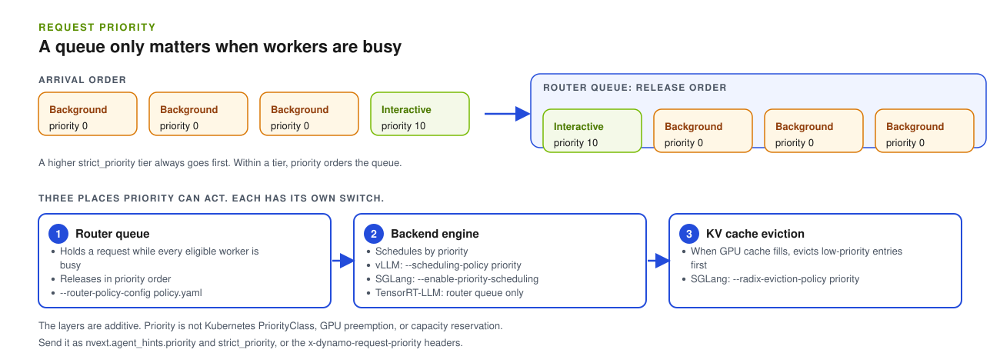

By the end of this guide, requests that you mark as higher priority are served ahead of lower-priority requests when workers are busy. Use it when interactive agent turns (the one a user is waiting on) compete with background subagents for the same workers.

Priority only changes anything under contention. If a request can be routed and scheduled immediately, there is no queue to reorder. Each layer below has its own switch, so turn on the layers you need.



## Send a Priority

Add `nvext.agent_hints` to the request body:

```json title="Request with priority hints"
{
    "model": "my-model",
    "messages": [
        { "role": "user", "content": "Summarize this incident." }
    ],
    "nvext": {
        "agent_hints": {
            "priority": 10,
            "strict_priority": 1
        }
    }
}
```

| Hint | Effect |
|---|---|
| `priority` | Soft priority. Higher values mean higher priority. The router uses it to order its queue, and supported backends use it for engine scheduling and cache eviction. |
| `strict_priority` | Router-only pending-queue tier, an unsigned integer. A higher tier always goes ahead of a lower tier. It is not forwarded to the backend engine. |

For HTTP requests you can send the same values as `x-dynamo-request-priority` and `x-dynamo-request-strict-priority`. Header values override the matching `nvext.agent_hints` fields.

## Turn On Priority in Each Layer

Priority can act in three places. They are configured separately and are additive.

### 1. Router queue

The router holds a request in a queue while every eligible worker is busy, then releases requests in priority order. Queueing is off until you enable it in a router policy file. Save this as `policy.yaml`:

```yaml
default_policy_family: standard
uncached_isl_buckets:
  - min_tokens: 0
    bucket: all
policy_classes:
  - name: standard_all
    policy_family: standard
    cache_bucket: all
    queue_policy: fcfs
    quantum: 1
    prefill_busy_threshold_frac: 1.0
```

Start the frontend with KV routing and the policy file:

```bash
python -m dynamo.frontend \
  --router-mode kv \
  --router-policy-config policy.yaml
```

A request waits while every eligible worker's active prefill tokens exceed `prefill_busy_threshold_frac` times its `max_num_batched_tokens`. Lower the fraction to queue sooner. See [Policy-Class Queues](../../developer-guide/knowledge-base/modular-components/router/configuration-and-tuning.md#policy-class-queues) for the full schema, including `wspt` ordering and per-worker queue limits.

> [!NOTE]
> The older `--router-queue-threshold` and `--router-queue-policy` flags are deprecated and are planned for removal in v1.7. Use the policy file instead.

### 2. Backend engine

Each engine has its own switch. Dynamo converts the priority to the polarity the engine expects.

<Tabs>
  <Tab title="vLLM">
    Start vLLM with `--scheduling-policy priority`. Do not negate `priority` in client code; Dynamo forwards it with the polarity vLLM expects.
  </Tab>
  <Tab title="SGLang">
    Start SGLang with `--enable-priority-scheduling`. Higher Dynamo values become higher SGLang scheduling priority. Dynamo rejects the inverted SGLang flag. See [Agents on SGLang](../../developer-guide/knowledge-base/modular-components/backends/sglang/agents-on-sglang.md#priority-scheduling).
  </Tab>
  <Tab title="TensorRT-LLM">
    Per-request engine scheduling priority is not exposed through Dynamo. Priority still affects router queueing before dispatch.
  </Tab>
</Tabs>

### 3. KV cache eviction

When GPU cache fills, an engine can evict low-priority entries first. On SGLang, start the worker with `--radix-eviction-policy priority`. This only matters under memory pressure. See [Priority-based KV cache eviction](../../developer-guide/knowledge-base/modular-components/backends/sglang/agents-on-sglang.md#priority-based-kv-cache-eviction).

Support by backend:

| Feature | vLLM | SGLang | TensorRT-LLM |
|---|:---:|:---:|:---:|
| Priority-aware routing | Yes | Yes | Yes |
| Engine priority scheduling | Yes | Yes | No |
| Priority-based cache eviction | Planned | Yes | Planned |

## Check That It Works

Use a benchmark that sends different `priority` values on individual requests. For AIPerf, use a version with per-request `extra` payload support. Older versions only support global `--extra-inputs`, which cannot produce mixed-priority tiers in one run.

For router priority:

- Send a fixed number of requests per priority tier, with the same model, input length, output length, and streaming mode.
- Run at enough load for requests to wait. Watch [`dynamo_frontend_router_queue_pending_requests`](../../reference/observability/metrics-catalog.mdx#router-queue-metrics) and confirm it is above zero during the measured window.
- Configure the backend flag separately if you want to measure engine scheduling and not only the router queue.

Expected result: higher priority values get better TTFT under contention. If lower values win, check whether the client, benchmark harness, or gateway negated the priority before it reached Dynamo.

## Troubleshooting

| Symptom | Check |
|---|---|
| Priority has no visible effect. | Confirm requests actually enter the router queue. Confirm the backend priority flag is on if you expect engine-level scheduling. |
| Lower numeric values appear to win. | Do not negate `priority` for vLLM. Dynamo normalizes backend polarity. |
| The router queue never becomes non-empty. | Lower `prefill_busy_threshold_frac`, increase offered load, or check the SGLang `max_num_batched_tokens` caveat in [Router Configuration and Tuning](../../developer-guide/knowledge-base/modular-components/router/configuration-and-tuning.md#tuning-guidelines). |
| Priority works through the frontend but not through a Kubernetes gateway. | Confirm the gateway path preserves `nvext`, and use Dynamo v1.2.0 or later. |
| AIPerf cannot assign a priority per request. | Use an AIPerf build with per-request `extra` payload support. |

## How Priority Works

### Router queue ordering

Queued requests are ordered by this key:

```text
(strict_priority, due_at, configured_policy_key)
```

The strict tier is compared first. Within a tier, every request with an internal `due_at` goes ahead of every request without one, and then the configured policy applies. Sustained deadline-bearing traffic can therefore starve non-deadline requests in the same class.

The default policy is `fcfs`, which treats `priority` as a positive arrival-time bump: higher values move the request earlier. Negative values are clamped to zero for router queueing, so a request cannot be pushed behind normal first-come ordering. The `wspt` policy orders by `(1 + priority_jump) / scheduling_cost_tokens` and optimizes average TTFT.

### What priority does not do

Priority is not Kubernetes `PriorityClass`, GPU preemption, or hard admission control, and it does not reserve capacity. Strict priority applies only to requests already waiting in one scheduler queue. It does not preempt admitted work, order requests across router replicas, or guarantee engine execution order. A new arrival that is eligible can still be admitted directly while others wait.

## Other Hints

Two more hints change serving behavior without being about priority:

| Hint | Description |
|---|---|
| `osl` | Expected output length in tokens. The router uses it for output block tracking and load-balancing accuracy when `--router-track-output-blocks` is enabled. |
| `speculative_prefill` | When `true`, Dynamo prefills the predicted prefix of the next turn after the current turn completes, to warm the KV cache. On SGLang this is a `max_tokens=1` prefill. |

Hints and session IDs are separate. A session ID is passive identity for traces and optional policies. Hints are active serving intent. Neither enables session affinity; see [Maintain session affinity](session-affinity.md).

## Version Notes

| Capability | Availability |
|---|---|
| Router priority queue and backend priority plumbing | Dynamo v1.0.0 and later |
| Higher `priority` means higher priority across the API | Dynamo v1.1.0 and later |
| EPP and Inference Gateway forwarding fixes for priority hints | Dynamo v1.2.0 and later |

## Related

- [NVIDIA Request Extensions](../../developer-guide/additional-resources/nvidia-request-extensions-nvext.md#agent-hints)
- [Router Configuration and Tuning](../../developer-guide/knowledge-base/modular-components/router/configuration-and-tuning.md)
- [vLLM Reference Guide](../../developer-guide/knowledge-base/modular-components/backends/vllm/reference-guide.md#priority-scheduling)
- [Agents on SGLang](../../developer-guide/knowledge-base/modular-components/backends/sglang/agents-on-sglang.md)
