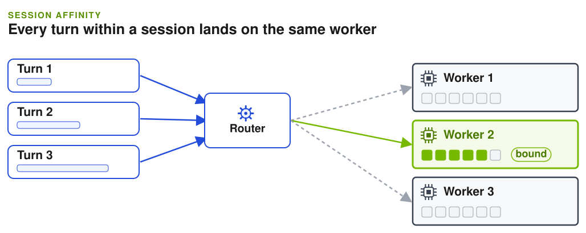

By the end of this guide, the frontend keeps every turn of an agent session on the same worker, so each turn reuses the KV cache that the earlier turns built.

An agent turn repeats the whole conversation so far. If the turn lands on the worker that already holds that prefix, it skips most of the prefill. KV-aware routing (`--router-mode kv`) already prefers workers with cache overlap. Session affinity goes further: it binds a session to one worker for a while, so reuse does not depend on the router's scoring on every turn.

Use it when your agents run many turns on a growing context and you have more than one worker. Pinning can unbalance load, so start with `soft` mode if your sessions vary a lot in length.



## Before You Start

- The frontend runs with `--router-mode kv`.
- Requests carry a session ID. Packaged harnesses send one automatically, and custom clients send `x-dynamo-session-id`. See [Identify agent sessions](session-ids.mdx).

A session ID alone does not change placement. Affinity is off until you set a TTL.

## Enable Session Affinity

Set an idle TTL on the frontend:

```bash
python -m dynamo.frontend \
  --router-mode kv \
  --router-session-affinity-ttl-secs 300
```

The same setting is available as `DYN_ROUTER_SESSION_AFFINITY_TTL_SECS`. The value is the idle timeout in seconds, from `1` through `31536000`. A binding expires when the session has had no active requests for that long, so choose a value longer than the pauses between your agent's turns (tool runs, human review).

The first successfully dispatched request binds the session to its selected worker and, when available, its data-parallel rank. Later requests from the same session follow that binding.

## Choose Hard or Soft Binding

Set `--router-session-affinity-mode` (or `DYN_ROUTER_SESSION_AFFINITY_MODE`):

| Mode | Behavior | Use it when |
|---|---|---|
| `hard` (default) | Sends the request to the bound worker. If that worker or rank is no longer valid, Dynamo drops the binding and selects a worker normally. | Cache reuse matters more than load balance, and sessions have similar load. |
| `soft` | Passes the bound worker to normal worker selection as a preference. The built-in selector keeps it while the worker is eligible. A custom or [ThunderAgent](thunderagent-program-scheduler.md) policy can choose another worker. | Sessions vary in length, or a policy needs to move sessions under pressure. |

```bash
python -m dynamo.frontend \
  --router-mode kv \
  --router-session-affinity-ttl-secs 300 \
  --router-session-affinity-mode soft
```

## Check That It Works

Enable [tracing](agent-tracing.md) and list the worker for each request in a session. The default trace sink writes gzip segments:

```bash
gzip -cd "${DYN_REQUEST_TRACE_FILE_PATH:-/tmp/dynamo-request-trace}".*.jsonl.gz \
  | jq -c 'select(.event_type=="request_end")
           | {session: .agent_context.session_id, worker: .request.worker,
              cached_tokens: .request.cached_tokens}'
```

If you started the endpoint with `agg_agent.sh`, it writes plain JSONL instead; use the path it prints at startup with `jq` directly.

With `hard` affinity, every row for one session shows the same worker, and `cached_tokens` grows as the conversation grows.

## Subagents

A request that carries a parent session ID binds under a key derived from that parent, so the subagents of one parent share a binding while the parent keeps its own. This behavior is experimental. Dynamo reads the parent ID from `X-Dynamo-Parent-Session-ID` and from the native parent headers listed in [Identify agent sessions](session-ids.mdx#native-agent-headers).

- Under `hard` mode, the group stays on its first worker and does not move because of load. The binding resets only when the worker becomes unusable or dispatch fails.
- Siblings share one binding, so when several subagents start at once, the others wait for the first sibling's dispatch to finish before they are placed.
- With TensorRT-LLM attention data parallelism and `kv_cache_routing_conversation_affinity` enabled, set `--conversation-affinity-dp-rank-source dynamo` so the rank Dynamo selects is the one the engine records.

## SGLang Session Control

On SGLang, session control (`nvext.session_control`) also keeps a subagent's KV cache isolated from other sessions. See [Agents on SGLang](../../developer-guide/knowledge-base/modular-components/backends/sglang/agents-on-sglang.md#session-control-for-subagent-kv-isolation-experimental).

## Notes

- Affinity state is local to each router and synchronizes across router replicas on a best-effort basis.
- The TTL is independent of `--router-ttl-secs` and `--router-predicted-ttl-secs`.
- An explicit worker target on a request always wins over a binding, in both modes.

For the full binding rules, including how soft rebinding commits and LoRA behavior, see [Session Affinity](../../developer-guide/knowledge-base/modular-components/router/configuration-and-tuning.md#session-affinity) in Router Configuration and Tuning.

## Next

[Prioritize requests](priority-scheduling.md) lets interactive requests go ahead of background work on the same workers.
