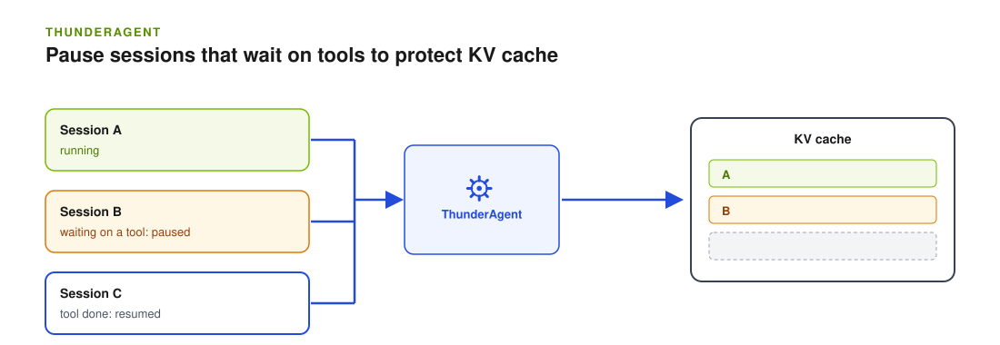

By the end of this guide, the frontend schedules each agent session as one program. It pauses sessions that are waiting on tools when KV cache is under pressure, and resumes them when there is room.

<Note>
ThunderAgent is experimental. Dynamo includes a native plugin that ports the scheduler from the [ThunderAgent](https://arxiv.org/abs/2602.13692) paper (Kang et al., 2026). It runs inside the frontend and is enabled through router-policy YAML.
</Note>



## When to Use It

Agentic workloads (SWE-bench, browser-use, anything with a tool loop) make many short LLM calls separated by non-GPU work: `docker exec`, `pytest`, `curl`, waiting on a subagent. Between turns the agent's KV cache stays resident, holding blocks while doing nothing. A request-level router (vLLM's, SGLang's, Dynamo's stock `KvRouter`) sees each turn but not the agent behind it, which costs you two ways:

- **Cache-occupancy blowup.** With N agents at step K, the working set is `N × step_K_context`, most of it idle between turns. The engine evicts useful blocks under pressure or refuses admission, and every next turn pays a re-prefill tax.
- **No tool-boundary backpressure.** The router can't defer a hot session at a natural pause point — it can only cancel in-flight requests or queue them, both worse than waiting until the agent is between turns.

If your agents run few concurrent sessions, or KV cache is never under pressure, you do not need this. Start with [session affinity](session-affinity.md) and [priority](priority-scheduling.mdx).

## Native Frontend Plugin

To implement your own admission policy, see [Write an Admission Control Plugin](../../developer-guide/knowledge-base/modular-components/router/custom-admission-control.md).

Use this path for aggregated serving through `dynamo.frontend`. It requires a Dynamo build that includes the `thunderagent` builtin plugin; older wheels and images do not recognize that type. The plugin is included in the builtin catalog without a separate ThunderAgent build feature. Admission behavior remains unchanged until the plugin is selected in YAML.

Custom catalogs that already register `thunderagent` must remove that registration; duplicate type names fail startup.

Save the following as `thunderagent.yaml`:

```yaml
request_classifier:
  type: thunderagent
worker_selection:
  aggregated: thunderagent
  instances:
    - name: thunderagent
      type: thunderagent
```

Start the frontend against your existing aggregated workers, using the same discovery configuration as the workers:

```bash
python3 -m dynamo.frontend \
  --router-mode kv \
  --router-policy-config thunderagent.yaml \
  --router-session-affinity-ttl-secs 1800 \
  --router-session-affinity-mode soft
```

Send a stable `X-Dynamo-Session-ID` on every turn of an agent's reasoning and tool-use chain. Dynamo also accepts the [native agent headers](session-ids.mdx#native-agent-headers). Requests without session context pass through admission unchanged. At the end of a session, a dedicated minimal request with `X-Dynamo-Session-Final: true` releases the retained program state; otherwise idle retention expires it.

Select both plugin roles. The classifier owns the program table and delays admission when a session is busy or paused. When it releases a request, it supplies a preferred worker/rank. The worker selector honors that target if it is eligible, falling back to the least-loaded eligible candidate otherwise. Soft session affinity allows this repacking; hard affinity would constrain the request before the selector can move it. The `Sent` event records the worker actually selected.


The classifier uses each worker/rank's published GPU KV-block capacity and a logical token estimate from active and retained programs. It observes context growth during generation, then pauses and repacks programs between turns. This estimate is not physical KV occupancy and does not deduplicate shared prefixes or include host/offload capacity. Running generation is allowed to finish.

### Native Plugin Parameters

Set admission parameters under `request_classifier.parameters`. Leave worker-selection parameters empty. Unknown parameter names and invalid values fail startup.

| Parameter | Default | Meaning |
|---|---|---|
| `pause_threshold` | `0.95` | Per-worker usage fraction that starts pausing programs. |
| `pause_target` | `0.80` | Usage fraction the pause cycle drains toward. |
| `resume_hysteresis` | `0.10` | Headroom below the pause threshold required for normal resume. |
| `resume_timeout_seconds` | `1800` | Maximum deferral before forced release on a live worker. This does not reject the request. |
| `session_retention_seconds` | `1800` | Retention period for an idle, continuing program. |
| `scheduler_interval_seconds` | `5` | Interval between pressure and resume decisions. |
| `acting_token_weight` | `1` | Capacity weight while the agent is doing tool work. |
| `acting_decay_tau_seconds` | `1` | Acting-token decay half-life used for timeout fallback placement. |
| `buffer_per_program` | `100` | Token headroom reserved for each active program. |
| `max_tracked_requests` | `10000` | Independent limits on tracked requests and retained programs. Requests fail classification at the request limit. New programs fail at the program limit if no idle program can be evicted. |

The default deferral timeout permits waits of roughly 30 minutes under pressure. Set client deadlines to match the workload's acceptable wait. Router policy classes and queues still apply after classification releases a request.

Program state is local to each frontend's router instance. This is not a cluster-wide admission budget; keep a session's turns on the same frontend when using multiple replicas. The native plugin has been exercised with aggregated vLLM workers. Standalone EPP and disaggregated deployment guidance are outside this example.

The native plugin's classifier and worker selector register together in Dynamo's builtin catalog. It does not expose the Python prototype's soft-demotion controls, priority boosts, host-cache budget, or separate status endpoints described in [ThunderAgent Python Router](thunderagent-python-router.md).

### Native Plugin Logs

The plugin logs its interval, deferral timeout, and tracking limit at INFO when admission is enabled. A WARN event reports the number of programs forcibly resumed after reaching the deferral timeout. These requests continue processing; they are not rejected. Timeout warnings are aggregated into one event per scheduler tick.

To see scheduler state changes, enable DEBUG for the `thunderagent` log target before starting the frontend:

```bash
export DYN_LOG='info,thunderagent=debug'
```

Each changed tick reports counts of active, paused, and marked-for-pause programs, waiting requests, and tracked requests. Unchanged ticks are silent. Log snapshots use stored counts without scanning programs or requests, and log emission happens after releasing the scheduler lock.

## Python Router Prototype

An older standalone Python implementation, `dynamo.thunderagent_router`, schedules with the same idea but runs as its own router service with different flags and observability endpoints. Use the native plugin above for new deployments. See [ThunderAgent Python Router](thunderagent-python-router.md) for the prototype.

## Next

- [Maintain session affinity](session-affinity.md) explains the soft affinity mode this plugin relies on.
- [Write an admission control plugin](../../developer-guide/knowledge-base/modular-components/router/custom-admission-control.md) shows how to build your own policy.
